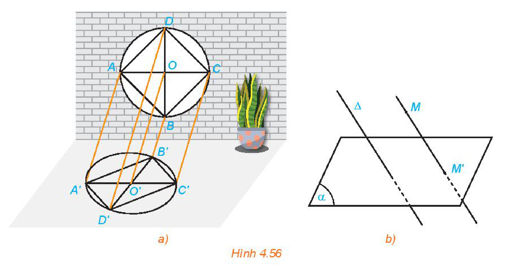
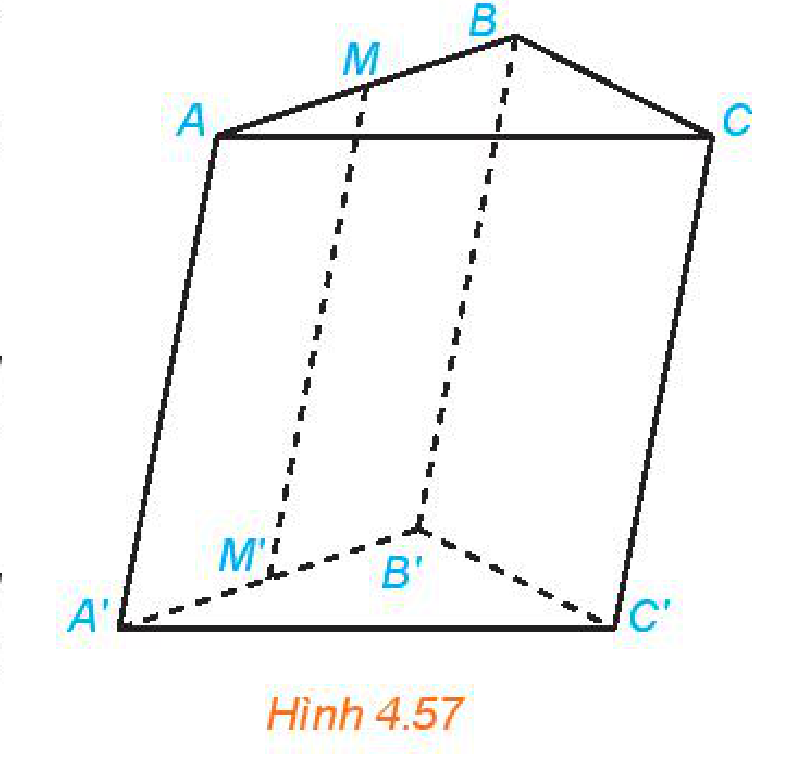
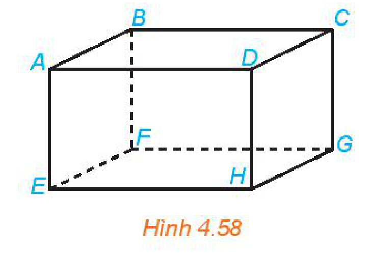
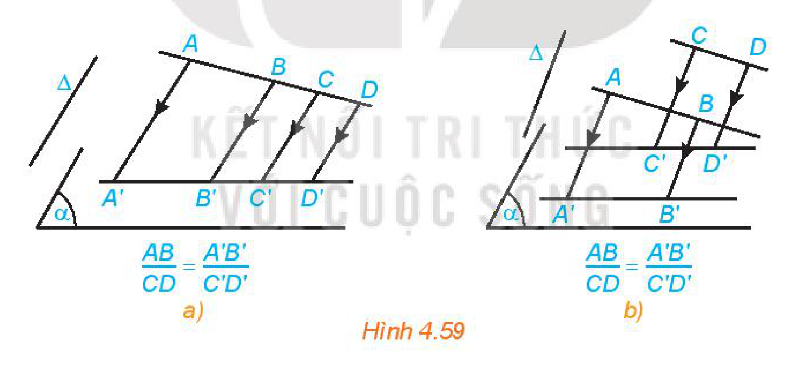
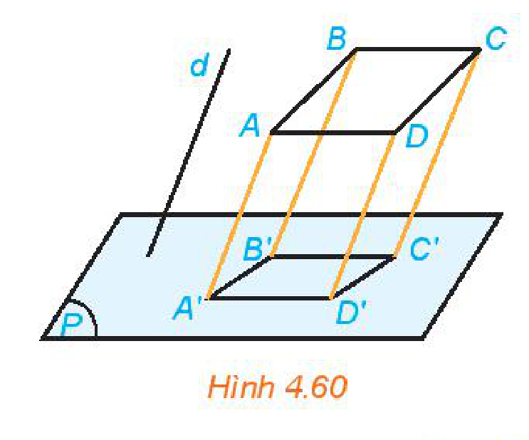
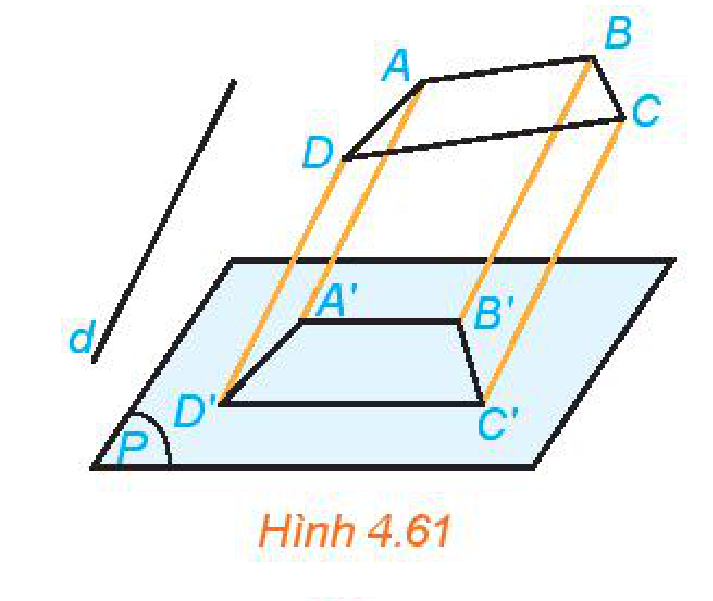
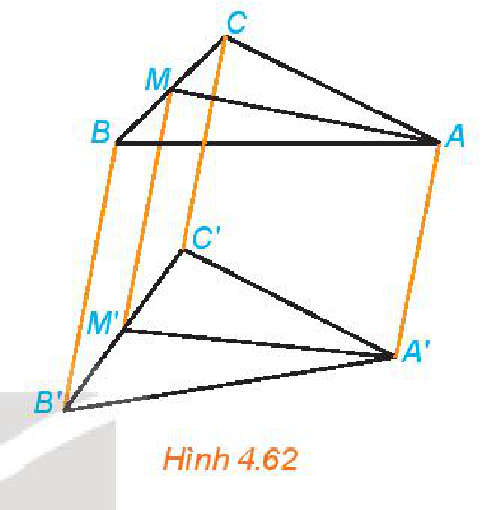
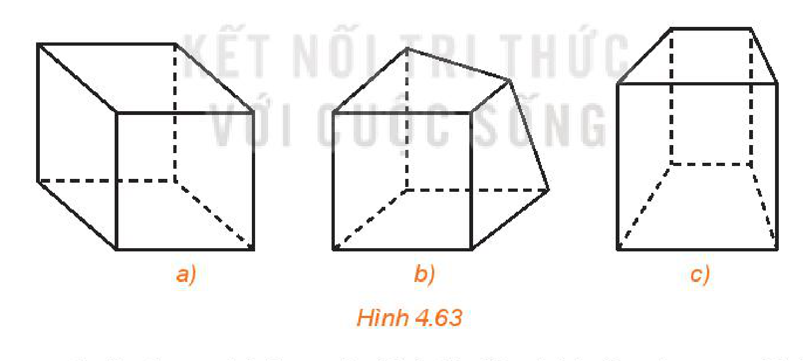
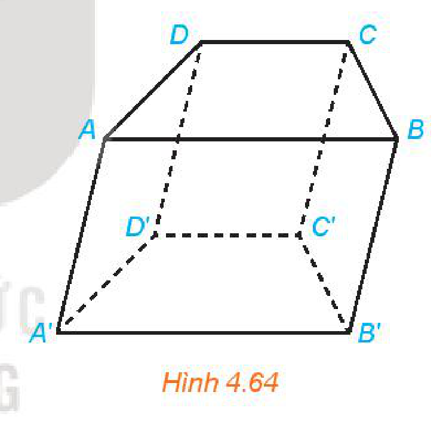
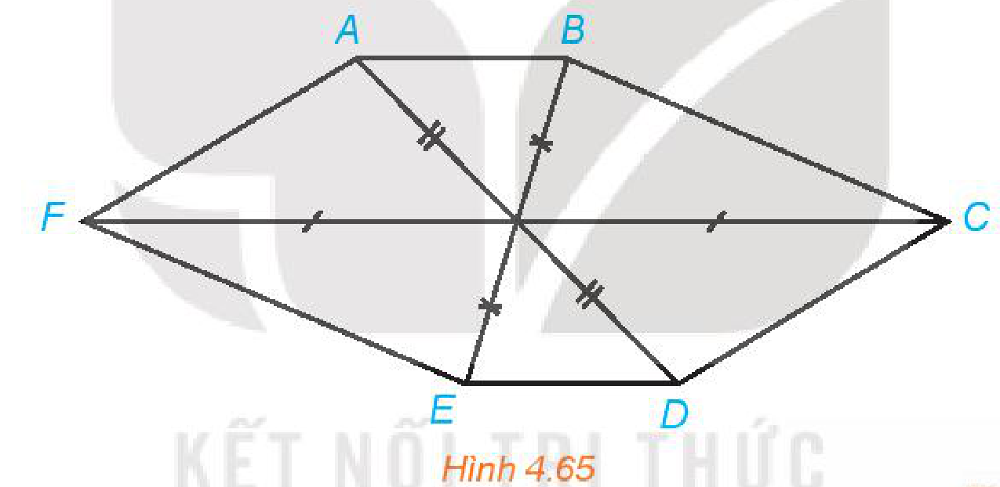

<!-- pdf:96 -->

# BÀI 14: PHÉP CHIẾU SONG SONG

## 🔤 Thuật ngữ

- Phép chiếu song song
- Hình chiếu
- Phương chiếu
- Hình biểu diễn

## 🎯 Kiến thức, kĩ năng

- Nhận biết khái niệm và tính chất cơ bản về phép chiếu song song.
- Xác định ảnh của một điểm, một đoạn thẳng, một tam giác, một đường tròn qua phép chiếu song song.
- Vẽ hình biểu diễn của một số hình khối đơn giản.
- Mô tả một số hình ảnh trong thực tiễn có liên quan đến phép chiếu song song.

## 🔴 Mở đầu

Trong bóng đá, công nghệ Goal-line được sử dụng để xác định xem bóng đã hoàn toàn vượt qua vạch vôi hay chưa, từ đó giúp trọng tài đưa ra quyết định về một bàn thắng có được ghi hay không. Yếu tố hình học nào cho ta biết quả bóng đã vượt qua vạch vôi hay chưa?

*Một bàn thắng được ghi.*

---

## 1. PHÉP CHIẾU SONG SONG

**HĐ1:** Một khung cửa sổ có dạng hình tròn với các chấn song tạo thành hình vuông $ABCD$, hai đường chéo của hình vuông cắt nhau tại $O$. Dưới ánh mặt trời, khung cửa và các chấn song đổ bóng lên sàn nhà (H.4.56a). Quan sát hình vẽ và trả lời các câu hỏi sau:

a) Các đường thẳng nối mỗi điểm $A, B, C$ với bóng $A', B', C'$ có đôi một song song hay không?

b) Làm thế nào để xác định được bóng đổ trên sàn nhà của mỗi điểm trên khung cửa sổ?

*Hình 4.56*

<!-- pdf:97 -->

<!-- term: hình chiếu song song của điểm -->
<!-- term: phép chiếu song song -->
<!-- term: mặt phẳng chiếu -->
<!-- term: phương chiếu -->
> Cho mặt phẳng $(\alpha)$ và đường thẳng $\Delta$ cắt $(\alpha)$. Với mỗi điểm $M$ trong không gian ta xác định điểm $M'$ như sau:
> - Nếu $M$ thuộc $\Delta$ thì $M'$ là giao điểm của $(\alpha)$ và $\Delta$.
> - Nếu $M$ không thuộc $\Delta$ thì $M'$ là giao điểm của $(\alpha)$ và đường thẳng qua $M$ song song với $\Delta$.
>
> Điểm $M'$ được gọi là **hình chiếu song song của điểm** $M$ trên mặt phẳng $(\alpha)$ theo phương $\Delta$.
> Phép đặt tương ứng mỗi điểm $M$ với hình chiếu $M'$ của nó được gọi là **phép chiếu song song** lên $(\alpha)$ theo phương $\Delta$.
> Mặt phẳng $(\alpha)$ được gọi là **mặt phẳng chiếu**, phương $\Delta$ được gọi là **phương chiếu**.

**Câu hỏi:** Trong HĐ1, làm thế nào để xác định được bóng của toàn bộ song cửa $CD$ trên sàn nhà?

<!-- term: hình chiếu -->
> Cho hình $\mathscr{H}$. Tập hợp $\mathscr{H}'$ các hình chiếu $M'$ của các điểm $M$ thuộc $\mathscr{H}$ qua phép chiếu song song được gọi là **hình chiếu** của $\mathscr{H}$ qua phép chiếu song song đó.

*Hình chiếu của hình chữ “A”*

*Bóng đổ của người bán hàng rong dưới ánh mặt trời trên đường phố Hội An*

**Chú ý:** Nếu một đường thẳng song song với phương chiếu thì hình chiếu của đường thẳng đó là một điểm. Kể từ đây, nếu không nói gì thêm ta chỉ xét các phép chiếu mà phương chiếu không song song với mặt phẳng chiếu.

**Ví dụ 1:** Cho hình lăng trụ tam giác $ABC.A'B'C'$.

a) Xác định hình chiếu của điểm $A$ trên mặt phẳng $(A'B'C')$ theo phương $CC'$.

b) Gọi $M$ là một điểm thuộc đoạn thẳng $AB$. Xác định hình chiếu của $M$ trên mặt phẳng $(A'B'C')$ theo phương $CC'$.

*Hình 4.57*

**Giải:** (H.4.57)

a) Vì $ABC.A'B'C'$ là hình lăng trụ nên $AA' // BB' // CC'$. Vì $A'$ thuộc mặt phẳng $(A'B'C')$ nên $A'$ là hình chiếu của $A$ trên mặt phẳng $(A'B'C')$ theo phương $CC'$.

b) Trong mặt phẳng $(ABB'A')$ vẽ $MM' // AA'$ với $M'$ thuộc $A'B'$ thì $MM' // CC'$. Vì $M'$ thuộc mặt phẳng $(A'B'C')$ nên $M'$ là hình chiếu của $M$ trên mặt phẳng $(A'B'C')$ theo phương $CC'$.
<!-- ocr-ok: OCR đọc lệch kí hiệu MM', AA', CC', (ABB'A'), (A'B'C') -->

<!-- pdf:98 -->

**Luyện tập 1:** Cho hình hộp $ABCD.EFGH$ (H.4.58). Xác định hình chiếu của điểm $A$ trên mặt phẳng $(CDHG)$ theo phương $BC$ và theo phương $BG$.

*Hình 4.58*

**Vận dụng 1:** Trong *hình ảnh mở đầu*, khi một bàn thắng được ghi thì hình chiếu của quả bóng trên mặt đất theo phương thẳng đứng có vị trí như thế nào với vạch vôi?

---

## 2. TÍNH CHẤT CỦA PHÉP CHIẾU SONG SONG

**HĐ2:** Quan sát Hình 4.56a và trả lời các câu hỏi sau:

a) Hình chiếu $O'$ của điểm $O$ có nằm trên đoạn $A'C'$ hay không?

b) Hình chiếu của hai song cửa $AB$ và $CD$ như thế nào với nhau?

c) Hình chiếu $O'$ của điểm $O$ có phải là trung điểm của đoạn $A'C'$ hay không?

Ta có các tính chất sau của phép chiếu song song:

<!-- term: tính chất của phép chiếu song song -->
> - Phép chiếu song song biến ba điểm thẳng hàng thành ba điểm thẳng hàng và không làm thay đổi thứ tự ba điểm đó. Phép chiếu song song biến đường thẳng thành đường thẳng, tia thành tia, đoạn thẳng thành đoạn thẳng.
> - Phép chiếu song song biến hai đường thẳng song song thành hai đường thẳng song song hoặc trùng nhau.
> - Phép chiếu song song giữ nguyên tỉ số độ dài của hai đoạn thẳng cùng nằm trên một đường thẳng hoặc nằm trên hai đường thẳng song song.

*Hình 4.59*

**Câu hỏi:** Hình chiếu của hai đường thẳng cắt nhau có phải là hai đường thẳng cắt nhau hay không?

**Ví dụ 2:** Cho hình bình hành $ABCD$ và gọi $A'B'C'D'$ là hình chiếu của $ABCD$ trên mặt phẳng $(P)$ theo phương $d$ (H.4.60). Chứng minh rằng tứ giác $A'B'C'D'$ là hình bình hành.

*Hình 4.60*

**Giải:**

Vì $ABCD$ là hình bình hành nên $AB$ song song với $CD$, do đó hình chiếu của $AB$ là $A'B'$ song song với hình chiếu của $CD$ là $C'D'$. Tương tự $A'D'$ song song với $B'C'$.

Tứ giác $A'B'C'D'$ có $A'B' // C'D'$ và $A'D' // B'C'$ nên nó là hình bình hành.

<!-- pdf:99 -->

**Luyện tập 2:** Chứng minh rằng hình chiếu song song của một hình thang là một hình thang (H.4.61).

*Hình 4.61*

**Ví dụ 3:** Cho tam giác $ABC$ có $M$ là trung điểm của $BC$. Một phép chiếu song song biến tam giác $ABC$ thành tam giác $A'B'C'$, biến $M$ thành $M'$. Chứng minh rằng $A'M'$ là đường trung tuyến của tam giác $A'B'C'$ (H.4.62).

*Hình 4.62*

**Giải:**

Vì $M$ là trung điểm của $BC$ nên $B, M, C$ thẳng hàng theo thứ tự đó và $\dfrac{BM}{MC} = 1$. Do vậy $B', M', C'$ thẳng hàng theo thứ tự đó và $\dfrac{B'M'}{M'C'} = 1$, tức là $M'$ là trung điểm của $B'C'$. Vậy $A'M'$ là đường trung tuyến của tam giác $A'B'C'$.

**Luyện tập 3:** Một phép chiếu song song biến tam giác $ABC$ thành tam giác $A'B'C'$. Chứng minh rằng phép chiếu đó biến đường trung bình của tam giác $ABC$ thành đường trung bình của tam giác $A'B'C'$.

---

## 3. HÌNH BIỂU DIỄN CỦA MỘT HÌNH KHÔNG GIAN

**HĐ3:** Trong ba hình dưới đây, hình nào thể hiện hình lập phương chính xác hơn?

*Hình 4.63*

Từ đầu chương, ta thường minh hoạ các hình tứ diện, hình lập phương, hình lăng trụ,... bằng các hình vẽ trên giấy. Các hình vẽ này đều tuân theo một nguyên tắc nhất định và chúng được gọi là hình biểu diễn của hình không gian trên mặt phẳng.

<!-- term: hình biểu diễn -->
> **Hình biểu diễn** của một hình trong không gian là hình chiếu song song của hình đó trên một mặt phẳng theo một phương chiếu nào đó hoặc hình đồng dạng với hình chiếu đó.

**Câu hỏi:** Quan sát hình ảnh khung cửa sổ trong Hình 4.56a và cho biết hình biểu diễn của hình tam giác, hình vuông, hình tròn là hình gì?

<!-- pdf:100 -->

Khi hình phẳng nằm trong mặt phẳng không song song với phương chiếu thì hình biểu diễn của hình phẳng đó có các tính chất sau:

<!-- term: tính chất hình biểu diễn của hình phẳng -->
- Hình biểu diễn của một tam giác (cân, đều, vuông) là một tam giác;
- Hình biểu diễn của hình vuông, hình chữ nhật, hình thoi, hình bình hành là hình bình hành;
- Hình biểu diễn của hình thang $ABCD$ với $AB // CD$ là một hình thang $A'B'C'D'$ với $A'B' // C'D'$ thoả mãn $\dfrac{AB}{CD} = \dfrac{A'B'}{C'D'}$;
- Hình biểu diễn của hình tròn là hình elip.

> **Góc nhìn thêm:** Hình chiếu bằng, hình chiếu đứng, hình chiếu cạnh của một vật thể (môn Công nghệ 8 và Công nghệ 10) chính là hình biểu diễn của vật thể đó.

**Ví dụ 4:** Vẽ hình biểu diễn của hình lăng trụ $ABCD.A'B'C'D'$ có mặt đáy $ABCD$ là hình thang, $AB$ song song với $CD$ và $AB = 2CD$.

*Hình 4.64*

**Giải:**

Hình lăng trụ $ABCD.A'B'C'D'$ có các mặt bên là hình bình hành nên hình biểu diễn của nó cũng có các mặt bên là hình bình hành. Hình thang $ABCD$ có hai đáy $AB, CD$ và $AB = 2CD$ nên hình biểu diễn của $ABCD$ là một hình thang có độ dài một đáy gấp hai lần độ dài của đáy còn lại. Từ đó, ta vẽ được hình biểu diễn của hình lăng trụ $ABCD.A'B'C'D'$ như Hình 4.64.

**Luyện tập 4:** Vẽ hình biểu diễn của hình chóp $S.ABCD$ có đáy $ABCD$ là hình bình hành.

**Vận dụng 2:** Phép chiếu song song có thể được sử dụng để vẽ dạng nổi (hay dạng 3D) của chữ cái như trong hình dưới đây. Theo phương pháp đó hãy vẽ dạng nổi của một số chữ cái quen thuộc như L, N, T, ...

---

<!-- pdf:101 -->

## ✏️ BÀI TẬP

**4.29.** Những mệnh đề nào trong các mệnh đề sau đây là đúng?

a) Phép chiếu song song biến đoạn thẳng thành đoạn thẳng.

b) Phép chiếu song song biến hai đường thẳng song song thành hai đường thẳng cắt nhau.

c) Phép chiếu song song biến tam giác đều thành tam giác cân.

d) Phép chiếu song song biến hình vuông thành hình bình hành.

**4.30.** Nếu tam giác $A'B'C'$ là hình chiếu của tam giác $ABC$ qua một phép chiếu song song thì tam giác $ABC$ có phải là hình chiếu của tam giác $A'B'C'$ qua một phép chiếu song song hay không? Giải thích vì sao.

**4.31.** Phép chiếu song song biến tam giác $ABC$ thành tam giác $A'B'C'$. Chứng minh rằng phép chiếu đó biến trọng tâm của tam giác $ABC$ thành trọng tâm của tam giác $A'B'C'$.

**4.32.** Hình 4.65 có thể là hình biểu diễn của một hình lục giác đều hay không? Vì sao?

*Hình 4.65*

**4.33.** Vẽ hình biểu diễn của hình chóp $S.ABCD$ có đáy $ABCD$ là hình thang, $AB$ song song với $CD$ và $AB = 2\text{ cm}$, $CD = 6\text{ cm}$.

**4.34.** Trong hình bên, $AB$ và $CD$ là bóng của hai thanh chắn của một chiếc thang dưới ánh mặt trời.

Hãy giải thích tại sao $AB$ song song với $CD$.

---

<!-- pdf:102 -->

<!-- term: phép chiếu xuyên tâm -->
<!-- term: đường chân trời -->
> ### 💡 Em có biết?
>
> Phép chiếu song song được sử dụng chủ yếu trong các bản vẽ kĩ thuật vì phép chiếu này thể hiện đúng tỉ lệ kích thước trên vật thể. Tuy nhiên, phép chiếu song song không thể hiện đúng những gì mà mắt người quan sát được, ví dụ như phép chiếu song song không thể hiện đúng luật xa gần: đối với các vật thể có cùng kích thước, vật thể ở gần phải lớn hơn, vật thể ở xa phải nhỏ hơn. Vì vậy, trong nhiều trường hợp, phép chiếu song song không thể hiện đúng độ cao, độ sâu của đối tượng trong thực tế và tạo ra ảo giác cho người xem. Bằng cách khai thác những ảo giác này, Maurits Cornelis Escher và Roger Penrose đã đưa ra những hình ảnh về các “vật thể bất khả thi” (impossible objects) – các vật thể không tồn tại trong thực tế. “Thác nước Escher” và “Cầu thang Penrose” là hai ví dụ về các vật thể như vậy.
>
> *Thác nước Escher*
>
> *Cầu thang Penrose*
>
> Để khắc phục những hạn chế của phép chiếu song song, người ta sử dụng **phép chiếu xuyên tâm** (hay **phép chiếu phối cảnh**) mà ở đó luật xa gần được đảm bảo. Phép chiếu xuyên tâm với tâm $C$ lên mặt phẳng chiếu $(P)$ (không đi qua $C$) cho tương ứng mỗi điểm $M$ trong không gian với điểm $M'$ là giao điểm của $CM$ và $(P)$. Phép chiếu xuyên tâm biến đường thẳng thành đường thẳng.
>
> *Khi nhìn hai đường ray xe lửa ta có cảm giác chúng “cắt nhau ở xa vô tận”*
>
> Nếu $(Q)$ là một mặt phẳng cắt mặt phẳng $(P)$ theo giao tuyến $d$ thì phép chiếu xuyên tâm biến các đường thẳng song song nằm trong mặt phẳng $(Q)$ và không song song với $d$ thành các đường thẳng đồng quy. Khi đó, điểm đồng quy nằm trên giao tuyến $v$ của $(P)$ và mặt phẳng qua $C$ song song với $(Q)$. Giao tuyến này còn được gọi là “**đường thẳng vô tận**” hay “**đường chân trời**” trong hội hoạ. Tính chất này của phép chiếu xuyên tâm giải thích tại sao khi vẽ phối cảnh, các đường thẳng song song trong thực tế và hướng về phía người vẽ lại có xu hướng cắt nhau tại một điểm ở “xa vô tận”.

## 📷 Danh sách hình trong bài

| Mã hình | Trang PDF | Vị trí trong bài | Chú thích gốc |
| --- | --- | --- | --- |
| H11-toan-b14-01 | 96 | Mục 1, HĐ1 | Hình 4.56 |
| H11-toan-b14-02 | 97 | Mục 1, Ví dụ 1 | Hình 4.57 |
| H11-toan-b14-03 | 98 | Mục 1, Luyện tập 1 | Hình 4.58 |
| H11-toan-b14-04 | 98 | Mục 2 | Hình 4.59 |
| H11-toan-b14-05 | 98 | Mục 2, Ví dụ 2 | Hình 4.60 |
| H11-toan-b14-06 | 99 | Mục 2, Luyện tập 2 | Hình 4.61 |
| H11-toan-b14-07 | 99 | Mục 2, Ví dụ 3 | Hình 4.62 |
| H11-toan-b14-08 | 99 | Mục 3, HĐ3 | Hình 4.63 |
| H11-toan-b14-09 | 100 | Mục 3, Ví dụ 4 | Hình 4.64 |
| H11-toan-b14-10 | 101 | Bài tập 4.32 | Hình 4.65 |

