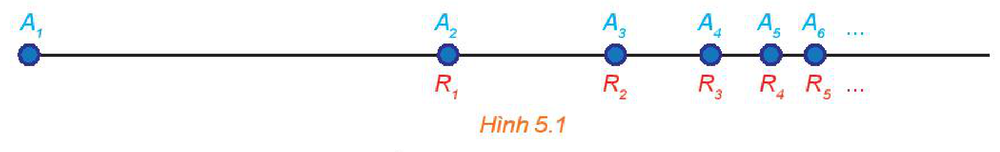
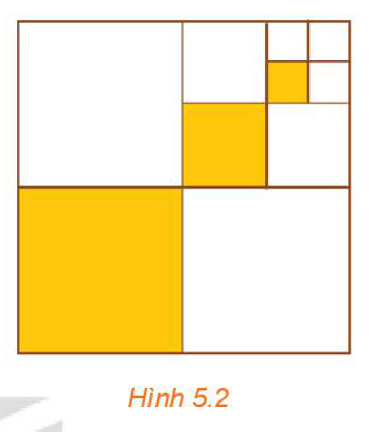
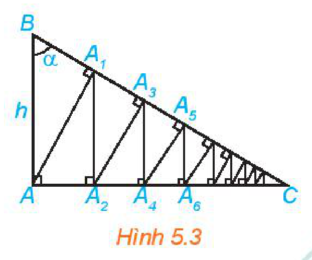
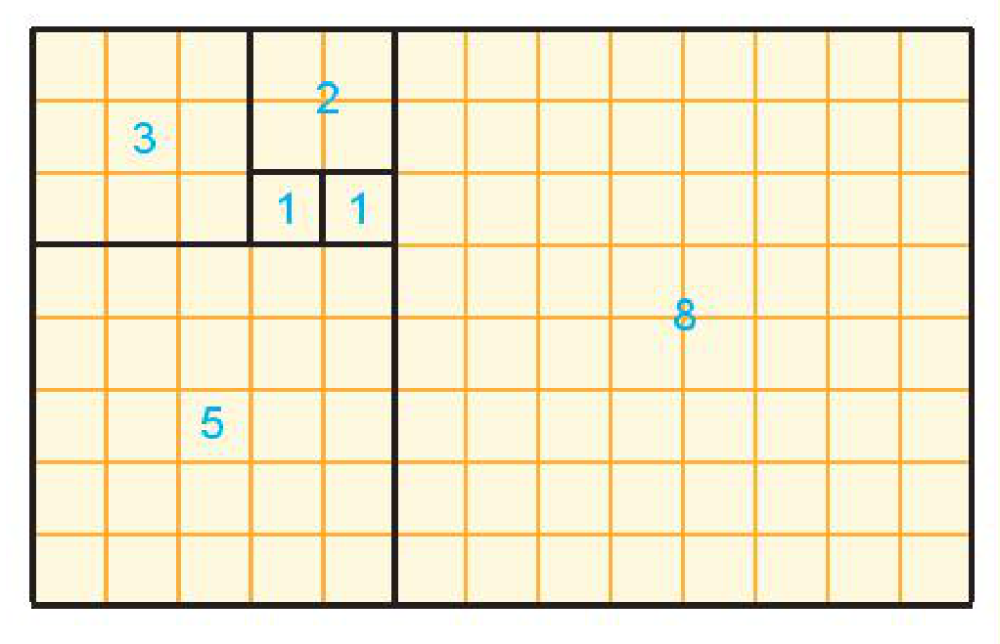

<!-- pdf:105 -->

<!-- Phần giới thiệu Chương V (in chung đầu trang PDF 105): CHƯƠNG V. GIỚI HẠN. HÀM SỐ LIÊN TỤC -->

Chương này trình bày khái niệm giới hạn của dãy số, của hàm số và một số định lí, quy tắc tìm giới hạn. Chúng là cơ sở cho việc nghiên cứu các nội dung khác của Giải tích và cho phép giải quyết nhiều bài toán của khoa học và thực tiễn. Khái niệm hàm số liên tục và một vài tính chất đơn giản của chúng được trình bày ở phần cuối chương.

# BÀI 15: GIỚI HẠN CỦA DÃY SỐ

## 🔤 Thuật ngữ

- Giới hạn của dãy số
- Các phép toán giới hạn
- Cấp số nhân lùi vô hạn
- Tổng của cấp số nhân lùi vô hạn

## 🎯 Mục tiêu

- Nhận biết khái niệm giới hạn của dãy số.
- Giải thích một số giới hạn cơ bản.
- Vận dụng các phép toán giới hạn để tìm giới hạn của một số dãy số đơn giản.
- Tính tổng của một cấp số nhân lùi vô hạn và vận dụng được kết quả đó để giải quyết một số tình huống thực tiễn giả định hoặc liên quan đến thực tiễn.

## 🔴 Mở đầu

**Nghịch lí Zeno.** Achilles (A-sin, một nhân vật trong thần thoại Hy Lạp, được mô tả là có thể chạy nhanh như gió) đuổi theo một con rùa trên một đường thẳng. Vị trí xuất phát của Achilles là $A_1$, cách vị trí xuất phát $R_1$ của rùa một quãng đường có chiều dài là $a$ (H.5.1). Zeno lí luận rằng, mặc dù chạy nhanh hơn nhưng Achilles không bao giờ đuổi kịp rùa.

*Hình 5.1*

Thật vậy, trước tiên Achilles phải đến được vị trí $A_2 = R_1$ và trong khoảng thời gian này, rùa đã di chuyển đến vị trí $R_2$. Sau đó, Achilles phải đến được vị trí $A_3 = R_2$, lúc này rùa đã di chuyển đến vị trí $R_3, \dots$ Cứ như vậy, Achilles không bao giờ đuổi kịp rùa.

Zeno ($490 - 429$ trước Công nguyên) là một triết gia Hy Lạp, đến từ thành phố Elea (miền nam nước Ý ngày nay). Trong số các nghịch lí của Zeno, nghịch lí Achilles đuổi rùa được coi là đã thúc đẩy sự hình thành khái niệm giới hạn, một công cụ thiết yếu của toán học, được sử dụng để nghiên cứu các quá trình liên quan đến sự vô hạn.

<!-- pdf:106 -->

## 1. GIỚI HẠN HỮU HẠN CỦA DÃY SỐ

**HĐ1:** Nhận biết dãy số có giới hạn là $0$

Cho dãy số $(u_n)$ với $u_n = \dfrac{(-1)^n}{n}$.

a) Biểu diễn năm số hạng đầu của dãy số này trên trục số.

b) Bắt đầu từ số hạng nào của dãy, khoảng cách từ $u_n$ đến $0$ nhỏ hơn $0,01$?

> Ta nói dãy số $(u_n)$ **có giới hạn là $0$** khi $n$ dần tới dương vô cực, nếu $|u_n|$ có thể nhỏ hơn một số dương bé tuỳ ý, kể từ một số hạng nào đó trở đi, kí hiệu $\lim_{n \to +\infty} u_n = 0$ hay $u_n \to 0$ khi $n \to +\infty$.

**Ví dụ 1:** Xét dãy số $u_n = \dfrac{1}{n^2}$. Giải thích vì sao dãy số này có giới hạn là $0$.

**Giải:**

Dãy số này có giới hạn là $0$, bởi vì $|u_n| = \dfrac{1}{n^2}$ có thể nhỏ hơn một số dương bé tuỳ ý khi $n$ đủ lớn. Chẳng hạn, để $|u_n| < 0,0001$ tức là $\dfrac{1}{n^2} < 10^{-4}$, ta cần $n^2 > 10\,000$ hay $n > 100$. Như vậy, các số hạng của dãy kể từ số hạng thứ $101$ đều có giá trị tuyệt đối nhỏ hơn $0,0001$.

<!-- term: Một số giới hạn cơ bản bằng 0 -->
**Chú ý:** Từ định nghĩa dãy số có giới hạn $0$, ta có các kết quả sau:
- $\lim_{n \to +\infty} \dfrac{1}{n^k} = 0$ với $k$ là một số nguyên dương;
- $\lim_{n \to +\infty} q^n = 0$ nếu $|q| < 1$;
- Nếu $|u_n| \le v_n$ với mọi $n \ge 1$ và $\lim_{n \to +\infty} v_n = 0$ thì $\lim_{n \to +\infty} u_n = 0$.

**Luyện tập 1:** Chứng minh rằng $\lim_{n \to +\infty} \dfrac{(-1)^{n-1}}{3^n} = 0$.

**HĐ2:** Nhận biết dãy số có giới hạn hữu hạn

Cho dãy số $(u_n)$ với $u_n = \dfrac{n + (-1)^n}{n}$. Xét dãy số $(v_n)$ xác định bởi $v_n = u_n - 1$.

Tính $\lim_{n \to +\infty} v_n$.

> Ta nói dãy số $(u_n)$ **có giới hạn là số thực $a$** khi $n$ dần tới dương vô cực nếu $\lim_{n \to +\infty} (u_n - a) = 0$, kí hiệu $\lim_{n \to +\infty} u_n = a$ hay $u_n \to a$ khi $n \to +\infty$.

<!-- pdf:107 -->

**Ví dụ 2:** Xét dãy số $(u_n)$ với $u_n = \dfrac{2n + 1}{n}$. Chứng minh rằng $\lim_{n \to +\infty} u_n = 2$.

> $\lim_{n \to +\infty} u_n = a$ khi và chỉ khi $\lim_{n \to +\infty} (u_n - a) = 0$.

**Giải:**

Ta có $u_n - 2 = \dfrac{2n + 1}{n} - 2 = \dfrac{(2n + 1) - 2n}{n} = \dfrac{1}{n} \to 0$ khi $n \to +\infty$.

Do vậy $\lim_{n \to +\infty} u_n = 2$.

**Chú ý:** Nếu $u_n = c$ ($c$ là hằng số) thì $\lim_{n \to +\infty} u_n = c$.

**Luyện tập 2:** Cho dãy số $(u_n)$ với $u_n = \dfrac{3 \cdot 2^n - 1}{2^n}$. Chứng minh rằng $\lim_{n \to +\infty} u_n = 3$.

**Vận dụng 1:** Một quả bóng cao su được thả từ độ cao $5\text{ m}$ xuống một mặt sàn. Sau mỗi lần chạm sàn, quả bóng nảy lên độ cao bằng $\dfrac{2}{3}$ độ cao trước đó. Giả sử rằng quả bóng luôn chuyển động vuông góc với mặt sàn và quá trình này tiếp diễn vô hạn lần. Giả sử $u_n$ là độ cao (tính bằng mét) của quả bóng sau lần nảy lên thứ $n$. Chứng minh rằng dãy số $(u_n)$ có giới hạn là $0$.

## 2. ĐỊNH LÍ VỀ GIỚI HẠN HỮU HẠN CỦA DÃY SỐ

**HĐ3:** Hình thành quy tắc tính giới hạn

Cho hai dãy số $(u_n)$ và $(v_n)$ với $u_n = 2 + \dfrac{1}{n}$, $v_n = 3 - \dfrac{2}{n}$.
<!-- ocr-ok: đã đối chiếu ảnh trang PDF 107, OCR đọc lỗi công thức phân thức -->

Tính và so sánh: $\lim_{n \to +\infty} (u_n + v_n)$ và $\lim_{n \to +\infty} u_n + \lim_{n \to +\infty} v_n$.

<!-- term: Định lí về giới hạn hữu hạn của dãy số -->
Tổng quát, ta có các quy tắc tính giới hạn sau đây:
> a) Nếu $\lim_{n \to +\infty} u_n = a$ và $\lim_{n \to +\infty} v_n = b$ thì
> - $\lim_{n \to +\infty} (u_n + v_n) = a + b$; $\quad \lim_{n \to +\infty} (u_n - v_n) = a - b$;
> - $\lim_{n \to +\infty} (u_n \cdot v_n) = a \cdot b$; $\quad \lim_{n \to +\infty} \dfrac{u_n}{v_n} = \dfrac{a}{b}$ (nếu $b \ne 0$).
>
> b) Nếu $u_n \ge 0$ với mọi $n$ và $\lim_{n \to +\infty} u_n = a$ thì $a \ge 0$ và $\lim_{n \to +\infty} \sqrt{u_n} = \sqrt{a}$.

**Ví dụ 3:** Tìm $\lim_{n \to +\infty} \dfrac{n^2 + n + 1}{2n^2 - 1}$.

> Để tính giới hạn của dãy số dạng phân thức, ta chia cả tử thức và mẫu thức cho luỹ thừa cao nhất của $n$, rồi áp dụng các quy tắc tính giới hạn.

**Giải:**

Áp dụng các quy tắc tính giới hạn, ta được

$\lim_{n \to +\infty} \dfrac{n^2 + n + 1}{2n^2 - 1} = \lim_{n \to +\infty} \dfrac{1 + \dfrac{1}{n} + \dfrac{1}{n^2}}{2 - \dfrac{1}{n^2}} = \dfrac{\lim_{n \to +\infty} \left(1 + \dfrac{1}{n} + \dfrac{1}{n^2}\right)}{\lim_{n \to +\infty} \left(2 - \dfrac{1}{n^2}\right)} = \dfrac{1}{2}.$

<!-- pdf:108 -->

**Luyện tập 3:** Tìm $\lim_{n \to +\infty} \dfrac{\sqrt{2n^2 + 1}}{n + 1}$.

## 3. TỔNG CỦA CẤP SỐ NHÂN LÙI VÔ HẠN

**HĐ4:** Làm quen với việc tính tổng vô hạn

Cho hình vuông cạnh $1$ (đơn vị độ dài). Chia hình vuông đó thành bốn hình vuông nhỏ bằng nhau, sau đó tô màu hình vuông nhỏ góc dưới bên trái (H.5.2). Lặp lại các thao tác này với hình vuông nhỏ góc trên bên phải. Giả sử quá trình trên tiếp diễn vô hạn lần. Gọi $u_1, u_2, \dots, u_n, \dots$ lần lượt là độ dài cạnh của các hình vuông được tô màu.

a) Tính tổng $S_n = u_1 + u_2 + \dots + u_n$.

b) Tìm $S = \lim_{n \to +\infty} S_n$.

*Hình 5.2*

Cấp số nhân vô hạn $(u_n)$ có công bội $q$ với $|q| < 1$ được gọi là **cấp số nhân lùi vô hạn**.

Cho cấp số nhân lùi vô hạn $(u_n)$ với công bội $q$. Khi đó

$S_n = u_1 + u_2 + \dots + u_n = \dfrac{u_1(1 - q^n)}{1 - q}.$

Vì $|q| < 1$ nên $q^n \to 0$ khi $n \to +\infty$. Do đó, ta có
<!-- ocr-ok: đã đối chiếu ảnh trang PDF 108, OCR đọc sai kí hiệu giá trị tuyệt đối và mũi tên -->

$\lim_{n \to +\infty} S_n = \lim_{n \to +\infty} \left[\dfrac{u_1}{1 - q} - \left(\dfrac{u_1}{1 - q}\right)q^n\right] = \dfrac{u_1}{1 - q}.$

Giới hạn này được gọi là **tổng của cấp số nhân lùi vô hạn** $(u_n)$, và kí hiệu là

$S = u_1 + u_2 + \dots + u_n + \dots$

Như vậy

> $S = \dfrac{u_1}{1 - q} \quad (|q| < 1).$

**Ví dụ 4:** Tính tổng $S = 1 - \dfrac{1}{2} + \dfrac{1}{4} - \dfrac{1}{8} + \dots + \left(-\dfrac{1}{2}\right)^{n-1} + \dots$

**Giải:**

Đây là tổng của cấp số nhân lùi vô hạn với $u_1 = 1$ và $q = -\dfrac{1}{2}$.

Do đó

$S = \dfrac{u_1}{1 - q} = \dfrac{1}{1 - \left(-\dfrac{1}{2}\right)} = \dfrac{2}{3}.$

<!-- pdf:109 -->

**Ví dụ 5:** Biểu diễn số thập phân vô hạn tuần hoàn $2,222\dots$ dưới dạng phân số.

**Giải:**

Ta có $2,222\dots = 2 + 0,2 + 0,02 + 0,002 + \dots = 2 + 2 \cdot 10^{-1} + 2 \cdot 10^{-2} + 2 \cdot 10^{-3} + \dots$

Đây là tổng của cấp số nhân lùi vô hạn với $u_1 = 2$, $q = 10^{-1}$ nên

$2,222\dots = \dfrac{u_1}{1 - q} = \dfrac{2}{1 - \dfrac{1}{10}} = \dfrac{20}{9}.$

**Luyện tập 4:** Tính tổng $S = 2 + \dfrac{2}{7} + \dfrac{2}{49} + \dots + \dfrac{2}{7^{n-1}} + \dots$

**Vận dụng 2:** (Giải thích nghịch lí Zeno)

Để đơn giản, ta giả sử Achilles chạy với vận tốc $100\text{ km/h}$, vận tốc của rùa là $1\text{ km/h}$ và khoảng cách ban đầu $a = 100\text{ (km)}$.

a) Tính thời gian $t_1, t_2, \dots, t_n, \dots$ tương ứng để Achilles đi từ $A_1$ đến $A_2$, từ $A_2$ đến $A_3, \dots$, từ $A_n$ đến $A_{n+1}, \dots$
<!-- ocr-ok: đã đối chiếu ảnh trang PDF 109, OCR đọc thiếu dấu câu và kí hiệu chỉ số dưới -->

b) Tính tổng thời gian cần thiết để Achilles chạy hết các quãng đường $A_1A_2, A_2A_3, \dots, A_nA_{n+1}, \dots$, tức là thời gian cần thiết để Achilles đuổi kịp rùa.

c) Sai lầm trong lập luận của Zeno là ở đâu?

## 4. GIỚI HẠN VÔ CỰC CỦA DÃY SỐ

**HĐ5:** Nhận biết giới hạn vô cực

Một loại vi khuẩn được nuôi cấy với số lượng ban đầu là $50$. Sau mỗi chu kì $4$ giờ, số lượng của chúng sẽ tăng gấp đôi.

a) Dự đoán công thức tính số vi khuẩn $u_n$ sau chu kì thứ $n$.

b) Sau bao lâu, số lượng vi khuẩn sẽ vượt con số $10\,000$?

> - Dãy số $(u_n)$ được gọi là **có giới hạn $+\infty$** khi $n \to +\infty$ nếu $u_n$ có thể lớn hơn một số dương bất kì, kể từ một số hạng nào đó trở đi, kí hiệu $\lim_{n \to +\infty} u_n = +\infty$ hay $u_n \to +\infty$ khi $n \to +\infty$.
> - Dãy số $(u_n)$ được gọi là **có giới hạn $-\infty$** khi $n \to +\infty$ nếu $\lim_{n \to +\infty} (-u_n) = +\infty$, kí hiệu $\lim_{n \to +\infty} u_n = -\infty$ hay $u_n \to -\infty$ khi $n \to +\infty$.

Theo định nghĩa trên, ta có:
- $\lim_{n \to +\infty} n^k = +\infty$, với $k$ là số nguyên dương;
- $\lim_{n \to +\infty} q^n = +\infty$, với $q > 1$.

<!-- pdf:110 -->

<!-- term: Quy tắc tính giới hạn vô cực của dãy số -->
Liên quan đến giới hạn vô cực của dãy số, ta có một số quy tắc sau đây:
> - Nếu $\lim_{n \to +\infty} u_n = a$ và $\lim_{n \to +\infty} v_n = +\infty$ (hoặc $\lim_{n \to +\infty} v_n = -\infty$) thì $\lim_{n \to +\infty} \dfrac{u_n}{v_n} = 0$.
> - Nếu $\lim_{n \to +\infty} u_n = a > 0$, $\lim_{n \to +\infty} v_n = 0$ và $v_n > 0$ với mọi $n$ thì $\lim_{n \to +\infty} \dfrac{u_n}{v_n} = +\infty$.
> - Nếu $\lim_{n \to +\infty} u_n = +\infty$ và $\lim_{n \to +\infty} v_n = a > 0$ thì $\lim_{n \to +\infty} u_nv_n = +\infty$.
<!-- ocr-ok: đã đối chiếu ảnh trang PDF 110, OCR đọc sai chữ Nếu và dính từ -->

**Ví dụ 6:** Tính $\lim_{n \to +\infty} (n^2 - 2n)$.

**Giải:**

Ta có $n^2 - 2n = n^2\left(1 - \dfrac{2}{n}\right)$. Hơn nữa $\lim_{n \to +\infty} n^2 = +\infty$ và $\lim_{n \to +\infty} \left(1 - \dfrac{2}{n}\right) = 1$.
<!-- ocr-ok: đã đối chiếu ảnh trang PDF 110, OCR đọc lỗi công thức toán học -->

Do đó, $\lim_{n \to +\infty} (n^2 - 2n) = +\infty$.

**Luyện tập 5:** Tính $\lim_{n \to +\infty} \left(n - \sqrt{n}\right)$.

## ✏️ Bài tập

**5.1.** Tìm các giới hạn sau:

a) $\lim_{n \to +\infty} \dfrac{n^2 + n + 1}{2n^2 + 1}$; $\quad$ b) $\lim_{n \to +\infty} \left(\sqrt{n^2 + 2n} - n\right)$.

**5.2.** Cho hai dãy số không âm $(u_n)$ và $(v_n)$ với $\lim_{n \to +\infty} u_n = 2$ và $\lim_{n \to +\infty} v_n = 3$.

Tìm các giới hạn sau:

a) $\lim_{n \to +\infty} \dfrac{u_n^2}{v_n - u_n}$; $\quad$ b) $\lim_{n \to +\infty} \sqrt{u_n + 2v_n}$.

**5.3.** Tìm giới hạn của các dãy số cho bởi:

a) $u_n = \dfrac{n^2 + 1}{2n - 1}$; $\quad$ b) $v_n = \sqrt{2n^2 + 1} - n$.

**5.4.** Viết các số thập phân vô hạn tuần hoàn sau đây dưới dạng phân số:

a) $1,(12) = 1,121212\dots$; $\quad$ b) $3,(102) = 3,102102102\dots$

**5.5.** Một bệnh nhân hàng ngày phải uống một viên thuốc $150\text{ mg}$. Sau ngày đầu, trước mỗi lần uống, hàm lượng thuốc cũ trong cơ thể vẫn còn $5\%$. Tính lượng thuốc có trong cơ thể sau khi uống viên thuốc của ngày thứ $5$. Ước tính lượng thuốc trong cơ thể nếu bệnh nhân sử dụng thuốc trong một thời gian dài.

**5.6.** Cho tam giác vuông $ABC$ vuông tại $A$, có $AB = h$ và góc $B$ bằng $\alpha$ (H.5.3). Từ $A$ kẻ $AA_1 \perp BC$, từ $A_1$ kẻ $A_1A_2 \perp AC$, sau đó lại kẻ $A_2A_3 \perp BC$. Tiếp tục quá trình trên, ta được đường gấp khúc vô hạn $AA_1A_2A_3\dots$ Tính độ dài đường gấp khúc này theo $h$ và $\alpha$.

*Hình 5.3*

<!-- pdf:111 -->

## 💡 Em có biết?

**Dãy số Fibonacci và tỉ lệ vàng**

Ta đã biết dãy Fibonacci cho bởi hệ thức truy hồi:

$u_1 = u_2 = 1$, $u_n = u_{n-1} + u_{n-2}$ với $n > 2$.

Chia hai vế cho $u_{n-1}$ và đặt $v_n = \dfrac{u_n}{u_{n-1}}$, ta có công thức
<!-- ocr-ok: đã đối chiếu ảnh trang PDF 111, OCR đọc sai chữ vế -->

$v_n = 1 + \dfrac{1}{v_{n-1}}.$

Dãy $(v_n)$ có giới hạn là một số dương $r$ thoả mãn phương trình $r = 1 + \dfrac{1}{r}$, hay tương đương $r^2 - r - 1 = 0$. Giải phương trình này ta được $r = \dfrac{1 + \sqrt{5}}{2}$.

Đây chính là **tỉ lệ vàng** (golden ratio) được sử dụng trong kiến trúc, hội hoạ, tôn giáo, ... Dãy Fibonacci và tỉ lệ vàng cũng xuất hiện nhiều trong thế giới tự nhiên.

**Dãy số logistic**

Trong sinh thái học, người ta sử dụng dãy $(p_n)$ cho bởi công thức truy hồi $p_{n+1} = kp_n(1 - p_n)$ để mô phỏng hệ sinh thái của một loài (động vật hoặc thực vật), trong đó $p_n$ là tỉ lệ giữa số lượng cá thể theo thời gian và sức chứa của môi trường, $k$ là hệ số phụ thuộc đặc điểm của loài và điều kiện môi trường. Dãy số này được gọi là **dãy logistic**, do nhà sinh học Robert May đưa ra năm 1976. Tuỳ thuộc hệ số $k$ và giá trị ban đầu $p_0$, ta có thể dự đoán sự thay đổi của hệ trong tương lai. Đặc biệt, trong trường hợp dãy $(p_n)$ có giới hạn là một số dương, ta nói hệ sinh thái của loài là ổn định.

*(Theo Stewart, Calculus, Nhà xuất bản Cengage Learning)*

## 📷 Danh sách hình trong bài

| Mã hình | Trang PDF | Vị trí trong bài | Chú thích gốc |
| --- | :---: | --- | --- |
| H11-toan-b15-01 | 105 | Mở đầu | Hình 5.1 |
| H11-toan-b15-02 | 108 | Mục 3, HĐ4 | Hình 5.2 |
| H11-toan-b15-03 | 110 | Bài tập 5.6 | Hình 5.3 |
| H11-toan-b15-04 | 111 | Em có biết? | (sách không đánh số, hình vuông ghép theo dãy Fibonacci $1, 1, 2, 3, 5, 8$) |
