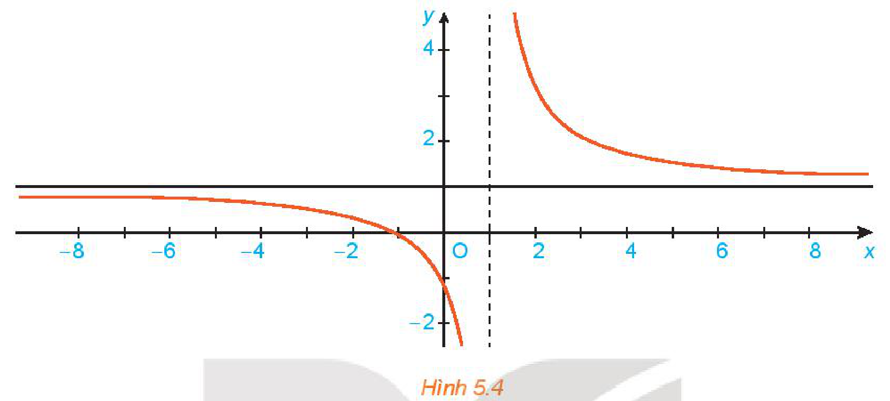
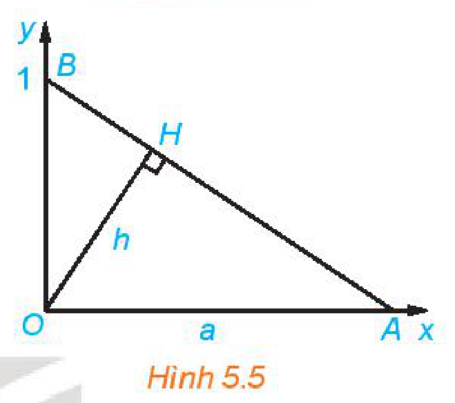
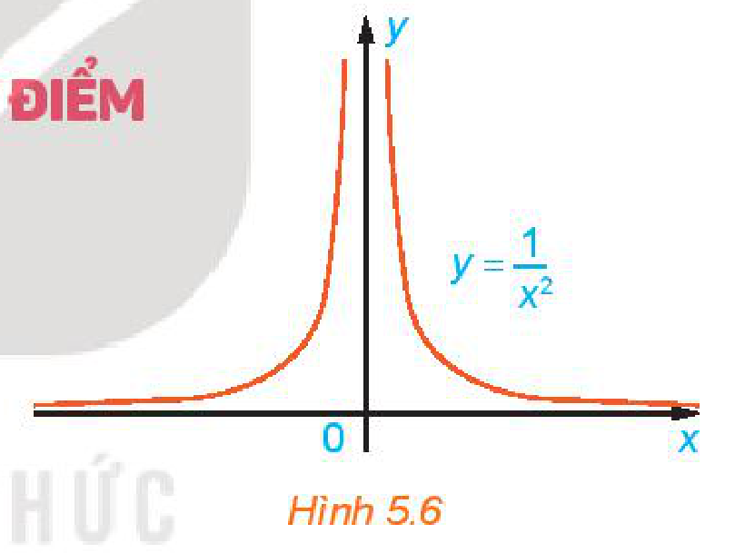

<!-- pdf:112 -->

# BÀI 16: GIỚI HẠN CỦA HÀM SỐ

## 🔤 Thuật ngữ

- Giới hạn của hàm số
- Giới hạn một phía
- Giới hạn tại vô cực
- Giới hạn vô cực

## 🎯 Mục tiêu

- Nhận biết khái niệm giới hạn hữu hạn của hàm số tại một điểm và tại vô cực.
- Nhận biết khái niệm giới hạn một phía.
- Nhận biết khái niệm giới hạn vô cực.
- Tính một số dạng giới hạn của hàm số.
- Giải quyết một số vấn đề thực tiễn gắn với giới hạn của hàm số.

## 🔴 Mở đầu

Trong Thuyết tương đối của Einstein, khối lượng của vật chuyển động với vận tốc $v$ cho bởi công thức

$m = \dfrac{m_0}{\sqrt{1 - \dfrac{v^2}{c^2}}},$

trong đó $m_0$ là khối lượng của vật khi nó đứng yên, $c$ là vận tốc ánh sáng. Chuyện gì xảy ra với khối lượng của vật khi vận tốc của vật gần với vận tốc ánh sáng?

*Albert Einstein (1879 – 1955)*

## 1. GIỚI HẠN HỮU HẠN CỦA HÀM SỐ TẠI MỘT ĐIỂM

**HĐ1:** Nhận biết khái niệm giới hạn tại một điểm

Cho hàm số $f(x) = \dfrac{4 - x^2}{x - 2}$.

a) Tìm tập xác định của hàm số $f(x)$.

b) Cho dãy số $x_n = \dfrac{2n + 1}{n}$. Rút gọn $f(x_n)$ và tính giới hạn của dãy $(u_n)$ với $u_n = f(x_n)$.

c) Với dãy số $(x_n)$ bất kì sao cho $x_n \ne 2$ và $x_n \to 2$, tính $f(x_n)$ và tìm $\lim_{n \to +\infty} f(x_n)$.

> Giả sử $(a; b)$ là một khoảng chứa điểm $x_0$ và hàm số $y = f(x)$ xác định trên khoảng $(a; b)$, có thể trừ điểm $x_0$. Ta nói hàm số $f(x)$ có **giới hạn** là số $L$ khi $x$ dần tới $x_0$ nếu với dãy số $(x_n)$ bất kì, $x_n \in (a; b), x_n \ne x_0$ và $x_n \to x_0$, ta có $f(x_n) \to L$, kí hiệu $\lim_{x \to x_0} f(x) = L$ hay $f(x) \to L$ khi $x \to x_0$.
<!-- ocr-ok: đã đối chiếu ảnh trang PDF 112, OCR đọc mất chữ ở lề trái -->

**Ví dụ 1:** Cho hàm số $f(x) = \dfrac{x - 1}{x^2 - 1}$. Chứng tỏ rằng $\lim_{x \to 1} f(x) = \dfrac{1}{2}$.

<!-- pdf:113 -->

**Giải:**

Lấy dãy số $(x_n)$ bất kì sao cho $x_n \ne 1$ và $x_n \to 1$. Ta có $f(x_n) = \dfrac{x_n - 1}{x_n^2 - 1} = \dfrac{1}{x_n + 1}$.
<!-- ocr-ok: đã đối chiếu ảnh trang PDF 113, OCR đọc sai chữ Lấy và bất -->

Do đó $\lim_{n \to +\infty} f(x_n) = \lim_{n \to +\infty} \dfrac{1}{x_n + 1} = \dfrac{1}{2}$. Vậy $\lim_{x \to 1} f(x) = \dfrac{1}{2}$.

<!-- term: Quy tắc tính giới hạn của hàm số tại một điểm -->
Tương tự đối với dãy số, ta có các quy tắc tính giới hạn của hàm số tại một điểm như sau:
> a) Nếu $\lim_{x \to x_0} f(x) = L$ và $\lim_{x \to x_0} g(x) = M$ thì
> - $\lim_{x \to x_0} [f(x) + g(x)] = L + M$;
> - $\lim_{x \to x_0} [f(x) - g(x)] = L - M$;
> - $\lim_{x \to x_0} [f(x) \cdot g(x)] = L \cdot M$;
> - $\lim_{x \to x_0} \dfrac{f(x)}{g(x)} = \dfrac{L}{M}$, nếu $M \ne 0$.
>
> b) Nếu $f(x) \ge 0$ với mọi $x \in (a; b) \setminus \{x_0\}$ và $\lim_{x \to x_0} f(x) = L$ thì $L \ge 0$ và $\lim_{x \to x_0} \sqrt{f(x)} = \sqrt{L}$.

> - $\lim_{x \to x_0} c = c$ với $c$ là hằng số.
> - $\lim_{x \to x_0} x^n = x_0^n$ với $n \in \mathbb{N}$.
<!-- ocr-ok: đã đối chiếu ảnh trang PDF 113, OCR đọc lẫn hộp chú ý bên phải -->

**Ví dụ 2:** Cho $f(x) = x - 1$ và $g(x) = x^3$. Tính các giới hạn sau:

a) $\lim_{x \to 1} [3f(x) - g(x)]$; $\quad$ b) $\lim_{x \to 1} \dfrac{[f(x)]^2}{g(x)}$.

**Giải:**

Ta có $\lim_{x \to 1} f(x) = \lim_{x \to 1} (x - 1) = \lim_{x \to 1} x - \lim_{x \to 1} 1 = 1 - 1 = 0$. Mặt khác, ta thấy $\lim_{x \to 1} g(x) = \lim_{x \to 1} x^3 = 1$.
<!-- ocr-ok: đã đối chiếu ảnh trang PDF 113, OCR đọc sai chữ thấy -->

a) Ta có

$\lim_{x \to 1} [3f(x) - g(x)] = \lim_{x \to 1} [3f(x)] - \lim_{x \to 1} g(x) = \lim_{x \to 1} 3 \cdot \lim_{x \to 1} f(x) - \lim_{x \to 1} g(x) = 3 \cdot 0 - 1 = -1.$

b) Ta có

$\lim_{x \to 1} \dfrac{[f(x)]^2}{g(x)} = \dfrac{\lim_{x \to 1} [f(x)]^2}{\lim_{x \to 1} g(x)} = \dfrac{\lim_{x \to 1} f(x) \cdot \lim_{x \to 1} f(x)}{\lim_{x \to 1} g(x)} = \dfrac{0}{1} = 0.$

**Ví dụ 3:** Tính $\lim_{x \to 0} \dfrac{\sqrt{x + 9} - 3}{x}$.

**Giải:**

Do mẫu thức có giới hạn là $0$ khi $x \to 0$ nên ta không thể áp dụng ngay quy tắc tính giới hạn của thương hai hàm số.

Chú ý rằng $\dfrac{\sqrt{x + 9} - 3}{x} = \dfrac{\left(\sqrt{x + 9}\right)^2 - 3^2}{x\left(\sqrt{x + 9} + 3\right)} = \dfrac{x}{x\left(\sqrt{x + 9} + 3\right)} = \dfrac{1}{\sqrt{x + 9} + 3}$.

<!-- pdf:114 -->

Do đó $\lim_{x \to 0} \dfrac{\sqrt{x + 9} - 3}{x} = \lim_{x \to 0} \dfrac{1}{\sqrt{x + 9} + 3} = \dfrac{1}{\lim_{x \to 0} \left[\sqrt{x + 9} + 3\right]} = \dfrac{1}{6}$.

**Luyện tập 1:** Tính $\lim_{x \to 1} \dfrac{x - 1}{\sqrt{x} - 1}$.

**HĐ2:** Nhận biết khái niệm giới hạn một bên

Cho hàm số $f(x) = \dfrac{|x - 1|}{x - 1}$.

a) Cho $x_n = \dfrac{n}{n + 1}$ và $x_n' = \dfrac{n + 1}{n}$. Tính $y_n = f(x_n)$ và $y_n' = f(x_n')$.
<!-- ocr-ok: đã đối chiếu ảnh trang PDF 114, OCR đọc lỗi công thức phân thức -->

b) Tìm giới hạn của các dãy số $(y_n)$ và $(y_n')$.

c) Cho các dãy số $(x_n)$ và $(x_n')$ bất kì sao cho $x_n < 1 < x_n'$ và $x_n \to 1, x_n' \to 1$, tính $\lim_{n \to +\infty} f(x_n)$ và $\lim_{n \to +\infty} f(x_n')$.
<!-- ocr-ok: đã đối chiếu ảnh trang PDF 114, OCR đọc sai chữ bất -->

> - Cho hàm số $y = f(x)$ xác định trên khoảng $(x_0; b)$. Ta nói số $L$ là **giới hạn bên phải** của $f(x)$ khi $x \to x_0$ nếu với dãy số $(x_n)$ bất kì thoả mãn $x_0 < x_n < b$ và $x_n \to x_0$, ta có $f(x_n) \to L$, kí hiệu $\lim_{x \to x_0^+} f(x) = L$.
> - Cho hàm số $y = f(x)$ xác định trên khoảng $(a; x_0)$. Ta nói số $L$ là **giới hạn bên trái** của $f(x)$ khi $x \to x_0$ nếu với dãy số $(x_n)$ bất kì thoả mãn $a < x_n < x_0$ và $x_n \to x_0$, ta có $f(x_n) \to L$, kí hiệu $\lim_{x \to x_0^-} f(x) = L$.

**Ví dụ 4:** Cho hàm số $f(x) = \begin{cases} x^2 & \text{nếu } 0 < x < 1 \\ x + 1 & \text{nếu } 1 \le x < 2. \end{cases}$

Tính $\lim_{x \to 1^-} f(x)$ và $\lim_{x \to 1^+} f(x)$.

**Giải:**

Với dãy số $(x_n)$ bất kì sao cho $0 < x_n < 1$ và $x_n \to 1$, ta có $f(x_n) = x_n^2$.

Do đó $\lim_{x \to 1^-} f(x) = \lim_{n \to +\infty} f(x_n) = 1$.

Tương tự, với dãy số $(x_n)$ bất kì mà $1 < x_n < 2, x_n \to 1$, ta có $f(x_n) = x_n + 1$, cho nên $\lim_{x \to 1^+} f(x) = \lim_{n \to +\infty} f(x_n) = 2$.

> $\lim_{x \to x_0} f(x) = L$ khi và chỉ khi $\lim_{x \to x_0^+} f(x) = \lim_{x \to x_0^-} f(x) = L$.

**Luyện tập 2:** Cho hàm số $f(x) = \begin{cases} -x & \text{nếu } x < 0 \\ \sqrt{x} & \text{nếu } x \ge 0. \end{cases}$

Tính $\lim_{x \to 0^+} f(x)$, $\lim_{x \to 0^-} f(x)$ và $\lim_{x \to 0} f(x)$.

<!-- pdf:115 -->

## 2. GIỚI HẠN HỮU HẠN CỦA HÀM SỐ TẠI VÔ CỰC

**HĐ3:** Nhận biết khái niệm giới hạn tại vô cực

Cho hàm số $f(x) = 1 + \dfrac{2}{x - 1}$ có đồ thị như Hình 5.4.

*Hình 5.4*

Giả sử $(x_n)$ là dãy số sao cho $x_n > 1, x_n \to +\infty$. Tính $f(x_n)$ và tìm $\lim_{n \to +\infty} f(x_n)$.

> - Cho hàm số $y = f(x)$ xác định trên khoảng $(a; +\infty)$. Ta nói hàm số $f(x)$ **có giới hạn là số $L$ khi $x \to +\infty$** nếu với dãy số $(x_n)$ bất kì, $x_n > a$ và $x_n \to +\infty$, ta có $f(x_n) \to L$, kí hiệu $\lim_{x \to +\infty} f(x) = L$ hay $f(x) \to L$ khi $x \to +\infty$.
> - Cho hàm số $y = f(x)$ xác định trên khoảng $(-\infty; b)$. Ta nói hàm số $f(x)$ **có giới hạn là số $L$ khi $x \to -\infty$** nếu với dãy số $(x_n)$ bất kì, $x_n < b$ và $x_n \to -\infty$, ta có $f(x_n) \to L$, kí hiệu $\lim_{x \to -\infty} f(x) = L$ hay $f(x) \to L$ khi $x \to -\infty$.
<!-- ocr-ok: đã đối chiếu ảnh trang PDF 115, OCR dính chữ kihiệu và Chohàm -->

**Ví dụ 5:** Cho $f(x) = 2 + \dfrac{4}{x - 1}$. Sử dụng định nghĩa, tìm $\lim_{x \to +\infty} f(x)$ và $\lim_{x \to -\infty} f(x)$.

**Giải:**

Lấy dãy $(x_n)$ bất kì sao cho $x_n > 1$ và $x_n \to +\infty$, ta có $f(x_n) = 2 + \dfrac{4}{x_n - 1}$. Do đó $\lim_{n \to +\infty} f(x_n) = 2$.
<!-- ocr-ok: đã đối chiếu ảnh trang PDF 115, OCR dính chữ Dođó -->

Vậy $\lim_{x \to +\infty} f(x) = 2$. Tương tự, ta cũng có $\lim_{x \to -\infty} f(x) = 2$.

<!-- term: Quy tắc tính giới hạn hữu hạn của hàm số tại vô cực -->
> - Các quy tắc tính giới hạn hữu hạn tại một điểm cũng đúng cho giới hạn hữu hạn tại vô cực.
> - Với $c$ là hằng số, ta có: $\lim_{x \to +\infty} c = c$, $\lim_{x \to -\infty} c = c$.
> - Với $k$ là một số nguyên dương, ta có: $\lim_{x \to +\infty} \dfrac{1}{x^k} = 0$, $\lim_{x \to -\infty} \dfrac{1}{x^k} = 0$.

<!-- pdf:116 -->

**Ví dụ 6:** Tính $\lim_{x \to -\infty} \dfrac{\sqrt{x^2 + 1}}{x}$.

> $a\sqrt{b} = \begin{cases} \sqrt{a^2b} & a \ge 0 \\ -\sqrt{a^2b} & a < 0. \end{cases}$

**Giải:**

Ta có $\lim_{x \to -\infty} \dfrac{\sqrt{x^2 + 1}}{x} = \lim_{x \to -\infty} \left(-\sqrt{\dfrac{x^2 + 1}{x^2}}\right) = -\lim_{x \to -\infty} \sqrt{1 + \dfrac{1}{x^2}}$

$= -\sqrt{\lim_{x \to -\infty} \left(1 + \dfrac{1}{x^2}\right)} = -\sqrt{1 + \lim_{x \to -\infty} \dfrac{1}{x^2}} = -1.$

**Luyện tập 3:** Tính $\lim_{x \to +\infty} \dfrac{\sqrt{x^2 + 2}}{x + 1}$.

**Vận dụng:** Cho tam giác vuông $OAB$ với $A = (a; 0)$ và $B = (0; 1)$ như Hình 5.5. Đường cao $OH$ có độ dài là $h$.

a) Tính $h$ theo $a$.

b) Khi điểm $A$ dịch chuyển về $O$, điểm $H$ thay đổi thế nào? Tại sao?
<!-- ocr-ok: đã đối chiếu ảnh trang PDF 116, OCR đọc sai chữ chuyển và đổi -->

c) Khi $A$ dịch chuyển ra vô cực theo chiều dương của trục $Ox$, điểm $H$ thay đổi thế nào? Tại sao?
<!-- ocr-ok: đã đối chiếu ảnh trang PDF 116, OCR đọc sai chữ chuyển, điểm, đổi -->

*Hình 5.5*

## 3. GIỚI HẠN VÔ CỰC CỦA HÀM SỐ TẠI MỘT ĐIỂM

**a) Giới hạn vô cực**

**HĐ4:** Nhận biết khái niệm giới hạn vô cực

Xét hàm số $f(x) = \dfrac{1}{x^2}$ có đồ thị như Hình 5.6.

Cho $x_n = \dfrac{1}{n}$, chứng tỏ rằng $f(x_n) \to +\infty$.

*Hình 5.6*

> Giả sử khoảng $(a; b)$ chứa $x_0$ và hàm số $y = f(x)$ xác định trên $(a; b) \setminus \{x_0\}$. Ta nói hàm số $f(x)$ **có giới hạn $+\infty$ khi $x \to x_0$** nếu với dãy số $(x_n)$ bất kì, $x_n \in (a; b) \setminus \{x_0\}, x_n \to x_0$, ta có $f(x_n) \to +\infty$, kí hiệu $\lim_{x \to x_0} f(x) = +\infty$.
>
> Ta nói hàm số $f(x)$ **có giới hạn $-\infty$ khi $x \to x_0$**, kí hiệu $\lim_{x \to x_0} f(x) = -\infty$, nếu $\lim_{x \to x_0} [-f(x)] = +\infty$.

**Ví dụ 7:** Tính $\lim_{x \to 1} \dfrac{1}{|x - 1|}$.

**Giải:**

Xét hàm số $f(x) = \dfrac{1}{|x - 1|}$. Lấy dãy số $(x_n)$ bất kì sao cho $x_n \ne 1, x_n \to 1$. Khi đó, $|x_n - 1| \to 0$.

Do đó $f(x_n) = \dfrac{1}{|x_n - 1|} \to +\infty$. Vậy $\lim_{x \to 1} \dfrac{1}{|x - 1|} = +\infty$.

<!-- pdf:117 -->

**HĐ5:** Cho hàm số $f(x) = \dfrac{1}{x - 1}$. Với các dãy số $(x_n)$ và $(x_n')$ cho bởi $x_n = 1 + \dfrac{1}{n}$, $x_n' = 1 - \dfrac{1}{n}$, tính $\lim_{n \to +\infty} f(x_n)$ và $\lim_{n \to +\infty} f(x_n')$.
<!-- ocr-ok: đã đối chiếu ảnh trang PDF 117, OCR đọc mất nhãn HĐ5 -->

> - Cho hàm số $y = f(x)$ xác định trên khoảng $(x_0; b)$. Ta nói hàm số $f(x)$ **có giới hạn $+\infty$ khi $x \to x_0$ về bên phải** nếu với dãy số $(x_n)$ bất kì thoả mãn $x_0 < x_n < b, x_n \to x_0$, ta có $f(x_n) \to +\infty$, kí hiệu $\lim_{x \to x_0^+} f(x) = +\infty$.
> - Cho hàm số $y = f(x)$ xác định trên khoảng $(a; x_0)$. Ta nói hàm số $f(x)$ **có giới hạn $+\infty$ khi $x \to x_0$ về bên trái** nếu với dãy số $(x_n)$ bất kì thoả mãn $a < x_n < x_0, x_n \to x_0$, ta có $f(x_n) \to +\infty$, kí hiệu $\lim_{x \to x_0^-} f(x) = +\infty$.
> - Các giới hạn một bên $\lim_{x \to x_0^+} f(x) = -\infty$ và $\lim_{x \to x_0^-} f(x) = -\infty$ được định nghĩa tương tự.

**Ví dụ 8:** Giải bài toán ở *tình huống mở đầu*.

**Giải:**

Từ công thức khối lượng

$m = \dfrac{m_0}{\sqrt{1 - \dfrac{v^2}{c^2}}}$

ta thấy $m$ là một hàm số của $v$, với tập xác định là nửa khoảng $[0; c)$. Rõ ràng khi $v$ tiến gần tới vận tốc ánh sáng, tức là $v \to c^-$, ta có $\sqrt{1 - \dfrac{v^2}{c^2}} \to 0$. Do đó $\lim_{v \to c^-} m(v) = +\infty$, nghĩa là khối lượng $m$ của vật trở nên vô cùng lớn khi vận tốc của vật gần với vận tốc ánh sáng.

**Luyện tập 4:** Tính các giới hạn sau:

a) $\lim_{x \to 0} \dfrac{2}{|x|}$; $\quad$ b) $\lim_{x \to 2^-} \dfrac{1}{\sqrt{2 - x}}$.

**Chú ý:** Các giới hạn $\lim_{x \to +\infty} f(x) = +\infty$, $\lim_{x \to -\infty} f(x) = +\infty$, $\lim_{x \to +\infty} f(x) = -\infty$ và $\lim_{x \to -\infty} f(x) = -\infty$ được định nghĩa tương tự như giới hạn của hàm số $f(x)$ tại vô cực. Chẳng hạn: Ta nói hàm số $y = f(x)$, xác định trên khoảng $(a; +\infty)$, có giới hạn là $-\infty$ khi $x \to +\infty$ nếu với dãy số $(x_n)$ bất kì, $x_n > a$ và $x_n \to +\infty$, ta có $f(x_n) \to -\infty$, kí hiệu $\lim_{x \to +\infty} f(x) = -\infty$ hay $f(x) \to -\infty$ khi $x \to +\infty$.

Một số giới hạn đặc biệt:
- $\lim_{x \to +\infty} x^k = +\infty$ với $k$ nguyên dương;
- $\lim_{x \to -\infty} x^k = +\infty$ với $k$ là số chẵn;
- $\lim_{x \to -\infty} x^k = -\infty$ với $k$ là số lẻ.
<!-- ocr-ok: đã đối chiếu ảnh trang PDF 117, OCR đọc sai chữ với và chẵn -->

<!-- pdf:118 -->

**b) Một số quy tắc tính giới hạn vô cực**

Chú ý các quy tắc tính giới hạn hữu hạn không còn đúng cho giới hạn vô cực.

<!-- term: Quy tắc tìm giới hạn của tích và thương khi có giới hạn vô cực -->
Ta có một số quy tắc tính giới hạn của tích và thương hai hàm số khi một trong hai hàm số đó có giới hạn vô cực.

- *Quy tắc tìm giới hạn của tích $f(x)g(x)$.*

Giả sử $\lim_{x \to x_0} f(x) = L \ne 0$ và $\lim_{x \to x_0} g(x) = +\infty$ (hoặc $-\infty$). Khi đó $\lim_{x \to x_0} f(x)g(x)$ được tính theo quy tắc cho trong bảng sau:
<!-- ocr-ok: đã đối chiếu ảnh trang PDF 118, OCR dính chữ vàlim -->

| $\lim_{x \to x_0} f(x)$ | $\lim_{x \to x_0} g(x)$ | $\lim_{x \to x_0} f(x)g(x)$ |
| :---: | :---: | :---: |
| $L > 0$ | $+\infty$ | $+\infty$ |
| $L > 0$ | $-\infty$ | $-\infty$ |
| $L < 0$ | $+\infty$ | $-\infty$ |
| $L < 0$ | $-\infty$ | $+\infty$ |

- *Quy tắc tìm giới hạn của thương $\dfrac{f(x)}{g(x)}$.*

| $\lim_{x \to x_0} f(x)$ | $\lim_{x \to x_0} g(x)$ | Dấu của $g(x)$ | $\lim_{x \to x_0} \dfrac{f(x)}{g(x)}$ |
| :---: | :---: | :---: | :---: |
| $L$ | $\pm\infty$ | Tuỳ ý | $0$ |
| $L > 0$ | $0$ | $+$ | $+\infty$ |
| $L > 0$ | $0$ | $-$ | $-\infty$ |
| $L < 0$ | $0$ | $+$ | $-\infty$ |
| $L < 0$ | $0$ | $-$ | $+\infty$ |

Các quy tắc trên vẫn đúng cho các trường hợp $x \to x_0^+, x \to x_0^-$.

**Ví dụ 9:** Tính $\lim_{x \to 0} \dfrac{x + 1}{x^2}$.

**Giải:**

Ta sử dụng quy tắc tìm giới hạn của thương. Rõ ràng, giới hạn của tử số $\lim_{x \to 0} (x + 1) = 1$.

Ngoài ra, mẫu số nhận giá trị dương với mọi $x \ne 0$ và $\lim_{x \to 0} x^2 = 0$. Do vậy $\lim_{x \to 0} \dfrac{x + 1}{x^2} = +\infty$.
<!-- ocr-ok: đã đối chiếu ảnh trang PDF 118, OCR đọc sai chữ mẫu số -->

**Ví dụ 10:** Tính $\lim_{x \to 1^+} \dfrac{1}{x(1 - x)}$ và $\lim_{x \to 1^-} \dfrac{1}{x(1 - x)}$.

**Giải:**

Viết $\dfrac{1}{x(1 - x)} = \dfrac{1}{x} \cdot \dfrac{1}{1 - x}$, ta có $\lim_{x \to 1^+} \dfrac{1}{x} = 1 > 0$. Hơn nữa $\lim_{x \to 1^+} \dfrac{1}{1 - x} = -\infty$ do $1 - x < 0$ khi $x > 1$.
<!-- ocr-ok: đã đối chiếu ảnh trang PDF 118, OCR đọc lỗi toàn bộ công thức dòng này -->

Áp dụng quy tắc tìm giới hạn của tích, ta được $\lim_{x \to 1^+} \dfrac{1}{x(1 - x)} = -\infty$.

Lí luận tương tự, ta có $\lim_{x \to 1^-} \dfrac{1}{x(1 - x)} = +\infty$.

<!-- pdf:119 -->

**Luyện tập 5:** Tính $\lim_{x \to 2^+} \dfrac{2x - 1}{x - 2}$ và $\lim_{x \to 2^-} \dfrac{2x - 1}{x - 2}$.

## ✏️ Bài tập

**5.7.** Cho hai hàm số $f(x) = \dfrac{x^2 - 1}{x - 1}$ và $g(x) = x + 1$. Khẳng định nào sau đây là đúng?

a) $f(x) = g(x)$; $\quad$ b) $\lim_{x \to 1} f(x) = \lim_{x \to 1} g(x)$.

**5.8.** Tính các giới hạn sau:

a) $\lim_{x \to 0} \dfrac{(x + 2)^2 - 4}{x}$; $\quad$ b) $\lim_{x \to 0} \dfrac{\sqrt{x^2 + 9} - 3}{x^2}$.

**5.9.** Cho hàm số $H(t) = \begin{cases} 0 & \text{nếu } t < 0 \\ 1 & \text{nếu } t \ge 0 \end{cases}$ (**hàm Heaviside**, thường được dùng để mô tả việc chuyển trạng thái tắt/mở của dòng điện tại thời điểm $t = 0$).

Tính $\lim_{t \to 0^+} H(t)$ và $\lim_{t \to 0^-} H(t)$.

**5.10.** Tính các giới hạn một bên:

a) $\lim_{x \to 1^+} \dfrac{x - 2}{x - 1}$; $\quad$ b) $\lim_{x \to 4^-} \dfrac{x^2 - x + 1}{4 - x}$.

**5.11.** Cho hàm số $g(x) = \dfrac{x^2 - 5x + 6}{|x - 2|}$.

Tìm $\lim_{x \to 2^+} g(x)$ và $\lim_{x \to 2^-} g(x)$.

**5.12.** Tính các giới hạn sau:

a) $\lim_{x \to +\infty} \dfrac{1 - 2x}{\sqrt{x^2 + 1}}$; $\quad$ b) $\lim_{x \to +\infty} \left(\sqrt{x^2 + x + 2} - x\right)$.

**5.13.** Cho hàm số $f(x) = \dfrac{2}{(x - 1)(x - 2)}$.

Tìm $\lim_{x \to 2^+} f(x)$ và $\lim_{x \to 2^-} f(x)$.

## 📷 Danh sách hình trong bài

| Mã hình | Trang PDF | Vị trí trong bài | Chú thích gốc |
| --- | :---: | --- | --- |
| H11-toan-b16-01 | 112 | Mở đầu | Albert Einstein (1879 – 1955) |
| H11-toan-b16-02 | 115 | Mục 2, HĐ3 | Hình 5.4 |
| H11-toan-b16-03 | 116 | Mục 2, Vận dụng | Hình 5.5 |
| H11-toan-b16-04 | 116 | Mục 3.a, HĐ4 | Hình 5.6 |
