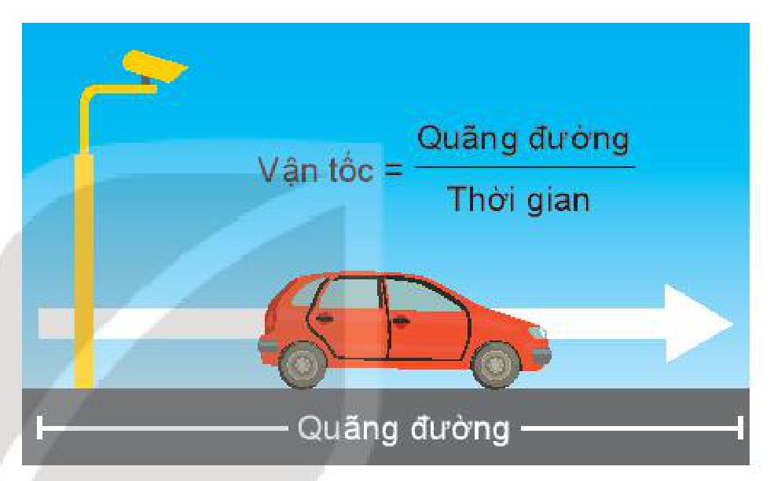
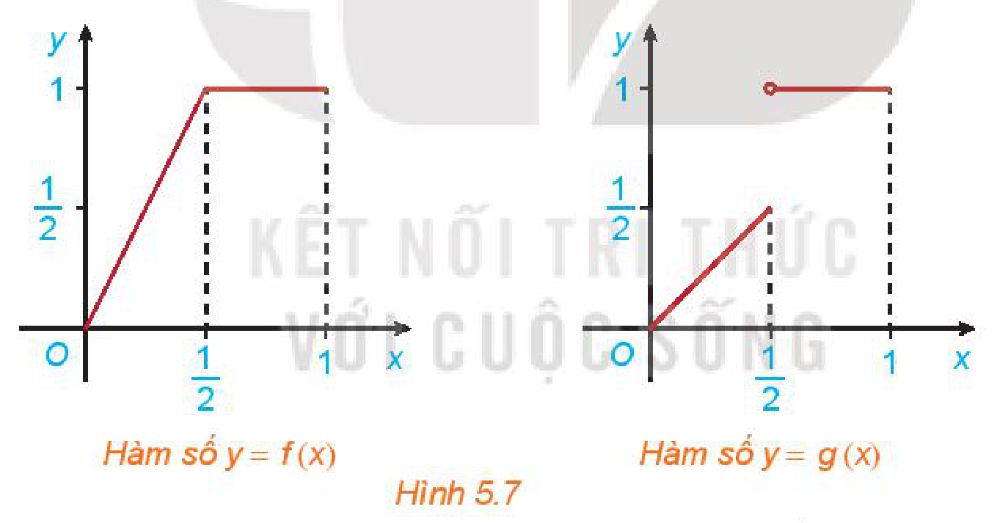
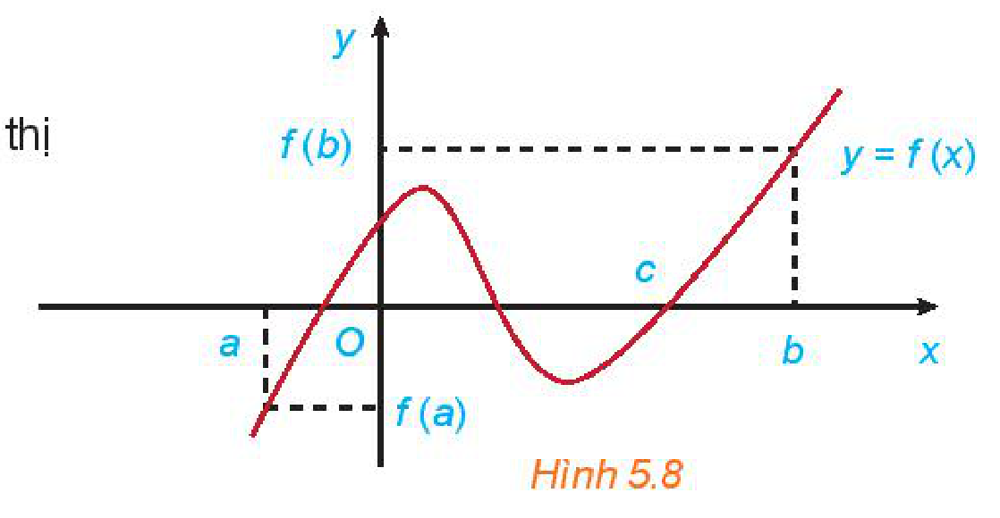

<!-- pdf:120 -->

# BÀI 17: HÀM SỐ LIÊN TỤC

## 🔤 Thuật ngữ

- Hàm số liên tục tại một điểm
- Hàm số gián đoạn
- Hàm số liên tục trên một khoảng
- Hàm số liên tục trên một đoạn

## 🎯 Mục tiêu

- Nhận dạng hàm số liên tục tại một điểm, hoặc trên một khoảng, trên một đoạn.
- Nhận dạng tính liên tục của tổng, hiệu, tích, thương của hai hàm số liên tục.
- Nhận biết tính liên tục của một số hàm sơ cấp cơ bản trên tập xác định của chúng.

## 🔴 Mở đầu

Một người lái xe từ địa điểm $A$ đến địa điểm $B$ trong thời gian $3$ giờ. Biết quãng đường từ $A$ đến $B$ dài $180\text{ km}$. Chứng tỏ rằng có ít nhất một thời điểm trên hành trình, xe chạy với vận tốc $60\text{ km/h}$.

## 1. HÀM SỐ LIÊN TỤC TẠI MỘT ĐIỂM

**HĐ1:** Nhận biết tính liên tục của hàm số tại một điểm

Cho hàm số $f(x) = \begin{cases} \dfrac{x^2 - 1}{x - 1} & \text{nếu } x \ne 1 \\ 2 & \text{nếu } x = 1. \end{cases}$

Tính giới hạn $\lim_{x \to 1} f(x)$ và so sánh giá trị này với $f(1)$.

> Cho hàm số $y = f(x)$ xác định trên khoảng $(a; b)$ chứa điểm $x_0$. Hàm số $f(x)$ được gọi là **liên tục tại điểm** $x_0$ nếu $\lim_{x \to x_0} f(x) = f(x_0)$.

Hàm số $f(x)$ không liên tục tại $x_0$ được gọi là **gián đoạn** tại điểm đó.

**Ví dụ 1:** Xét tính liên tục của hàm số $f(x) = \dfrac{x + 1}{x - 1}$ tại điểm $x_0 = 2$.

**Giải:**

Rõ ràng hàm số $f(x)$ xác định trên $\mathbb{R} \setminus \{1\}$, do đó $x_0 = 2$ thuộc tập xác định của hàm số.

Ta có $\lim_{x \to 2} f(x) = \lim_{x \to 2} \dfrac{x + 1}{x - 1} = 3 = f(2)$. Vậy hàm số $f(x)$ liên tục tại $x_0 = 2$.

<!-- pdf:121 -->

**Ví dụ 2:** Xét tính liên tục của **hàm dấu** $s(x) = \begin{cases} 1 & \text{nếu } x > 0 \\ 0 & \text{nếu } x = 0 \\ -1 & \text{nếu } x < 0 \end{cases}$ tại điểm $x_0 = 0$.

> Hàm số $f(x)$ liên tục tại $x_0$ khi và chỉ khi $\lim_{x \to x_0^+} f(x) = \lim_{x \to x_0^-} f(x) = f(x_0)$.

**Giải:**

Ta thấy $\lim_{x \to 0^+} s(x) = 1$, $\lim_{x \to 0^-} s(x) = -1$. Do đó không tồn tại giới hạn $\lim_{x \to 0} s(x)$.
<!-- ocr-ok: đã đối chiếu ảnh trang PDF 121, OCR dính chữ Tathấy và đọc sai tồn -->

Vậy hàm số này gián đoạn tại $0$.

**Luyện tập 1:** Xét tính liên tục của hàm số $f(x) = \begin{cases} -x & \text{nếu } x < 0 \\ 0 & \text{nếu } x = 0 \\ x^2 & \text{nếu } x > 0 \end{cases}$ tại điểm $x_0 = 0$.

## 2. HÀM SỐ LIÊN TỤC TRÊN MỘT KHOẢNG

**HĐ2:** Cho hai hàm số $f(x) = \begin{cases} 2x & \text{nếu } 0 \le x \le \dfrac{1}{2} \\ 1 & \text{nếu } \dfrac{1}{2} < x \le 1 \end{cases}$ và $g(x) = \begin{cases} x & \text{nếu } 0 \le x \le \dfrac{1}{2} \\ 1 & \text{nếu } \dfrac{1}{2} < x \le 1 \end{cases}$ với đồ thị tương ứng như Hình 5.7

*Hình 5.7*

Xét tính liên tục của các hàm số $f(x)$ và $g(x)$ tại điểm $x = \dfrac{1}{2}$ và nhận xét về sự khác nhau giữa hai đồ thị.

> Hàm số $y = f(x)$ được gọi là **liên tục trên khoảng** $(a; b)$ nếu nó liên tục tại mọi điểm thuộc khoảng này.
>
> Hàm số $y = f(x)$ được gọi là **liên tục trên đoạn** $[a; b]$ nếu nó liên tục trên khoảng $(a; b)$ và $\lim_{x \to a^+} f(x) = f(a)$, $\lim_{x \to b^-} f(x) = f(b)$.

Các khái niệm hàm số liên tục trên nửa khoảng như $(a; b]$, $[a; +\infty), \dots$ được định nghĩa theo cách tương tự. Có thể thấy đồ thị của hàm số liên tục trên một khoảng là một đường liền trên khoảng đó.

<!-- pdf:122 -->

**Ví dụ 3:** Xét tính liên tục của hàm số $f(x) = \begin{cases} x - 1 & \text{nếu } x \in (0; 1) \\ 0 & \text{nếu } x = 1 \end{cases}$ trên nửa khoảng $(0; 1]$.

**Giải:**

Ta có $f(x) = x - 1$ với $x \in (0; 1)$. Với $x_0 \in (0; 1)$ bất kì, ta có $\lim_{x \to x_0} (x - 1) = x_0 - 1 = f(x_0)$.
<!-- ocr-ok: đã đối chiếu ảnh trang PDF 122, OCR đọc sai kí hiệu thuộc -->

Vậy hàm số $f(x)$ liên tục trên khoảng $(0; 1)$.

Hơn nữa, $\lim_{x \to 1^-} f(x) = 0 = f(1)$ nên $f(x)$ liên tục trên nửa khoảng $(0; 1]$.

<!-- term: Tính liên tục của các hàm số sơ cấp cơ bản -->
Về tính liên tục của các hàm số sơ cấp cơ bản đã biết, ta có
> - Hàm số đa thức và các hàm số $y = \sin x, y = \cos x$ liên tục trên $\mathbb{R}$.
> - Các hàm số $y = \tan x, y = \cot x, y = \sqrt{x}$ và hàm phân thức hữu tỉ (thương của hai đa thức) liên tục trên tập xác định của chúng.

**Ví dụ 4:** Cho hàm số $f(x) = \dfrac{x + 1}{x - 1}$. Tìm các khoảng trên đó hàm số $f(x)$ liên tục.

**Giải:**

Tập xác định của hàm số $f(x)$ là $(-\infty; 1) \cup (1; +\infty)$. Vậy hàm số $f(x)$ liên tục trên các khoảng $(-\infty; 1)$ và $(1; +\infty)$.

**Luyện tập 2:** Tìm các khoảng trên đó hàm số $f(x) = \dfrac{x^2 + 1}{x + 2}$ liên tục.

## 3. MỘT SỐ TÍNH CHẤT CƠ BẢN

**HĐ3:** Cho hai hàm số $f(x) = x^2$ và $g(x) = -x + 1$.
<!-- ocr-ok: đã đối chiếu ảnh trang PDF 122, OCR đọc sai nhãn HĐ3 -->

a) Xét tính liên tục của hai hàm số trên tại $x = 1$.

b) Tính $L = \lim_{x \to 1} [f(x) + g(x)]$ và so sánh $L$ với $f(1) + g(1)$.
<!-- ocr-ok: đã đối chiếu ảnh trang PDF 122, OCR đọc lỗi biểu thức giới hạn -->

<!-- term: Tính liên tục của tổng, hiệu, tích và thương hai hàm số liên tục -->
Ta có khẳng định sau đây về tổng, hiệu, tích và thương của hai hàm số liên tục.
> Giả sử hai hàm số $y = f(x)$ và $y = g(x)$ liên tục tại điểm $x_0$. Khi đó:
>
> a) Các hàm số $y = f(x) + g(x)$, $y = f(x) - g(x)$ và $y = f(x)g(x)$ liên tục tại $x_0$;
>
> b) Hàm số $y = \dfrac{f(x)}{g(x)}$ liên tục tại $x_0$ nếu $g(x_0) \ne 0$.

**Ví dụ 5:** Xét tính liên tục của hàm số $f(x) = \dfrac{\sin x}{x - 1}$.

**Giải:**

Hàm số xác định trên các khoảng $(-\infty; 1)$ và $(1; +\infty)$. Trên các khoảng này, tử thức (hàm lượng giác) và mẫu thức (hàm đa thức) là các hàm số liên tục. Do đó, hàm số $f(x)$ liên tục trên $\mathbb{R} \setminus \{1\}$.

<!-- pdf:123 -->

<!-- term: Định lí giá trị trung gian của hàm số liên tục trên đoạn -->
**Nhận xét:** Nếu hàm số $y = f(x)$ liên tục trên đoạn $[a; b]$ và $f(a)f(b) < 0$ thì tồn tại ít nhất một điểm $c \in (a; b)$ sao cho $f(c) = 0$.

Kết quả này được minh hoạ bằng đồ thị như Hình 5.8

*Hình 5.8*

**Ví dụ 6:** Chứng minh rằng phương trình $x^5 + x^3 - 10 = 0$ có ít nhất một nghiệm.

**Giải:**

Xét hàm số $f(x) = x^5 + x^3 - 10$. Ta có $f(0) = -10 < 0, f(2) = 30 > 0$ và vì $f(x)$ là hàm đa thức nên nó liên tục trên $[0; 2]$. Khi đó, phương trình $f(x) = 0$ có ít nhất một nghiệm trong khoảng $(0; 2)$.

**Vận dụng:** Giải bài toán ở *tình huống mở đầu*.

## ✏️ Bài tập

**5.14.** Cho $f(x)$ và $g(x)$ là các hàm số liên tục tại $x = 1$. Biết $f(1) = 2$ và $\lim_{x \to 1} [2f(x) - g(x)] = 3$.

Tính $g(1)$.

**5.15.** Xét tính liên tục của các hàm số sau trên tập xác định của chúng:

a) $f(x) = \dfrac{x}{x^2 + 5x + 6}$; $\quad$ b) $f(x) = \begin{cases} 1 + x^2 & \text{nếu } x < 1 \\ 4 - x & \text{nếu } x \ge 1. \end{cases}$

**5.16.** Tìm giá trị của tham số $m$ để hàm số

$f(x) = \begin{cases} \sin x & \text{nếu } x \ge 0 \\ -x + m & \text{nếu } x < 0 \end{cases}$

liên tục trên $\mathbb{R}$.

**5.17.** Một bảng giá cước taxi được cho như sau:

| Giá mở cửa ($0,5\text{ km}$ đầu) | Giá cước các km tiếp theo đến $30\text{ km}$ | Giá cước từ km thứ $31$ |
| :---: | :---: | :---: |
| $10\,000$ đồng | $13\,500$ đồng | $11\,000$ đồng |
<!-- ocr-ok: đã đối chiếu ảnh trang PDF 123, OCR đọc mất tiêu đề cột thứ ba của bảng -->

a) Viết công thức hàm số mô tả số tiền khách phải trả theo quãng đường di chuyển.

b) Xét tính liên tục của hàm số ở câu a.

## 📷 Danh sách hình trong bài

| Mã hình | Trang PDF | Vị trí trong bài | Chú thích gốc |
| --- | :---: | --- | --- |
| H11-toan-b17-01 | 120 | Mở đầu | (sách không đánh số, minh hoạ xe ô tô và công thức vận tốc) |
| H11-toan-b17-02 | 121 | Mục 2, HĐ2 | Hình 5.7 |
| H11-toan-b17-03 | 123 | Mục 3, Nhận xét | Hình 5.8 |
