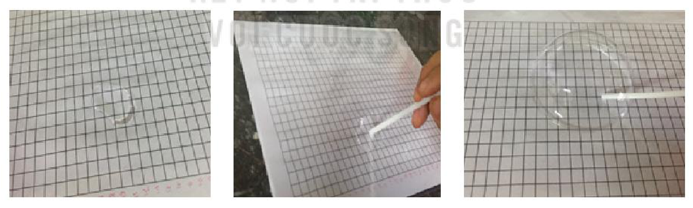

<!-- pdf:129 -->

# LỰC CĂNG MẶT NGOÀI CỦA NƯỚC

## 🎯 Mục tiêu

Học sinh biết thực hiện thí nghiệm để thu thập dữ liệu, biết sử dụng những số đặc trưng của số liệu ghép nhóm để so sánh kết quả và rút ra một số kết luận.

## 🔴 Mở đầu

<!-- term: Lực căng bề mặt -->
Nước cũng như các chất lỏng đều có lực căng bề mặt hình thành do sự tương tác giữa các phân tử của chất lỏng. Sẽ rất khó để thổi bong bóng từ nước do lực căng bề mặt của nước lớn. Tuy nhiên, nếu pha thêm xà phòng vào nước việc này sẽ được thực hiện do xà phòng làm giảm lực này của nước. Lực càng yếu bong bóng càng lớn.

Trong bài trải nghiệm này chúng ta sẽ xem xét ảnh hưởng của nhiệt độ tới lực căng mặt ngoài của nước xà phòng thông qua việc so sánh đường kính bong bóng thổi từ dung dịch xà phòng ở nhiệt độ khác nhau.

**HĐ1:** Thu thập dữ liệu

*Chuẩn bị:*

- Nước, nước nóng
- Xà phòng
- Nhiệt kế
- Cốc, thìa, ống hút
- Giấy bóng kính, giấy có đường kẻ chia centimét
- Bút, giấy.

*Thực hiện:*

- Nhóm 1:
  - *Bước 1.* Pha xà phòng vào nước ở nhiệt độ phòng
  - *Bước 2.* Đặt tờ giấy kẻ ô li xuống dưới tấm nhựa
  - *Bước 3.* Dùng thìa múc một lượng nước xà phòng đổ lên trên tấm nhựa
  - *Bước 4.* Dùng ống hút thổi bóng đến khi bóng vỡ
  - *Bước 5.* Xác định đường kính bong bóng
  - *Bước 6.* Lưu kết quả đo vào bảng theo mẫu sau:

<!-- pdf:130 -->

| Nhóm 1 | $[2; 4)$ | $[4; 6)$ | $[6; 8)$ | $[8; 10)$ | $[10; 12)$ | $[12; 14)$ | $[14; 16)$ | $[16; 18)$ | $[18; 20)$ | $[20; 22]$ |
| :---: | :---: | :---: | :---: | :---: | :---: | :---: | :---: | :---: | :---: | :---: |
| Đường kính bong bóng ($\text{cm}$) | $[2; 4)$ | $[4; 6)$ | $[6; 8)$ | $[8; 10)$ | $[10; 12)$ | $[12; 14)$ | $[14; 16)$ | $[16; 18)$ | $[18; 20)$ | $[20; 22]$ |
| Kết quả (đánh dấu $/`) | | $/$ | $///$ | | | | | | | |

*Bảng 1. Kết quả thí nghiệm trên nước xà phòng ở nhiệt độ phòng*

- Nhóm 2: Thực hiện tương tự với nước nóng ($70^\circ\text{C} - 80^\circ\text{C}$).

**HĐ2:** Lập bảng tần số ghép nhóm cho kết quả thí nghiệm thu được ở hai nhóm theo mẫu sau:

| Đường kính bong bóng ($\text{cm}$) | $[2; 4)$ | $[4; 6)$ | $[6; 8)$ | $[8; 10)$ | $[10; 12)$ | $[12; 14)$ | $[14; 16)$ | $[16; 18)$ | $[18; 20)$ | $[20; 22]$ |
| :---: | :---: | :---: | :---: | :---: | :---: | :---: | :---: | :---: | :---: | :---: |
| Tần số Nhóm 1 | | | | | | | | | | |
| Tần số Nhóm 2 | | | | | | | | | | |

*Bảng 2. Bảng tần số ghép nhóm cho dữ liệu đường kính bong bóng*

**HĐ3:** Dựa vào Bảng 2, hãy tính và so sánh số trung bình, trung vị, mốt của mẫu dữ liệu thu được về đường kính bong bóng của mỗi nhóm.

**HĐ4:** Các bạn học sinh lớp 11B đã thực hiện thí nghiệm và thu được bảng kết quả sau:

| Đường kính bong bóng ($\text{cm}$) | $[4; 6)$ | $[6; 8)$ | $[8; 10)$ | $[10; 12)$ | $[12; 14)$ | $[14; 16)$ | $[16; 18)$ | $[18; 20]$ |
| :---: | :---: | :---: | :---: | :---: | :---: | :---: | :---: | :---: |
| Nhóm 2 | | | $/$ | $//$ | $/$ | $///// \ ///$ | $///// \ ///$ | $//$ |
| Nhóm 1 | $/$ | $/$ | $///// \ ////$ | $///// \ ////$ | $////$ | $////$ | $/$ | |

a) Hãy thực hiện HĐ2 và HĐ3 dựa vào bảng kết quả thí nghiệm trên. Từ đó rút ra kết luận về ảnh hưởng của nhiệt độ lên sức căng bề mặt của nước xà phòng.

b) Tại sao giặt quần áo bằng nước ấm (với nhiệt độ thích hợp với chất liệu vải) sẽ làm sạch dễ dàng và nhanh chóng hơn?

## 📷 Danh sách hình trong bài

| Mã hình | Trang PDF | Vị trí trong bài | Chú thích gốc |
| --- | :---: | --- | --- |
| H11-toan-hd-thtn-02-01 | 129 | Mở đầu | (sách không đánh số, ảnh bong bóng xà phòng) |
| H11-toan-hd-thtn-02-02 | 129 | HĐ1 | (sách không đánh số, $3$ ảnh chụp các bước thổi bong bóng xà phòng trên giấy kẻ ô li) |
