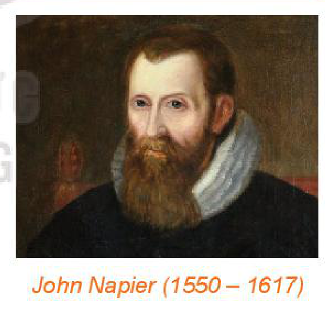

<!-- pdf:11 -->

# BÀI 19: LÔGARIT

## 🔤 Thuật ngữ

- Lôgarit
- Lôgarit thập phân
- Lôgarit tự nhiên
- Cơ số của lôgarit
- Số $e$

## 🎯 Kiến thức, kĩ năng

- Nhận biết khái niệm lôgarit cơ số $a$ của một số thực dương.
- Giải thích các tính chất của phép tính lôgarit nhờ sử dụng định nghĩa hoặc các tính chất đã biết trước đó.
- Sử dụng tính chất của phép tính lôgarit trong tính toán các biểu thức số và rút gọn các biểu thức chứa biến.
- Tính giá trị (đúng hoặc gần đúng) của lôgarit bằng cách sử dụng máy tính cầm tay.
- Giải quyết một số vấn đề có liên quan đến môn học khác hoặc thực tiễn gắn với phép tính lôgarit.

## 🔴 Mở đầu

Bác An gửi tiết kiệm ngân hàng $100$ triệu đồng kì hạn $12$ tháng, với lãi suất không đổi là $6\%$ một năm. Khi đó sau $n$ năm gửi thì tổng số tiền bác An thu được (cả vốn lẫn lãi) cho bởi công thức sau:

$A = 100 \cdot (1 + 0,06)^n\text{ (triệu đồng)}.$

Hỏi sau ít nhất bao nhiêu năm, tổng số tiền bác An thu được là không dưới $150$ triệu đồng?

## 1. KHÁI NIỆM LÔGARIT

**HĐ1:** Nhận biết khái niệm lôgarit

Tìm $x$, biết: $\qquad$ a) $2^x = 8$; $\qquad$ b) $2^x = \frac{1}{4}$; $\qquad$ c) $2^x = \sqrt{2}$.
<!-- ocr-ok: đã đối chiếu ảnh trang PDF 11, OCR đọc sai Tìm thành Tim -->

<!-- term: Lôgarit -->
> Cho $a$ là một số thực dương khác $1$ và $M$ là một số thực dương. Số thực $\alpha$ để $a^\alpha = M$ được gọi là **lôgarit cơ số $a$ của $M$** và kí hiệu là $\log_a M$.
> $\alpha = \log_a M \Leftrightarrow a^\alpha = M.$
<!-- ocr-ok: đã đối chiếu ảnh trang PDF 11, OCR đọc sai để/gọi/lôgarit/kí -->

**Chú ý:** Không có lôgarit của số âm và số $0$. **Cơ số của lôgarit** phải dương và khác $1$.

Từ định nghĩa lôgarit, ta có các tính chất sau:

<!-- term: Tính chất cơ bản của lôgarit -->
> Với $0 < a \ne 1, M > 0$ và $\alpha$ là số thực tuỳ ý, ta có:
> $\log_a 1 = 0;\ \log_a a = 1;$
> $a^{\log_a M} = M;\ \log_a a^\alpha = \alpha.$

**Ví dụ 1:** Tính: a) $\log_2 \frac{1}{8}$; $\qquad$ b) $\log_{\sqrt{3}} 9$.

**Giải:**

a) $\log_2 \frac{1}{8} = \log_2 2^{-3} = -3$. $\qquad$ b) $\log_{\sqrt{3}} 9 = \log_{\sqrt{3}} (\sqrt{3})^4 = 4$.

<!-- pdf:12 -->

**Luyện tập 1:** Tính: a) $\log_3 3\sqrt{3}$; $\qquad$ b) $\log_{\frac{1}{2}} 32$.

## 2. TÍNH CHẤT CỦA LÔGARIT

**a) Quy tắc tính lôgarit**

**HĐ2:** Nhận biết quy tắc tính lôgarit

Cho $M = 2^5, N = 2^3$. Tính và so sánh:
<!-- ocr-ok: đã đối chiếu ảnh trang PDF 12, OCR đọc sai Tính thành Tĩnh -->

a) $\log_2(MN)$ và $\log_2 M + \log_2 N$; $\qquad$ b) $\log_2\left(\frac{M}{N}\right)$ và $\log_2 M - \log_2 N$.

<!-- term: Quy tắc tính lôgarit -->
> Giả sử $a$ là số thực dương khác $1$, $M$ và $N$ là các số thực dương, $\alpha$ là số thực tuỳ ý. Khi đó:
> $\log_a(MN) = \log_a M + \log_a N;$
> $\log_a\left(\frac{M}{N}\right) = \log_a M - \log_a N;$
> $\log_a M^\alpha = \alpha \log_a M.$

**Ví dụ 2:** Tính giá trị của các biểu thức sau:

a) $\log_4 2 + \log_4 32$; $\qquad$ b) $\log_2 80 - \log_2 5$.

**Giải:**

a) $\log_4 2 + \log_4 32 = \log_4(2 \cdot 32) = \log_4 64 = \log_4 4^3 = 3\log_4 4 = 3$.

b) $\log_2 80 - \log_2 5 = \log_2 \frac{80}{5} = \log_2 16 = \log_2 2^4 = 4\log_2 2 = 4$.

**Luyện tập 2:** Rút gọn biểu thức:

$A = \log_2(x^3 - x) - \log_2(x + 1) - \log_2(x - 1)\ (x > 1).$

**b) Đổi cơ số của lôgarit**

Trong nhiều vấn đề lí thuyết và ứng dụng, chúng ta cần đổi từ lôgarit theo một cơ số này sang lôgarit theo một cơ số khác.

**HĐ3:** Xây dựng công thức đổi cơ số của lôgarit
<!-- ocr-ok: đã đối chiếu ảnh trang PDF 12, OCR đọc thiếu dấu hỏi trong đổi -->

Giả sử đã cho $\log_a M$ và ta muốn tính $\log_b M$. Để tìm mối liên hệ giữa $\log_a M$ và $\log_b M$, hãy thực hiện các yêu cầu sau:

a) Đặt $y = \log_b M$, tính $M$ theo $y$;

b) Lấy lôgarit theo cơ số $b$ cả hai vế của kết quả nhận được trong câu a, từ đó suy ra công thức mới để tính $y$.

<!-- pdf:13 -->

<!-- term: Công thức đổi cơ số của lôgarit -->
> Với các cơ số lôgarit $a$ và $b$ bất kì ($0 < a \ne 1, 0 < b \ne 1$) và $M$ là số thực dương tuỳ ý, ta luôn có:
> $\log_a M = \frac{\log_b M}{\log_b a}.$

**Ví dụ 3:** Không dùng máy tính cầm tay, hãy tính $\log_4 8$.

**Giải:**

Ta có: $\log_4 8 = \frac{\log_2 8}{\log_2 4} = \frac{\log_2 2^3}{\log_2 2^2} = \frac{3}{2}$.

**Ví dụ 4:** Chứng minh rằng:

a) Nếu $a$ và $b$ là hai số dương khác $1$ thì $\log_a b = \frac{1}{\log_b a}$;
<!-- ocr-ok: đã đối chiếu ảnh trang PDF 13, OCR tách dòng công thức -->

b) Nếu $a$ là số dương khác $1$, $M$ là số dương và $\alpha \ne 0$, thì $\log_{a^\alpha} M = \frac{1}{\alpha} \log_a M$.

**Giải:**

a) Theo công thức đổi cơ số, ta có: $\log_a b = \frac{\log_b b}{\log_b a} = \frac{1}{\log_b a}$.

b) Theo công thức đổi cơ số, ta có: $\log_{a^\alpha} M = \frac{\log_a M}{\log_a a^\alpha} = \frac{1}{\alpha} \log_a M$.

**Luyện tập 3:** Không dùng máy tính cầm tay, hãy tính $\log_9 \frac{1}{27}$.

## 3. LÔGARIT THẬP PHÂN VÀ LÔGARIT TỰ NHIÊN

**a) Lôgarit thập phân**

Trong thực hành, ta hay dùng hệ đếm thập phân (hệ đếm cơ số $10$); lôgarit cơ số $10$ đóng vai trò quan trọng trong tính toán.

> Lôgarit cơ số $10$ của một số dương $M$ gọi là **lôgarit thập phân** của $M$, kí hiệu là $\log M$ hoặc $\lg M$ (đọc là lốc của $M$).

**Ví dụ 5:** Độ $\text{pH}$ của một dung dịch hoá học được tính theo công thức:

$\text{pH} = -\log[\text{H}^+],$

trong đó $[\text{H}^+]$ là nồng độ (tính theo $\text{mol/lít}$) của các ion hydrogen. Giá trị $\text{pH}$ nằm trong khoảng từ $0$ đến $14$. Nếu $\text{pH} < 7$ thì dung dịch có tính acid, nếu $\text{pH} > 7$ thì dung dịch có tính base, còn nếu $\text{pH} = 7$ thì dung dịch là trung tính.

a) Tính độ $\text{pH}$ của dung dịch có nồng độ ion hydrogen bằng $0,01\text{ mol/lít}$.

b) Xác định nồng độ ion hydrogen của một dung dịch có độ $\text{pH} = 7,4$.

**Giải:**

a) Khi $[\text{H}^+] = 0,01$, ta có: $\text{pH} = -\log 0,01 = -\log 10^{-2} = 2$.

b) Nồng độ ion hydrogen trong dung dịch đó là $[\text{H}^+] = 10^{-7,4}$.
<!-- ocr-ok: đã đối chiếu ảnh trang PDF 13, OCR mất dấu ngã chữ Nồng -->

<!-- pdf:14 -->

**b) Số $e$ và lôgarit tự nhiên**

*Bài toán lãi kép liên tục và số $e$*

Ta đã biết: Nếu đem gửi ngân hàng một số vốn ban đầu là $P$ theo thể thức lãi kép với lãi suất hằng năm không đổi là $r$ và chia mỗi năm thành $m$ kì tính lãi thì sau $t$ năm (tức là sau $tm$ kì) số tiền thu được (cả vốn lẫn lãi) là

$A_m = P\left(1 + \frac{r}{m}\right)^{tm}.$

Nếu kì tính lãi được chia càng ngày càng nhỏ, tức là tính lãi hằng ngày, hằng giờ, hằng phút, hằng giây, $\dots$ thì dẫn đến việc tính giới hạn của dãy số $A_m$ khi $m \to +\infty$. Ta có:

$A_m = P\left(1 + \frac{r}{m}\right)^{tm} = P\left[\left(1 + \frac{1}{\frac{m}{r}}\right)^{\frac{m}{r}}\right]^{tr}.$

Để tính giới hạn $\lim_{m \to +\infty} A_m$, ta cần xét giới hạn $\lim_{m \to +\infty} \left(1 + \frac{1}{\frac{m}{r}}\right)^{\frac{m}{r}}$.

Một cách tổng quát, ta xét giới hạn $\lim_{x \to +\infty} \left(1 + \frac{1}{x}\right)^x$.

<!-- term: Số e -->
Người ta chứng minh được giới hạn trên tồn tại, nó là một số vô tỉ có giá trị bằng $2,718281828\dots$ và kí hiệu là $e$. Vậy
<!-- ocr-ok: đã đối chiếu ảnh trang PDF 14, OCR dính chữ nólà và sóvôf -->

$e = \lim_{x \to +\infty} \left(1 + \frac{1}{x}\right)^x \approx 2,7183.$

Từ các kết quả trên suy ra $\lim_{m \to +\infty} A_m = Pe^{tr}$.

Thể thức tính lãi khi $m \to +\infty$ theo cách trên gọi là **thể thức lãi kép liên tục**. Như vậy, với số vốn ban đầu là $P$, theo thể thức lãi kép liên tục, lãi suất hằng năm không đổi là $r$ thì sau $t$ năm, số tiền thu được cả vốn lẫn lãi sẽ là $A = Pe^{tr}$. Công thức trên gọi là **công thức lãi kép liên tục**.

*Lôgarit tự nhiên*

Ta có định nghĩa sau:

> Lôgarit cơ số $e$ của một số dương $M$ gọi là **lôgarit tự nhiên** của $M$, kí hiệu là $\ln M$ (đọc là **lôgarit Nêpe** của $M$).

**Ví dụ 6:** Biết thời gian cần thiết (tính theo năm) để tăng gấp đôi số tiền đầu tư theo thể thức lãi kép liên tục với lãi suất không đổi $r$ mỗi năm được cho bởi công thức sau:

$t = \frac{\ln 2}{r}.$

Tính thời gian cần thiết để tăng gấp đôi một khoản đầu tư khi lãi suất là $6\%$ mỗi năm (làm tròn kết quả đến chữ số thập phân thứ nhất).

<!-- pdf:15 -->

**Giải:**

Ta có: $r = 6\% = 0,06$. Do đó thời gian cần thiết để tăng gấp đôi khoản đầu tư là

$t = \frac{\ln 2}{r} = \frac{\ln 2}{0,06} \approx 11,6\text{ (năm)}.$

**c) Tính lôgarit bằng máy tính cầm tay**

Có thể dùng máy tính cầm tay để tính lôgarit của một số dương.

| Tính (làm tròn kết quả đến chữ số thập phân thứ tư) | Bấm phím | Màn hình hiện | Kết quả |
| :---: | :---: | :---: | :---: |
| $\log 6,52$ | `[log] [1] [0] [▶] [6] [.] [5] [2] [=]` | `0.8142475957` | $\log 6,52 \approx 0,8142$ |
| $\ln 6,52$ | `[ln] [6] [.] [5] [2] [=]` | `1.874874376` | $\ln 6,52 \approx 1,8749$ |
| $\log_{14} 17$ | `[log_■□] [1] [4] [▶] [1] [7] [=]` | `1.073570215` | $\log_{14} 17 \approx 1,0736$ |
<!-- ocr-ok: đã đối chiếu ảnh trang PDF 15, bảng bấm phím máy tính cầm tay -->

**Ví dụ 7:** Giải bài toán trong *tình huống mở đầu*.
<!-- ocr-ok: đã đối chiếu ảnh trang PDF 15, OCR đọc sai tình huống thành tình huồng -->

**Giải:**

Ta có: $A = 100 \cdot (1 + 0,06)^n = 100 \cdot 1,06^n$.

Với $A = 150$, ta có: $100 \cdot 1,06^n = 150$ hay $1,06^n = 1,5$, tức là $n = \log_{1,06} 1,5 \approx 6,96$.
<!-- ocr-ok: đã đối chiếu ảnh trang PDF 15, câu nhiều công thức toán -->

Vì gửi tiết kiệm kì hạn $12$ tháng (tức là $1$ năm) nên $n$ phải là số nguyên. Do đó ta chọn $n = 7$.

Vậy sau ít nhất $7$ năm thì bác An nhận được số tiền ít nhất là $150$ triệu đồng.

**Vận dụng:** Cô Hương gửi tiết kiệm $100$ triệu đồng với lãi suất $6\%$ một năm.

a) Tính số tiền cô Hương thu được (cả vốn lẫn lãi) sau $1$ năm, nếu lãi suất được tính theo một trong các thể thức sau:

- Lãi kép kì hạn $12$ tháng;
- Lãi kép kì hạn $1$ tháng;
- Lãi kép liên tục.

b) Tính thời gian cần thiết để cô Hương thu được số tiền (cả vốn lẫn lãi) là $150$ triệu đồng nếu gửi theo thể thức lãi kép liên tục (làm tròn kết quả đến chữ số thập phân thứ nhất).

> - Công thức lãi kép tính số tiền thu được sau $N$ kì gửi là $A = 100 \cdot \left(1 + \frac{0,06}{n}\right)^N$, trong đó $n$ là số kì tính lãi trong $1$ năm.
> - Công thức lãi kép liên tục tính số tiền thu được sau $t$ năm gửi là $A = 100 \cdot e^{0,06t}$.

## ✏️ Bài tập

**6.9.** Tính:

a) $\log_2 2^{-13}$; $\qquad$ b) $\ln e^{\sqrt{2}}$; $\qquad$ c) $\log_8 16 - \log_8 2$; $\qquad$ d) $\log_2 6 \cdot \log_6 8$.

**6.10.** Viết mỗi biểu thức sau thành lôgarit của một biểu thức (giả thiết các biểu thức đều có nghĩa):

a) $A = \ln\left(\frac{x}{x - 1}\right) + \ln\left(\frac{x + 1}{x}\right) - \ln(x^2 - 1)$; $\qquad$ b) $B = 21\log_3 \sqrt[3]{x} + \log_3(9x^2) - \log_3 9$.

<!-- pdf:16 -->

**6.11.** Rút gọn các biểu thức sau:

a) $A = \log_{\frac{1}{3}} 5 + 2\log_9 25 - \log_{\sqrt{3}} \frac{1}{5}$; $\qquad$ b) $B = \log_a M^2 + \log_{a^2} M^4$.

**6.12.** Tính giá trị của các biểu thức sau:

a) $A = \log_2 3 \cdot \log_3 4 \cdot \log_4 5 \cdot \log_5 6 \cdot \log_6 7 \cdot \log_7 8$; $\qquad$ b) $B = \log_2 2 \cdot \log_2 4 \cdots \log_2 2^n$.

**6.13.** Biết rằng khi độ cao tăng lên, áp suất không khí sẽ giảm và công thức tính áp suất dựa trên độ cao là

$a = 15\,500(5 - \log p),$

trong đó $a$ là độ cao so với mực nước biển (tính bằng mét) và $p$ là áp suất không khí (tính bằng pascal).

Tính áp suất không khí ở đỉnh Everest có độ cao $8\,850\text{ m}$ so với mực nước biển.

**6.14.** Mức cường độ âm $L$ đo bằng decibel ($\text{dB}$) của âm thanh có cường độ $I$ (đo bằng oát trên mét vuông, kí hiệu là $\text{W/m}^2$) được định nghĩa như sau:

$L(I) = 10\log \frac{I}{I_0},$

trong đó $I_0 = 10^{-12}\text{ W/m}^2$ là cường độ âm thanh nhỏ nhất mà tai người có thể phát hiện được (gọi là **ngưỡng nghe**).

Xác định mức cường độ âm của mỗi âm sau:

a) Cuộc trò chuyện bình thường có cường độ $I = 10^{-7}\text{ W/m}^2$.

b) Giao thông thành phố đông đúc có cường độ $I = 10^{-3}\text{ W/m}^2$.

## 💡 Em có biết?

Các luỹ thừa với số mũ hữu tỉ và những quy tắc phép tính đơn giản nhất trên các luỹ thừa với số mũ hữu tỉ được nhà toán học Pháp Oresme đề xuất ở thế kỉ XIV. Đến thế kỉ XV, nhà toán học Pháp Chuquet khảo sát luỹ thừa với số mũ âm và số mũ không. Các kí hiệu về số mũ như hiện nay chúng ta đang dùng là do các nhà toán học Descartes và Euler đề xuất.

Lôgarit đã được đưa vào (một cách độc lập với nhau) bởi nhà toán học Anh Napier và nhà toán học Thuỵ Sĩ Bürgi như là một cách để đơn giản hoá việc tính toán. Nói riêng, Napier đã có công phát triển lí thuyết lôgarit. Trong công trình “Mô tả các bảng lôgarit” xuất bản năm 1614, ông đã trình bày các tính chất của lôgarit, mô tả bảng lôgarit, cho quy tắc dùng bảng và những ví dụ ứng dụng.

*John Napier (1550 – 1617)*

Các lôgarit thập phân được đưa vào bởi nhà toán học Anh Briggs. Việc dùng bảng lôgarit và thước tính lôgarit đã đơn giản hoá rất nhiều công việc tính toán. Trong một thời gian dài, đó là những phương tiện tính toán rất có hiệu lực. Nhà toán học Pháp Laplace đã nói rằng việc phát minh ra lôgarit kéo dài “tuổi thọ” cho các nhà tính toán. Ngày nay, thay cho việc dùng bảng lôgarit và thước tính lôgarit, người ta sử dụng máy tính cầm tay còn thuận tiện hơn rất nhiều.

*(Theo C. B. Boyer, V. C. Merzbach, A History of Mathematics, Third Edition, Wiley, 2011)*
<!-- ocr-ok: đã đối chiếu ảnh trang PDF 16, OCR đọc sai C. thành GƠ./G. và Wiley thành VViley -->

## 📷 Danh sách hình trong bài

| Mã hình | Trang PDF | Vị trí trong bài | Chú thích gốc |
| --- | :---: | --- | --- |
| H11-toan-b19-01 | 16 | Em có biết? | John Napier (1550 – 1617) |
