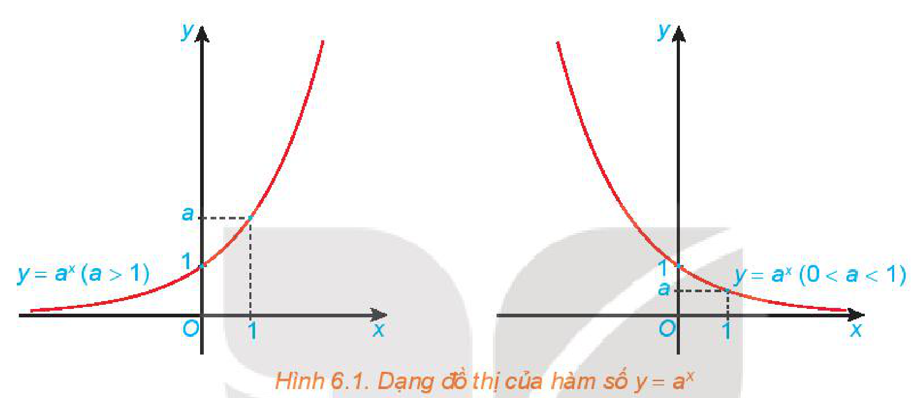
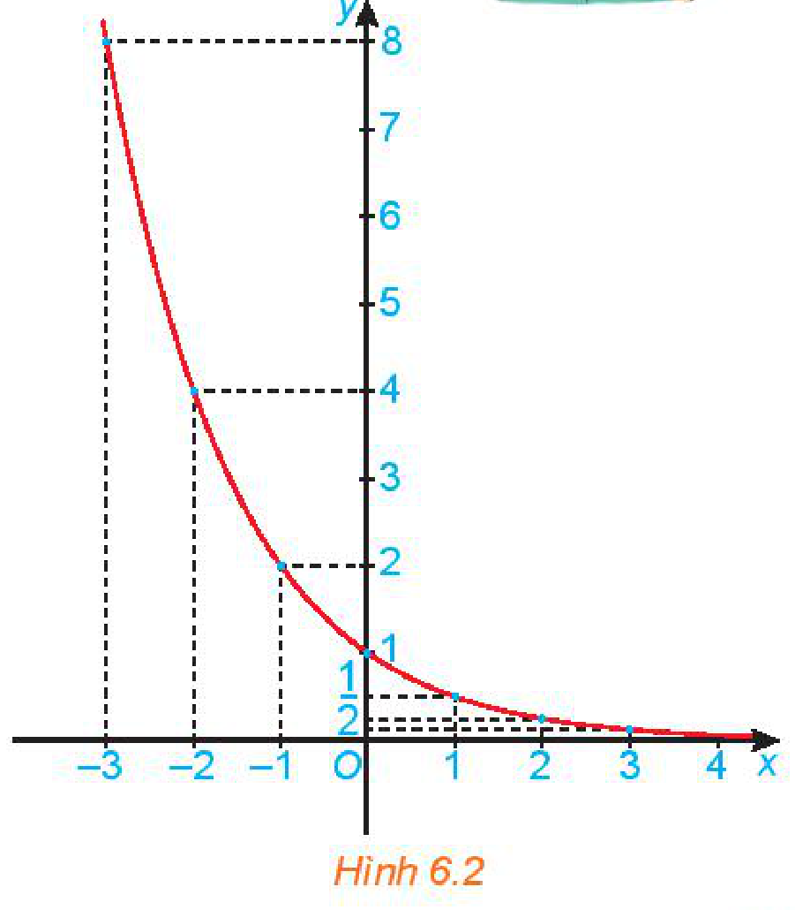
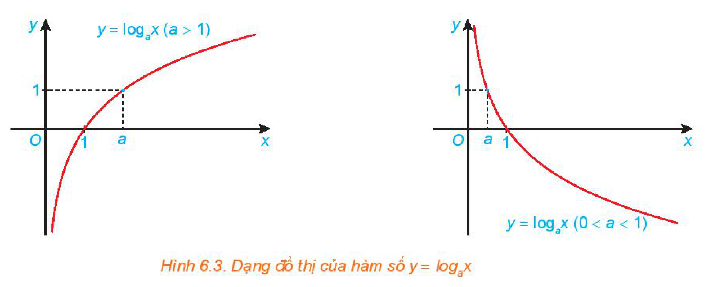
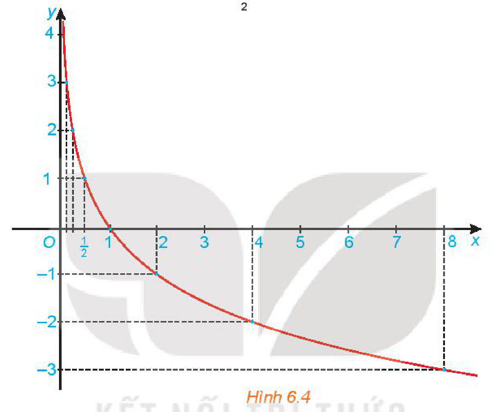

<!-- pdf:17 -->

# BÀI 20: HÀM SỐ MŨ VÀ HÀM SỐ LÔGARIT

## 🔤 Thuật ngữ

- Hàm số mũ
- Hàm số lôgarit

## 🎯 Kiến thức, kĩ năng

- Nhận biết hàm số mũ và hàm số lôgarit. Nêu một số ví dụ thực tế về hàm số mũ, hàm số lôgarit.
- Nhận dạng đồ thị của các hàm số mũ, hàm số lôgarit.
- Giải thích các tính chất của hàm số mũ, hàm số lôgarit thông qua đồ thị của chúng.
- Giải quyết một số vấn đề có liên quan đến môn học khác hoặc thực tiễn gắn với hàm số mũ và hàm số lôgarit.

## 🔴 Mở đầu

<!-- term: Công thức tăng trưởng mũ -->
Sự tăng trưởng dân số được ước tính theo công thức *tăng trưởng mũ* sau:

$A = Pe^{rt},$

<!-- term: Công thức tăng trưởng mũ -->
trong đó $P$ là dân số của năm lấy làm mốc, $A$ là dân số sau $t$ năm, $r$ là tỉ lệ tăng dân số hằng năm. Biết rằng vào năm 2020, dân số Việt Nam là khoảng $97,34$ triệu người và tỉ lệ tăng dân số là $0,91\%$ (theo *danso.org*). Nếu tỉ lệ tăng dân số này giữ nguyên, hãy ước tính dân số Việt Nam vào năm 2050.

## 1. HÀM SỐ MŨ

**HĐ1:** Nhận biết hàm số mũ

a) Tính $y = 2^x$ khi $x$ lần lượt nhận các giá trị $-1; 0; 1$. Với mỗi giá trị của $x$ có bao nhiêu giá trị của $y = 2^x$ tương ứng?
<!-- ocr-ok: đã đối chiếu ảnh trang PDF 17, OCR dính chữ Tínhy=2*khix và đọc sai mỗi -->

b) Với những giá trị nào của $x$, biểu thức $y = 2^x$ có nghĩa?

> Cho $a$ là số thực dương khác $1$.
> Hàm số $y = a^x$ được gọi là **hàm số mũ** cơ số $a$.

> ❓ Trong các hàm số sau, những hàm số nào là hàm số mũ? Khi đó hãy chỉ ra cơ số.
> a) $y = (\sqrt{2})^x$; $\qquad$ b) $y = 2^{-x}$; $\qquad$ c) $y = 8^{\frac{x}{3}}$; $\qquad$ d) $y = x^{-2}$.

**HĐ2:** Nhận dạng đồ thị và tính chất của hàm số mũ

Cho hàm số mũ $y = 2^x$.
<!-- ocr-ok: đã đối chiếu ảnh trang PDF 17, OCR dính chữ sốmñũ -->

a) Hoàn thành bảng giá trị sau:

| $x$ | $-3$ | $-2$ | $-1$ | $0$ | $1$ | $2$ | $3$ |
| :---: | :---: | :---: | :---: | :---: | :---: | :---: | :---: |
| $y = 2^x$ | $?$ | $?$ | $?$ | $?$ | $?$ | $?$ | $?$ |

<!-- pdf:18 -->

b) Trong mặt phẳng toạ độ $Oxy$, biểu diễn các điểm $(x; y)$ trong bảng giá trị ở câu a. Bằng cách làm tương tự, lấy nhiều điểm $(x; 2^x)$ với $x \in \mathbb{R}$ và nối lại ta được đồ thị của hàm số $y = 2^x$.

c) Từ đồ thị đã vẽ ở câu b, hãy kết luận về tập giá trị và tính chất biến thiên của hàm số $y = 2^x$.

<!-- term: Tính chất của hàm số mũ -->
> Hàm số mũ $y = a^x$:
> - Có tập xác định là $\mathbb{R}$ và tập giá trị là $(0; +\infty)$;
> - Đồng biến trên $\mathbb{R}$ khi $a > 1$ và nghịch biến trên $\mathbb{R}$ khi $0 < a < 1$;
> - Liên tục trên $\mathbb{R}$;
> - Có đồ thị đi qua các điểm $(0; 1)$, $(1; a)$ và luôn nằm phía trên trục hoành.

*Hình 6.1. Dạng đồ thị của hàm số $y = a^x$*
<!-- ocr-ok: đã đối chiếu ảnh trang PDF 18, chú thích Hình 6.1 nằm trong vùng đồ thị -->

**Ví dụ 1:** Vẽ đồ thị hàm số $y = \left(\frac{1}{2}\right)^x$.
<!-- ocr-ok: đã đối chiếu ảnh trang PDF 18, OCR đọc sai Vẽ thành Về -->

> Hàm số $y = \left(\frac{1}{2}\right)^x$ còn được viết dưới dạng $y = 2^{-x}$.

**Giải:**

Lập bảng giá trị của hàm số tại một số điểm như sau:

| $x$ | $-3$ | $-2$ | $-1$ | $0$ | $1$ | $2$ | $3$ |
| :---: | :---: | :---: | :---: | :---: | :---: | :---: | :---: |
| $y = \left(\frac{1}{2}\right)^x$ | $8$ | $4$ | $2$ | $1$ | $\frac{1}{2}$ | $\frac{1}{4}$ | $\frac{1}{8}$ |

Từ đó, ta vẽ được đồ thị của hàm số $y = \left(\frac{1}{2}\right)^x$ như Hình 6.2.

*Hình 6.2*

**Luyện tập:** Vẽ đồ thị của hàm số $y = \left(\frac{3}{2}\right)^x$.

<!-- pdf:19 -->

## 2. HÀM SỐ LÔGARIT

**HĐ3:** Nhận biết hàm số lôgarit

a) Tính $y = \log_2 x$ khi $x$ lần lượt nhận các giá trị $1; 2; 4$. Với mỗi giá trị của $x > 0$ có bao nhiêu giá trị của $y = \log_2 x$ tương ứng?
<!-- ocr-ok: đã đối chiếu ảnh trang PDF 19, OCR dính chữ khix và đọc sai lần/mỗi -->

b) Với những giá trị nào của $x$, biểu thức $y = \log_2 x$ có nghĩa?

> Cho $a$ là số thực dương khác $1$.
> Hàm số $y = \log_a x$ được gọi là **hàm số lôgarit** cơ số $a$.

> ❓ Trong các hàm số sau, những hàm số nào là hàm số lôgarit? Khi đó hãy chỉ ra cơ số.
> a) $y = \log_{\sqrt{3}} x$; $\qquad$ b) $y = \log_{2^{-2}} x$; $\qquad$ c) $y = \log_x 2$; $\qquad$ d) $y = \log_{\frac{1}{x}} 5$.

**HĐ4:** Nhận dạng đồ thị và tính chất của hàm số lôgarit

Cho hàm số lôgarit $y = \log_2 x$.

a) Hoàn thành bảng giá trị sau:

| $x$ | $2^{-3}$ | $2^{-2}$ | $2^{-1}$ | $1$ | $2$ | $2^2$ | $2^3$ |
| :---: | :---: | :---: | :---: | :---: | :---: | :---: | :---: |
| $y = \log_2 x$ | $?$ | $?$ | $?$ | $?$ | $?$ | $?$ | $?$ |

b) Trong mặt phẳng toạ độ $Oxy$, biểu diễn các điểm $(x; y)$ trong bảng giá trị ở câu a. Bằng cách làm tương tự, lấy nhiều điểm $(x; \log_2 x)$ và nối lại ta được đồ thị của hàm số $y = \log_2 x$.

c) Từ đồ thị đã vẽ ở câu b, hãy kết luận về tập giá trị và tính chất biến thiên của hàm số $y = \log_2 x$.

<!-- term: Tính chất của hàm số lôgarit -->
> Hàm số lôgarit $y = \log_a x$:
> - Có tập xác định là $(0; +\infty)$ và tập giá trị là $\mathbb{R}$;
> - Đồng biến trên $(0; +\infty)$ khi $a > 1$ và nghịch biến trên $(0; +\infty)$ khi $0 < a < 1$;
> - Liên tục trên $(0; +\infty)$;
> - Có đồ thị đi qua các điểm $(1; 0)$, $(a; 1)$ và luôn nằm bên phải trục tung.

*Hình 6.3. Dạng đồ thị của hàm số $y = \log_a x$*

<!-- pdf:20 -->

**Ví dụ 2:** Vẽ đồ thị của hàm số $y = \log_{\frac{1}{2}} x$.

**Giải:**

Lập bảng giá trị của hàm số tại một số điểm như sau:

| $x$ | $\left(\frac{1}{2}\right)^{-3} = 8$ | $\left(\frac{1}{2}\right)^{-2} = 4$ | $\left(\frac{1}{2}\right)^{-1} = 2$ | $1$ | $\frac{1}{2}$ | $\left(\frac{1}{2}\right)^2 = \frac{1}{4}$ | $\left(\frac{1}{2}\right)^3 = \frac{1}{8}$ |
| :---: | :---: | :---: | :---: | :---: | :---: | :---: | :---: |
| $y = \log_{\frac{1}{2}} x$ | $-3$ | $-2$ | $-1$ | $0$ | $1$ | $2$ | $3$ |

Từ đó, ta vẽ được đồ thị của hàm số $y = \log_{\frac{1}{2}} x$ như Hình 6.4.

*Hình 6.4*

**Vận dụng:** Giải bài toán trong *tình huống mở đầu* (kết quả tính theo đơn vị triệu người và làm tròn đến chữ số thập phân thứ hai).

## ✏️ Bài tập

**6.15.** Vẽ đồ thị của các hàm số sau: a) $y = 3^x$; $\qquad$ b) $y = \left(\frac{1}{3}\right)^x$.

**6.16.** Vẽ đồ thị của các hàm số sau: a) $y = \log x$; $\qquad$ b) $y = \log_{\frac{1}{3}} x$.

**6.17.** Tìm tập xác định của các hàm số sau: a) $y = \log|x + 3|$; $\qquad$ b) $y = \ln(4 - x^2)$.

**6.18.** Giả sử một chất phóng xạ bị phân rã theo cách sao cho khối lượng $m(t)$ của chất còn lại (tính bằng kilôgam) sau $t$ ngày được cho bởi hàm số $m(t) = 13e^{-0,015t}$.

a) Tìm khối lượng của chất đó tại thời điểm $t = 0$.

b) Sau $45$ ngày khối lượng chất đó còn lại là bao nhiêu?

**6.19.** Trong một nghiên cứu, một nhóm học sinh được cho xem cùng một danh sách các loài động vật và được kiểm tra lại xem họ còn nhớ bao nhiêu phần trăm danh sách đó sau mỗi tháng. Giả sử sau $t$ tháng, khả năng nhớ trung bình của nhóm học sinh đó được tính theo công thức $M(t) = 75 - 20\ln(t + 1),\ 0 \le t \le 12$ (đơn vị: $\%$). Hãy tính khả năng nhớ trung bình của nhóm học sinh đó sau $6$ tháng.

## 📷 Danh sách hình trong bài

| Mã hình | Trang PDF | Vị trí trong bài | Chú thích gốc |
| --- | :---: | --- | --- |
| H11-toan-b20-01 | 18 | Mục 1, HĐ2 | Hình 6.1. Dạng đồ thị của hàm số $y = a^x$ |
| H11-toan-b20-02 | 18 | Mục 1, Ví dụ 1 | Hình 6.2 |
| H11-toan-b20-03 | 19 | Mục 2, HĐ4 | Hình 6.3. Dạng đồ thị của hàm số $y = \log_a x$ |
| H11-toan-b20-04 | 20 | Mục 2, Ví dụ 2 | Hình 6.4 |
