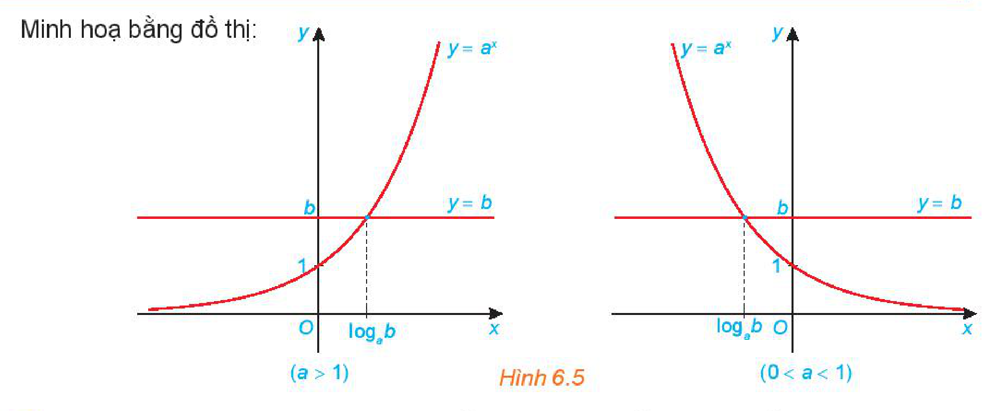
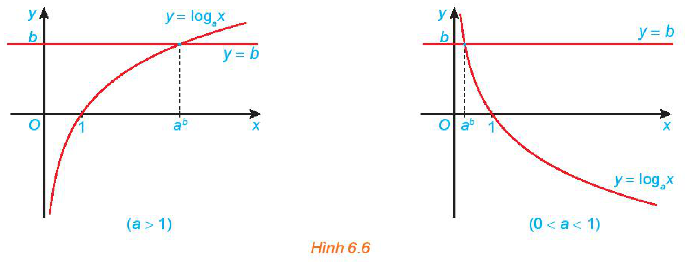
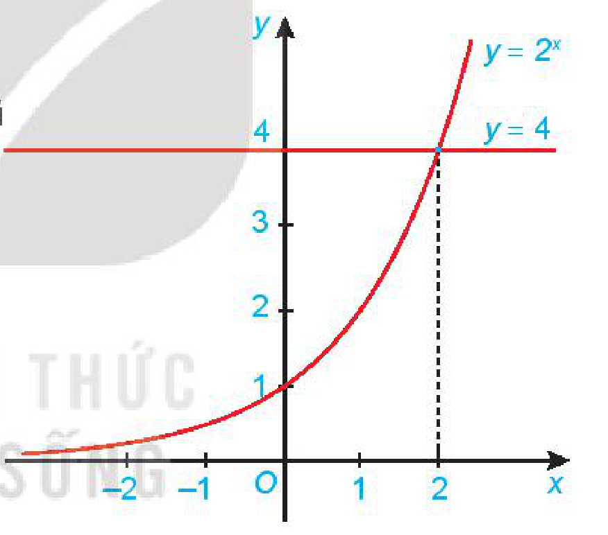
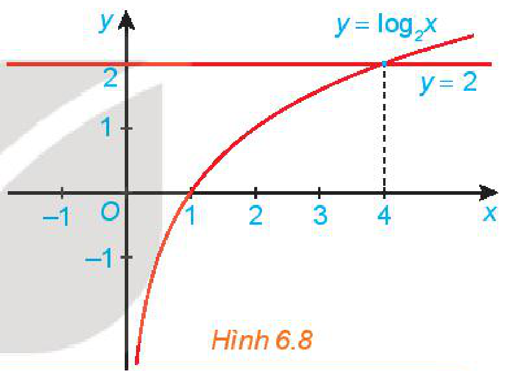

<!-- pdf:21 -->

# BÀI 21: PHƯƠNG TRÌNH, BẤT PHƯƠNG TRÌNH MŨ VÀ LÔGARIT

## 🔤 Thuật ngữ

- Phương trình mũ
- Phương trình lôgarit
- Bất phương trình mũ
- Bất phương trình lôgarit

## 🎯 Kiến thức, kĩ năng

- Giải phương trình, bất phương trình mũ và lôgarit ở dạng đơn giản.
- Giải quyết một số vấn đề liên môn hoặc có liên quan đến thực tiễn gắn với phương trình, bất phương trình mũ và lôgarit.

## 🔴 Mở đầu

Giả sử giá trị còn lại (tính theo triệu đồng) của một chiếc xe ô tô sau $t$ năm sử dụng được mô hình hoá bằng công thức:

$V(t) = 780 \cdot (0,905)^t.$

Hỏi nếu theo mô hình này, sau bao nhiêu năm sử dụng thì giá trị của chiếc xe đó còn lại không quá $300$ triệu đồng? (Làm tròn kết quả đến hàng đơn vị).

## 1. PHƯƠNG TRÌNH MŨ

**HĐ1:** Nhận biết nghiệm của phương trình mũ

Xét phương trình: $2^{x+1} = \frac{1}{4}$.

a) Khi viết $\frac{1}{4}$ thành luỹ thừa của $2$ thì phương trình trên trở thành phương trình nào?

b) So sánh số mũ của $2$ ở hai vế của phương trình nhận được ở câu a để tìm $x$.

> **Phương trình mũ cơ bản** có dạng $a^x = b$ (với $0 < a \ne 1$).
> - Nếu $b > 0$ thì phương trình có nghiệm duy nhất $x = \log_a b$.
> - Nếu $b \le 0$ thì phương trình vô nghiệm.

Minh hoạ bằng đồ thị:

*Hình 6.5*

<!-- term: Phương pháp giải phương trình mũ bằng cách đưa về cùng cơ số -->
**Chú ý:** Phương pháp giải phương trình mũ bằng cách đưa về cùng cơ số:

Nếu $0 < a \ne 1$ thì $a^u = a^v \Leftrightarrow u = v$.

<!-- pdf:22 -->

**Ví dụ 1:** Giải phương trình: $3^{x+1} = \frac{1}{3^{1-2x}}$.

**Giải:**

Đưa vế phải về cơ số $3$, ta có $\frac{1}{3^{1-2x}} = 3^{2x-1}$.
<!-- ocr-ok: đã đối chiếu ảnh trang PDF 22, OCR đọc sai vế thành về và dính chữ tacó -->

Từ đó phương trình trở thành $3^{x+1} = 3^{2x-1} \Leftrightarrow x + 1 = 2x - 1 \Leftrightarrow x = 2$.

Vậy phương trình đã cho có nghiệm duy nhất $x = 2$.

**Ví dụ 2:** Giải phương trình: $10^{x-1} = 2\,022$.

**Giải:**

Lấy lôgarit thập phân hai vế của phương trình ta được $x - 1 = \log 2\,022$ hay $x = 1 + \log 2\,022$.

Vậy phương trình đã cho có nghiệm duy nhất $x = 1 + \log 2\,022$.

**Luyện tập 1:** Giải các phương trình sau:

a) $2^{3x-1} = \frac{1}{2^{x+1}}$; $\qquad$ b) $2e^{2x} = 5$.

## 2. PHƯƠNG TRÌNH LÔGARIT

**HĐ2:** Nhận biết nghiệm của phương trình lôgarit

Xét phương trình: $2\log_2 x = -3$.

a) Từ phương trình trên, hãy tính $\log_2 x$.

b) Từ kết quả ở câu a và sử dụng định nghĩa lôgarit, hãy tìm $x$.

> **Phương trình lôgarit cơ bản** có dạng $\log_a x = b\ (0 < a \ne 1)$.
> Phương trình lôgarit cơ bản $\log_a x = b$ có nghiệm duy nhất $x = a^b$.

Minh hoạ bằng đồ thị:

*Hình 6.6*

<!-- term: Phương pháp giải phương trình lôgarit bằng cách đưa về cùng cơ số -->
**Chú ý:** Phương pháp giải phương trình lôgarit bằng cách đưa về cùng cơ số:

Nếu $u, v > 0$ và $0 < a \ne 1$ thì $\log_a u = \log_a v \Leftrightarrow u = v$.

<!-- pdf:23 -->

**Ví dụ 3:** Giải phương trình: $4 + 3\log(2x) = 16$.
<!-- ocr-ok: đã đối chiếu ảnh trang PDF 23, OCR đọc sai Ví dụ 3 thành Ví đụ 5 -->

**Giải:**

Điều kiện: $2x > 0$ hay $x > 0$.
<!-- ocr-ok: đã đối chiếu ảnh trang PDF 23, OCR dính chữ 0hayx -->

Phương trình trở thành $\log(2x) = 4$. Từ đó $2x = 10^4$ hay $x = 5\,000$ (thoả mãn điều kiện).

Vậy phương trình đã cho có nghiệm là $x = 5\,000$.

**Ví dụ 4:** Giải phương trình: $\log_3(x + 1) = \log_3(x^2 - 1)$.

**Giải:**

Điều kiện: $x + 1 > 0$ và $x^2 - 1 > 0$, tức là $x > 1$.
<!-- ocr-ok: đã đối chiếu ảnh trang PDF 23, OCR dính chữ vàx-1>0,fứclàx>1 -->

Phương trình trở thành $x + 1 = x^2 - 1$ hay $x^2 - x - 2 = 0$.

Từ đó tìm được $x = -1$ và $x = 2$, nhưng chỉ có nghiệm $x = 2$ thoả mãn điều kiện.

Vậy phương trình đã cho có nghiệm duy nhất $x = 2$.

**Luyện tập 2:** Giải các phương trình sau:

a) $4 - \log(3 - x) = 3$; $\qquad$ b) $\log_2(x + 2) + \log_2(x - 1) = 1$.

## 3. BẤT PHƯƠNG TRÌNH MŨ

**HĐ3:** Nhận biết nghiệm của bất phương trình mũ

Cho đồ thị của các hàm số $y = 2^x$ và $y = 4$ như Hình 6.7. Tìm khoảng giá trị của $x$ mà đồ thị hàm số $y = 2^x$ nằm phía trên đường thẳng $y = 4$ và từ đó suy ra tập nghiệm của bất phương trình $2^x > 4$.

*Hình 6.7*

> - **Bất phương trình mũ cơ bản** có dạng $a^x > b$ (hoặc $a^x \ge b, a^x < b, a^x \le b$) với $a > 0, a \ne 1$.
> - Xét bất phương trình dạng $a^x > b$:
>   - Nếu $b \le 0$ thì tập nghiệm của bất phương trình là $\mathbb{R}$.
>   - Nếu $b > 0$ thì bất phương trình tương đương với $a^x > a^{\log_a b}$.
>     Với $a > 1$, nghiệm của bất phương trình là $x > \log_a b$.
>     Với $0 < a < 1$, nghiệm của bất phương trình là $x < \log_a b$.

<!-- term: Bất phương trình mũ đưa về cùng cơ số -->
**Chú ý:**
- a) Các bất phương trình mũ cơ bản còn lại được giải tương tự.
- b) Nếu $a > 1$ thì $a^u > a^v \Leftrightarrow u > v$. Nếu $0 < a < 1$ thì $a^u > a^v \Leftrightarrow u < v$.

<!-- pdf:24 -->

**Ví dụ 5:** Giải bất phương trình: $16^x > \frac{1}{8}$.

**Giải:**

Ta có: $16^x > \frac{1}{8} \Leftrightarrow 2^{4x} > 2^{-3} \Leftrightarrow 4x > -3 \Leftrightarrow x > -\frac{3}{4}$.

**Ví dụ 6:** Giải bài toán trong *tình huống mở đầu*.

**Giải:**

Ta cần tìm $t$ sao cho

$V(t) \le 300 \Leftrightarrow 780 \cdot (0,905)^t \le 300 \Leftrightarrow (0,905)^t \le \frac{5}{13} \Leftrightarrow t \ge \log_{0,905} \frac{5}{13} \approx 9,6.$

Vậy sau khoảng $10$ năm sử dụng, giá trị của chiếc xe đó còn lại không quá $300$ triệu đồng.

**Luyện tập 3:** Giải các bất phương trình sau:

a) $0,1^{2x-1} \le 0,1^{2-x}$; $\qquad$ b) $3 \cdot 2^{x+1} \le 1$.

## 4. BẤT PHƯƠNG TRÌNH LÔGARIT

**HĐ4:** Nhận biết nghiệm của bất phương trình lôgarit

Cho đồ thị của các hàm số $y = \log_2 x$ và $y = 2$ như Hình 6.8. Tìm khoảng giá trị của $x$ mà đồ thị hàm số $y = \log_2 x$ nằm phía trên đường thẳng $y = 2$ và từ đó suy ra tập nghiệm của bất phương trình $\log_2 x > 2$.

*Hình 6.8*

> - **Bất phương trình lôgarit cơ bản** có dạng $\log_a x > b$ (hoặc $\log_a x \ge b, \log_a x < b, \log_a x \le b$) với $a > 0, a \ne 1$.
> - Xét bất phương trình dạng $\log_a x > b$:
>   - Nếu $a > 1$ thì nghiệm của bất phương trình là $x > a^b$.
>   - Nếu $0 < a < 1$ thì nghiệm của bất phương trình là $0 < x < a^b$.
<!-- ocr-ok: đã đối chiếu ảnh trang PDF 24, OCR dính nhiều từ trong khung kiến thức -->

<!-- term: Bất phương trình lôgarit đưa về cùng cơ số -->
**Chú ý:**
- a) Các bất phương trình lôgarit cơ bản còn lại được giải tương tự.
- b) Nếu $a > 1$ thì $\log_a u > \log_a v \Leftrightarrow u > v > 0$. Nếu $0 < a < 1$ thì $\log_a u > \log_a v \Leftrightarrow 0 < u < v$.

**Ví dụ 7:** Giải bất phương trình: $\log_{0,3}(x + 1) \le \log_{0,3}(2x - 1)$.

**Giải:**

Điều kiện: $x > \frac{1}{2}$.

Vì cơ số $0,3 < 1$ nên bất phương trình trở thành $x + 1 \ge 2x - 1$, từ đó tìm được $x \le 2$.

Kết hợp với điều kiện, ta được nghiệm của bất phương trình đã cho là $\frac{1}{2} < x \le 2$.

<!-- pdf:25 -->

**Luyện tập 4:** Giải các bất phương trình sau:

a) $\log_{\frac{1}{7}}(x + 1) > \log_7(2 - x)$; $\qquad$ b) $2\log(2x + 1) > 3$.

**Vận dụng:** Áp suất khí quyển $p$ (tính bằng kilopascal, viết tắt là $\text{kPa}$) ở độ cao $h$ (so với mực nước biển, tính bằng $\text{km}$) được tính theo công thức sau:

$\ln\left(\frac{p}{100}\right) = -\frac{h}{7}.$

*(Theo britannica.com)*

a) Tính áp suất khí quyển ở độ cao $4\text{ km}$.

b) Ở độ cao trên $10\text{ km}$ thì áp suất khí quyển sẽ như thế nào?

## ✏️ Bài tập

**6.20.** Giải các phương trình sau:

a) $3^{x-1} = 27$; $\qquad$ b) $100^{2x^2-3} = 0,1^{2x^2-18}$;

c) $\sqrt{3}e^{3x} = 1$; $\qquad$ d) $5^x = 3^{2x-1}$.

**6.21.** Giải các phương trình sau:

a) $\log(x + 1) = 2$; $\qquad$ b) $2\log_4 x + \log_2(x - 3) = 2$;

c) $\ln x + \ln(x - 1) = \ln 4x$; $\qquad$ d) $\log_3(x^2 - 3x + 2) = \log_3(2x - 4)$.

**6.22.** Giải các bất phương trình sau:

a) $0,1^{2-x} > 0,1^{4+2x}$; $\qquad$ b) $2 \cdot 5^{2x+1} \le 3$;

c) $\log_3(x + 7) \ge -1$; $\qquad$ d) $\log_{0,5}(x + 7) \ge \log_{0,5}(2x - 1)$.

**6.23.** Bác Minh gửi tiết kiệm $500$ triệu đồng ở một ngân hàng với lãi suất không đổi $7,5\%$ một năm theo thể thức lãi kép kì hạn $12$ tháng. Tổng số tiền bác Minh thu được (cả vốn lẫn lãi) sau $n$ năm là:

$A = 500 \cdot (1 + 0,075)^n\text{ (triệu đồng)}.$

Tính thời gian tối thiểu gửi tiết kiệm để bác Minh thu được ít nhất $800$ triệu đồng (cả vốn lẫn lãi).

**6.24.** Số lượng vi khuẩn ban đầu trong một mẻ nuôi cấy là $500$ con. Người ta lấy một mẫu vi khuẩn trong mẻ nuôi cấy đó, đếm số lượng vi khuẩn và thấy rằng tỉ lệ tăng trưởng vi khuẩn là $40\%$ mỗi giờ. Khi đó số lượng vi khuẩn $N(t)$ sau $t$ giờ nuôi cấy được ước tính bằng công thức sau:

$N(t) = 500e^{0,4t}.$

Hỏi sau bao nhiêu giờ nuôi cấy, số lượng vi khuẩn vượt mức $80\,000$ con?

**6.25.** Giả sử nhiệt độ $T$ ($^\circ\text{C}$) của một vật giảm dần theo thời gian cho bởi công thức:

$T = 25 + 70e^{-0,5t}$, trong đó thời gian $t$ được tính bằng phút.

a) Tìm nhiệt độ ban đầu của vật.

b) Sau bao lâu nhiệt độ của vật còn lại $30\ ^\circ\text{C}$?

**6.26.** Tính nồng độ ion hydrogen (tính bằng $\text{mol/lít}$) của một dung dịch có độ $\text{pH}$ là $8$.
<!-- ocr-ok: đã đối chiếu ảnh trang PDF 25, OCR mất nhãn 6.26 và dấu huyền chữ nồng -->

## 📷 Danh sách hình trong bài

| Mã hình | Trang PDF | Vị trí trong bài | Chú thích gốc |
| --- | :---: | --- | --- |
| H11-toan-b21-01 | 21 | Mục 1, HĐ1 | Hình 6.5 |
| H11-toan-b21-02 | 22 | Mục 2, HĐ2 | Hình 6.6 |
| H11-toan-b21-03 | 23 | Mục 3, HĐ3 | Hình 6.7 |
| H11-toan-b21-04 | 24 | Mục 4, HĐ4 | Hình 6.8 |
