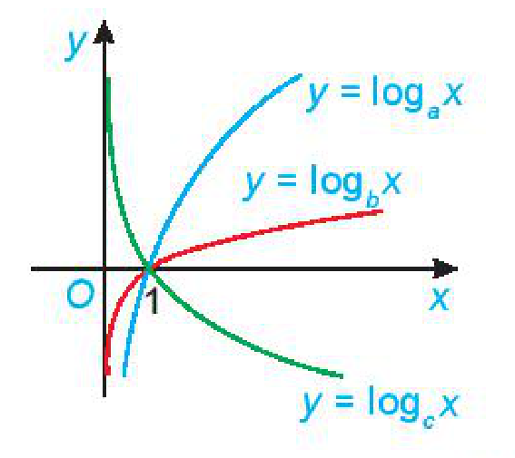

<!-- pdf:26 -->

# BÀI TẬP CUỐI CHƯƠNG VI

## ✏️ A – TRẮC NGHIỆM

**6.27.** Cho hai số thực dương $x, y$ và hai số thực $\alpha, \beta$ tuỳ ý. Khẳng định nào sau đây là **sai**?

A. $x^\alpha \cdot x^\beta = x^{\alpha + \beta}$.

B. $x^\alpha \cdot y^\beta = (xy)^{\alpha + \beta}$.

C. $(x^\alpha)^\beta = x^{\alpha \cdot \beta}$.

D. $(xy)^\alpha = x^\alpha \cdot y^\alpha$.

**6.28.** Rút gọn biểu thức $\sqrt{x\sqrt{x\sqrt{x}}} : x^{\frac{5}{8}}\ (x > 0)$ ta được

A. $\sqrt[4]{x}$.

B. $\sqrt{x}$.

C. $\sqrt[3]{x}$.

D. $\sqrt[5]{x}$.

**6.29.** Cho hai số thực dương $a, b$ với $a \ne 1$. Khẳng định nào sau đây là đúng?

A. $\log_a(a^3 b^2) = 3 + \log_a b$.

B. $\log_a(a^3 b^2) = 3 + 2\log_a b$.

C. $\log_a(a^3 b^2) = \frac{3}{2} + \log_a b$.

D. $\log_a(a^3 b^2) = \frac{1}{3} + \frac{1}{2}\log_a b$.

**6.30.** Cho bốn số thực dương $a, b, x, y$ với $a, b \ne 1$. Khẳng định nào sau đây là **sai**?

A. $\log_a(xy) = \log_a x + \log_b y$.

B. $\log_a \frac{x}{y} = \log_a x - \log_a y$.

C. $\log_a \frac{1}{x} = \frac{1}{\log_a x}$.

D. $\log_a b \cdot \log_b x = \log_a x$.

**6.31.** Đặt $\log_2 5 = a$, $\log_3 5 = b$. Khi đó, $\log_6 5$ tính theo $a$ và $b$ bằng
<!-- ocr-ok: đã đối chiếu ảnh trang PDF 26, câu chứa nhiều kí hiệu toán -->

A. $\frac{ab}{a + b}$.

B. $\frac{1}{a + b}$.

C. $a^2 + b^2$.

D. $a + b$.

**6.32.** Cho hàm số $y = 2^x$. Khẳng định nào sau đây là **sai**?

A. Tập xác định của hàm số là $\mathbb{R}$.

B. Tập giá trị của hàm số là $(0; +\infty)$.

C. Đồ thị của hàm số cắt trục $Ox$ tại đúng một điểm.

D. Hàm số đồng biến trên tập xác định của nó.

**6.33.** Hàm số nào sau đây đồng biến trên tập xác định của nó?

A. $y = \log_{0,5} x$.

B. $y = e^{-x}$.

C. $y = \left(\frac{1}{3}\right)^x$.

D. $y = \ln x$.

**6.34.** Cho đồ thị ba hàm số $y = \log_a x$, $y = \log_b x$ và $y = \log_c x$ như hình bên. Mệnh đề nào sau đây là đúng?

A. $a > b > c$.

B. $b > a > c$.

C. $a > b > c$.

D. $b > c > a$.

<!-- pdf:27 -->

## ✏️ B – TỰ LUẬN

**6.35.** Cho $0 < a \ne 1$. Tính giá trị của biểu thức $B = \log_a\left(\frac{a^2 \cdot \sqrt[3]{a} \cdot \sqrt[5]{a^4}}{\sqrt[4]{a}}\right) + a^{2\log_a \frac{\sqrt{105}}{30}}$.
<!-- ocr-ok: đã đối chiếu ảnh trang PDF 27, OCR mất nhãn 6.35 -->

**6.36.** Giải các phương trình sau:

a) $3^{1-2x} = 4^x$; $\qquad$ b) $\log_3(x + 1) + \log_3(x + 4) = 2$.

**6.37.** Tìm tập xác định của các hàm số sau:

a) $y = \sqrt{4^x - 2^{x+1}}$; $\qquad$ b) $y = \ln(1 - \ln x)$.

**6.38.** *Lạm phát* là sự tăng mức giá chung một cách liên tục của hàng hoá và dịch vụ theo thời gian, tức là sự mất giá trị của một loại tiền tệ nào đó. Chẳng hạn, nếu lạm phát là $5\%$ một năm thì sức mua của $1$ triệu đồng sau một năm chỉ còn là $950$ nghìn đồng (vì đã giảm mất $5\%$ của $1$ triệu đồng, tức là $50\,000$ đồng). Nói chung, nếu tỉ lệ lạm phát trung bình là $r\%$ một năm thì tổng số tiền $P$ ban đầu, sau $n$ năm số tiền đó chỉ còn giá trị là

$A = P \cdot \left(1 - \frac{r}{100}\right)^n.$

a) Nếu tỉ lệ lạm phát là $8\%$ một năm thì sức mua của $100$ triệu đồng sau hai năm sẽ còn lại bao nhiêu?

b) Nếu sức mua của $100$ triệu đồng sau hai năm chỉ còn là $90$ triệu đồng thì tỉ lệ lạm phát trung bình của hai năm đó là bao nhiêu?

c) Nếu tỉ lệ lạm phát là $5\%$ một năm thì sau bao nhiêu năm sức mua của số tiền ban đầu chỉ còn lại một nửa?

**6.39.** Giả sử quá trình nuôi cấy vi khuẩn tuân theo quy luật tăng trưởng tự do. Khi đó, nếu gọi $N_0$ là số lượng vi khuẩn ban đầu và $N(t)$ là số lượng vi khuẩn sau $t$ giờ thì ta có:

$N(t) = N_0 e^{rt},$

trong đó $r$ là tỉ lệ tăng trưởng vi khuẩn mỗi giờ.

Giả sử ban đầu có $500$ con vi khuẩn và sau $1$ giờ tăng lên $800$ con. Hỏi:

a) Sau $5$ giờ thì số lượng vi khuẩn là khoảng bao nhiêu con?

b) Sau bao lâu thì số lượng vi khuẩn ban đầu sẽ tăng lên gấp đôi?

**6.40.** Vào năm 1938, nhà vật lí Frank Benford đã đưa ra một phương pháp để xác định xem một bộ số đã được chọn ngẫu nhiên hay đã được chọn theo cách thủ công. Nếu bộ số này không được chọn ngẫu nhiên thì công thức Benford sau sẽ được dùng ước tính xác suất $P$ để chữ số $d$ là chữ số đầu tiên của bộ số đó: $P = \log\frac{d + 1}{d}$. (Theo F. Benford, The Law of Anomalous Numbers, *Proc. Am. Philos. Soc.* 78 (1938), 551 – 572).

Chẳng hạn, xác suất để chữ số đầu tiên là $9$ bằng khoảng $4,6\%$ (thay $d = 9$ trong công thức Benford để tính $P$).

a) Viết công thức tìm chữ số $d$ nếu cho trước xác suất $P$.

b) Tìm chữ số có xác suất bằng $9,7\%$ được chọn.

c) Tính xác suất để chữ số đầu tiên là $1$.

## 📷 Danh sách hình trong bài

| Mã hình | Trang PDF | Vị trí trong bài | Chú thích gốc |
| --- | :---: | --- | --- |
| H11-toan-bt-c06-01 | 26 | Bài tập 6.34 | (sách không đánh số, đồ thị ba hàm số $y = \log_a x$, $y = \log_b x$ và $y = \log_c x$) |
