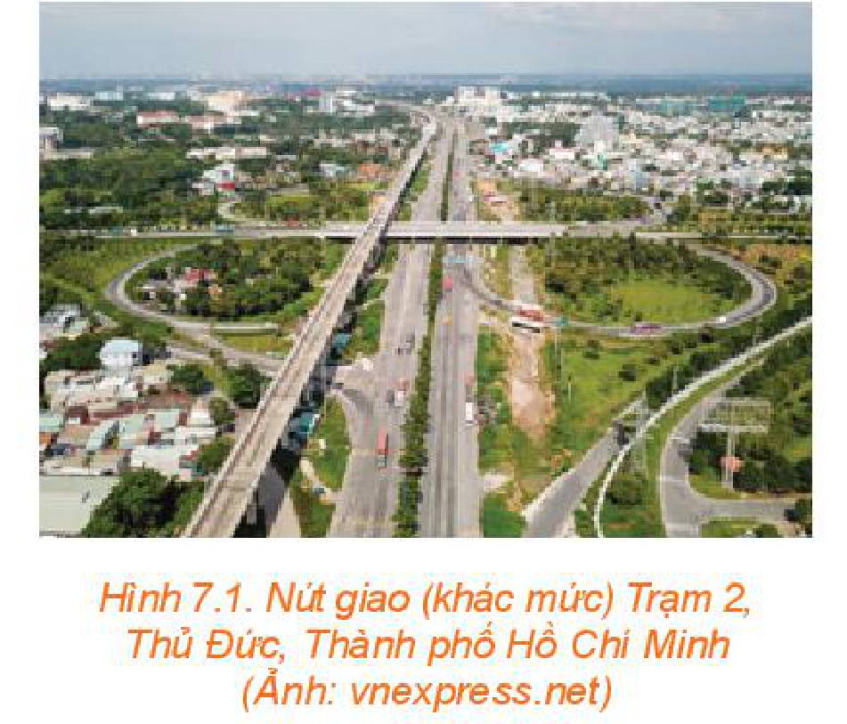
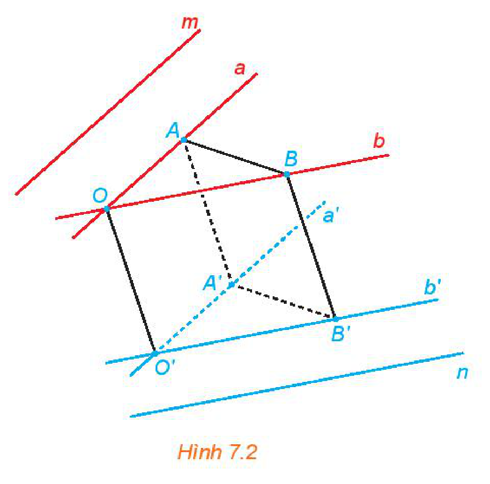
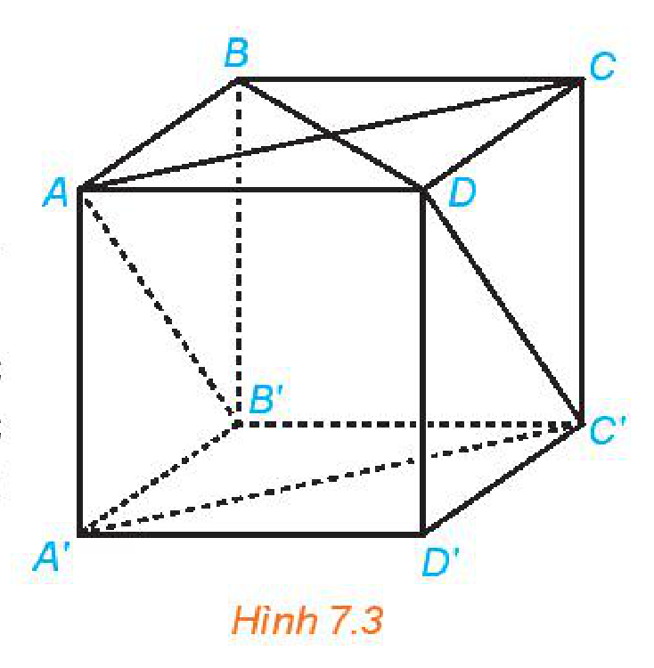
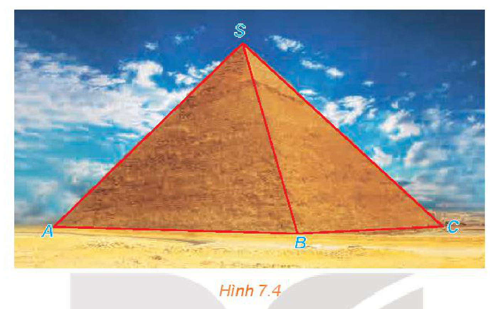
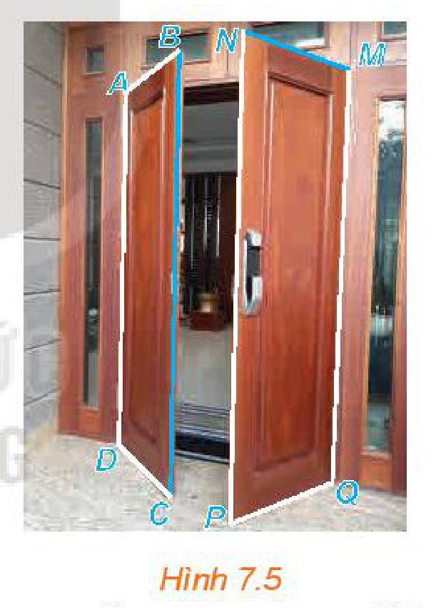
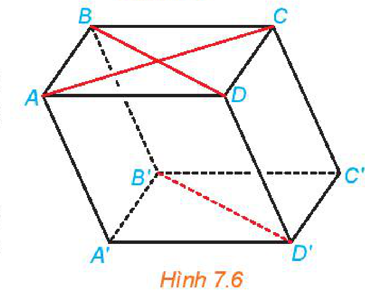
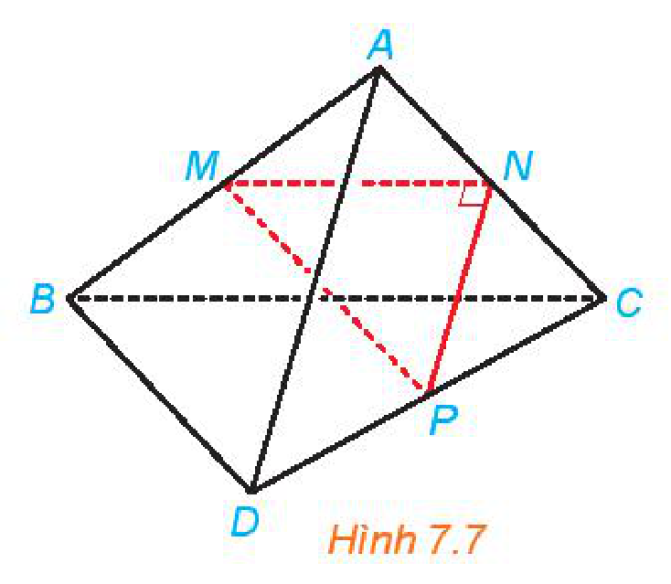
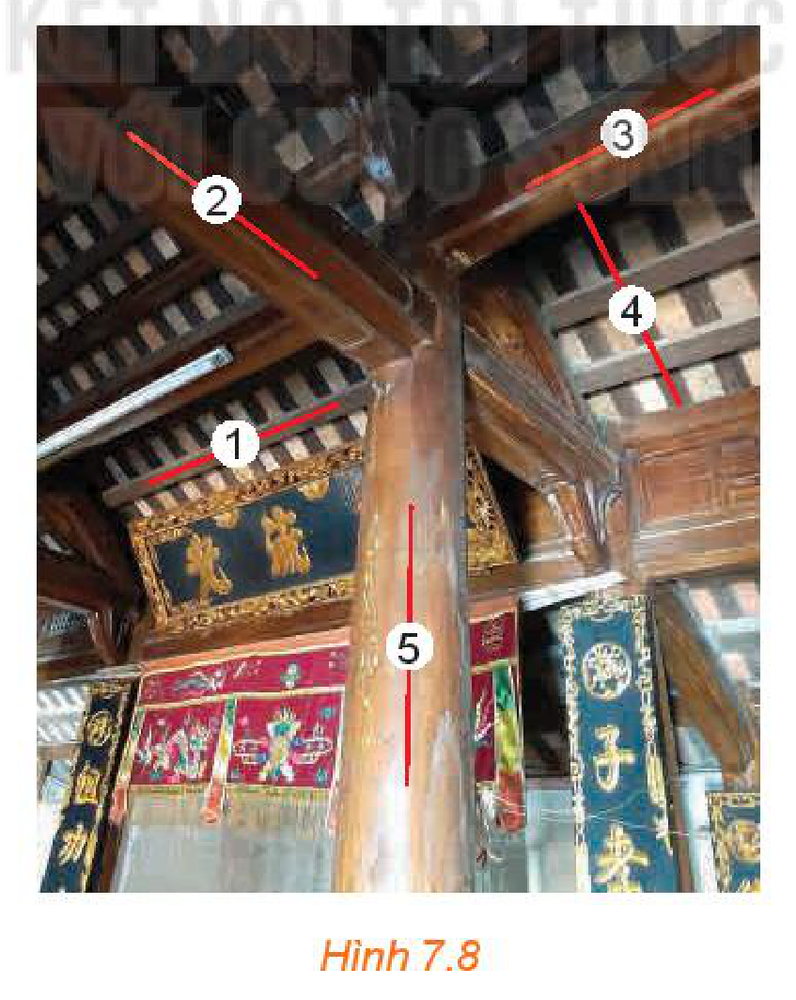

<!-- pdf:28 -->

<!-- Phần giới thiệu Chương VII (in chung đầu trang PDF 28): CHƯƠNG VII. QUAN HỆ VUÔNG GÓC TRONG KHÔNG GIAN -->

Chương này, ta sẽ tìm hiểu về quan hệ vuông góc, góc, khoảng cách và thể tích trong Hình học không gian.

# BÀI 22: HAI ĐƯỜNG THẲNG VUÔNG GÓC

## 🔤 Thuật ngữ

- Góc giữa hai đường thẳng
- Hai đường thẳng vuông góc

## 🎯 Mục tiêu

- Nhận biết góc giữa hai đường thẳng.
- Nhận biết hai đường thẳng vuông góc.
- Chứng minh hai đường thẳng vuông góc trong một số tình huống đơn giản.
- Vận dụng kiến thức về quan hệ vuông góc giữa hai đường thẳng để mô tả một số hình ảnh thực tế.

## 🔴 Mở đầu

Đối với các nút giao thông cùng mức hay khác mức, để có thể dễ dàng bố trí các nhánh rẽ và để người tham gia giao thông có góc nhìn đảm bảo an toàn, khi thiết kế người ta đều cố gắng để các tuyến đường tạo với nhau một góc đủ lớn và tốt nhất là góc vuông. Đối với nút giao thông cùng mức, tức là các đường giao nhau, thì góc giữa chúng là góc giữa hai đường thẳng mà ta đã biết. Còn đối với nút giao khác mức, tức là các đường chéo nhau, thì góc giữa chúng được hiểu như thế nào? Bài học này sẽ đề cập tới đối tượng toán học tương ứng.

*Hình 7.1. Nút giao (khác mức) Trạm 2, Thủ Đức, Thành phố Hồ Chí Minh (Ảnh: vnexpress.net)*

<!-- pdf:29 -->

## 1. GÓC GIỮA HAI ĐƯỜNG THẲNG

**HĐ1:** Trong không gian, cho hai đường thẳng chéo nhau $m$ và $n$. Từ hai điểm phân biệt $O, O'$ tuỳ ý lần lượt kẻ các cặp đường thẳng $a, b$ và $a', b'$ tương ứng song song với $m, n$ (H.7.2).

a) Mỗi cặp đường thẳng $a, a'$ và $b, b'$ có cùng thuộc một mặt phẳng hay không?

b) Lấy các điểm $A, B$ (khác $O$) tương ứng thuộc $a, b$. Đường thẳng qua $A$ song song với $OO'$ cắt $a'$ tại $A'$, đường thẳng qua $B$ song song với $OO'$ cắt $b'$ tại $B'$. Giải thích vì sao $OAA'O', OBB'O', ABB'A'$ là các hình bình hành.
<!-- ocr-ok: kí hiệu điểm và đường thẳng bị OCR đọc lệch, đã đối chiếu ảnh -->

c) So sánh góc giữa hai đường thẳng $a, b$ và góc giữa hai đường thẳng $a', b'$.

*(Gợi ý: Áp dụng định lí côsin cho các tam giác $OAB, O'A'B'$).*

*Hình 7.2*

> **Góc giữa hai đường thẳng** $m$ và $n$ trong không gian, kí hiệu $(m, n)$, là góc giữa hai đường thẳng $a$ và $b$ cùng đi qua một điểm và tương ứng song song với $m$ và $n$.

**Chú ý:**

<!-- term: Cách xác định góc giữa hai đường thẳng chéo nhau -->
- Để xác định góc giữa hai đường thẳng chéo nhau $a$ và $b$, ta có thể lấy một điểm $O$ thuộc đường thẳng $a$ và qua đó kẻ đường thẳng $b'$ song song với $b$. Khi đó $(a, b) = (a, b')$.
- Với hai đường thẳng $a, b$ bất kì: $0^\circ \le (a, b) \le 90^\circ$.

**Câu hỏi:** Nếu $a$ song song hoặc trùng với $a'$ và $b$ song song hoặc trùng với $b'$ thì $(a, b)$ và $(a', b')$ có mối quan hệ gì?
<!-- ocr-ok: kí hiệu góc giữa hai đường thẳng bị OCR đọc lệch, đã đối chiếu ảnh -->

**Ví dụ 1:** Cho hình hộp $ABCD.A'B'C'D'$ có các mặt là các hình vuông. Tính các góc $(AA', CD), (A'C', BD), (AC, DC')$.

**Giải:** (H.7.3)

Vì $CD \parallel AB$ nên $(AA', CD) = (AA', AB) = 90^\circ$. Tứ giác $ACC'A'$ có các cặp cạnh đối bằng nhau nên nó là một hình bình hành. Do đó, $A'C' \parallel AC$. Vậy $(A'C', BD) = (AC, BD) = 90^\circ$.

Tương tự, $DC' \parallel AB'$. Vậy $(AC, DC') = (AC, AB')$. Tam giác $AB'C$ có ba cạnh bằng nhau (vì là các đường chéo của các hình vuông có độ dài cạnh bằng nhau) nên nó là một tam giác đều. Từ đó, $(AC, DC') = (AC, AB') = 60^\circ$.

*Hình 7.3*

<!-- pdf:30 -->

**Vận dụng:** Kim tự tháp Cheops là kim tự tháp lớn nhất trong các kim tự tháp ở Ai Cập, được xây dựng vào thế kỉ thứ $26$ trước Công nguyên và là một trong bảy kì quan của thế giới cổ đại. Kim tự tháp có dạng hình chóp với đáy là hình vuông có cạnh dài khoảng $230\text{ m}$, các cạnh bên bằng nhau và dài khoảng $219\text{ m}$ (kích thước hiện nay). *(Theo britannica.com)*.

Tính (gần đúng) góc tạo bởi cạnh bên $SC$ và cạnh đáy $AB$ của kim tự tháp (H.7.4).

*Hình 7.4*

## 2. HAI ĐƯỜNG THẲNG VUÔNG GÓC

**HĐ2:** Đối với hai cánh cửa trong Hình 7.5, tính góc giữa hai đường mép cửa $BC$ và $MN$.

*Hình 7.5*

> Hai đường thẳng $a, b$ được gọi là **vuông góc với nhau**, kí hiệu $a \perp b$, nếu góc giữa chúng bằng $90^\circ$.

**Câu hỏi:** Nếu đường thẳng $a$ vuông góc với đường thẳng $b$ thì $a$ có vuông góc với các đường thẳng song song với $b$ hay không?

**Ví dụ 2:** Cho hình hộp $ABCD.A'B'C'D'$ (H.7.6).
<!-- ocr-ok: kí hiệu đỉnh hình hộp bị OCR đọc lệch, đã đối chiếu ảnh -->

a) Xác định vị trí tương đối của hai đường thẳng $AC$ và $B'D'$.

b) Chứng minh rằng $AC$ và $B'D'$ vuông góc với nhau khi và chỉ khi $ABCD$ là một hình thoi.

*Hình 7.6*

**Giải:**

a) Hai đường thẳng $AC$ và $B'D'$ lần lượt thuộc hai mặt phẳng song song $(ABCD)$ và $(A'B'C'D')$ nên chúng không có điểm chung, tức là chúng không thể trùng nhau hoặc cắt nhau.

Tứ giác $BDD'B'$ có hai cạnh đối $BB'$ và $DD'$ song song và bằng nhau nên nó là một hình bình hành. Do đó $B'D'$ song song với $BD$. Mặt khác, $BD$ không song song với $AC$ nên $B'D'$ không song song với $AC$.

Từ những điều trên suy ra $AC$ và $B'D'$ chéo nhau.

<!-- pdf:31 -->

b) Do $B'D'$ song song với $BD$ nên $(AC, B'D') = (AC, BD)$. Do đó, $AC$ và $B'D'$ vuông góc với nhau khi và chỉ khi $AC$ và $BD$ vuông góc với nhau. Do $ABCD$ là hình bình hành nên $AC$ vuông góc với $BD$ khi và chỉ khi $ABCD$ là hình thoi.

**Luyện tập 1:** Cho tam giác $MNP$ vuông tại $N$ và một điểm $A$ nằm ngoài mặt phẳng $(MNP)$. Lần lượt lấy các điểm $B, C, D$ sao cho $M, N, P$ tương ứng là trung điểm của $AB, AC, CD$ (H.7.7). Chứng minh rằng $AD$ và $BC$ vuông góc với nhau và chéo nhau.

*Hình 7.7*

## ✏️ Bài tập

**7.1.** Cho hình lăng trụ $ABC.A'B'C'$ có các đáy là các tam giác đều. Tính góc $(AB, B'C')$.

**7.2.** Cho hình hộp $ABCD.A'B'C'D'$ có các cạnh bằng nhau. Chứng minh rằng tứ diện $ACB'D'$ có các cặp cạnh đối diện vuông góc với nhau.

**7.3.** Cho tứ diện $ABCD$ có $\widehat{CBD} = 90^\circ$.
<!-- ocr-ok: kí hiệu góc vuông bị OCR đọc lệch, đã đối chiếu ảnh -->

a) Gọi $M, N$ tương ứng là trung điểm của $AB, AD$. Chứng minh rằng $MN$ vuông góc với $BC$.

b) Gọi $G, K$ tương ứng là trọng tâm của các tam giác $ABC, ACD$. Chứng minh rằng $GK$ vuông góc với $BC$.

**7.4.** Đối với nhà gỗ truyền thống, trong các cấu kiện hoành, quá giang, xà cái, rui, cột tương ứng được đánh số $1, 2, 3, 4, 5$ như trong Hình 7.8, những cặp cấu kiện nào vuông góc với nhau?

*Hình 7.8*

## 📷 Danh sách hình trong bài

| Mã hình | Trang PDF | Vị trí trong bài | Chú thích gốc |
| --- | :---: | --- | --- |
| H11-toan-b22-01 | 28 | Mở đầu | Hình 7.1. Nút giao (khác mức) Trạm 2, Thủ Đức, Thành phố Hồ Chí Minh (Ảnh: vnexpress.net) |
| H11-toan-b22-02 | 29 | Mục 1, HĐ1 | Hình 7.2 |
| H11-toan-b22-03 | 29 | Mục 1, Ví dụ 1 | Hình 7.3 |
| H11-toan-b22-04 | 30 | Mục 1, Vận dụng | Hình 7.4 |
| H11-toan-b22-05 | 30 | Mục 2, HĐ2 | Hình 7.5 |
| H11-toan-b22-06 | 30 | Mục 2, Ví dụ 2 | Hình 7.6 |
| H11-toan-b22-07 | 31 | Mục 2, Luyện tập 1 | Hình 7.7 |
| H11-toan-b22-08 | 31 | Bài tập 7.4 | Hình 7.8 |
