<!-- pdf:32 -->

# BÀI 23: ĐƯỜNG THẲNG VUÔNG GÓC VỚI MẶT PHẲNG

## 🔤 Thuật ngữ

- Đường thẳng vuông góc với mặt phẳng
- Mặt phẳng trung trực của đoạn thẳng

## 🎯 Mục tiêu

- Nhận biết đường thẳng vuông góc với mặt phẳng.
- Điều kiện để đường thẳng vuông góc với mặt phẳng.
- Giải thích mối liên hệ giữa quan hệ song song và quan hệ vuông góc của đường thẳng và mặt phẳng.
- Vận dụng kiến thức về quan hệ vuông góc giữa đường thẳng và mặt phẳng vào thực tế.

## 🔴 Mở đầu

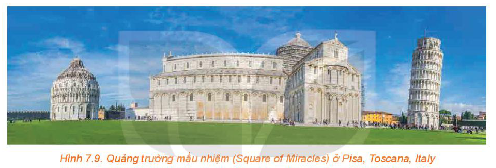
*Hình 7.9. Quảng trường mầu nhiệm (Square of Miracles) ở Pisa, Toscana, Italy*

Hầu hết các công trình kiến trúc đều được xây dựng theo phương thẳng đứng để có thế vững chãi, mặc dù vậy, cũng có những công trình có phương nghiêng. Nếu đứng tại Quảng trường mầu nhiệm ở Pisa (H.7.9), bằng mắt thường, ta có thể cảm nhận rằng tháp ngoài cùng bên phải trong hình là nghiêng và các công trình còn lại đều thẳng đứng. Sau bài học, ta có thể diễn giải chính xác và bản chất hơn về điều này.

## 1. ĐƯỜNG THẲNG VUÔNG GÓC VỚI MẶT PHẲNG

**HĐ1:** Đối với cánh cửa như trong Hình 7.10, khi đóng – mở cánh cửa, ta coi mép dưới $BC$ của cánh cửa luôn sát sàn nhà (khe hở không đáng kể).

a) Từ quan sát trên, hãy giải thích vì sao đường thẳng $AB$ vuông góc với mọi đường thẳng đi qua $B$ trên sàn nhà.

b) Giải thích vì sao đường thẳng $AB$ vuông góc với mọi đường thẳng trên sàn nhà.

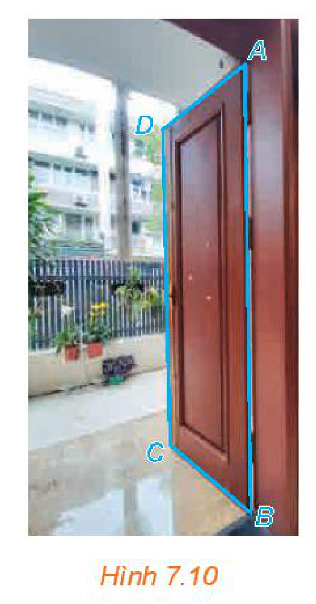
*Hình 7.10*

> Đường thẳng $\Delta$ được gọi là **vuông góc** với mặt phẳng $(P)$ nếu $\Delta$ vuông góc với mọi đường thẳng nằm trong $(P)$.

<!-- pdf:33 -->

**Chú ý:** Khi $\Delta$ vuông góc với $(P)$, ta còn nói $(P)$ vuông góc với $\Delta$ hoặc $\Delta$ và $(P)$ vuông góc với nhau, kí hiệu $\Delta \perp (P)$.
<!-- ocr-ok: kí hiệu đường thẳng và mặt phẳng vuông góc bị OCR đọc lệch, đã đối chiếu ảnh -->

**Câu hỏi:** Nếu đường thẳng $\Delta$ và mặt phẳng $(P)$ vuông góc với nhau thì chúng có cắt nhau hay không?

**HĐ2:** Gấp tấm bìa cứng hình chữ nhật sao cho nếp gấp chia tấm bìa thành hai hình chữ nhật, sau đó đặt nó lên mặt bàn như Hình 7.11.

a) Bằng cách trên, ta tạo được đường thẳng $AB$ vuông góc với hai đường thẳng nào thuộc mặt bàn?

b) Trên mặt bàn, qua điểm $A$ kẻ một đường thẳng $a$ tuỳ ý. Dùng ê ke, hãy kiểm tra trên mô hình xem $AB$ có vuông góc với $a$ hay không.

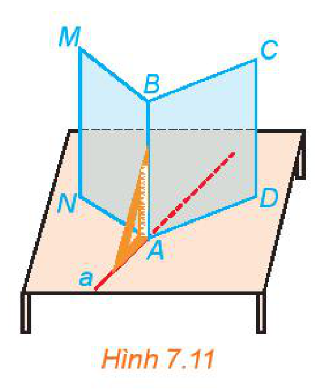
*Hình 7.11*

Người ta chứng minh được rằng:

<!-- term: Điều kiện để đường thẳng vuông góc với mặt phẳng -->
> Nếu một đường thẳng vuông góc với hai đường thẳng cắt nhau thuộc cùng một mặt phẳng thì nó vuông góc với mặt phẳng đó.

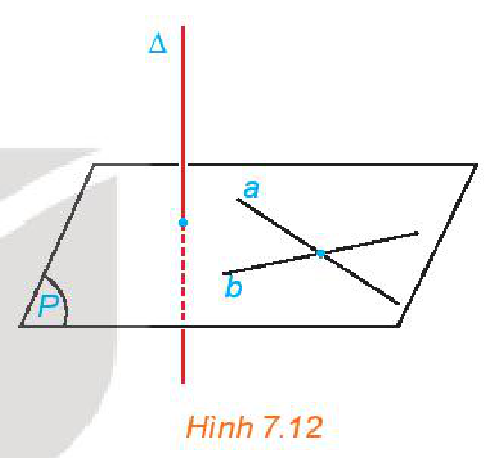
*Hình 7.12*

**Câu hỏi:** Nếu một đường thẳng vuông góc với hai cạnh của một tam giác thì đường thẳng đó có vuông góc với cạnh còn lại hay không?

**Ví dụ 1:** Cho hình chóp $S.ABC$ có đáy là tam giác $ABC$ vuông tại $B$ và cạnh $SA$ vuông góc với các cạnh $AB, AC$. Chứng minh rằng $BC \perp (SAB)$.

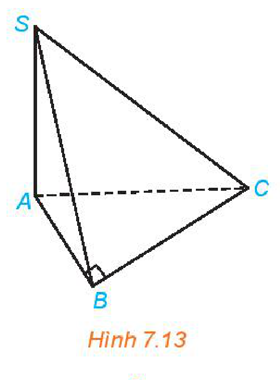
*Hình 7.13*

**Giải:** (H.7.13)

Vì $SA$ vuông góc với hai đường thẳng $AB$ và $AC$ nên $SA \perp (ABC)$. Suy ra $SA \perp BC$.
<!-- ocr-ok: kí hiệu vuông góc bị OCR đọc lệch, đã đối chiếu ảnh -->

Tam giác $ABC$ vuông tại $B$ nên $BC \perp BA$.
<!-- ocr-ok: kí hiệu vuông góc bị OCR đọc lệch, đã đối chiếu ảnh -->

Vì $BC$ vuông góc với hai đường thẳng $SA$ và $BA$ nên $BC \perp (SAB)$.
<!-- ocr-ok: kí hiệu vuông góc bị OCR đọc lệch, đã đối chiếu ảnh -->

**Luyện tập 1:** Cho hình chóp $S.ABCD$ có đáy $ABCD$ là hình bình hành tâm $O$, $SA = SC$ và $SB = SD$ (H.7.14). Chứng minh rằng $SO \perp (ABCD)$.

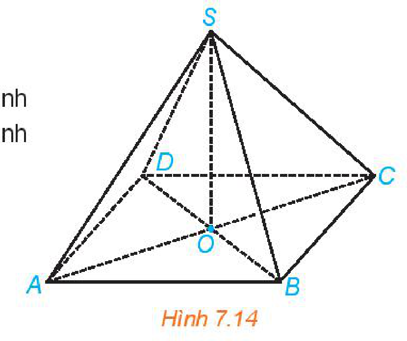
*Hình 7.14*

<!-- pdf:34 -->

**Vận dụng:** Khi làm cột treo quần áo, ta có thể tạo hai thanh đế thẳng đặt dưới sàn nhà và dựng cột treo vuông góc với hai thanh đế đó (H.7.15). Hãy giải thích vì sao bằng cách đó ta có được cột treo vuông góc với sàn nhà.

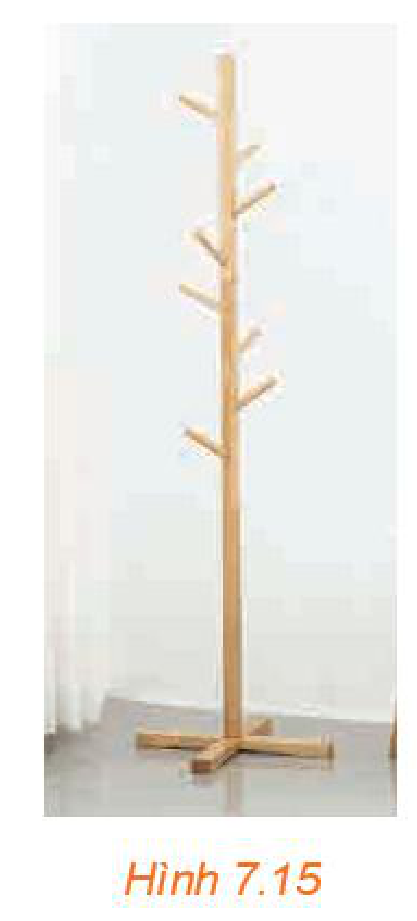
*Hình 7.15*

## 2. TÍNH CHẤT

**HĐ3:** Cho điểm $O$ và đường thẳng $\Delta$ không đi qua $O$. Gọi $d$ là đường thẳng đi qua $O$ và song song với $\Delta$. Xét hai mặt phẳng phân biệt tuỳ ý $(P)$ và $(Q)$ cùng chứa $d$. Trong các mặt phẳng $(P), (Q)$ tương ứng kẻ các đường thẳng $a, b$ cùng đi qua $O$ và vuông góc với $d$ (H.7.16). Giải thích vì sao $\text{mp}(a, b)$ đi qua $O$ và vuông góc với $\Delta$.

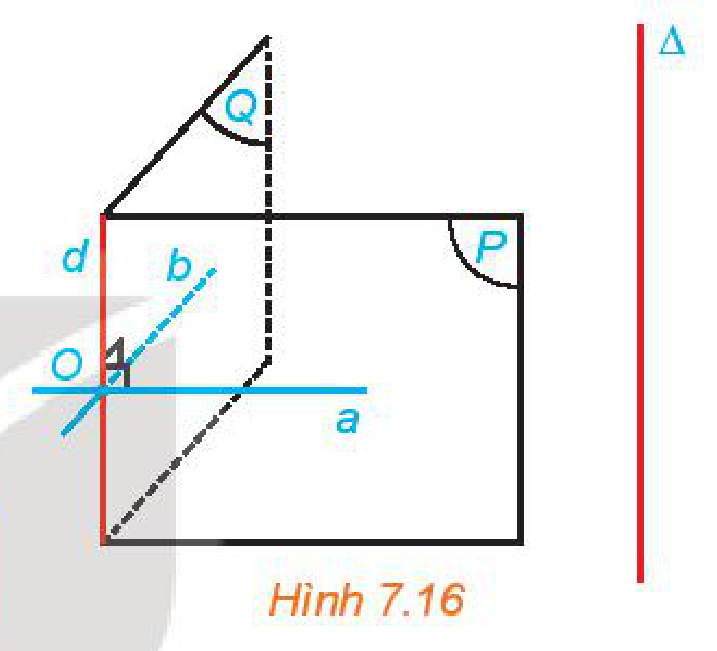
*Hình 7.16*

> Có duy nhất một mặt phẳng đi qua một điểm cho trước và vuông góc với một đường thẳng cho trước.

**Nhận xét:** Nếu ba đường thẳng đôi một phân biệt $a, b, c$ cùng đi qua một điểm $O$ và cùng vuông góc với một đường thẳng $\Delta$ thì ba đường thẳng đó cùng nằm trong mặt phẳng đi qua $O$ và vuông góc với $\Delta$ (H.7.17).

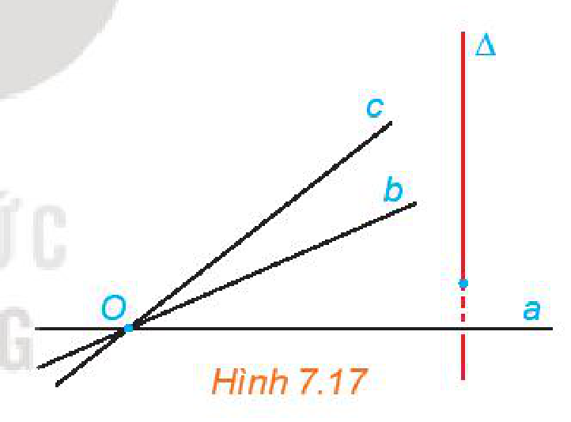
*Hình 7.17*

**Ví dụ 2:** Chứng minh rằng điểm $M$ cách đều hai điểm phân biệt $A, B$ cho trước khi và chỉ khi $M$ thuộc mặt phẳng đi qua trung điểm của đoạn thẳng $AB$ và vuông góc với đường thẳng $AB$.

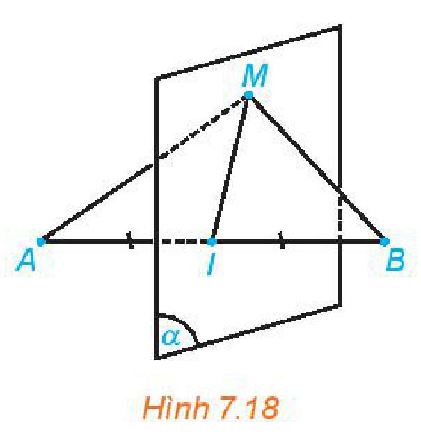
*Hình 7.18*

**Giải:** (H.7.18)

Gọi $(\alpha)$ là mặt phẳng đi qua trung điểm $I$ của đoạn thẳng $AB$ và vuông góc với đường thẳng $AB$. Ta có $MA = MB$ khi và chỉ khi $M$ trùng $I$ hoặc tam giác $MAB$ cân tại $M$. Mặt khác, $\triangle MAB$ cân tại $M$ khi và chỉ khi $MI \perp AB$, tức là $M$ thuộc mặt phẳng $(\alpha)$. Do đó, $MA = MB$ khi và chỉ khi $M$ thuộc $(\alpha)$.

**Chú ý:** Mặt phẳng đi qua trung điểm của đoạn thẳng $AB$ và vuông góc với đường thẳng $AB$ được gọi là **mặt phẳng trung trực** của đoạn thẳng $AB$. Mặt phẳng trung trực của đoạn thẳng $AB$ là tập hợp các điểm cách đều hai điểm $A, B$.

<!-- pdf:35 -->

**HĐ4:** Cho mặt phẳng $(P)$ và điểm $O$. Trong mặt phẳng $(P)$, lấy hai đường thẳng cắt nhau $a, b$ tuỳ ý. Gọi $(\alpha), (\beta)$ là các mặt phẳng qua $O$ và tương ứng vuông góc với $a, b$ (H.7.19).

a) Giải thích vì sao hai mặt phẳng $(\alpha), (\beta)$ cắt nhau theo một đường thẳng đi qua $O$.

b) Nêu nhận xét về mối quan hệ giữa $\Delta$ và $(P)$.

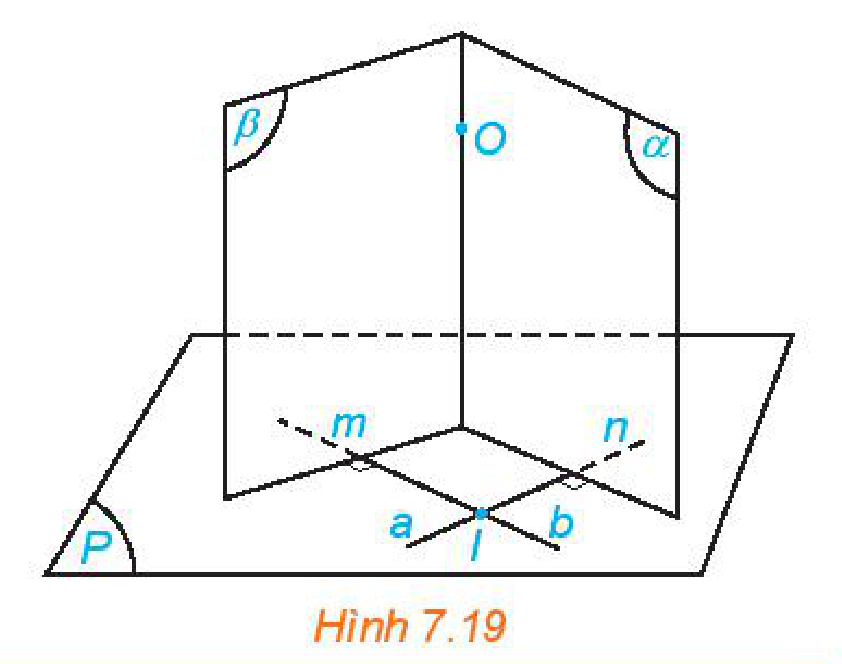
*Hình 7.19*

> Có duy nhất một đường thẳng đi qua một điểm cho trước và vuông góc với một mặt phẳng cho trước.

**Luyện tập 2:** Cho ba điểm phân biệt $A, B, C$ sao cho các đường thẳng $AB$ và $AC$ cùng vuông góc với một mặt phẳng $(P)$. Chứng minh rằng ba điểm $A, B, C$ thẳng hàng.

**Ví dụ 3:** Cho điểm $A$ nằm ngoài mặt phẳng $(P)$. Giải thích vì sao có duy nhất điểm $H$ thuộc $(P)$ sao cho đường thẳng $AH$ vuông góc với $(P)$.

**Giải:**

Gọi $a$ là đường thẳng đi qua $A$ và vuông góc với mặt phẳng $(P)$. Lấy điểm $H$ thuộc $(P)$. Khi đó, đường thẳng $AH$ vuông góc với $(P)$ khi và chỉ khi $AH$ trùng với $a$, tức là $H$ là giao điểm của $a$ và $(P)$. Vậy có duy nhất điểm $H$ thuộc $(P)$ để $AH$ vuông góc với $(P)$, đó là giao điểm của $a$ với $(P)$.

## 3. LIÊN HỆ GIỮA QUAN HỆ SONG SONG VÀ QUAN HỆ VUÔNG GÓC CỦA ĐƯỜNG THẲNG VÀ MẶT PHẲNG

Nội dung của mục này nhằm củng cố kiến thức và kĩ năng đã học ở hai mục trên. Ngoài ra, từ đó có thể rút ra các tính chất về mối liên hệ giữa quan hệ song song và quan hệ vuông góc của đường thẳng và mặt phẳng.

**HĐ5:** Cho đường thẳng $a$ vuông góc với mặt phẳng $(P)$ và song song với đường thẳng $b$. Lấy một đường thẳng $m$ bất kì thuộc mặt phẳng $(P)$. Tính $(b, m)$ và từ đó rút ra mối quan hệ giữa $b$ và $(P)$.
<!-- ocr-ok: kí hiệu góc và mặt phẳng bị OCR đọc lệch, đã đối chiếu ảnh -->

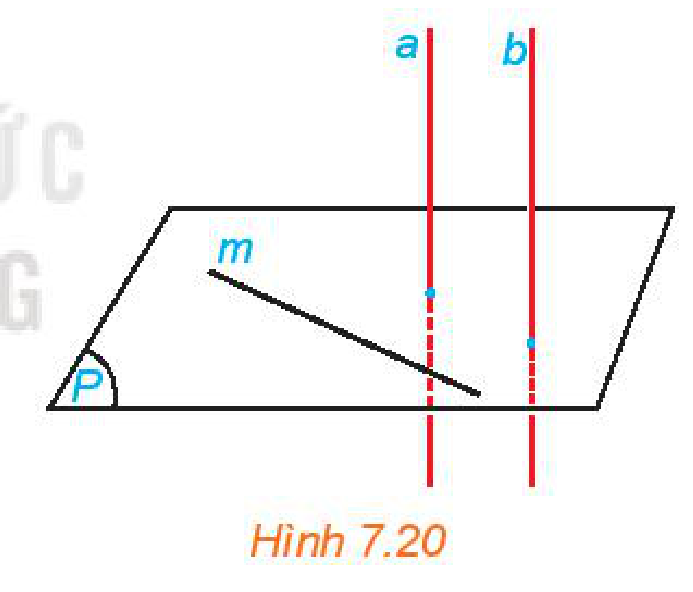
*Hình 7.20*

**HĐ6:** Cho hai đường thẳng phân biệt $a$ và $b$ cùng vuông góc với mặt phẳng $(P)$. Xét $O$ là một điểm thuộc $a$ nhưng không thuộc $b$. Gọi $c$ là đường thẳng qua $O$ và song song với $b$.

a) Hỏi $c$ có vuông góc với $(P)$ hay không? Nêu nhận xét về vị trí tương đối giữa $a$ và $c$.

b) Nêu nhận xét về vị trí tương đối giữa hai đường thẳng $a$ và $b$.

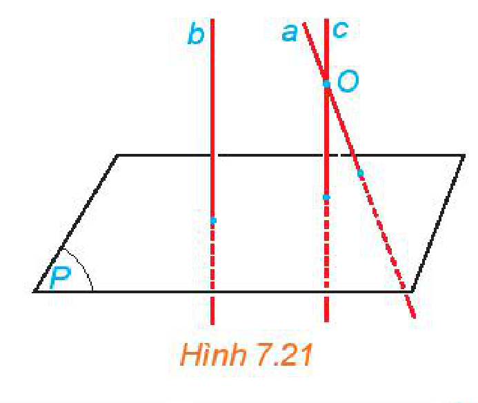
*Hình 7.21*

> - Nếu đường thẳng $a$ vuông góc với mặt phẳng $(P)$ thì các đường thẳng song song với $a$ cũng vuông góc với $(P)$.
> - Hai đường thẳng phân biệt cùng vuông góc với một mặt phẳng thì song song với nhau.

<!-- pdf:36 -->

**Ví dụ 4:** Cho tứ diện $OABC$ có các cạnh $OA, OB, OC$ tương ứng vuông góc với nhau. Gọi $M, N$ tương ứng là trọng tâm của các tam giác $ABC, OBC$. Chứng minh rằng đường thẳng $MN$ vuông góc với mặt phẳng $(OBC)$.

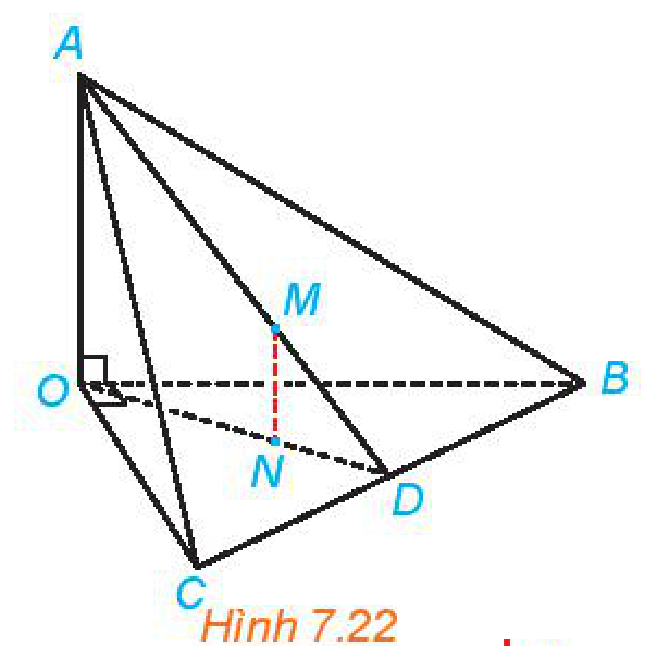
*Hình 7.22*

**Giải:** (H.7.22)

Vì $AO$ vuông góc với các đường thẳng $OB, OC$ nên $AO \perp (OBC)$. Kẻ các đường trung tuyến $AD, OD$ tương ứng của các tam giác $ABC, OBC$.

Ta có $\dfrac{MA}{MD} = 2 = \dfrac{NO}{ND}$. Do đó, $MN$ song song với $AO$.

Mặt khác, $AO \perp (OBC)$ nên $MN \perp (OBC)$.

**HĐ7:** Cho hai mặt phẳng $(P)$ và $(Q)$ song song với nhau và đường thẳng $\Delta$ vuông góc với $(P)$. Gọi $b$ là một đường thẳng bất kì thuộc $(Q)$. Lấy một đường thẳng $a$ thuộc $(P)$ sao cho $a$ song song với $b$ (H.7.23). So sánh $(\Delta, b)$ và $(\Delta, a)$. Từ đó rút ra mối quan hệ giữa $\Delta$ và $(Q)$.
<!-- ocr-ok: kí hiệu Delta và mặt phẳng bị OCR đọc lệch, đã đối chiếu ảnh -->

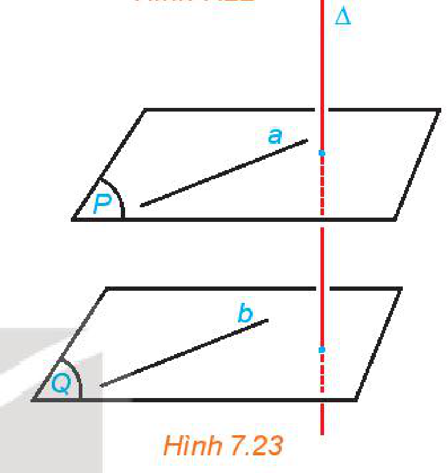
*Hình 7.23*

**HĐ8:** Cho hai mặt phẳng phân biệt $(P)$ và $(Q)$ cùng vuông góc với đường thẳng $\Delta$. Xét $O$ là một điểm thuộc mặt phẳng $(P)$ nhưng không thuộc mặt phẳng $(Q)$. Gọi $(R)$ là mặt phẳng đi qua $O$ và song song với $(Q)$ (H.7.24).

a) Hỏi $(R)$ có vuông góc với $\Delta$ hay không? Nêu nhận xét về vị trí tương đối giữa $(P)$ và $(R)$.

b) Nêu vị trí tương đối giữa $(P)$ và $(Q)$.

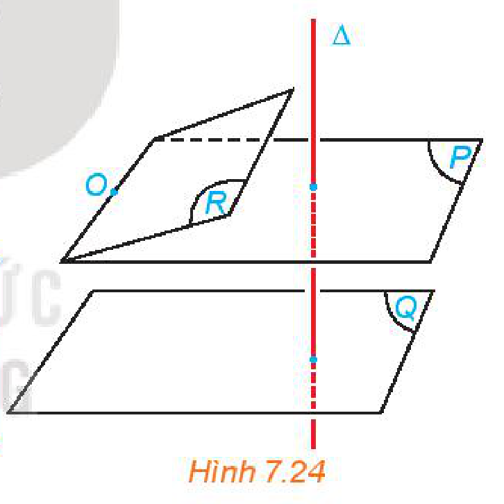
*Hình 7.24*

> - Nếu đường thẳng $\Delta$ vuông góc với mặt phẳng $(P)$ thì $\Delta$ cũng vuông góc với các mặt phẳng song song với $(P)$.
> - Hai mặt phẳng phân biệt cùng vuông góc với một đường thẳng thì song song với nhau.

**Ví dụ 5:** Cho hình chóp $S.ABC$. Các điểm $M, N, P$ tương ứng là trung điểm của $SA, SB, SC$. Đường thẳng qua $S$ vuông góc với mặt phẳng $(ABC)$ và cắt mặt phẳng đó tại $H$. Chứng minh rằng $SH \perp (MNP)$.

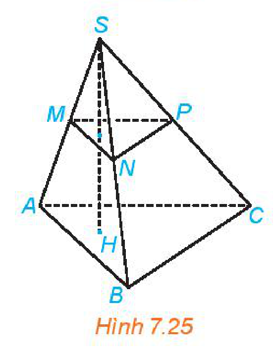
*Hình 7.25*

**Giải:** (H.7.25)

Do $MN \parallel AB, MP \parallel AC$ nên $(MNP) \parallel (ABC)$.

Mặt khác, $SH \perp (ABC)$. Do đó $SH \perp (MNP)$.

**Luyện tập 2:** Một chiếc bàn có các chân cùng vuông góc với mặt phẳng chứa mặt bàn và mặt phẳng chứa mặt sàn. Hỏi hai mặt phẳng đó có song song với nhau hay không? Vì sao?

**HĐ9:** Cho đường thẳng $a$ song song với mặt phẳng $(P)$ và đường thẳng $\Delta$ vuông góc với mặt phẳng $(P)$. Tính $(\Delta, a)$.

<!-- pdf:37 -->

**HĐ10:** Cho đường thẳng $a$ và mặt phẳng $(P)$ cùng vuông góc với một đường thẳng $\Delta$.

a) Qua một điểm $O$ thuộc $(P)$, kẻ đường thẳng $a'$ song song với $a$. Nêu vị trí tương đối giữa $a'$ và $(P)$.

b) Nêu vị trí tương đối giữa $a$ và $(P)$.

> - Nếu đường thẳng $\Delta$ vuông góc với mặt phẳng $(P)$ thì $\Delta$ vuông góc với mọi đường thẳng song song với $(P)$.
> - Nếu đường thẳng $a$ và mặt phẳng $(P)$ cùng vuông góc với một đường thẳng $\Delta$ thì $a$ nằm trong $(P)$ hoặc song song với $(P)$.

**Ví dụ 6:** Cho hình chóp $S.ABCD$ có đáy $ABCD$ là một hình vuông, $SA \perp (ABCD)$. Gọi $M, N$ tương ứng là trung điểm của $SB, BC$. Chứng minh rằng $BD \perp MN$.

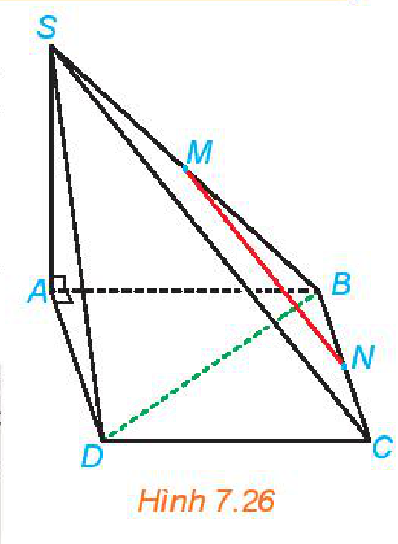
*Hình 7.26*

**Giải:** (H.7.26)

Do $SA \perp (ABCD)$ nên $BD \perp SA$. Mặt khác, $BD \perp AC$ nên $BD \perp (SAC)$.
<!-- ocr-ok: kí hiệu vuông góc bị OCR đọc lệch, đã đối chiếu ảnh -->

Ta lại có $MN \parallel SC$ nên $MN \parallel (SAC)$. Do đó $BD \perp MN$.
<!-- ocr-ok: kí hiệu song song và vuông góc bị OCR đọc lệch, đã đối chiếu ảnh -->

**Luyện tập 4:** Cho hình chóp $S.ABCD$ có đáy $ABCD$ là một hình vuông, $SA \perp (ABCD)$. Kẻ $AH$ vuông góc với $SC$ ($H$ thuộc $SC$), $BM$ vuông góc với $SC$ ($M$ thuộc $SC$). Chứng minh rằng $SC \perp (MBD)$ và $AH \parallel (MBD)$.

## ✏️ Bài tập

**7.5.** Cho hình chóp $S.ABC$ có đáy là tam giác cân tại $A$ và $SA \perp (ABC)$. Gọi $M$ là trung điểm của $BC$. Chứng minh rằng:

a) $BC \perp (SAM)$;

b) Tam giác $SBC$ cân tại $S$.

**7.6.** Cho hình chóp $S.ABCD$ có đáy $ABCD$ là hình chữ nhật và $SA \perp (ABCD)$.

Chứng minh rằng các mặt bên của hình chóp $S.ABCD$ là các tam giác vuông.

**7.7.** Cho hình chóp $S.ABCD$ có đáy là hình chữ nhật và $SA \perp (ABCD)$. Gọi $M, N$ tương ứng là hình chiếu của $A$ trên $SB, SD$. Chứng minh rằng:
<!-- ocr-ok: kí hiệu vuông góc bị OCR đọc lệch, đã đối chiếu ảnh -->

$$AM \perp (SBC), \quad AN \perp (SCD), \quad SC \perp (AMN).$$
<!-- ocr-ok: công thức chứng minh vuông góc bị OCR đọc lệch, đã đối chiếu ảnh -->

**7.8.** Bạn Vinh thả quả dọi chìm vào thùng nước. Hỏi khi dây dọi căng và mặt nước yên lặng thì đường thẳng chứa dây dọi có vuông góc với mặt phẳng chứa mặt nước trong thùng hay không?

**7.9.** Một cột bóng rổ được dựng trên một sân phẳng. Bạn Hùng đo khoảng cách từ một điểm trên sân, cách chân cột $1\text{ m}$ đến một điểm trên cột, cách chân cột $1\text{ m}$ được kết quả là $1,5\text{ m}$ (H.7.27). Nếu phép đo của Hùng là chính xác thì cột có vuông góc với sân hay không? Có thể kết luận rằng cột không có phương thẳng đứng hay không?

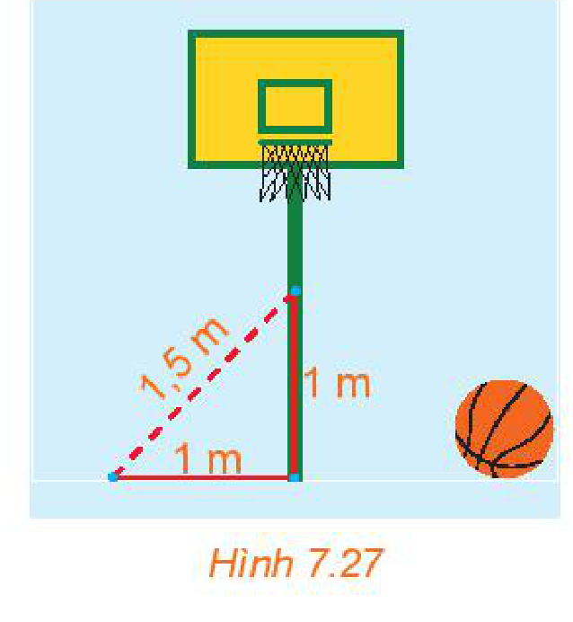
*Hình 7.27*

<!-- pdf:38 -->

## 💡 Em có biết?

**Phương thẳng đứng** là phương đi qua tâm Trái Đất. Để xác định phương thẳng đứng đi qua một điểm, người ta thường dùng cách thả dây dọi từ điểm đó (H.7.28). Do quả dọi chịu lực hút hướng về tâm Trái Đất nên đường thẳng chứa dây dọi khi đó chính là phương thẳng đứng cần xác định.

Trong xây dựng, để có thế vững chãi, các công trình kiến trúc thường được thiết kế với chiều cao có phương thẳng đứng. Trong khi xây, người thợ thường dùng dây dọi để đảm bảo các bức tường chứa phương thẳng đứng. Đặc biệt, đường giao nhau của hai bức tường có phương thẳng đứng (H.7.28).

Nếu công trình kiến trúc không thẳng đứng thì ta nói nó nghiêng, chẳng hạn tháp Pisa ở Italy là nghiêng và thường được gọi là Tháp nghiêng Pisa.

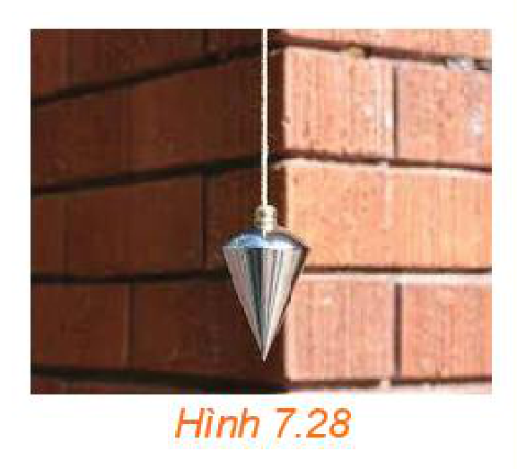
*Hình 7.28*

**Mặt phẳng nằm ngang** tại một điểm là mặt phẳng vuông góc với phương thẳng đứng tại điểm đó. **Phương nằm ngang** tại một điểm là phương đi qua điểm đó và thuộc mặt phẳng nằm ngang tại đó.

Mặt nước (trong chậu, trong hồ,...) lúc yên lặng là một mặt phẳng nằm ngang. Dựa vào nguyên tắc bình thông nhau, trong thực tế người ta thường dùng ống nhựa mềm chứa nước bên trong để xác định phương nằm ngang: Đường thẳng nối hai điểm $A, B$ có phương nằm ngang khi có thể điều chỉnh hai đầu dây để mực nước trong hai đầu của dây tương ứng ở hai vị trí $A$ và $B$ (H.7.29).

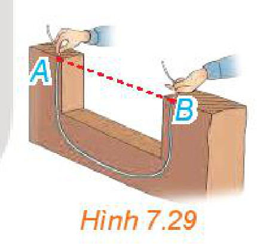
*Hình 7.29*

Khi công trình kiến trúc được xây dựng trên một mặt phẳng nằm ngang thì bằng mắt thường ta có thể cảm nhận được tương đối chính xác công trình đó là đứng hay nghiêng. Tuy vậy, nếu công trình được xây dựng trên một nền không có phương nằm ngang thì việc nhận biết bằng mắt thường sẽ khó khăn hơn.

Sàn nhà thường được thiết kế có phương nằm ngang. Tuy vậy, cũng có một số ngoại lệ, chẳng hạn, để dễ dàng thoát nước, sàn nhà tắm, sân,... thường được làm nghiêng.

*Hình 7.30. Mặc dù nằm trên dốc núi, các ruộng bậc thang đều được thiết kế theo các mặt phẳng nằm ngang nhằm giữ nước.*

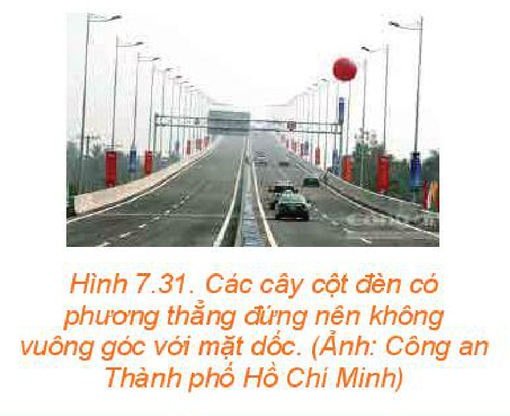
*Hình 7.31. Các cây cột đèn có phương thẳng đứng nên không vuông góc với mặt dốc. (Ảnh: Công an Thành phố Hồ Chí Minh)*

## 📷 Danh sách hình trong bài

| Mã hình | Trang PDF | Vị trí trong bài | Chú thích gốc |
| --- | :---: | --- | --- |
| H11-toan-b23-01 | 32 | Mở đầu | Hình 7.9. Quảng trường mầu nhiệm (Square of Miracles) ở Pisa, Toscana, Italy |
| H11-toan-b23-02 | 32 | Mục 1, HĐ1 | Hình 7.10 |
| H11-toan-b23-03 | 33 | Mục 1, HĐ2 | Hình 7.11 |
| H11-toan-b23-04 | 33 | Mục 1 | Hình 7.12 |
| H11-toan-b23-05 | 33 | Mục 1, Ví dụ 1 | Hình 7.13 |
| H11-toan-b23-06 | 33 | Mục 1, Luyện tập 1 | Hình 7.14 |
| H11-toan-b23-07 | 34 | Mục 1, Vận dụng | Hình 7.15 |
| H11-toan-b23-08 | 34 | Mục 2, HĐ3 | Hình 7.16 |
| H11-toan-b23-09 | 34 | Mục 2, Nhận xét | Hình 7.17 |
| H11-toan-b23-10 | 34 | Mục 2, Ví dụ 2 | Hình 7.18 |
| H11-toan-b23-11 | 35 | Mục 2, HĐ4 | Hình 7.19 |
| H11-toan-b23-12 | 35 | Mục 3, HĐ5 | Hình 7.20 |
| H11-toan-b23-13 | 35 | Mục 3, HĐ6 | Hình 7.21 |
| H11-toan-b23-14 | 36 | Mục 3, Ví dụ 4 | Hình 7.22 |
| H11-toan-b23-15 | 36 | Mục 3, HĐ7 | Hình 7.23 |
| H11-toan-b23-16 | 36 | Mục 3, HĐ8 | Hình 7.24 |
| H11-toan-b23-17 | 36 | Mục 3, Ví dụ 5 | Hình 7.25 |
| H11-toan-b23-18 | 37 | Mục 3, Ví dụ 6 | Hình 7.26 |
| H11-toan-b23-19 | 37 | Bài tập 7.9 | Hình 7.27 |
| H11-toan-b23-20 | 38 | Em có biết? | Hình 7.28 |
| H11-toan-b23-21 | 38 | Em có biết? | Hình 7.29 |
| H11-toan-b23-22 | 38 | Em có biết? | Hình 7.30. Mặc dù nằm trên dốc núi, các ruộng bậc thang đều được thiết kế theo các mặt phẳng nằm ngang nhằm giữ nước. |
| H11-toan-b23-23 | 38 | Em có biết? | Hình 7.31. Các cây cột đèn có phương thẳng đứng nên không vuông góc với mặt dốc. (Ảnh: Công an Thành phố Hồ Chí Minh) |
