<!-- pdf:39 -->

# BÀI 24: PHÉP CHIẾU VUÔNG GÓC. GÓC GIỮA ĐƯỜNG THẲNG VÀ MẶT PHẲNG

## 🔤 Thuật ngữ

- Phép chiếu vuông góc
- Hình chiếu vuông góc
- Định lí ba đường vuông góc

## 🎯 Mục tiêu

- Nhận biết phép chiếu vuông góc.
- Xác định hình chiếu vuông góc của một điểm, một đường thẳng, một tam giác.
- Giải thích định lí ba đường vuông góc.
- Nhận biết và tính góc giữa đường thẳng và mặt phẳng trong một số trường hợp đơn giản.
- Vận dụng kiến thức về góc giữa đường thẳng và mặt phẳng để mô tả một số hình ảnh thực tế.

## 🔴 Mở đầu

Vào khoảng thời gian giữa mùa hè, ở phía bắc của vòng Bắc Cực (như một số vùng phía bắc của Na Uy, Phần Lan, Nga,...), Mặt Trời có thể được nhìn thấy trong suốt $24$ giờ của ngày. Hình học giải thích hiện tượng này như thế nào?

*Hình 7.32. Mặt Trời lúc nửa đêm tại Nordkapp, Na Uy.*

## 1. PHÉP CHIẾU VUÔNG GÓC

**HĐ1:** Trên sân phẳng có một cây cột thẳng vuông góc với mặt sân.

a) Dưới ánh sáng mặt trời, bóng của cây cột trên sân có thể được nhìn như là hình chiếu của cây cột qua một phép chiếu song song hay không?

b) Khi tia sáng mặt trời vuông góc với mặt sân, liệu ta có thể quan sát được bóng của cây cột trên sân hay không?

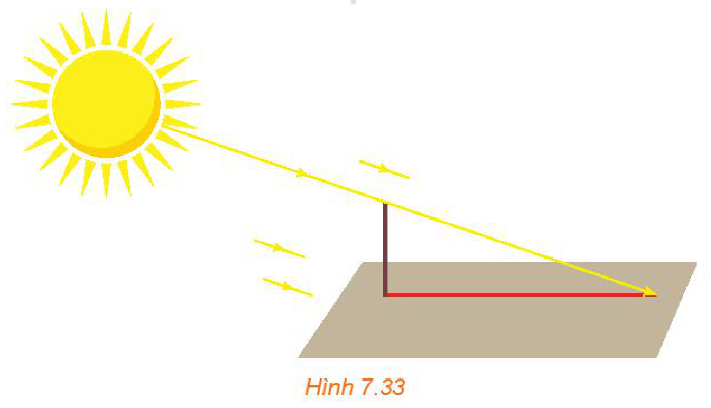
*Hình 7.33*

> Phép chiếu song song lên mặt phẳng $(P)$ theo phương $\Delta$ vuông góc với $(P)$ được gọi là **phép chiếu vuông góc** lên mặt phẳng $(P)$.

<!-- pdf:40 -->

**Chú ý:**

- Vì phép chiếu vuông góc lên một mặt phẳng là một trường hợp đặc biệt của phép chiếu song song nên nó có mọi tính chất của phép chiếu song song.
- Phép chiếu vuông góc lên mặt phẳng $(P)$ còn được gọi đơn giản là phép chiếu lên mặt phẳng $(P)$. **Hình chiếu vuông góc** $\mathcal{H}'$ của hình $\mathcal{H}$ trên mặt phẳng $(P)$ còn được gọi là **hình chiếu** của $\mathcal{H}$ trên mặt phẳng $(P)$.

**Câu hỏi:**

a) Nếu $A$ là một điểm không thuộc mặt phẳng $(P)$ và $A'$ là hình chiếu của $A$ trên $(P)$ thì đường thẳng $AA'$ có quan hệ gì với mặt phẳng $(P)$?

b) Nếu đường thẳng $a$ vuông góc với mặt phẳng $(P)$ thì hình chiếu của $a$ trên $(P)$ là gì?

**HĐ2:** Cho đường thẳng $a$ và mặt phẳng $(P)$ không vuông góc với nhau. Xét $b$ là một đường thẳng nằm trong $(P)$. Trên $a$, lấy hai điểm $M, N$ tuỳ ý. Gọi $M', N'$ tương ứng là hình chiếu của $M, N$ trên mặt phẳng $(P)$ (H.7.34).

a) Hình chiếu của $a$ trên mặt phẳng $(P)$ là đường thẳng nào?

b) Nếu $b$ vuông góc với $M'N'$ thì $b$ có vuông góc với $a$ hay không?
<!-- ocr-ok: kí hiệu đoạn thẳng M'N' bị OCR đọc lệch, đã đối chiếu ảnh -->

c) Nếu $b$ vuông góc với $a$ thì $b$ có vuông góc với $M'N'$ hay không?
<!-- ocr-ok: kí hiệu đoạn thẳng M'N' bị OCR đọc lệch, đã đối chiếu ảnh -->

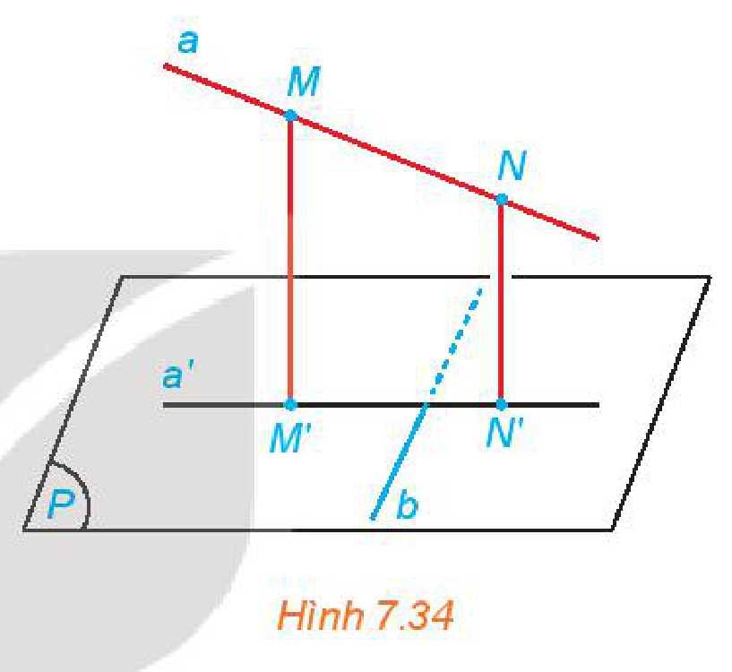
*Hình 7.34*

> **Định lí ba đường vuông góc:**
> Cho đường thẳng $a$ và mặt phẳng $(P)$ không vuông góc với nhau. Khi đó, một đường thẳng $b$ nằm trong mặt phẳng $(P)$ vuông góc với đường thẳng $a$ khi và chỉ khi $b$ vuông góc với hình chiếu vuông góc $a'$ của $a$ trên $(P)$.

> 💡 Định lí ba đường vuông góc cho phép chuyển việc kiểm tra tính vuông góc giữa $a$ và $b$ (có thể chéo nhau) sang kiểm tra tính vuông góc giữa $b$ và $a'$ (cùng thuộc mặt phẳng $(P)$).

**Ví dụ 1:** Trên một sân phẳng nằm ngang, tại các điểm $A, B, C, D$, người ta dựng các cột thẳng đứng $AM, BN, CP, DQ$ và nối các sợi dây thẳng giữa $M$ và $P$, $N$ và $Q$ như Hình 7.35.

a) Hãy chỉ ra hình chiếu của các dây $MP$ và $NQ$ trên sân.

b) Chứng minh rằng nếu $BD \perp AC$ thì $BD \perp MP$.

c) Chứng minh rằng nếu $ABCD$ là một hình bình hành thì các trung điểm $E, F$ tương ứng của các đoạn thẳng $MP$ và $NQ$ có cùng hình chiếu trên sân.

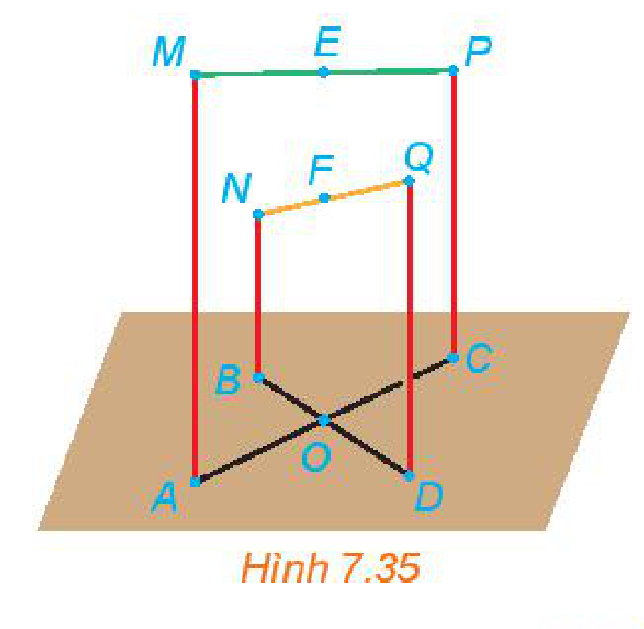
*Hình 7.35*

<!-- pdf:41 -->

**Giải:**

a) Do các cột có phương thẳng đứng và sân thuộc mặt phẳng nằm ngang nên các cột vuông góc với sân. Vậy $A, B, C, D$ tương ứng là hình chiếu của $M, N, P, Q$ trên sân. Do đó $AC, BD$ tương ứng là hình chiếu của $MP, NQ$ trên sân.

b) Nếu $BD \perp AC$, mà $AC$ là hình chiếu của $MP$ trên sân và $BD$ thuộc sân nên theo định lí ba đường vuông góc ta có $BD \perp MP$.

c) Nếu $ABCD$ là một hình bình hành thì các đoạn thẳng $AC, BD$ có chung trung điểm $O$. Do $EO$ là đường trung bình của hình thang $ACPM$ nên $EO \parallel MA$. Mặt khác, $MA$ vuông góc với sân nên $EO$ cũng vuông góc với sân. Vậy $O$ là hình chiếu của $E$ trên sân. Tương tự, $O$ cũng là hình chiếu của $F$ trên sân. Vậy $E$ và $F$ có cùng hình chiếu trên sân.

**Luyện tập 1:** Cho hình chóp $S.ABC$ có $SA = SB = SC$. Gọi $O$ là hình chiếu của $S$ trên mặt phẳng $(ABC)$ (H.7.36).

a) Chứng minh rằng $O$ là tâm đường tròn ngoại tiếp tam giác $ABC$.

b) Xác định hình chiếu của đường thẳng $SA$ trên mặt phẳng $(ABC)$.

c) Chứng minh rằng nếu $AO \perp BC$ thì $SA \perp BC$.

d) Xác định hình chiếu của các tam giác $SBC, SCA, SAB$ trên mặt phẳng $(ABC)$.

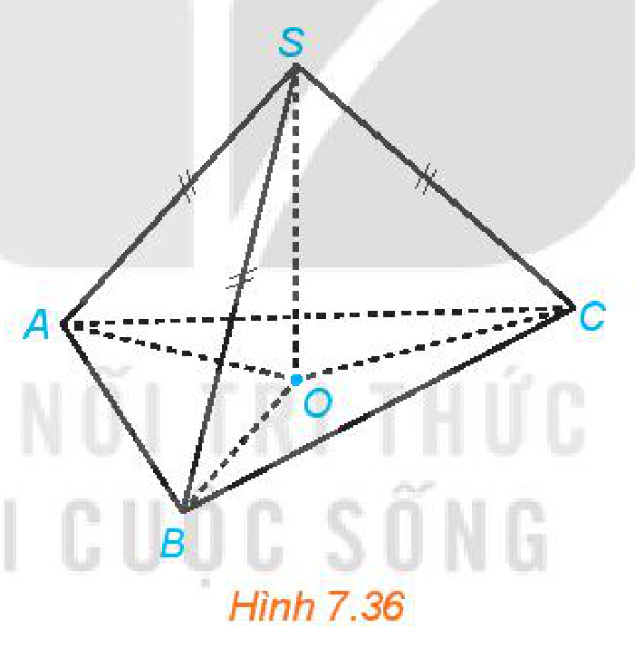
*Hình 7.36*

## 2. GÓC GIỮA ĐƯỜNG THẲNG VÀ MẶT PHẲNG

**HĐ3:** Một máy bay giữ vận tốc không đổi, với độ lớn $240\text{ km/h}$ trong suốt $2$ phút đầu kể từ khi cất cánh. Hỏi thông tin trên có đủ để ta xác định độ cao của máy bay so với mặt đất phẳng, tại thời điểm $1$ phút kể từ khi máy bay cất cánh không?

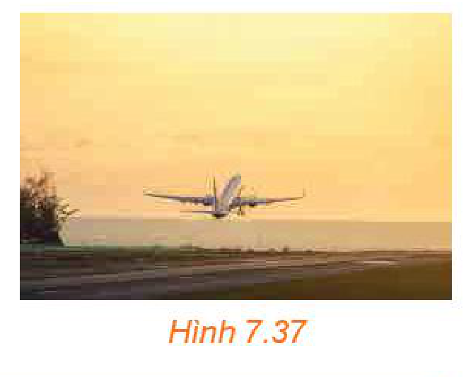
*Hình 7.37*

> Nếu đường thẳng $a$ vuông góc với mặt phẳng $(P)$ thì ta nói rằng **góc giữa đường thẳng $a$ và mặt phẳng $(P)$** bằng $90^\circ$.
> Nếu đường thẳng $a$ không vuông góc với mặt phẳng $(P)$ thì góc giữa $a$ và hình chiếu $a'$ của nó trên $(P)$ được gọi là góc giữa đường thẳng $a$ và mặt phẳng $(P)$.

<!-- pdf:42 -->

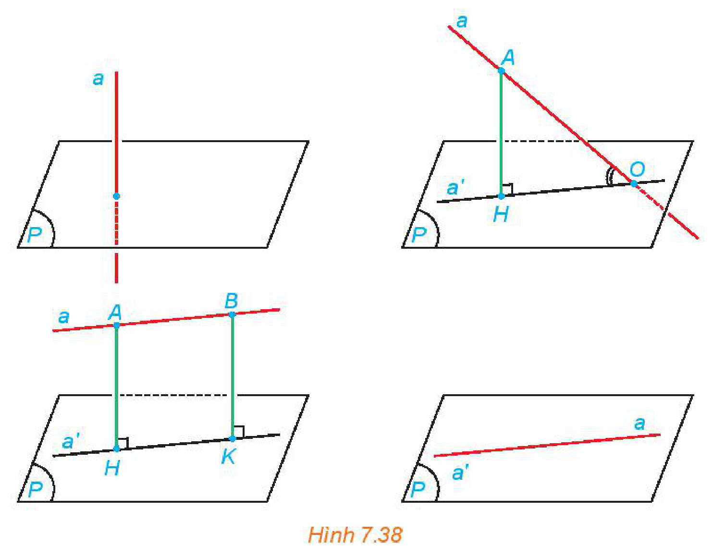
*Hình 7.38*

**Chú ý:** Nếu $\alpha$ là góc giữa đường thẳng $a$ và mặt phẳng $(P)$ thì $0 \le \alpha \le 90^\circ$.
<!-- ocr-ok: công thức bất đẳng thức góc alpha bị OCR đọc lệch, đã đối chiếu ảnh -->

**Nhận xét:** Cho điểm $A$ có hình chiếu $H$ trên mặt phẳng $(P)$. Lấy điểm $O$ thuộc mặt phẳng $(P)$, $O$ không trùng $H$. Khi đó góc giữa đường thẳng $AO$ và mặt phẳng $(P)$ bằng góc $AOH$ (H.7.39).
<!-- ocr-ok: kí hiệu mặt phẳng (P) và góc AOH bị OCR đọc lệch, đã đối chiếu ảnh -->

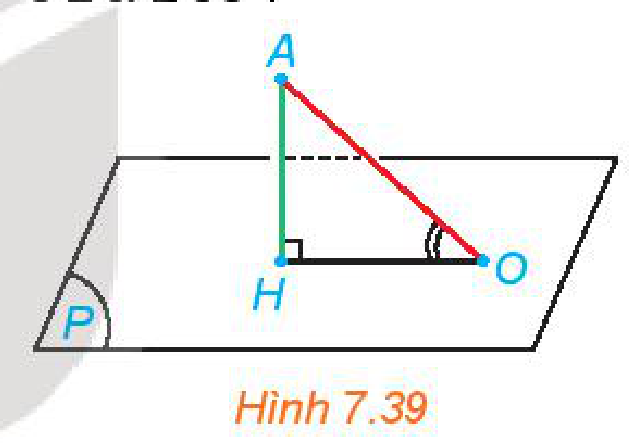
*Hình 7.39*

**Ví dụ 2:** Cho hình chóp $S.ABC$ có $SA \perp (ABC)$, $SA = a, CA = CB = a\sqrt{7}, AB = 2a$.

a) Gọi $\alpha$ là góc giữa $SB$ và $(ABC)$. Tính $\tan \alpha$.

b) Tính góc giữa $SC$ và $(SAB)$.

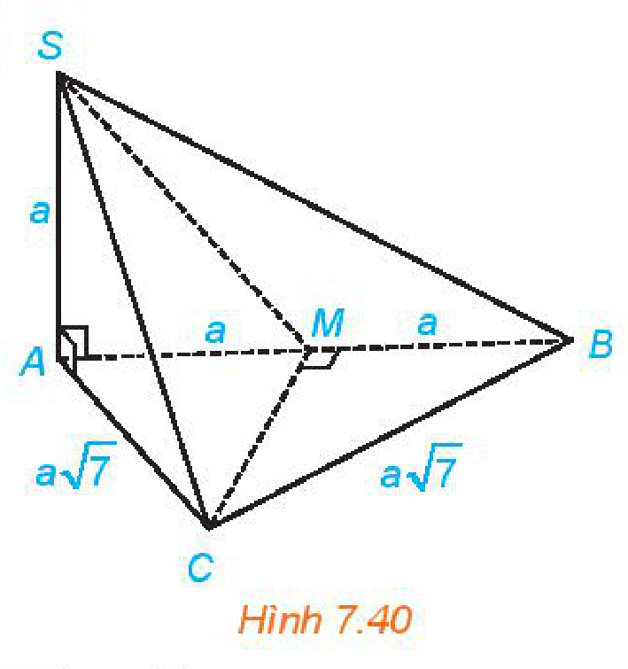
*Hình 7.40*

**Giải:** (H.7.40)

a) Do $SA \perp (ABC)$ nên $\alpha = \widehat{SBA}$. Tam giác $SAB$ vuông tại $A$ nên
<!-- ocr-ok: công thức góc SBA bị OCR đọc lệch, đã đối chiếu ảnh -->

$$\tan \alpha = \tan \widehat{SBA} = \dfrac{SA}{AB} = \dfrac{a}{2a} = \dfrac{1}{2}.$$
<!-- ocr-ok: công thức tan góc alpha bị OCR đọc lệch, đã đối chiếu ảnh -->

b) Gọi $M$ là trung điểm của $AB$. Tam giác $ABC$ cân tại $C$ nên $CM \perp AB$.

Mặt khác, từ $SA \perp (ABC)$ ta có $CM \perp SA$. Do đó $CM \perp (SAB)$.
<!-- ocr-ok: kí hiệu vuông góc bị OCR đọc lệch, đã đối chiếu ảnh -->

Vậy góc giữa $SC$ và $(SAB)$ bằng $\widehat{CSM}$.

Tam giác $SAC$ vuông tại $A$ nên $SC = \sqrt{SA^2 + AC^2} = \sqrt{a^2 + 7a^2} = a\sqrt{8}$.
<!-- ocr-ok: công thức căn thức SC bị OCR đọc lệch, đã đối chiếu ảnh -->

Ta có $AM = \dfrac{1}{2}AB = a$. Do đó, tam giác $SAM$ vuông cân tại $A$ và $SM = a\sqrt{2}$.

Tam giác $CMS$ vuông tại $M$ và $\cos \widehat{CSM} = \dfrac{SM}{SC} = \dfrac{a\sqrt{2}}{a\sqrt{8}} = \dfrac{1}{2}$.
<!-- ocr-ok: công thức cos góc CSM bị OCR đọc lệch, đã đối chiếu ảnh -->

Vậy $\widehat{CSM} = 60^\circ$ và do đó góc giữa $SC$ và $(SAB)$ bằng $60^\circ$.

<!-- pdf:43 -->

**Vận dụng:** Tâm Trái Đất chuyển động quanh Mặt Trời theo quỹ đạo là một đường elip nhận tâm Mặt Trời làm tiêu điểm. Trong quá trình chuyển động, Trái Đất lại quay quanh trục Bắc Nam. Trục này có phương không đổi và luôn tạo với mặt phẳng chứa quỹ đạo một góc khoảng $66,5^\circ$. *(Theo nationalgeographic.org)*.

a) Giải thích vì sao hình chiếu của trục Trái Đất trên mặt phẳng quỹ đạo $(P)$ cũng có phương không đổi.

b) Giải thích vì sao có hai thời điểm trong năm mà tại đó hình chiếu của trục Trái Đất trên mặt phẳng $(P)$ thuộc đường thẳng nối tâm Mặt Trời và tâm Trái Đất.

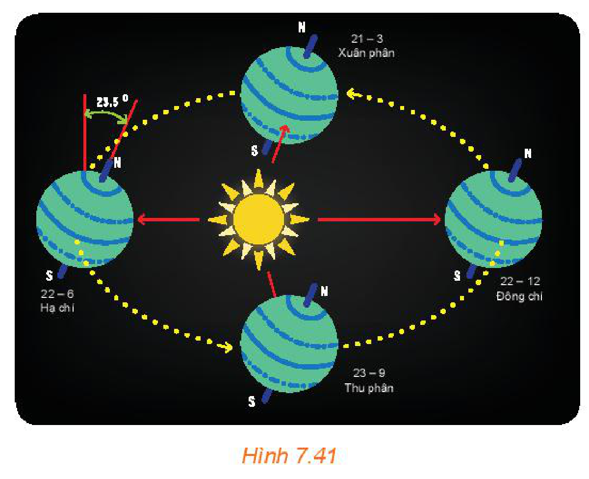
*Hình 7.41*

**Khám phá:** Cho đường thẳng $\Delta$ vuông góc với mặt phẳng $(P)$. Khi đó, với một đường thẳng $a$ bất kì, góc giữa $a$ và $(P)$ có mối quan hệ gì với góc giữa $a$ và $\Delta$?

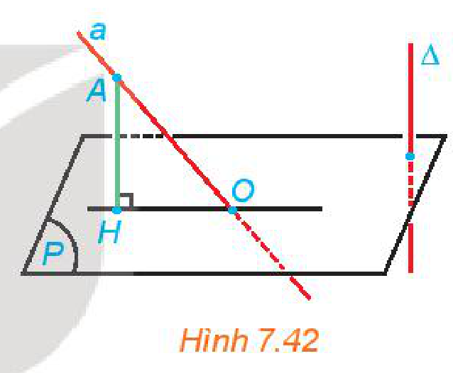
*Hình 7.42*

**Trải nghiệm:** Đo góc giữa một sợi dây kéo căng và mặt bàn hoặc sàn lớp học. (Có thể cho một đầu sợi dây thuộc mặt bàn, mặt sàn để thuận tiện hơn cho việc đo.)

## ✏️ Bài tập

**7.10.** Cho hình chóp $S.ABC$ có $SA \perp (ABC)$, tam giác $ABC$ vuông tại $B$.
<!-- ocr-ok: kí hiệu vuông góc bị OCR đọc lệch, đã đối chiếu ảnh -->

a) Xác định hình chiếu của điểm $S$ trên mặt phẳng $(ABC)$.

b) Xác định hình chiếu của tam giác $SBC$ trên mặt phẳng $(ABC)$.

c) Xác định hình chiếu của tam giác $SBC$ trên mặt phẳng $(SAB)$.

**7.11.** Cho hình chóp $S.ABCD$ có đáy là hình vuông $ABCD$ cạnh $a$, $SA \perp (ABCD)$ và $SA = a\sqrt{2}$.
<!-- ocr-ok: công thức SA = a căn 2 bị OCR đọc lệch, đã đối chiếu ảnh -->

a) Tính góc giữa $SC$ và mặt phẳng $(ABCD)$.

b) Tính góc giữa $BD$ và mặt phẳng $(SAC)$.

c) Tìm hình chiếu của $SB$ trên mặt phẳng $(SAC)$.

**7.12.** Cho hình chóp $S.ABC$ có $SA \perp (ABC)$, tam giác $ABC$ vuông tại $B$, $SA = AB = BC = a$.
<!-- ocr-ok: công thức độ dài cạnh bị OCR đọc lệch, đã đối chiếu ảnh -->

a) Xác định hình chiếu của $A$ trên mặt phẳng $(SBC)$.

b) Tính góc giữa $SC$ và mặt phẳng $(ABC)$.

<!-- pdf:44 -->

**7.13.** Cho điểm $S$ nằm ngoài mặt phẳng $(P)$, có hình chiếu $H$ trên $(P)$. Với mỗi điểm $M$ bất kì (không trùng $H$) trên mặt phẳng $(P)$, ta gọi đoạn thẳng $SM$ là đường xiên, đoạn thẳng $HM$ là hình chiếu trên $(P)$ của đường xiên đó. Chứng minh rằng:

a) Hai đường xiên $SM$ và $SM'$ bằng nhau khi và chỉ khi hai hình chiếu $HM, HM'$ tương ứng của chúng bằng nhau;

b) Đường xiên $SM$ lớn hơn đường xiên $SM'$ nếu hình chiếu $HM$ lớn hơn hình chiếu $HM'$.

**7.14.** Trong một khoảng thời gian đầu kể từ khi cất cánh, máy bay bay theo một đường thẳng. *Góc cất cánh* của nó là góc giữa đường thẳng đó và mặt phẳng nằm ngang nơi cất cánh. Hai máy bay cất cánh và bay thẳng với cùng độ lớn vận tốc trong $5$ phút đầu, với các góc cất cánh lần lượt là $10^\circ, 15^\circ$. Hỏi sau $1$ phút kể từ khi cất cánh, máy bay nào ở độ cao so với mặt đất (phẳng, nằm ngang) lớn hơn?

**Chú ý:** Độ cao của máy bay so với mặt đất là khoảng cách từ máy bay (coi là một điểm) đến hình chiếu của nó trên mặt đất.

**7.15.** Hãy nêu cách đo góc giữa đường thẳng chứa tia sáng mặt trời và mặt phẳng nằm ngang tại một vị trí và một thời điểm.

**Chú ý:** Góc giữa đường thẳng chứa tia sáng mặt trời lúc giữa trưa với mặt phẳng nằm ngang tại vị trí đó được gọi là góc Mặt Trời. Giữa trưa là thời điểm ban ngày mà tâm Mặt Trời thuộc mặt phẳng chứa kinh tuyến đi qua điểm đang xét. Góc Mặt Trời ảnh hưởng tới sự hấp thụ nhiệt từ Mặt Trời của Trái Đất, tạo nên các mùa trong năm trên Trái Đất.

## 💡 Em có biết?

Hai thời điểm được đề cập ở phần b trong Vận dụng ở trang $42$ thuộc các ngày $22$ tháng $6$ và $22$ tháng $12$ trong năm *(theo nationalgeographic.org)*, chúng tương ứng với thời điểm cực Bắc của Trái Đất nghiêng về phía Mặt Trời và thời điểm cực Nam của Trái Đất nghiêng về phía Mặt Trời như được mô tả trong Hình 7.43.

Trong cả ngày $22$ tháng $6$ của năm, hình chiếu của trục Trái Đất trên mặt phẳng quỹ đạo $(P)$ gần như chính là đường thẳng $\Delta$ nối giữa tâm Trái Đất, tâm Mặt Trời và cực Bắc của Trái Đất nghiêng về phía Mặt Trời (H.7.43). Do đó, góc giữa trục Trái Đất và đường nối hai tâm xấp xỉ bằng $66,5^\circ$. Mặt khác, Mặt Trời chiếu sáng nửa Trái Đất được cắt bởi mặt phẳng vuông góc với $\Delta$. Vì vậy, trong cả ngày $22$ tháng $6$, mặc dù Trái Đất quay quanh trục và di chuyển trên quỹ đạo, nhưng gần như toàn bộ vùng có vĩ độ Bắc lớn hơn $66,5^\circ$ (phía bắc vòng Bắc Cực) luôn được Mặt Trời chiếu sáng. Điều này giúp em trả lời được câu hỏi trong phần mở đầu bài học này. Ta cũng có điều tương tự đối với vùng có vĩ độ lớn hơn $66,5^\circ$ (phía nam vùng Nam Cực) trong ngày $22$ tháng $12$.

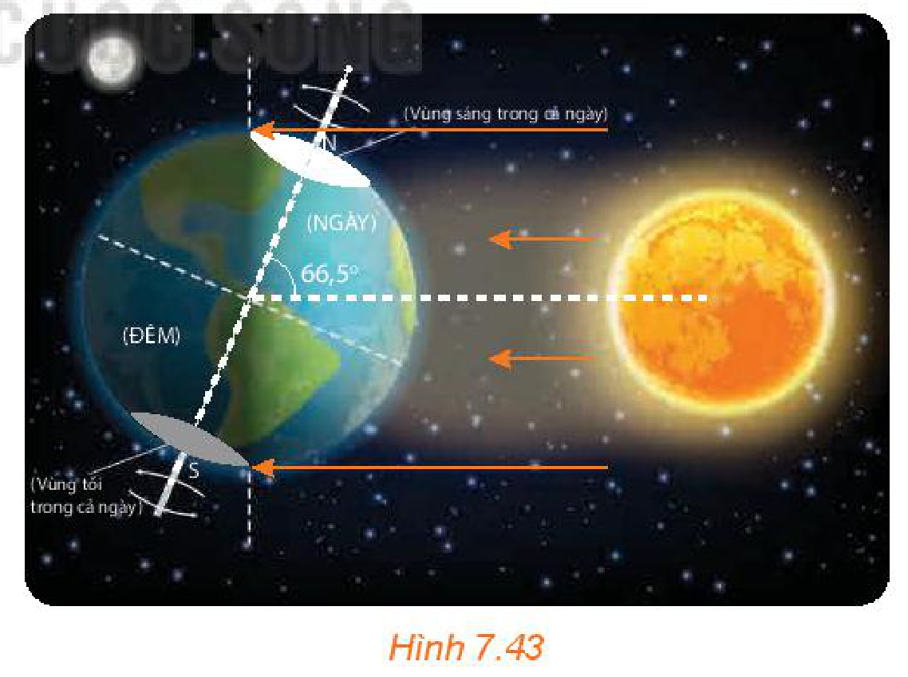
*Hình 7.43*

## 📷 Danh sách hình trong bài

| Mã hình | Trang PDF | Vị trí trong bài | Chú thích gốc |
| --- | :---: | --- | --- |
| H11-toan-b24-01 | 39 | Mở đầu | Hình 7.32. Mặt Trời lúc nửa đêm tại Nordkapp, Na Uy. |
| H11-toan-b24-02 | 39 | Mục 1, HĐ1 | Hình 7.33 |
| H11-toan-b24-03 | 40 | Mục 1, HĐ2 | Hình 7.34 |
| H11-toan-b24-04 | 40 | Mục 1, Ví dụ 1 | Hình 7.35 |
| H11-toan-b24-05 | 41 | Mục 1, Luyện tập 1 | Hình 7.36 |
| H11-toan-b24-06 | 41 | Mục 2, HĐ3 | Hình 7.37 |
| H11-toan-b24-07 | 42 | Mục 2 | Hình 7.38 |
| H11-toan-b24-08 | 42 | Mục 2, Nhận xét | Hình 7.39 |
| H11-toan-b24-09 | 42 | Mục 2, Ví dụ 2 | Hình 7.40 |
| H11-toan-b24-10 | 43 | Mục 2, Vận dụng | Hình 7.41 |
| H11-toan-b24-11 | 43 | Mục 2, Khám phá | Hình 7.42 |
| H11-toan-b24-12 | 44 | Em có biết? | Hình 7.43 |
