<!-- pdf:45 -->

# BÀI 25: HAI MẶT PHẲNG VUÔNG GÓC

## 🔤 Thuật ngữ

- Góc giữa hai mặt phẳng
- Hai mặt phẳng vuông góc
- Góc nhị diện
- Góc phẳng của góc nhị diện
- Hình lăng trụ đứng, lăng trụ đều
- Hình hộp đứng
- Hình chóp đều, hình chóp cụt đều

## 🎯 Mục tiêu

- Nhận biết góc giữa hai mặt phẳng, hai mặt phẳng vuông góc.
- Xác định điều kiện hai mặt phẳng vuông góc.
- Giải thích tính chất cơ bản của hai mặt phẳng vuông góc.
- Nhận biết góc phẳng của góc nhị diện, tính góc phẳng nhị diện trong một số trường hợp đơn giản.
- Giải thích tính chất cơ bản của hình chóp đều, hình lăng trụ đứng (và các trường hợp đặc biệt của nó).
- Vận dụng kiến thức của bài học để mô tả một số hình ảnh thực tế.

## 🔴 Mở đầu

Ta có thể gắn cho mỗi vị trí trên Trái Đất một cặp số, được gọi là vĩ độ và kinh độ. Mỗi vị trí trên Trái Đất hoàn toàn xác định khi biết vĩ độ và kinh độ của nó. Sau bài học này, ta có thể hiểu và diễn đạt chính xác các khái niệm đó.

## 1. GÓC GIỮA HAI MẶT PHẲNG, HAI MẶT PHẲNG VUÔNG GÓC

**HĐ1:** Cho hai mặt phẳng $(P)$ và $(Q)$. Lấy hai đường thẳng $a, a'$ cùng vuông góc với $(P)$, hai đường thẳng $b, b'$ cùng vuông góc với $(Q)$. Tìm mối quan hệ giữa các góc $(a, b)$ và $(a', b')$.
<!-- ocr-ok: kí hiệu mặt phẳng và góc bị OCR đọc lệch, đã đối chiếu ảnh -->

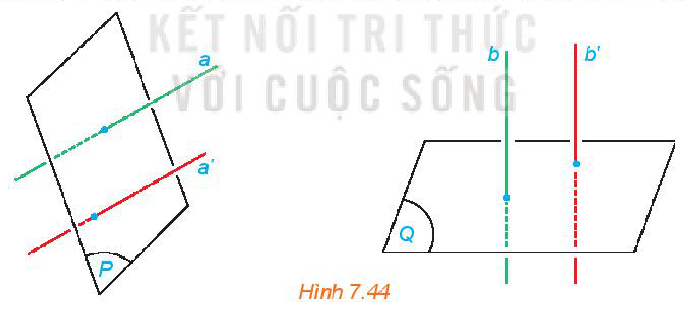
*Hình 7.44*

> - Cho hai mặt phẳng $(P)$ và $(Q)$. Lấy các đường thẳng $a, b$ tương ứng vuông góc với $(P), (Q)$. Khi đó, góc giữa $a$ và $b$ không phụ thuộc vào vị trí của $a, b$ và được gọi là **góc giữa hai mặt phẳng** $(P)$ và $(Q)$.
> - Hai mặt phẳng $(P)$ và $(Q)$ được gọi là **vuông góc với nhau** nếu góc giữa chúng bằng $90^\circ$.

**Chú ý:** Nếu $\varphi$ là góc giữa hai mặt phẳng $(P)$ và $(Q)$ thì $0 \le \varphi \le 90^\circ$.
<!-- ocr-ok: công thức bất đẳng thức góc phi bị OCR đọc lệch, đã đối chiếu ảnh -->

**Câu hỏi:** Góc giữa hai mặt phẳng bằng $0^\circ$ khi nào, khác $0^\circ$ khi nào?

<!-- pdf:46 -->

**Ví dụ 1:** Cho hai mặt phẳng $(P)$ và $(Q)$ cắt nhau theo giao tuyến $\Delta$. Lấy một điểm $O$ bất kì thuộc đường thẳng $\Delta$. Gọi $m, n$ là các đường thẳng đi qua $O$, tương ứng thuộc $(P), (Q)$ và vuông góc với $\Delta$. Chứng minh rằng góc giữa $(P)$ và $(Q)$ bằng góc giữa $m$ và $n$.

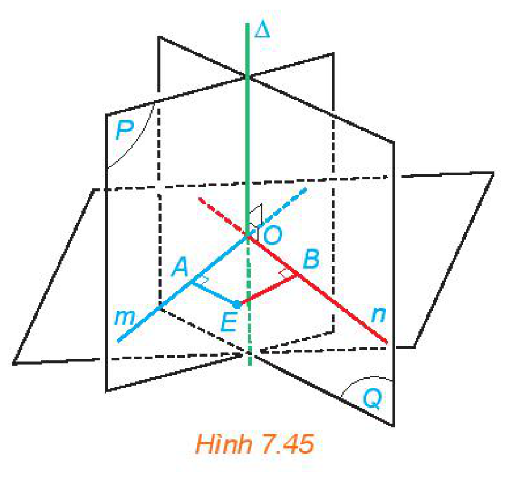
*Hình 7.45*

**Giải:** (H.7.45)

Trong mặt phẳng chứa $m, n$, lấy một điểm $E$ không thuộc các đường thẳng $m, n$. Gọi $A, B$ tương ứng là hình chiếu của $E$ trên $m, n$. Khi đó $\Delta$ vuông góc với các đường thẳng $EA, EB$.

Do $EA \perp m, EA \perp \Delta$ nên $EA \perp (P)$. Tương tự, $EB \perp (Q)$. Do đó, góc giữa $(P)$ và $(Q)$ bằng góc giữa $EA$ và $EB$.
<!-- ocr-ok: kí hiệu vuông góc và mặt phẳng bị OCR đọc lệch, đã đối chiếu ảnh -->

Do $\widehat{OAE} = 90^\circ = \widehat{OBE}$ nên bốn điểm $O, A, E, B$ thuộc một đường tròn. Do đó, $\widehat{AOB}$ và $\widehat{AEB}$ bằng hoặc bù nhau, tức là $(EA, EB) = (m, n)$.

Vậy góc giữa $(P)$ và $(Q)$ bằng góc giữa $m$ và $n$.
<!-- ocr-ok: kí hiệu mặt phẳng (P), (Q) bị OCR đọc lệch, đã đối chiếu ảnh -->

**Nhận xét:** (H.7.46) Cho hai mặt phẳng $(P)$ và $(Q)$ cắt nhau theo giao tuyến $\Delta$. Lấy hai đường thẳng $m, n$ tương ứng thuộc $(P), (Q)$ và cùng vuông góc với $\Delta$ tại một điểm $O$ (nói cách khác, lấy một mặt phẳng vuông góc với $\Delta$, cắt $(P), (Q)$ tương ứng theo các giao tuyến $m, n$). Khi đó, góc giữa $(P)$ và $(Q)$ bằng góc giữa $m$ và $n$. Đặc biệt, $(P)$ vuông góc với $(Q)$ khi và chỉ khi $m$ vuông góc với $n$.

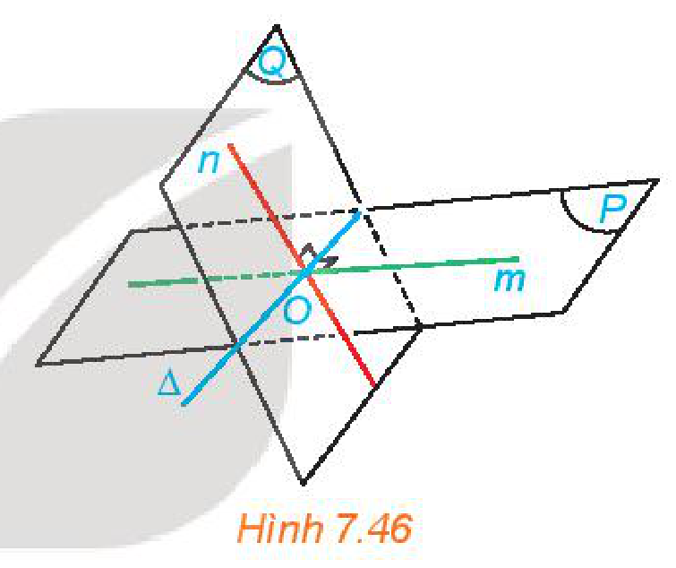
*Hình 7.46*

**Luyện tập 1:** Cho hình chóp $S.ABCD$, đáy $ABCD$ là một hình chữ nhật có tâm $O$, $SO \perp (ABCD)$. Chứng minh rằng hai mặt phẳng $(SAC)$ và $(SBD)$ vuông góc với nhau khi và chỉ khi $ABCD$ là một hình vuông.

## 2. ĐIỀU KIỆN HAI MẶT PHẲNG VUÔNG GÓC

**HĐ2:** Cho mặt phẳng $(P)$ chứa đường thẳng $b$ vuông góc với mặt phẳng $(Q)$. Lấy một đường thẳng $a$ vuông góc với $(P)$ (H.7.47).

a) Tính góc giữa $a$ và $b$.

b) Tính góc giữa $(P)$ và $(Q)$.

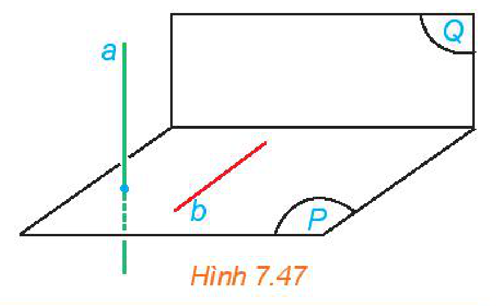
*Hình 7.47*

<!-- term: Điều kiện hai mặt phẳng vuông góc -->
> Hai mặt phẳng vuông góc với nhau nếu mặt phẳng này chứa một đường thẳng vuông góc với mặt phẳng kia.

**Ví dụ 2:** Cho tứ diện $OABC$ có $OA$ vuông góc với $OB$ và $OC$. Chứng minh rằng các mặt phẳng $(OAB)$ và $(OAC)$ cùng vuông góc với mặt phẳng $(OBC)$.

**Giải:**

Do $OA$ vuông góc với $OB$ và $OC$ nên $OA \perp (OBC)$. Mặt khác, các mặt phẳng $(OAB), (OAC)$ chứa $OA$. Do đó chúng cùng vuông góc với mặt phẳng $(OBC)$.

<!-- pdf:47 -->

**Luyện tập 2:** Trong HĐ1 của Bài 23, ta đã nhận ra rằng đường thẳng nối các bản lề của cửa phòng vuông góc với sàn nhà. Hãy giải thích vì sao trong quá trình đóng – mở, cánh cửa luôn vuông góc với sàn nhà.

## 3. TÍNH CHẤT HAI MẶT PHẲNG VUÔNG GÓC

**HĐ3:** Cho hai mặt phẳng $(P)$ và $(Q)$ vuông góc với nhau. Kẻ đường thẳng $a$ thuộc $(P)$ và vuông góc với giao tuyến $\Delta$ của $(P)$ và $(Q)$. Gọi $O$ là giao điểm của $a$ và $\Delta$. Trong mặt phẳng $(Q)$, gọi $b$ là đường thẳng vuông góc với $\Delta$ tại $O$.

a) Tính góc giữa $a$ và $b$.

b) Tìm mối quan hệ giữa $a$ và $(Q)$.
<!-- ocr-ok: kí hiệu mặt phẳng (Q) bị OCR đọc lệch, đã đối chiếu ảnh -->

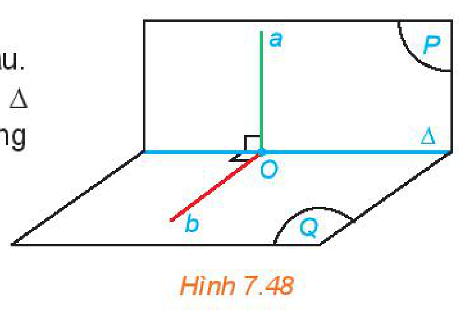
*Hình 7.48*

<!-- term: Tính chất hai mặt phẳng vuông góc -->
> Với hai mặt phẳng vuông góc với nhau, bất kì đường thẳng nào nằm trong mặt phẳng này mà vuông góc với giao tuyến cũng vuông góc với mặt phẳng kia.

**Nhận xét:** Cho hai mặt phẳng $(P)$ và $(Q)$ vuông góc với nhau. Mỗi đường thẳng qua điểm $O$ thuộc $(P)$ và vuông góc với mặt phẳng $(Q)$ thì đường thẳng đó thuộc mặt phẳng $(P)$.

**HĐ4:** Cho hai mặt phẳng $(P)$ và $(Q)$ cắt nhau theo giao tuyến $a$ và cùng vuông góc với mặt phẳng $(R)$. Gọi $O$ là một điểm thuộc $a$ và $a'$ là đường thẳng qua $O$ và vuông góc với $(R)$.

a) Hỏi $a'$ có nằm trong các mặt phẳng $(P), (Q)$ hay không?

b) Tìm mối quan hệ giữa $a$ và $a'$.
<!-- ocr-ok: kí hiệu đường thẳng a và a' bị OCR đọc lệch, đã đối chiếu ảnh -->

c) Tìm mối quan hệ giữa $a$ và $(R)$.
<!-- ocr-ok: kí hiệu mặt phẳng (R) bị OCR đọc lệch, đã đối chiếu ảnh -->

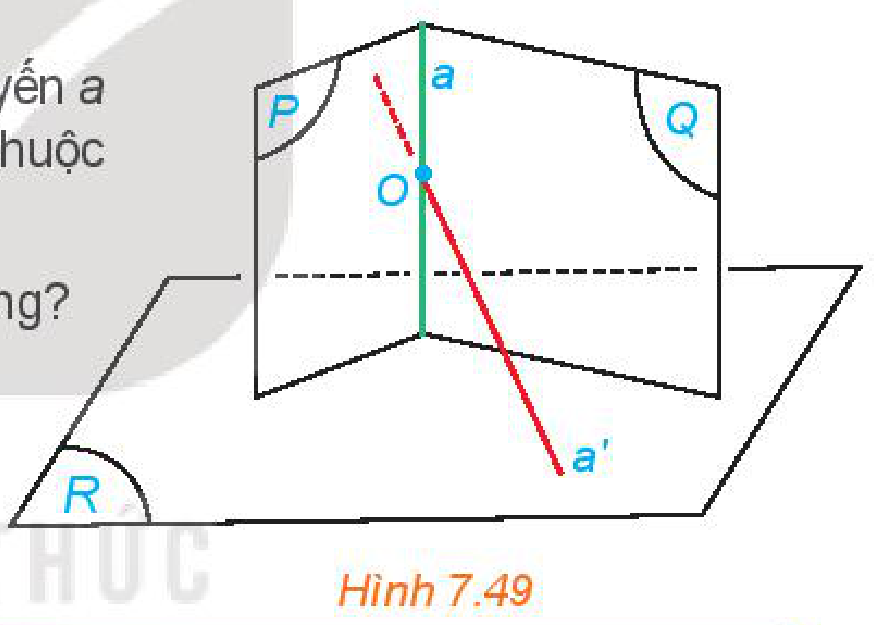
*Hình 7.49*

<!-- term: Tính chất hai mặt phẳng vuông góc -->
> Nếu hai mặt phẳng cắt nhau và cùng vuông góc với một mặt phẳng thứ ba thì giao tuyến của chúng vuông góc với mặt phẳng thứ ba đó.

**Ví dụ 3:** Cho hình chóp $S.ABCD$ có đáy là hình chữ nhật và $SA \perp (ABCD)$. Gọi $B', C', D'$ tương ứng là hình chiếu của $A$ trên $SB, SC, SD$. Chứng minh rằng:

a) $(SBC) \perp (SAB)$, $AB' \perp (SBC)$, $AD' \perp (SCD)$.

b) Các điểm $A, B', C', D'$ cùng thuộc một mặt phẳng.

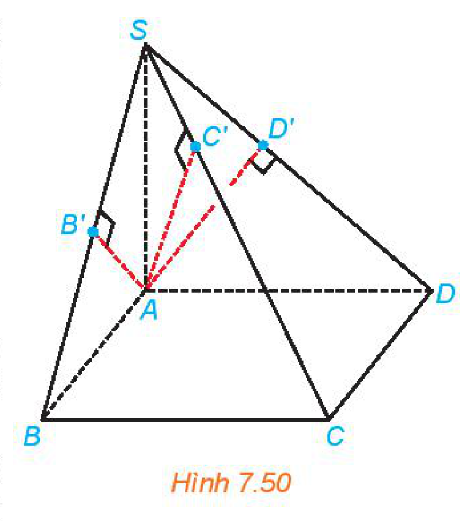
*Hình 7.50*

**Giải:** (H.7.50)

a) Vì $BC \perp SA$ và $BC \perp AB$ nên $BC \perp (SAB)$. Do đó, $(SBC) \perp (SAB)$. Đường thẳng $AB'$ thuộc $(SAB)$ và vuông góc với $SB$ nên $AB' \perp (SBC)$. Tương tự $AD' \perp (SCD)$.
<!-- ocr-ok: các kí hiệu vuông góc bị OCR đọc lệch, đã đối chiếu ảnh -->

b) Từ câu a ta có $AB' \perp SC, AD' \perp SC$. Các đường thẳng $AB', AC', AD'$ cùng đi qua $A$ và vuông góc với $SC$ nên cùng thuộc một mặt phẳng. Do đó bốn điểm $A, B', C', D'$ cùng thuộc một mặt phẳng.

<!-- pdf:48 -->

**Luyện tập 3:** Với giả thiết như ở Ví dụ 3, chứng minh rằng:

a) Các mặt phẳng $(AB'C'D')$ và $(ABCD)$ cùng vuông góc với $(SAC)$;

b) Giao tuyến của hai mặt phẳng $(AB'C'D')$ và $(ABCD)$ là đường thẳng đi qua $A$, nằm trong mặt phẳng $(ABCD)$ và vuông góc với $AC$.

## 4. GÓC NHỊ DIỆN

**HĐ5:** Một tài liệu hướng dẫn rằng đối với ghế bàn ăn, nên thiết kế lưng ghế tạo với mặt ghế một góc có số đo từ $100^\circ$ đến $105^\circ$. Trong Hình 7.51, các tia $Ox, Oy$ được vẽ tương ứng trên mặt ghế, lưng ghế đồng thời vuông góc với giao tuyến $a$ của mặt ghế và lưng ghế.

a) Theo tài liệu nói trên, góc nào trong hình nên có số đo từ $100^\circ$ đến $105^\circ$?

b) Nếu thiết kế theo hướng dẫn đó thì góc giữa mặt phẳng chứa mặt ghế và mặt phẳng chứa lưng ghế có thể nhận số đo từ bao nhiêu đến bao nhiêu độ?

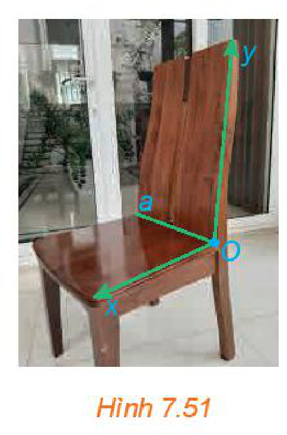
*Hình 7.51*

> Hình gồm hai nửa mặt phẳng $(P), (Q)$ có chung bờ $a$ được gọi là một **góc nhị diện**, kí hiệu là $[P, a, Q]$. Đường thẳng $a$ và các nửa mặt phẳng $(P), (Q)$ tương ứng được gọi là cạnh và các mặt của góc nhị diện đó.

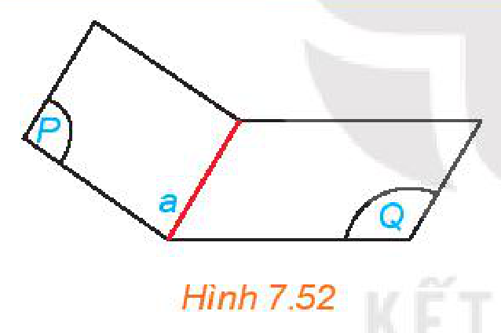
*Hình 7.52*

> 💡 Mỗi đường thẳng $a$ trong một mặt phẳng chia mặt phẳng thành hai phần, mỗi phần cùng với $a$ là một nửa mặt phẳng bờ $a$.

> Từ một điểm $O$ bất kì thuộc cạnh $a$ của góc nhị diện $[P, a, Q]$, vẽ các tia $Ox, Oy$ tương ứng thuộc $(P), (Q)$ và vuông góc với $a$. Góc $xOy$ được gọi là một **góc phẳng của góc nhị diện** $[P, a, Q]$ (gọi tắt là **góc phẳng nhị diện**). Số đo của góc $xOy$ không phụ thuộc vào vị trí của $O$ trên $a$, được gọi là **số đo của góc nhị diện** $[P, a, Q]$.

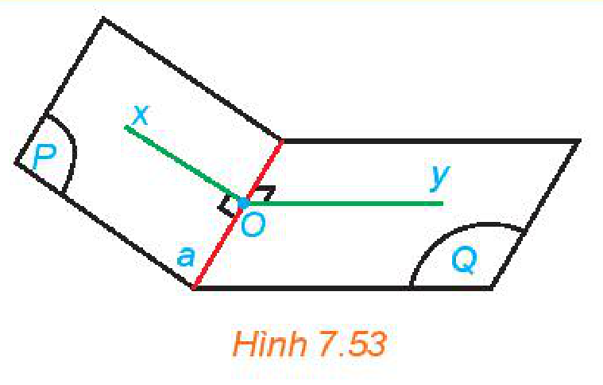
*Hình 7.53*

> 💡 Mặt phẳng chứa góc phẳng nhị diện $xOy$ của $[P, a, Q]$ vuông góc với cạnh $a$.

**Chú ý:**

- Số đo của góc nhị diện có thể nhận giá trị từ $0^\circ$ đến $180^\circ$. Góc nhị diện được gọi là vuông, nhọn, tù nếu nó có số đo tương ứng bằng, nhỏ hơn, lớn hơn $90^\circ$.
- Đối với hai điểm $M, N$ không thuộc đường thẳng $a$, ta kí hiệu $[M, a, N]$ là góc nhị diện có cạnh $a$ và các mặt tương ứng chứa $M, N$.
- Hai mặt phẳng cắt nhau tạo thành bốn góc nhị diện. Nếu một trong bốn góc nhị diện đó là góc nhị diện vuông thì các góc nhị diện còn lại cũng là góc nhị diện vuông.

<!-- pdf:49 -->

**Ví dụ 4:** Cho hình chóp $S.ABCD$ có $SA \perp (ABCD)$, đáy $ABCD$ là hình thoi có cạnh bằng $a$, $AC = a, SA = \dfrac{1}{2}a$. Gọi $O$ là giao điểm của hai đường chéo hình thoi $ABCD$ và $H$ là hình chiếu của $O$ trên $SC$.

a) Tính số đo của các góc nhị diện $[B, SA, D]; [S, BD, A]; [S, BD, C]$.

b) Chứng minh rằng $\widehat{BHD}$ là một góc phẳng của góc nhị diện $[B, SC, D]$.

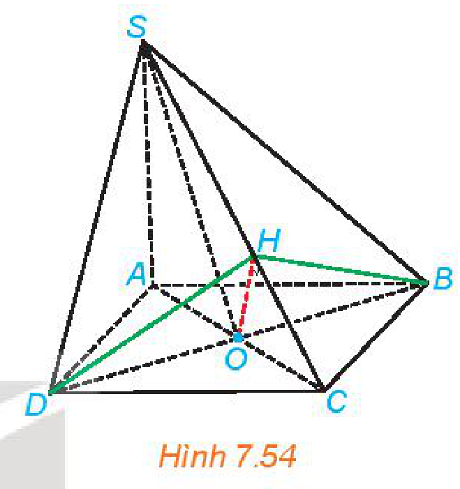
*Hình 7.54*

**Giải:** (H.7.54)

a) Vì $SA \perp (ABCD)$ nên $AB$ và $AD$ vuông góc với $SA$. Vậy $\widehat{BAD}$ là một góc phẳng của góc nhị diện $[B, SA, D]$. Hình thoi $ABCD$ có cạnh bằng $a$ và $AC = a$ nên các tam giác $ABC, ACD$ đều. Do đó $\widehat{BAD} = 120^\circ$. Vậy số đo của góc nhị diện $[B, SA, D]$ bằng $120^\circ$.

Vì $BD \perp AC$ và $BD \perp SA$ nên $BD \perp (SAC)$. Vậy $AC$ và $SO$ vuông góc với $BD$. Suy ra $\widehat{AOS}$ là một góc phẳng của góc nhị diện $[S, BD, A]$ và $\widehat{COS}$ là một góc phẳng của góc nhị diện $[S, BD, C]$.

Tam giác $SAO$ vuông tại $A$ và có $SA = \dfrac{1}{2}a = AO$ nên $\widehat{AOS} = 45^\circ$. Suy ra $\widehat{COS} = 180^\circ - \widehat{AOS} = 135^\circ$.
<!-- ocr-ok: công thức phân số và góc bị OCR đọc lệch, đã đối chiếu ảnh -->

Vậy các góc nhị diện $[S, BD, A], [S, BD, C]$ tương ứng có số đo là $45^\circ, 135^\circ$.

b) Theo chứng minh trên, $BD \perp (SAC)$ nên $BD \perp SC$. Mặt khác, $OH \perp SC$ nên $SC \perp (BOD)$. Do đó, $\widehat{BHD}$ là một góc phẳng của góc nhị diện $[B, SC, D]$.
<!-- ocr-ok: kí hiệu vuông góc và góc BHD bị OCR đọc lệch, đã đối chiếu ảnh -->

**Luyện tập 4:** Cho hình chóp $S.ABC$ có $SA \perp (ABC)$, $AB = AC = a$, $\widehat{BAC} = 120^\circ$, $SA = \dfrac{a}{2\sqrt{3}}$. Gọi $M$ là trung điểm của $BC$.
<!-- ocr-ok: công thức SA và góc BAC bị OCR đọc lệch, đã đối chiếu ảnh -->

a) Chứng minh rằng $\widehat{SMA}$ là một góc phẳng của góc nhị diện $[S, BC, A]$.

b) Tính số đo của góc nhị diện $[S, BC, A]$.

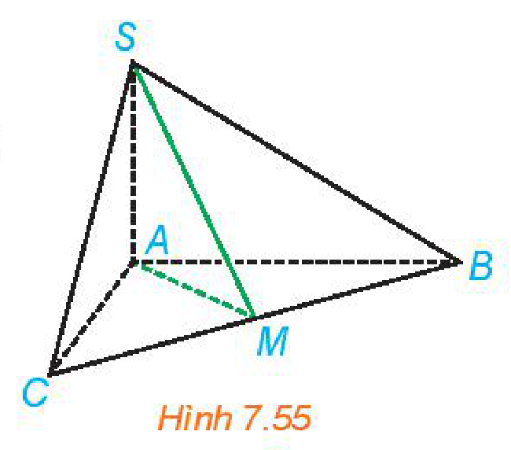
*Hình 7.55*

**Vận dụng 1:** Trong cửa sổ ở Hình 7.56, cánh và khung cửa là các nửa hình tròn có đường kính $80\text{ cm}$, bản lề được đính ở điểm chính giữa $O$ của các cung tròn khung và cánh cửa. Khi cửa mở, đường kính của khung và đường kính của cánh song song với nhau và cách nhau một khoảng $d$; khi cửa đóng, hai đường kính đó trùng nhau. Hãy tính số đo của góc nhị diện có hai nửa mặt phẳng tương ứng chứa cánh, khung cửa khi $d = 40\text{ cm}$.

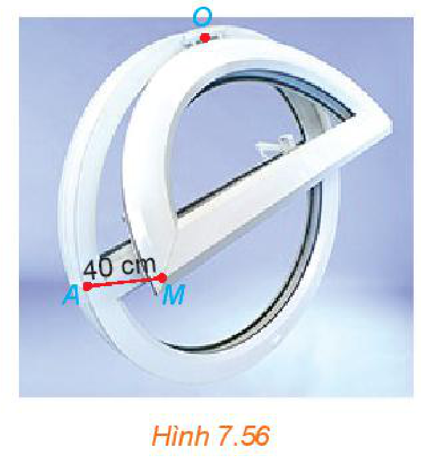
*Hình 7.56*

Trở lại vấn đề được nêu ở đầu bài học. Trên Trái Đất, mỗi kinh tuyến là một nửa đường tròn có đường kính là trục của Trái Đất (đoạn thẳng nối cực Bắc và cực Nam). Kinh tuyến gốc là kinh tuyến đi qua Đài Thiên văn Greeanwich ở London. Mặt phẳng chứa kinh tuyến gốc chia Trái Đất làm hai nửa là Đông và Tây, nước ta nằm ở nửa Đông. Kinh độ của một điểm $P$ trên Trái Đất là số đo của

<!-- pdf:50 -->

góc nhị diện có hai cạnh tương ứng chứa kinh tuyến gốc và kinh tuyến đi qua $P$ (cạnh của góc nhị diện này là trục Trái Đất). Do đó, các điểm trên cùng kinh tuyến thì có cùng kinh độ. Vĩ độ của điểm $P$ là số đo của góc giữa mặt phẳng chứa đường xích đạo và đường thẳng nối $P$ với tâm Trái Đất. Mỗi điểm trên Trái Đất sẽ thuộc một trong hai bán cầu Bắc hoặc Nam và thuộc nửa Đông hay nửa Tây. Vì vậy, đi kèm số đo vĩ độ còn có chữ $E$ hoặc $W$ nếu vị trí đó tương ứng thuộc nửa Đông, nửa Tây, và có chữ $N, S$ nếu vị trí đó tương ứng ở bán cầu Bắc, bán cầu Nam. Chẳng hạn, Bia Chủ quyền đảo Song Tử Tây thuộc xã Song Tử Tây, huyện Hoàng Sa, tỉnh Khánh Hoà, có vị trí: $11^\circ 25'55''N, 114^\circ 8'00''E$. *(Theo baokhanhhoa.vn)*.

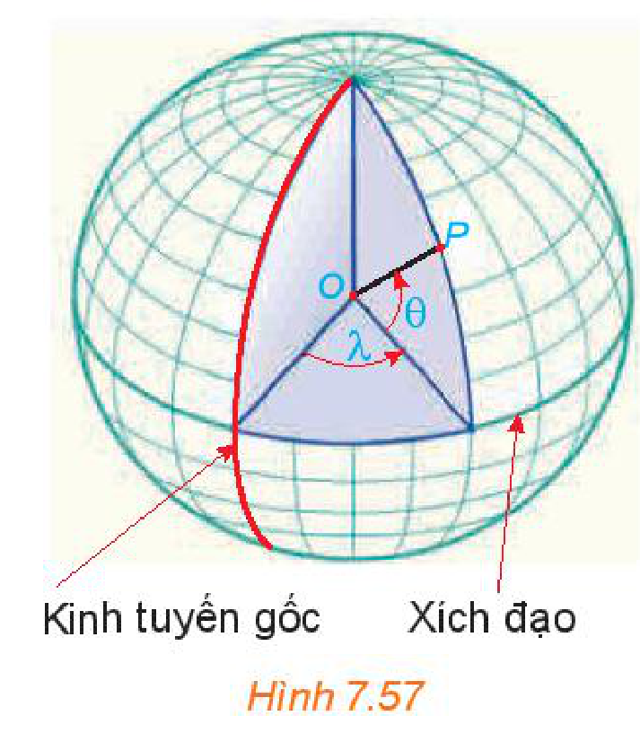
*Hình 7.57*

## 5. MỘT SỐ HÌNH LĂNG TRỤ ĐẶC BIỆT

Trong chương IV, ta đã biết khái niệm hình lăng trụ. Với các kiến thức về quan hệ vuông góc, ta có thể định nghĩa một số hình lăng trụ đặc biệt sau đây.

**a) Hình lăng trụ đứng**

> **Hình lăng trụ đứng** là hình lăng trụ có các cạnh bên vuông góc với mặt đáy.

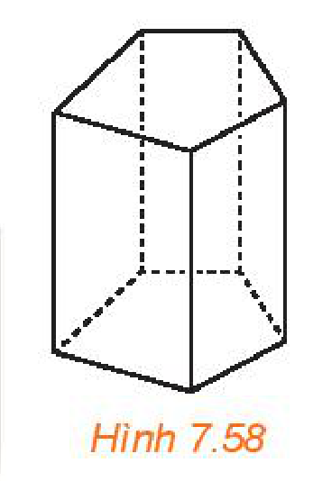
*Hình 7.58*

**HĐ4:** Các mặt bên của lăng trụ đứng là các hình gì và các mặt bên đó có vuông góc với mặt đáy không? Vì sao?

> Hình lăng trụ đứng có các mặt bên là các hình chữ nhật và vuông góc với mặt đáy.

**b) Hình lăng trụ đều**

> **Hình lăng trụ đều** là hình lăng trụ đứng có đáy là đa giác đều.

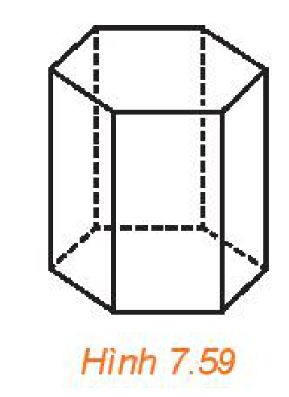
*Hình 7.59*

**HĐ7:** Các mặt bên của hình lăng trụ đều có phải là các hình chữ nhật có cùng kích thước hay không? Vì sao?

> Hình lăng trụ đều có các mặt bên là các hình chữ nhật có cùng kích thước.

**c) Hình hộp đứng**

> **Hình hộp đứng** là hình lăng trụ đứng, có đáy là hình bình hành.

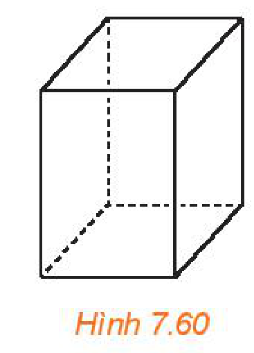
*Hình 7.60*

**HĐ8:** Trong $6$ mặt của hình hộp đứng, có ít nhất bao nhiêu mặt là hình chữ nhật? Vì sao?

> Hình hộp đứng có các mặt bên là các hình chữ nhật.

**d) Hình hộp chữ nhật**

> **Hình hộp chữ nhật** là hình hộp đứng có đáy là hình chữ nhật.

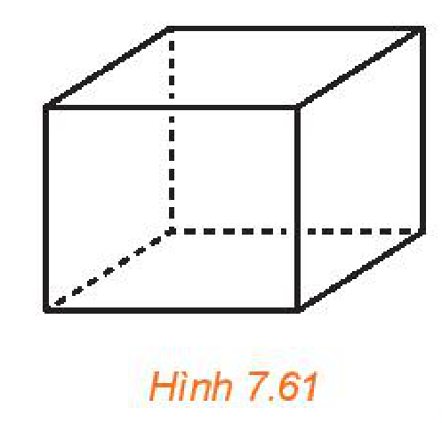
*Hình 7.61*

<!-- pdf:51 -->

**HĐ9:**

a) Hình hộp chữ nhật có bao nhiêu mặt là hình chữ nhật? Vì sao?

b) Các đường chéo của hình hộp chữ nhật có bằng nhau và cắt nhau tại trung điểm mỗi đường hay không? Vì sao?

> Hình hộp chữ nhật có các mặt bên là hình chữ nhật. Các đường chéo của hình hộp chữ nhật có độ dài bằng nhau và chúng cắt nhau tại trung điểm của mỗi đường.

**Ví dụ 5:** Cho hình hộp chữ nhật $ABCD.A'B'C'D'$. Chứng minh rằng $AA'C'C$ là một hình chữ nhật.

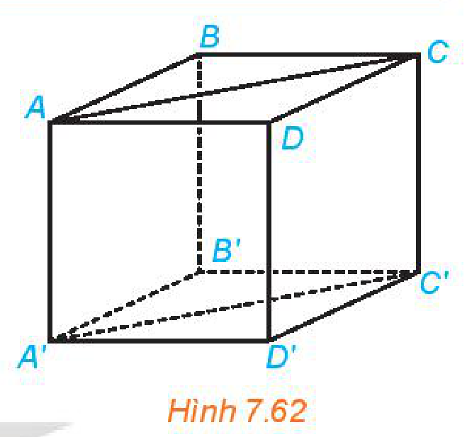
*Hình 7.62*

**Giải:** (H.7.62)

Ta có $AA' = CC'$ và $AA' \parallel CC'$ (vì $AA', CC'$ cùng bằng và cùng song song với $DD'$). Do đó $ACC'A'$ là một hình bình hành.

Mặt khác, $AA' \perp (A'B'C'D')$ nên $AA' \perp A'C'$. Do đó $ACC'A'$ là một hình chữ nhật.

**e) Hình lập phương**

> **Hình lập phương** là hình hộp chữ nhật có tất cả các cạnh bằng nhau.

**HĐ10:** Các mặt của một hình lập phương là các hình gì? Vì sao?

> Hình lập phương có các mặt là các hình vuông.

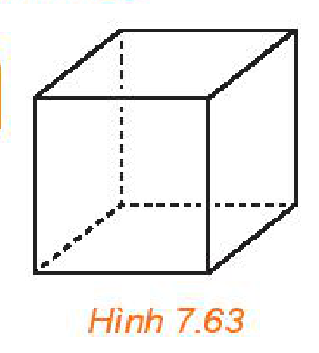
*Hình 7.63*

**Chú ý:** Khi đáy của hình lăng trụ đứng (đều) là tam giác, tứ giác, ngũ giác,... đôi khi ta cũng tương ứng gọi rõ là hình lăng trụ đứng (đều) tam giác, tứ giác, ngũ giác,...

**Ví dụ 6:** Cho hình lập phương $ABCD.A'B'C'D'$. Chứng minh rằng $A'BD$ là tam giác đều.

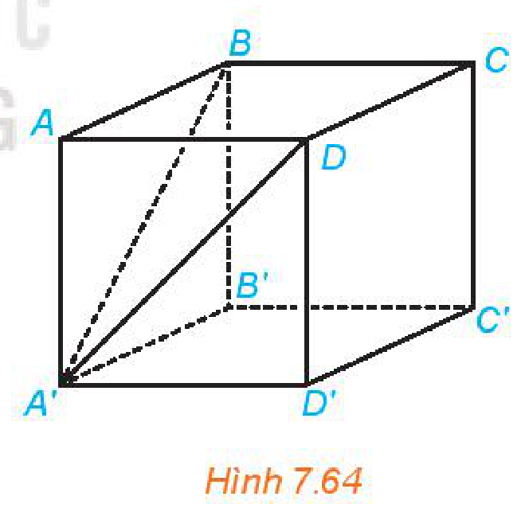
*Hình 7.64*

**Giải:** (H.7.64)

Gọi $a$ là độ dài các cạnh của hình lập phương. Do các mặt của hình lập phương là các hình vuông nên

$$A'D = \sqrt{AA'^2 + AD^2} = a\sqrt{2};$$
<!-- ocr-ok: công thức căn thức A'D bị OCR đọc lệch, đã đối chiếu ảnh -->

$$BD = \sqrt{AB^2 + AD^2} = a\sqrt{2};$$
<!-- ocr-ok: công thức căn thức BD bị OCR đọc lệch, đã đối chiếu ảnh -->

$$A'B = \sqrt{AA' + AB^2} = a\sqrt{2}.$$
<!-- ocr-ok: công thức căn thức A'B (sách in thiếu số mũ 2 ở AA') bị OCR đọc lệch, đã đối chiếu ảnh -->

Tam giác $A'BC$ có ba cạnh bằng nhau nên là tam giác đều.

**Vận dụng 2:** Từ một tấm tôn hình chữ nhật, tại $4$ góc bác Hùng cắt bỏ đi $4$ hình vuông có cùng kích thước và sau đó hàn gắn các mép tại các góc như Hình 7.65. Giải thích vì sao bằng cách đó, bác Hùng nhận được chiếc thùng không nắp có dạng hình hộp chữ nhật.

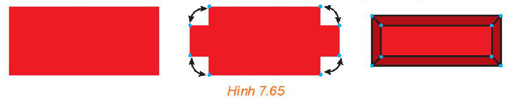
*Hình 7.65*

<!-- pdf:52 -->

## 6. HÌNH CHÓP ĐỀU VÀ HÌNH CHÓP CỤT ĐỀU

**HĐ11:** Tháp lớn tại Bảo tàng Louvre ở Paris (H.7.66) (với kết cấu kính và kim loại) có dạng hình chóp với đáy là hình vuông có cạnh bằng $34\text{ m}$, các cạnh bên bằng nhau và có độ dài xấp xỉ $32,3\text{ m}$ *(theo Wikipedia.org)*.

Giải thích vì sao hình chiếu của đỉnh trên đáy là tâm của đáy tháp.

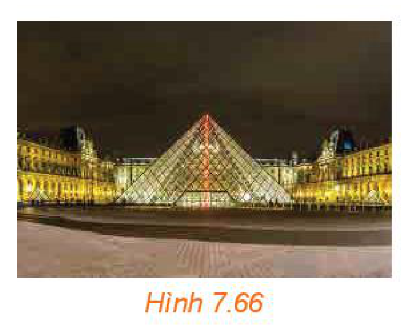
*Hình 7.66*

> **Hình chóp đều** là hình chóp có đáy là đa giác đều và các cạnh bên bằng nhau.

**Chú ý:** Tương tự như đối với hình chóp, khi đáy của hình chóp đều là tam giác đều, hình vuông, ngũ giác đều,... đôi khi ta cũng gọi rõ chúng tương ứng là chóp tam giác đều, tứ giác đều, ngũ giác đều,...

**HĐ12:** Cho hình chóp $S.A_1A_2\dots A_n$. Gọi $O$ là hình chiếu của $S$ trên mặt phẳng $(A_1A_2\dots A_n)$.

a) Trong trường hợp hình chóp đã cho là đều, vị trí của điểm $O$ có gì đặc biệt đối với tam giác đều $A_1A_2\dots A_n$?

b) Nếu đa giác $A_1A_2\dots A_n$ là đều và $O$ là tâm của đa giác đó thì hình chóp đã cho có gì đặc biệt?

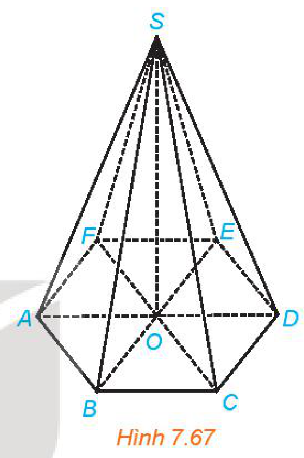
*Hình 7.67*

> Một hình chóp là đều khi và chỉ khi đáy của nó là một hình đa giác đều và hình chiếu của đỉnh trên mặt phẳng đáy là tâm của mặt đáy.

**Ví dụ 7:** Chứng minh rằng một hình chóp là đều khi và chỉ khi đáy của nó là một đa giác đều và các cạnh bên tạo với mặt phẳng đáy các góc bằng nhau.

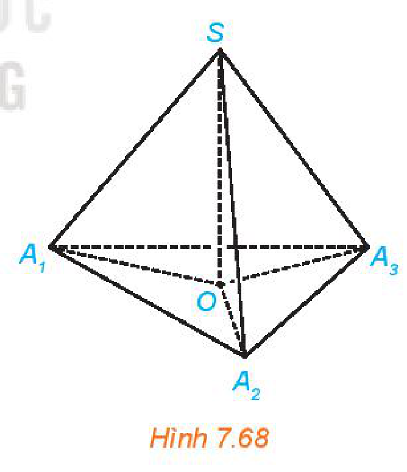
*Hình 7.68*

**Giải:** (H.7.68)

Xét hình chóp $S.A_1A_2\dots A_n$. Gọi $O$ là hình chiếu của $S$ trên mặt phẳng đáy.

Giả sử hình chóp là đều, khi đó $O$ là tâm của đa giác đều $A_1A_2\dots A_n$. Các tam giác $SOA_1, SOA_2, \dots, SOA_n$ đều vuông tại $O$, có chung cạnh $SO$ và có các cạnh $OA_1, OA_2, \dots, OA_n$ bằng nhau, do đó chúng bằng nhau. Vậy $\widehat{SA_1O} = \widehat{SA_2O} = \dots = \widehat{SA_nO}$, tức là các cạnh bên của hình chóp tạo với mặt phẳng đáy các góc bằng nhau.

Ngược lại, giả sử hình chóp có đáy là đa giác đều và các cạnh bên tạo với mặt phẳng đáy các góc bằng nhau. Khi đó, $\widehat{SA_1O} = \widehat{SA_2O} = \dots = \widehat{SA_nO}$. Từ đó suy ra các tam giác vuông $SOA_1, SOA_2, \dots, SOA_n$ bằng nhau. Do đó, $SA_1 = SA_2 = \dots = SA_n$. Mặt khác, $A_1A_2\dots A_n$ là đa giác đều, do đó $S.A_1A_2\dots A_n$ là hình chóp đều.

**Luyện tập 5:** Cho hình chóp tam giác đều $S.ABC$, cạnh đáy bằng $a$, cạnh bên bằng $a\sqrt{\dfrac{5}{12}}$. Tính số đo của góc nhị diện $[S, BC, A]$.

<!-- pdf:53 -->

**HĐ13:** Cho hình chóp đều $S.A_1A_2\dots A_n$. Một mặt phẳng không đi qua $S$ và song song với mặt phẳng đáy, cắt các cạnh $SA_1, SA_2, \dots, SA_n$ tương ứng tại $B_1, B_2, \dots, B_n$.

a) Giải thích vì sao $S.B_1B_2\dots B_n$ là một hình chóp đều.

b) Gọi $H$ là tâm của đa giác $A_1A_2\dots A_n$. Chứng minh rằng đường thẳng $SH$ đi qua tâm $K$ của đa giác đều $B_1B_2\dots B_n$ và $HK$ vuông góc với các mặt phẳng $(A_1A_2\dots A_n)$, $(B_1B_2\dots B_n)$.

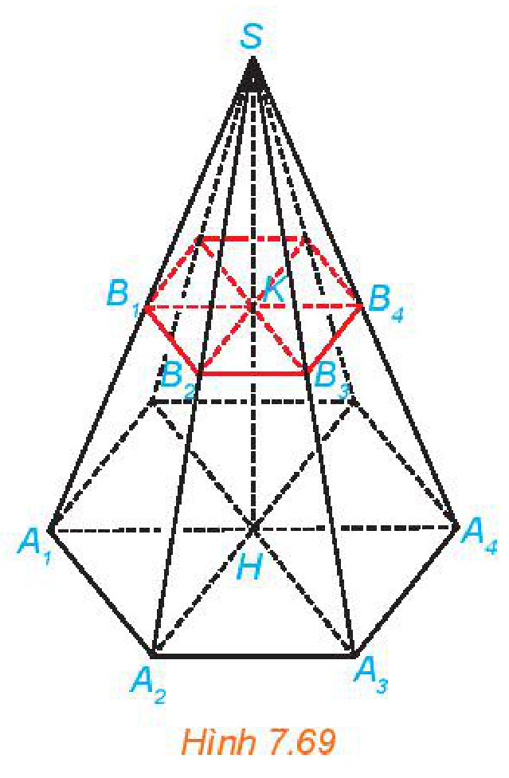
*Hình 7.69*

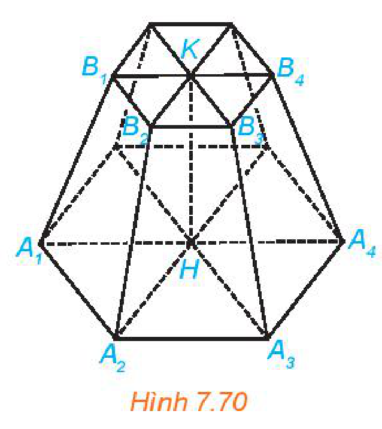
*Hình 7.70*

> - Hình gồm các đa giác đều $A_1A_2\dots A_n, B_1B_2\dots B_n$ và các hình thang cân $A_1A_2B_2B_1$, $A_2A_3B_3B_2, \dots, A_nA_1B_1B_n$ được tạo thành như trong HĐ13 được gọi là một **hình chóp cụt đều** (nói đơn giản là hình chóp cụt được tạo thành từ hình chóp đều $S.A_1A_2\dots A_n$ sau khi cắt đi chóp đều $S.B_1B_2\dots B_n$), kí hiệu là $A_1A_2\dots A_n.B_1B_2\dots B_n$.
> - Các đa giác $A_1A_2\dots A_n, B_1B_2\dots B_n$ được gọi là hai **mặt đáy**, các hình thang $A_1A_2B_2B_1$, $A_2A_3B_3B_2, \dots, A_nA_1B_1B_n$ được gọi là các **mặt bên** của hình chóp cụt. Các đoạn thẳng $A_1B_1, A_2B_2, \dots, A_nB_n$ được gọi là các **cạnh bên**; các cạnh của mặt đáy được gọi là các **cạnh đáy** của hình chóp cụt.
> - Đoạn thẳng $HK$ nối hai tâm của đáy được gọi là **đường cao** của hình chóp cụt đều. Độ dài của đường cao được gọi là **chiều cao** của hình chóp cụt.

**Câu hỏi:** Hình chóp cụt đều có các cạnh bên bằng nhau hay không?

**Ví dụ 8:** Cho hình chóp cụt đều $ABC.A'B'C'$ có chiều cao bằng $h$, các đáy là các tam giác đều $ABC, A'B'C'$ có cạnh tương ứng là $a, a'$ ($a > a'$). Tính độ dài các cạnh bên của hình chóp cụt.

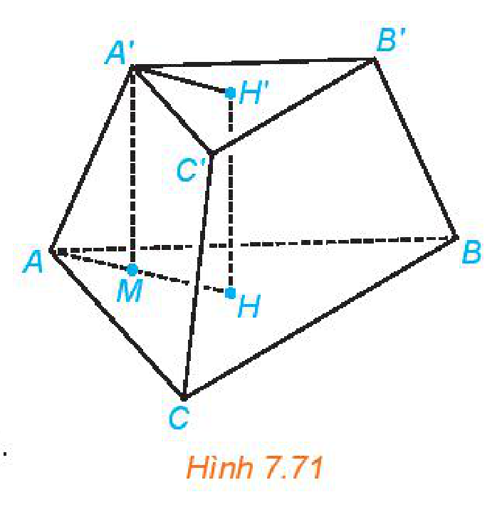
*Hình 7.71*

**Giải:** (H.7.71)

Gọi $H, H'$ tương ứng là tâm của các tam giác $ABC, A'B'C'$.

Khi đó, $HH'$ vuông góc với hai đáy của hình chóp cụt.

Trong tam giác đều $ABC$, ta có $HA = \dfrac{a}{\sqrt{3}}$.

Trong tam giác đều $A'B'C'$, ta có $H'A' = \dfrac{a'}{\sqrt{3}}$.

Hình thang $AHH'A'$ vuông tại $H$ và $H'$. Kẻ $A'M \perp HA$ ($M \in HA$).
<!-- ocr-ok: kí hiệu vuông góc và thuộc bị OCR đọc lệch, đã đối chiếu ảnh -->

<!-- pdf:54 -->

Ta có $AA' = \sqrt{A'M^2 + MA^2} = \sqrt{H'H^2 + (HA - H'A')^2} = \sqrt{h^2 + \left(\dfrac{a}{\sqrt{3}} - \dfrac{a'}{\sqrt{3}}\right)^2} = \sqrt{h^2 + \dfrac{(a - a')^2}{3}}$.

Vậy các cạnh bên của chóp cụt có độ dài bằng $\sqrt{h^2 + \dfrac{(a - a')^2}{3}}$.

## ✏️ Bài tập

**7.16.** Cho hình chóp $S.ABC$ có $SA \perp (ABC)$. Gọi $H$ là hình chiếu của $A$ trên $BC$.
<!-- ocr-ok: kí hiệu vuông góc bị OCR đọc lệch, đã đối chiếu ảnh -->

a) Chứng minh rằng $(SAB) \perp (ABC)$ và $(SAH) \perp (SBC)$.

b) Giả sử tam giác $ABC$ vuông tại $A$, $\widehat{ABC} = 30^\circ, AC = a, SA = \dfrac{a\sqrt{3}}{2}$. Tính số đo của góc nhị diện $[S, BC, A]$.

**7.17.** Cho hình lập phương $ABCD.A'B'C'D'$ có cạnh bằng $a$.
<!-- ocr-ok: kí hiệu đỉnh hình lập phương bị OCR đọc lệch, đã đối chiếu ảnh -->

a) Tính độ dài đường chéo của hình lập phương.

b) Chứng minh rằng $(ACC'A') \perp (BDD'B')$.

c) Gọi $O$ là tâm của hình vuông $ABCD$. Chứng minh rằng $\widehat{COC'}$ là một góc phẳng của góc nhị diện $[C, BD, C']$. Tính (gần đúng) số đo của các góc nhị diện $[C, BD, C']$, $[A, BD, C']$.

**7.18.** Cho hình hộp chữ nhật $ABCD.A'B'C'D'$.

a) Chứng minh rằng $(BDD'B') \perp (ABCD)$.

b) Xác định hình chiếu của $AC'$ trên mặt phẳng $(ABCD)$.

c) Cho $AB = a, BC = b, CC' = c$. Tính $AC'$.

**7.19.** Cho hình chóp đều $S.ABC$, đáy có cạnh bằng $a$, cạnh bên bằng $b$.

a) Tính $\sin$ của góc tạo bởi cạnh bên và mặt đáy.

b) Tính $\tan$ của góc giữa mặt phẳng chứa mặt đáy và mặt phẳng chứa mặt bên.

**7.20.** Hai mái nhà trong Hình 7.72 là hai hình chữ nhật. Giả sử $AB = 4,8\text{ m}$; $OA = 2,8\text{ m}$; $OB = 4\text{ m}$.

a) Tính (gần đúng) số đo của góc nhị diện tạo bởi hai nửa mặt phẳng tương ứng chứa hai mái nhà.

b) Chứng minh rằng mặt phẳng $(OAB)$ vuông góc với mặt đất phẳng. *Lưu ý:* Đường giao giữa hai mái (đường nóc) song song với mặt đất.

c) Điểm $A$ ở độ cao (so với mặt đất) hơn điểm $B$ là $0,5\text{ m}$. Tính (gần đúng) góc giữa mái nhà (chứa $OB$) so với mặt đất.

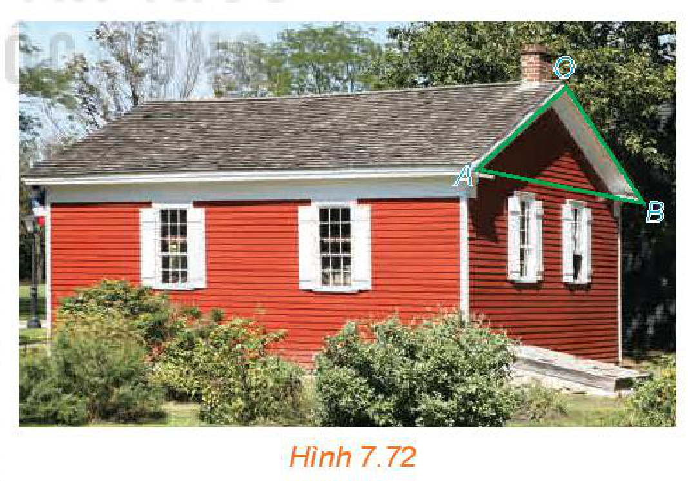
*Hình 7.72*

**7.21.** Độ dốc của mái nhà, mặt sân, con đường thẳng là tang của góc tạo bởi mái nhà mặt sân, con đường thẳng đó với mặt phẳng nằm ngang. Độ dốc của đường thẳng dành cho người khuyết tật được quy định là không quá $\dfrac{1}{12}$. Hỏi theo đó, góc tạo bởi đường dành cho người khuyết tật và mặt phẳng nằm ngang không vượt quá bao nhiêu độ? (Làm tròn kết quả đến chữ số thập phân thứ hai).

## 📷 Danh sách hình trong bài

| Mã hình | Trang PDF | Vị trí trong bài | Chú thích gốc |
| --- | :---: | --- | --- |
| H11-toan-b25-01 | 45 | Mục 1, HĐ1 | Hình 7.44 |
| H11-toan-b25-02 | 46 | Mục 1, Ví dụ 1 | Hình 7.45 |
| H11-toan-b25-03 | 46 | Mục 1, Nhận xét | Hình 7.46 |
| H11-toan-b25-04 | 46 | Mục 2, HĐ2 | Hình 7.47 |
| H11-toan-b25-05 | 47 | Mục 3, HĐ3 | Hình 7.48 |
| H11-toan-b25-06 | 47 | Mục 3, HĐ4 | Hình 7.49 |
| H11-toan-b25-07 | 47 | Mục 3, Ví dụ 3 | Hình 7.50 |
| H11-toan-b25-08 | 48 | Mục 4, HĐ5 | Hình 7.51 |
| H11-toan-b25-09 | 48 | Mục 4 | Hình 7.52 |
| H11-toan-b25-10 | 48 | Mục 4 | Hình 7.53 |
| H11-toan-b25-11 | 49 | Mục 4, Ví dụ 4 | Hình 7.54 |
| H11-toan-b25-12 | 49 | Mục 4, Luyện tập 4 | Hình 7.55 |
| H11-toan-b25-13 | 49 | Mục 4, Vận dụng 1 | Hình 7.56 |
| H11-toan-b25-14 | 50 | Mục 4, Vận dụng 1 | Hình 7.57 |
| H11-toan-b25-15 | 50 | Mục 5.a | Hình 7.58 |
| H11-toan-b25-16 | 50 | Mục 5.b | Hình 7.59 |
| H11-toan-b25-17 | 50 | Mục 5.c | Hình 7.60 |
| H11-toan-b25-18 | 50 | Mục 5.d | Hình 7.61 |
| H11-toan-b25-19 | 51 | Mục 5.d, Ví dụ 5 | Hình 7.62 |
| H11-toan-b25-20 | 51 | Mục 5.e | Hình 7.63 |
| H11-toan-b25-21 | 51 | Mục 5.e, Ví dụ 6 | Hình 7.64 |
| H11-toan-b25-22 | 51 | Mục 5.e, Vận dụng 2 | Hình 7.65 |
| H11-toan-b25-23 | 52 | Mục 6, HĐ11 | Hình 7.66 |
| H11-toan-b25-24 | 52 | Mục 6, HĐ12 | Hình 7.67 |
| H11-toan-b25-25 | 52 | Mục 6, Ví dụ 7 | Hình 7.68 |
| H11-toan-b25-26 | 53 | Mục 6, HĐ13 | Hình 7.69 |
| H11-toan-b25-27 | 53 | Mục 6, HĐ13 | Hình 7.70 |
| H11-toan-b25-28 | 53 | Mục 6, Ví dụ 8 | Hình 7.71 |
| H11-toan-b25-29 | 54 | Bài tập 7.20 | Hình 7.72 |
