<!-- pdf:55 -->

# BÀI 26: KHOẢNG CÁCH

## 🔤 Thuật ngữ

- Khoảng cách
- Chiều cao của hình chóp, hình lăng trụ
- Đường vuông góc chung

## 🎯 Mục tiêu

- Xác định khoảng cách giữa các đối tượng điểm, đường thẳng, mặt phẳng trong không gian.
- Xác định đường vuông góc chung của hai đường thẳng chéo nhau trong các trường hợp đơn giản.
- Vận dụng kiến thức về khoảng cách vào một số tình huống thực tế.
<!-- ocr-ok: bảng hai cột đầu bài bị OCR trộn dòng, đã đối chiếu ảnh -->

## 🔴 Mở đầu

Khoảng cách là khái niệm được dùng trong nhiều lĩnh vực của đời sống. Trong bài học này ta tìm hiểu về khoảng cách giữa điểm, đường thẳng, mặt phẳng.

*Hình 7.73. Các đầu phun nước chữa cháy sprinkler cần được lắp đặt theo tiêu chuẩn kĩ thuật, trong đó có tiêu chuẩn về khoảng cách tới từng loại trần, tường, nhà.*
<!-- ocr-ok: chú thích Hình 7.73 chữ màu bị OCR bỏ sót, đã đối chiếu ảnh -->

## 1. KHOẢNG CÁCH TỪ MỘT ĐIỂM ĐẾN MỘT ĐƯỜNG THẲNG, ĐẾN MỘT MẶT PHẲNG

**HĐ1:**

a) Cho điểm $M$ và đường thẳng $a$. Gọi $H$ là hình chiếu của $M$ trên $a$. Với mỗi điểm $K$ thuộc $a$, giải thích vì sao $MK \ge MH$ (H.7.74).
<!-- ocr-ok: công thức bất đẳng thức MK >= MH bị OCR đọc lệch, đã đối chiếu ảnh -->

b) Cho điểm $M$ và mặt phẳng $(P)$. Gọi $H$ là hình chiếu của $M$ trên $(P)$. Với mỗi điểm $K$ thuộc $(P)$, giải thích vì sao $MK \ge MH$ (H.7.75).
<!-- ocr-ok: công thức bất đẳng thức MK >= MH bị OCR đọc lệch, đã đối chiếu ảnh -->

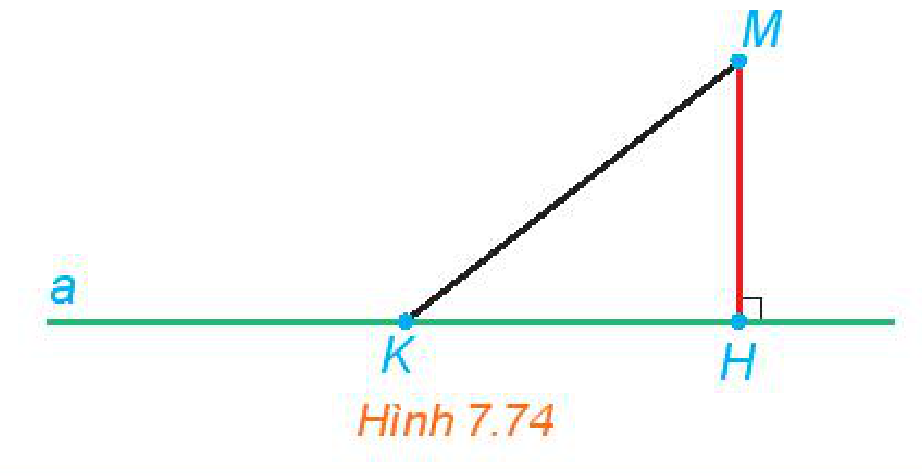
*Hình 7.74*

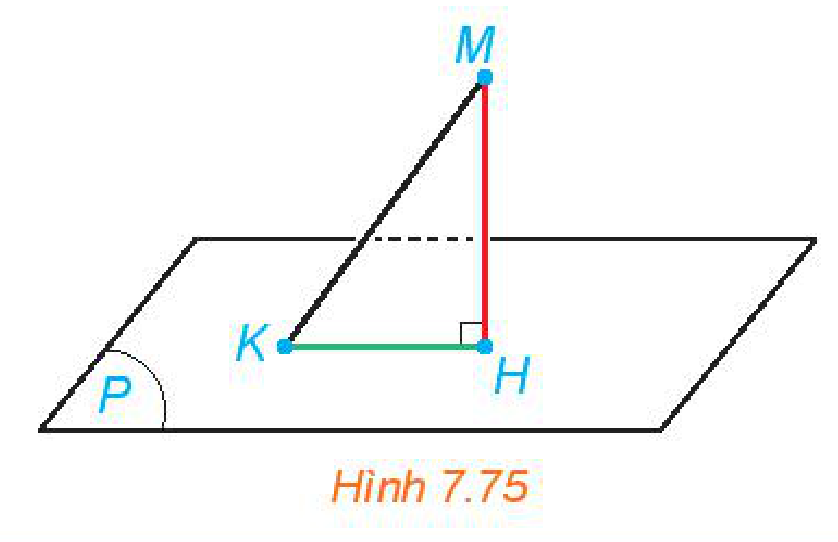
*Hình 7.75*

> - **Khoảng cách** từ một điểm $M$ đến một đường thẳng $a$, kí hiệu $\text{d}(M, a)$, là khoảng cách giữa $M$ và hình chiếu $H$ của $M$ trên $a$.
> - Khoảng cách từ một điểm $M$ đến một mặt phẳng $(P)$, kí hiệu $\text{d}(M, (P))$, là khoảng cách giữa $M$ và hình chiếu $H$ của $M$ trên $(P)$.

**Chú ý:** $\text{d}(M, a) = 0$ khi và chỉ khi $M \in a$; $\text{d}(M, (P)) = 0$ khi và chỉ khi $M \in (P)$.

<!-- pdf:56 -->

**Nhận xét:** Khoảng cách từ $M$ đến đường thẳng $a$ (mặt phẳng $(P)$) là khoảng cách nhỏ nhất giữa $M$ và một điểm thuộc $a$ (thuộc $(P)$).

**Chú ý:** Khoảng cách từ đỉnh đến mặt phẳng chứa mặt đáy của một hình chóp được gọi là **chiều cao của hình chóp** đó.

**Ví dụ 1:** Cho hình chóp đều $S.ABC$. Biết độ dài cạnh đáy, cạnh bên tương ứng bằng $a, b$ ($a < b\sqrt{3}$). Tính chiều cao của hình chóp.

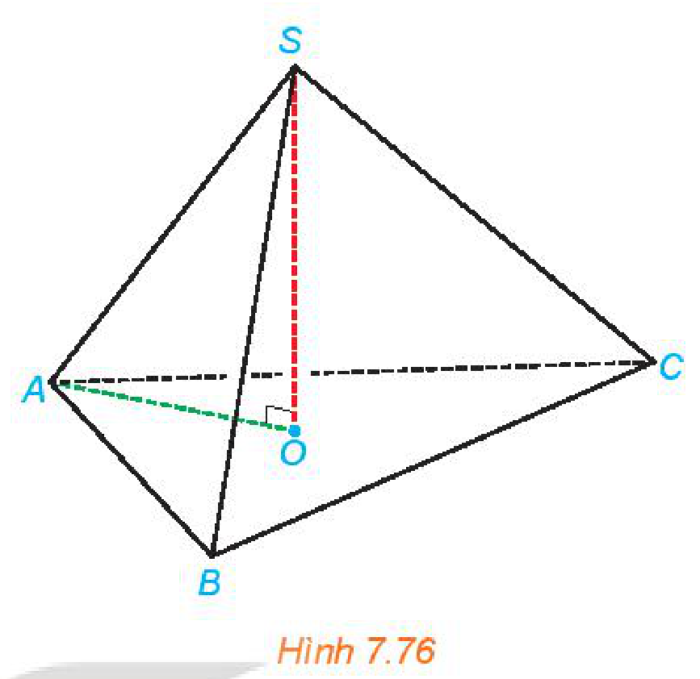
*Hình 7.76*

**Giải:** (H.7.76)

Hình chiếu của $S$ trên mặt phẳng $(ABC)$ là tâm $O$ của tam giác đều $ABC$. Trong tam giác đều $ABC$, ta có $OA = \dfrac{a}{\sqrt{3}}$. Trong tam giác vuông $SOA$, ta có

$$SO = \sqrt{SA^2 - OA^2} = \sqrt{b^2 - \dfrac{a^2}{3}}.$$
<!-- ocr-ok: công thức căn thức SO bị OCR đọc lệch, đã đối chiếu ảnh -->

Vậy chiều cao của hình chóp là $SO = \sqrt{b^2 - \dfrac{a^2}{3}}$.

**Luyện tập 1:** Cho hình lăng trụ đứng $ABC.A'B'C'$ có $ABC$ là tam giác vuông cân tại $A$, $AB = a, AA' = h$ (H.7.77).

a) Tính khoảng cách từ $A$ đến mặt phẳng $(BCC'B')$.

b) Tam giác $ABC'$ là tam giác gì? Tính khoảng cách từ $A$ đến $BC'$.

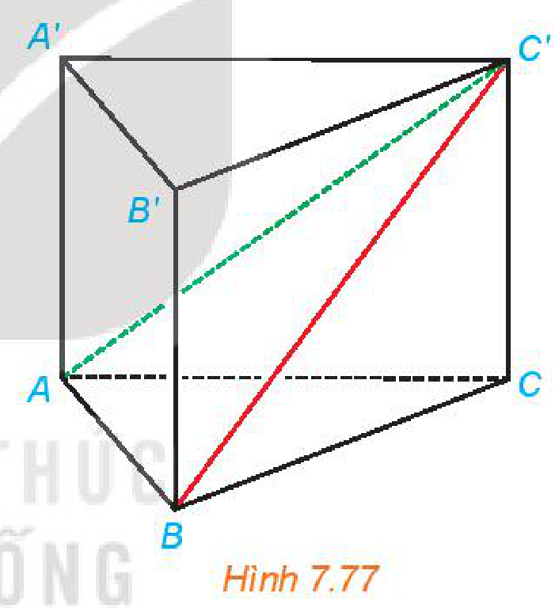
*Hình 7.77*

## 2. KHOẢNG CÁCH GIỮA CÁC ĐƯỜNG THẲNG VÀ MẶT PHẲNG SONG SONG, GIỮA HAI MẶT PHẲNG SONG SONG

**HĐ2:** Cho đường thẳng $a$ song song với mặt phẳng $(P)$. Lấy hai điểm $M, N$ bất kì thuộc $a$ và gọi $A, B$ tương ứng là các hình chiếu của chúng trên $(P)$ (H.7.78).

Giải thích vì sao $ABNM$ là một hình chữ nhật và $M, N$ có cùng khoảng cách đến $(P)$.

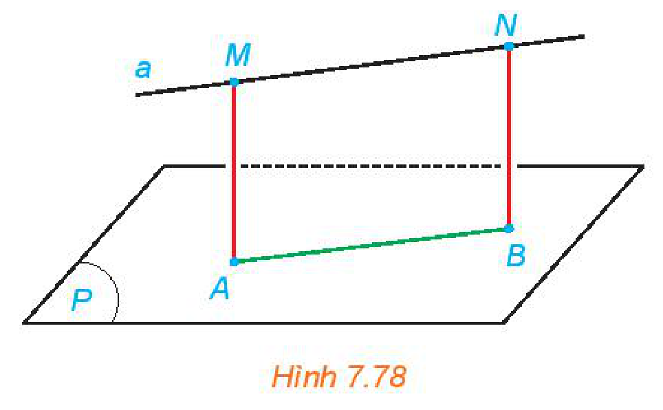
*Hình 7.78*

<!-- term: Khoảng cách giữa đường thẳng và mặt phẳng song song -->
> Khoảng cách giữa đường thẳng $a$ và mặt phẳng $(P)$ song song với $a$, kí hiệu $\text{d}(a, (P))$, là khoảng cách từ một điểm bất kì trên $a$ đến $(P)$.

<!-- pdf:57 -->

**HĐ3:**

a) Cho hai đường thẳng $m$ và $n$ song song với nhau. Khi một điểm $M$ thay đổi trên $m$ thì khoảng cách từ nó đến đường thẳng $n$ có thay đổi hay không?

b) Cho hai mặt phẳng song song $(P)$ và $(Q)$ và một điểm $M$ thay đổi trên $(P)$ (H.7.79). Hỏi khoảng cách từ $M$ đến $(Q)$ thay đổi thế nào khi $M$ thay đổi.

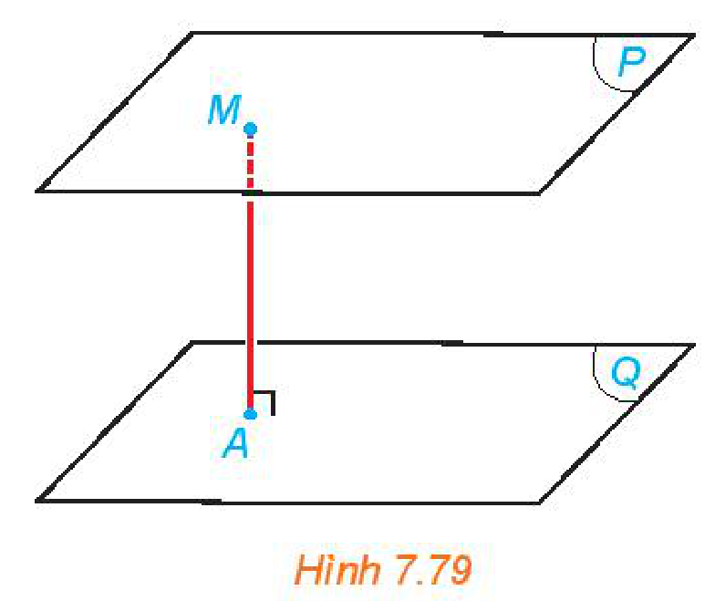
*Hình 7.79*

> - **Khoảng cách giữa hai mặt phẳng song song** $(P)$ và $(Q)$, kí hiệu $\text{d}((P), (Q))$, là khoảng cách từ một điểm bất kì thuộc mặt phẳng này đến mặt phẳng kia.
> - **Khoảng cách giữa hai đường thẳng song song** $m$ và $n$, kí hiệu $\text{d}(m, n)$, là khoảng cách từ một điểm thuộc đường thẳng này đến đường thẳng kia.

**Câu hỏi:** Nếu đường thẳng $a$ thuộc mặt phẳng $(P)$ và mặt phẳng $(Q)$ song song với $(P)$ thì giữa $\text{d}(a, (Q))$ và $\text{d}((P), (Q))$ có mối quan hệ gì?

**Chú ý:** Khoảng cách giữa hai đáy của một hình lăng trụ được gọi là **chiều cao của hình lăng trụ** đó.

**Ví dụ 2:** Cho một hình hộp đứng $ABCD.A'B'C'D'$, đáy là các hình thoi có cạnh bằng $a$, $\widehat{BAD} = 120^\circ, AA' = h$. Tính các khoảng cách giữa $A'C'$ và $(ABCD)$, $AA'$ và $(BDD'B')$.

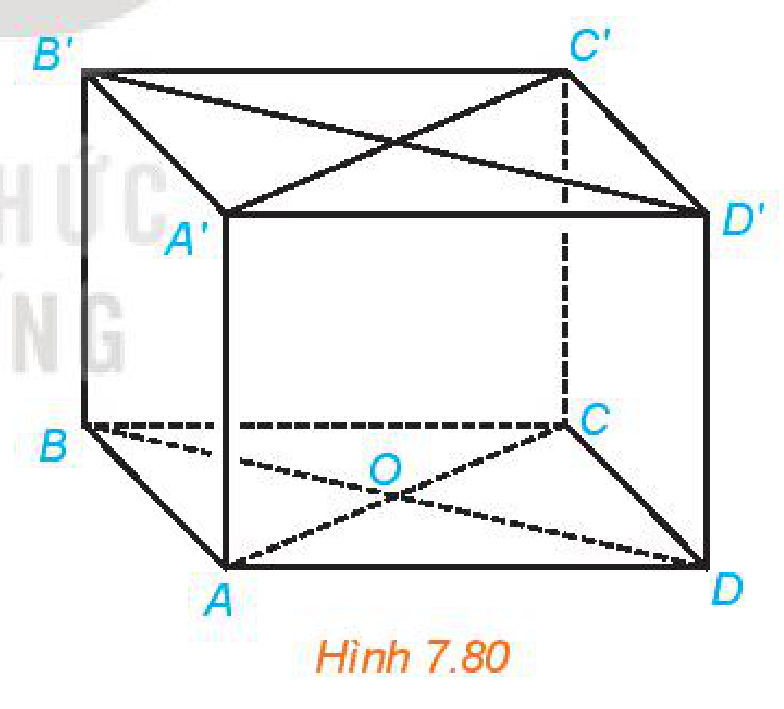
*Hình 7.80*

**Giải:** (H.7.80)

Đường thẳng $A'C'$ thuộc mặt phẳng $(A'B'C'D')$ nên nó song song với mặt phẳng $(ABCD)$. Do $ABCD.A'B'C'D'$ là hình hộp đứng nên $A'A \perp (ABCD)$.

Vậy $\text{d}(A'C', (ABCD)) = \text{d}(A', (ABCD)) = A'A = h$.

Do $AA'$ song song với $BB'$ nên $AA'$ song song với $(BDD'B')$. Gọi $O$ là tâm của hình thoi $ABCD$. Do $AO \perp BD$ và $AO \perp BB'$ nên $AO \perp (BDD'B')$. Vậy khoảng cách giữa $AA'$ và $(BDD'B')$ bằng độ dài đoạn thẳng $AO$.
<!-- ocr-ok: kí hiệu mặt phẳng (BDD'B') và vuông góc bị OCR đọc lệch, đã đối chiếu ảnh -->

Tam giác $BAD$ cân tại $A$ và có $\widehat{BAD} = 120^\circ$ nên $\widehat{ABO} = 30^\circ$.
<!-- ocr-ok: kí hiệu góc BAD và ABO bị OCR đọc lệch, đã đối chiếu ảnh -->

Do đó, trong tam giác vuông $AOB$, ta có $AO = \dfrac{1}{2}AB = \dfrac{a}{2}$.

Vậy khoảng cách giữa $AA'$ và $(BDD'B')$ bằng $\dfrac{a}{2}$.
<!-- ocr-ok: công thức phân số a/2 bị OCR đọc lệch, đã đối chiếu ảnh -->

**Luyện tập 2:** Cho hình chóp $S.ABC$ có $SA \perp (ABC), SA = h$. Gọi $M, N, P$ tương ứng là trung điểm của $SA, SB, SC$.

a) Tính $\text{d}((MNP), (ABC))$ và $\text{d}(NP, (ABC))$.

b) Giả sử tam giác $ABC$ vuông tại $B$ và $AB = a$. Tính $\text{d}(A, (SBC))$.

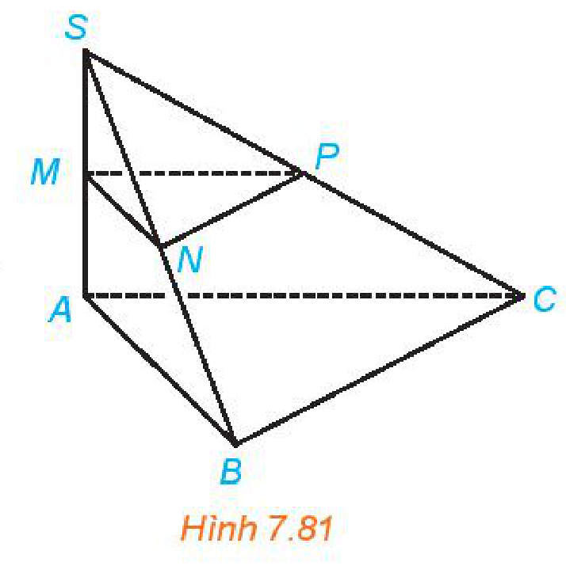
*Hình 7.81*

<!-- pdf:58 -->

**Vận dụng:** Ở một con dốc lên cầu, người ta đặt một khung khống chế chiều cao, hai cột của khung có phương thẳng đứng và có chiều dài bằng $2,28\text{ m}$. Đường thẳng nối hai chân cột vuông góc với hai đường mép dốc. Thanh ngang được đặt trên đỉnh hai cột. Biết dốc nghiêng $15^\circ$ so phương nằm ngang. Tính khoảng cách giữa thanh ngang của khung và mặt đường (theo đơn vị mét và làm tròn kết quả đến chữ số thập phân thứ hai). Hỏi cầu này có cho phép xe cao $2,21\text{ m}$ đi qua hay không?

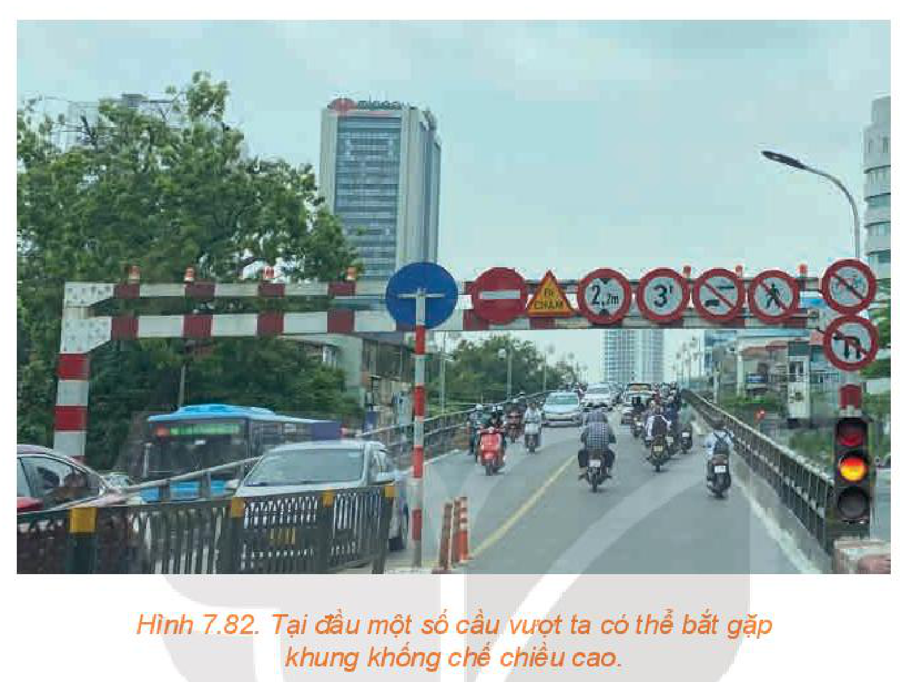
*Hình 7.82. Tại đầu một số cầu vượt ta có thể bắt gặp khung khống chế chiều cao.*

## 3. KHOẢNG CÁCH GIỮA HAI ĐƯỜNG THẲNG CHÉO NHAU

**HĐ4:** Cho hai đường thẳng chéo nhau $a$ và $b$. Gọi $(Q)$ là mặt phẳng chứa đường thẳng $b$ và song song với $a$. Hình chiếu $a'$ của $a$ trên $(Q)$ cắt $b$ tại $N$. Gọi $M$ là hình chiếu của $N$ trên $a$ (H.7.83).

a) Mặt phẳng chứa $a$ và $a'$ có vuông góc với $(Q)$ hay không?

b) Đường thẳng $MN$ có vuông góc với cả hai đường thẳng $a$ và $b$ hay không?

c) Nêu mối quan hệ của khoảng cách giữa $a, (Q)$ và độ dài đoạn thẳng $MN$.
<!-- ocr-ok: kí hiệu a, (Q) và MN bị OCR đọc lệch, đã đối chiếu ảnh -->

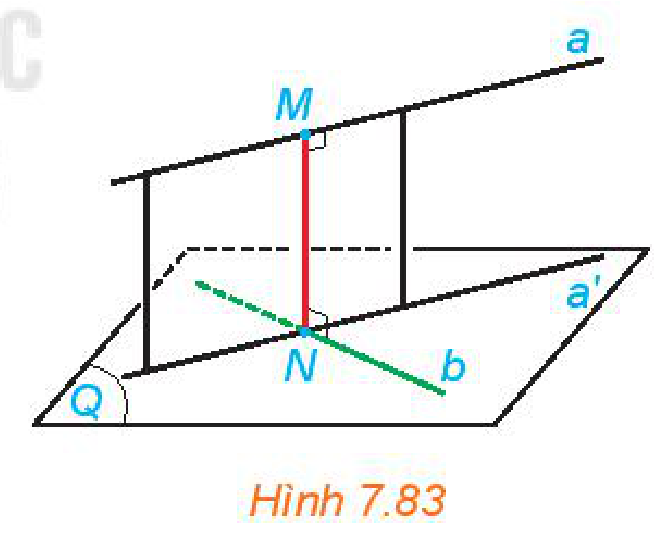
*Hình 7.83*

> Đường thẳng $\Delta$ cắt hai đường thẳng chéo nhau $a, b$ và vuông góc với cả hai đường thẳng đó được gọi là **đường vuông góc chung** của $a$ và $b$.
> Nếu đường vuông góc chung $\Delta$ cắt $a, b$ tương ứng tại $M, N$ thì độ dài đoạn thẳng $MN$ được gọi là **khoảng cách giữa hai đường thẳng chéo nhau** $a, b$.

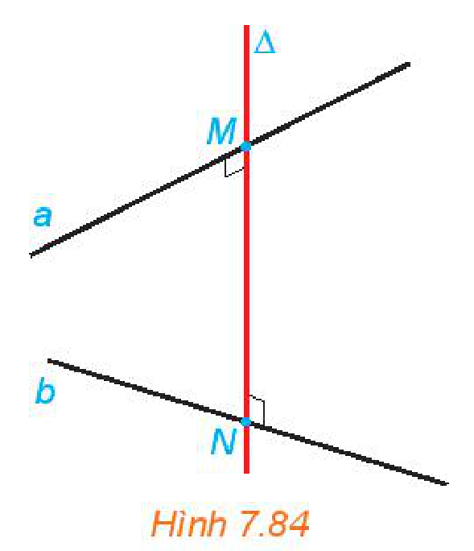
*Hình 7.84*

<!-- pdf:59 -->

**Nhận xét:**

- Khoảng cách giữa hai đường thẳng chéo nhau bằng khoảng cách giữa một trong hai đường thẳng đó đến mặt phẳng song song với nó và chứa đường thẳng còn lại (H.7.85).
- Khoảng cách giữa hai đường thẳng chéo nhau bằng khoảng cách giữa hai mặt phẳng song song, tương ứng chứa hai đường thẳng đó (H.7.86).

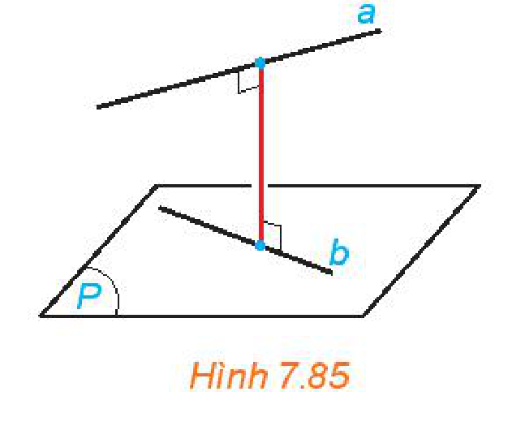
*Hình 7.85*

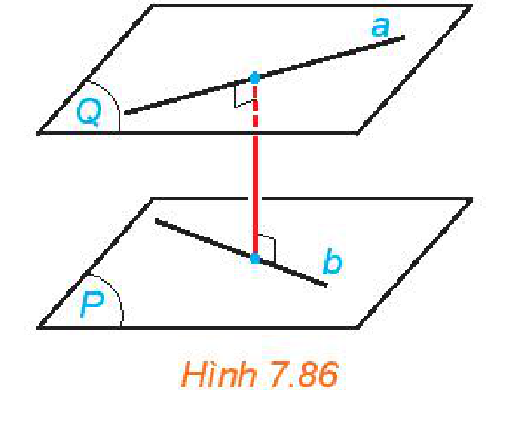
*Hình 7.86*

**Ví dụ 3:** Cho hình chóp $S.ABC$ có $SA \perp (ABC)$, $AB = a, \widehat{ABC} = 60^\circ$. Xác định đường vuông góc chung và tính khoảng cách giữa hai đường thẳng $SA$ và $BC$.

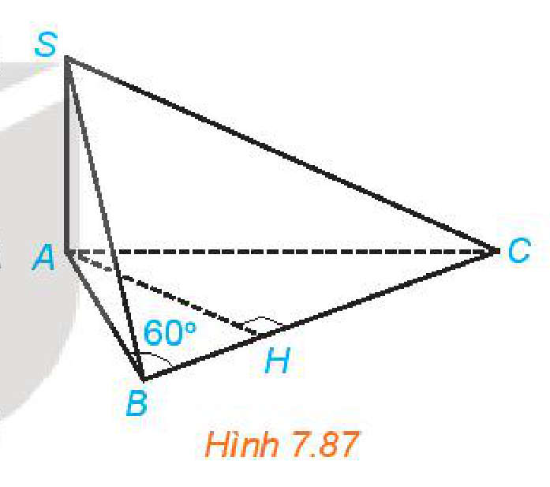
*Hình 7.87*

**Giải:** (H.7.87)

Gọi $H$ là hình chiếu của $A$ trên $BC$. Tam giác $ABH$ vuông tại $H$ và có $AB = a, \widehat{ABH} = 60^\circ$ nên $BH = \dfrac{a}{2}$.
<!-- ocr-ok: công thức góc ABH và BH = a/2 bị OCR đọc lệch, đã đối chiếu ảnh -->

Do $SA$ vuông góc với mặt phẳng $(ABC)$ nên $AH$ là đường vuông góc chung của $SA$ và $BC$ ($H$ thuộc tia $BC$ và $BH = \dfrac{a}{2}$).
<!-- ocr-ok: công thức BH = a/2 bị OCR đọc lệch, đã đối chiếu ảnh -->

Khoảng cách giữa hai đường thẳng $SA$ và $BC$ là

$$\text{d}(SA, BC) = AH = \dfrac{a\sqrt{3}}{2}.$$
<!-- ocr-ok: công thức khoảng cách d(SA, BC) bị OCR đọc lệch, đã đối chiếu ảnh -->

**Khám phá:** Cho đường thẳng $a$ vuông góc với mặt phẳng $(P)$ và cắt $(P)$ tại $O$. Cho đường thẳng $b$ thuộc mặt phẳng $(P)$. Hãy tìm mối quan hệ giữa khoảng cách giữa $a, b$ và khoảng cách từ $O$ đến $b$ (H.7.88).

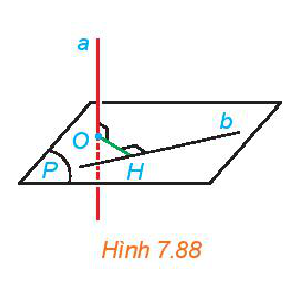
*Hình 7.88*

**Luyện tập 3:** Cho hình chóp $S.ABCD$ có đáy là hình vuông cạnh $a$, $SA \perp (ABCD), SA = a\sqrt{2}$.

a) Tính khoảng cách từ $A$ đến $SC$.

b) Chứng minh rằng $BD \perp (SAC)$.

c) Xác định đường vuông góc chung và tính khoảng cách giữa $BD$ và $SC$.

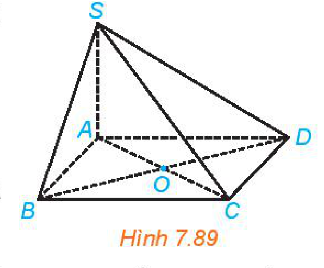
*Hình 7.89*

**Thảo luận:** Khoảng cách giữa hai hình được nêu trong bài học (điểm, đường thẳng, mặt phẳng) là khoảng cách nhỏ nhất giữa một điểm thuộc hình này và một điểm thuộc hình kia. Hãy thảo luận để làm rõ nhận xét này.

<!-- pdf:60 -->

## ✏️ Bài tập

**7.22.** Cho hình chóp $S.ABCD$ có đáy là một hình vuông cạnh $a$, mặt bên $SAD$ là một tam giác đều và $(SAD) \perp (ABCD)$.

a) Tính chiều cao của hình chóp.

b) Tính khoảng cách giữa $BC$ và $(SAD)$.
<!-- ocr-ok: kí hiệu BC và (SAD) bị OCR đọc lệch, đã đối chiếu ảnh -->

c) Xác định đường vuông góc chung và tính khoảng cách giữa $AB$ và $SD$.

**7.23.** Cho hình hộp chữ nhật $ABCD.A'B'C'D'$ có $AA' = a, AB = b, BC = c$.
<!-- ocr-ok: kí hiệu đỉnh hình hộp và độ dài cạnh bị OCR đọc lệch, đã đối chiếu ảnh -->

a) Tính khoảng cách giữa $CC'$ và $(BB'D'D)$.

b) Xác định đường vuông góc chung và tính khoảng cách giữa $AC$ và $B'D'$.

**7.24.** Cho tứ diện $ABCD$ có các cạnh đều bằng $a$. Gọi $M, N$ tương ứng là trung điểm của các cạnh $AB, CD$. Chứng minh rằng:

a) $MN$ là đường vuông góc chung của $AB$ và $CD$.

b) Các cặp cạnh đối diện trong tứ diện $ABCD$ đều vuông góc với nhau.

**7.25.** Cho hình lập phương $ABCD.A'B'C'D'$ có cạnh $a$.
<!-- ocr-ok: kí hiệu đỉnh hình lập phương bị OCR đọc lệch, đã đối chiếu ảnh -->

a) Chứng minh rằng hai mặt phẳng $(D'AC)$ và $(BC'A')$ song song với nhau và $DB'$ vuông góc với hai mặt phẳng đó.

b) Xác định các giao điểm $E, F$ của $DB'$ với $(D'AC), (BC'A')$. Tính $\text{d}((D'AC), (BC'A'))$.

**7.26.** Giá đỡ ba chân ở Hình 7.90 đang được mở sao cho ba gốc chân cách đều nhau một khoảng cách bằng $110\text{ cm}$. Tính chiều cao của giá đỡ, biết các chân của giá đỡ dài $129\text{ cm}$.

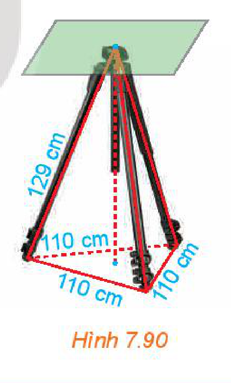
*Hình 7.90*

**7.27.** Một bể nước có đáy thuộc mặt phẳng nằm ngang. Trong trường hợp này, độ sâu của bể là khoảng cách giữa mặt nước và đáy bể. Giải thích vì sao để đo độ sâu của bể, ta có thể thả quả dọi chạm đáy bể và đo chiều dài của đoạn dây dọi nằm trong bể nước.

## 💡 Em có biết?

Vì sao vùng phía bắc chí tuyến Bắc và vùng phía nam chí tuyến Nam tia sáng mặt trời không bao giờ vuông góc với mặt đất (tức là, không xảy ra hiện tượng đứng bóng thực sự tại đó)? *(Theo nationalgeographic.com)*

Tia sáng mặt trời chỉ vuông góc với mặt đất (tức là có hướng đi qua tâm Trái Đất) tại vị trí $P_0$ trên mặt đất thuộc đoạn thẳng nối tâm $O$ của Trái Đất và tâm $I$ của Mặt Trời (H.7.91b).

Đường thẳng $OI$ thuộc mặt phẳng chứa quỹ đạo của Trái Đất và trục quay $SN$ (Bắc – Nam) của Trái Đất luôn tạo với mặt phẳng đó một góc khoảng $66,5^\circ$. Từ đó ta có thể rút ra $\widehat{NOI} \ge 66,5^\circ$.

Mỗi vị trí $P$ thuộc vùng phía bắc chí tuyến Bắc đều có vĩ độ bắc $\varphi > 23,5^\circ$, tức là $\widehat{NOP} = 90^\circ - \varphi < 66,5^\circ$. Để ý rằng $ON$ vuông góc với mặt phẳng xích đạo, nên $OP$ tạo với mặt phẳng xích đạo và đường thẳng $ON$ hai góc phụ nhau.

<!-- pdf:61 -->

Mặt khác, nếu xảy ra hiện tượng đứng bóng thực sự ở vị trí $P$ thì điểm $P$ thuộc đoạn thẳng $OI$ và do đó $\widehat{NOP} = \widehat{NOI} \ge 66,5^\circ$. Điều này dẫn tới mâu thuẫn. Do đó, không thể xảy ra hiện tượng đứng bóng thực sự tại $P$.

Trong mô hình toán học được đề cập ở trên, chúng ta thấy, tại mỗi thời điểm, chỉ có thể xảy ra hiện tượng đứng bóng thực sự tại một vị trí (đó là tại vị trí $P_0$ trên mặt đất và thuộc đoạn thẳng $OI$), do đó, nhìn chung ngay cả ở các vị trí thuộc vùng giữa hai đường chí tuyến Bắc, Nam (có vĩ độ nhỏ hơn $66,5^\circ$), trong một năm cũng rất hiếm khi xảy ra hiện tượng đứng bóng thực sự.

Tuy vậy, hiện tượng đứng bóng tại một vị trí trên mặt đất được hiểu theo nghĩ rộng hơn; đó là hiện tượng tia sáng mặt trời chiếu trực diện tới Trái Đất tại vị trí đó. Nó xảy ra khi đường kinh tuyến đi qua vị trí đó và tâm $I$ của Mặt Trời cùng thuộc một nửa mặt phẳng bờ $NS$. Như vậy, tại mỗi vị trí trên mặt đất, mỗi ngày đều xảy ra hiện tượng đứng bóng. Các vị trí thuộc cùng một kinh tuyến thì xảy ra hiện tượng đứng bóng tại cùng một thời điểm, gọi là **giữa trưa** (trong khoảng $12$ giờ trưa cộng, trừ $16$ phút).

Góc giữa đường thẳng chứa tia sáng mặt trời và mặt phẳng nằm ngang tại một vị trí lúc giữa trưa được gọi là **góc Mặt Trời** (như đã phân tích ở trên, nhìn chung, góc này nhọn). Góc Mặt Trời có ảnh hưởng tới sự hấp thụ nhiệt từ Mặt Trời của Trái Đất, tạo nên các mùa trong năm trên Trái Đất, chẳng hạn vào mùa hè, góc Mặt Trời lớn nên nhiệt độ cao.

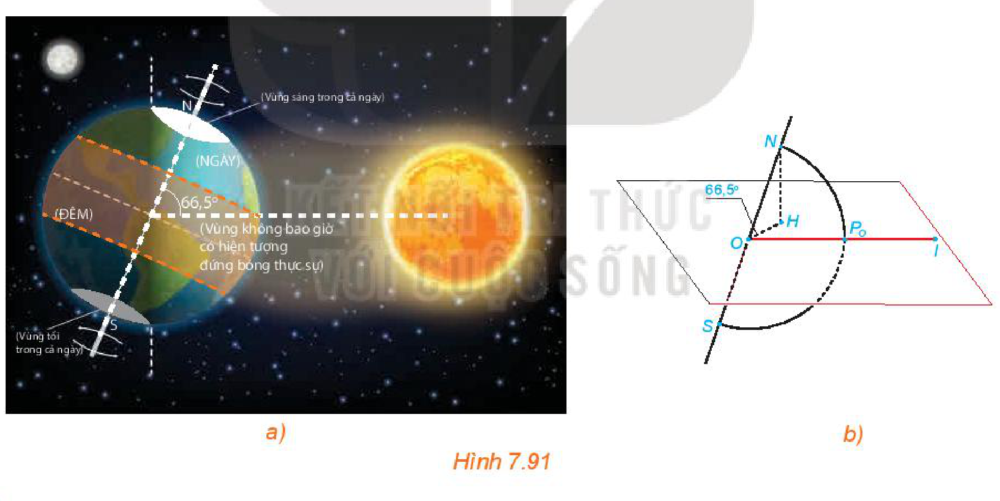
*Hình 7.91*

## 📷 Danh sách hình trong bài

| Mã hình | Trang PDF | Vị trí trong bài | Chú thích gốc |
| --- | :---: | --- | --- |
| H11-toan-b26-01 | 55 | Mở đầu | Hình 7.73. Các đầu phun nước chữa cháy sprinkler cần được lắp đặt theo tiêu chuẩn kĩ thuật, trong đó có tiêu chuẩn về khoảng cách tới từng loại trần, tường, nhà. |
| H11-toan-b26-02 | 55 | Mục 1, HĐ1 | Hình 7.74 |
| H11-toan-b26-03 | 55 | Mục 1, HĐ1 | Hình 7.75 |
| H11-toan-b26-04 | 56 | Mục 1, Ví dụ 1 | Hình 7.76 |
| H11-toan-b26-05 | 56 | Mục 1, Luyện tập 1 | Hình 7.77 |
| H11-toan-b26-06 | 56 | Mục 2, HĐ2 | Hình 7.78 |
| H11-toan-b26-07 | 57 | Mục 2, HĐ3 | Hình 7.79 |
| H11-toan-b26-08 | 57 | Mục 2, Ví dụ 2 | Hình 7.80 |
| H11-toan-b26-09 | 57 | Mục 2, Luyện tập 2 | Hình 7.81 |
| H11-toan-b26-10 | 58 | Mục 2, Vận dụng | Hình 7.82. Tại đầu một số cầu vượt ta có thể bắt gặp khung khống chế chiều cao. |
| H11-toan-b26-11 | 58 | Mục 3, HĐ4 | Hình 7.83 |
| H11-toan-b26-12 | 58 | Mục 3 | Hình 7.84 |
| H11-toan-b26-13 | 59 | Mục 3, Nhận xét | Hình 7.85 |
| H11-toan-b26-14 | 59 | Mục 3, Nhận xét | Hình 7.86 |
| H11-toan-b26-15 | 59 | Mục 3, Ví dụ 3 | Hình 7.87 |
| H11-toan-b26-16 | 59 | Mục 3, Khám phá | Hình 7.88 |
| H11-toan-b26-17 | 59 | Mục 3, Luyện tập 3 | Hình 7.89 |
| H11-toan-b26-18 | 60 | Bài tập 7.26 | Hình 7.90 |
| H11-toan-b26-19 | 61 | Em có biết? | Hình 7.91 |
