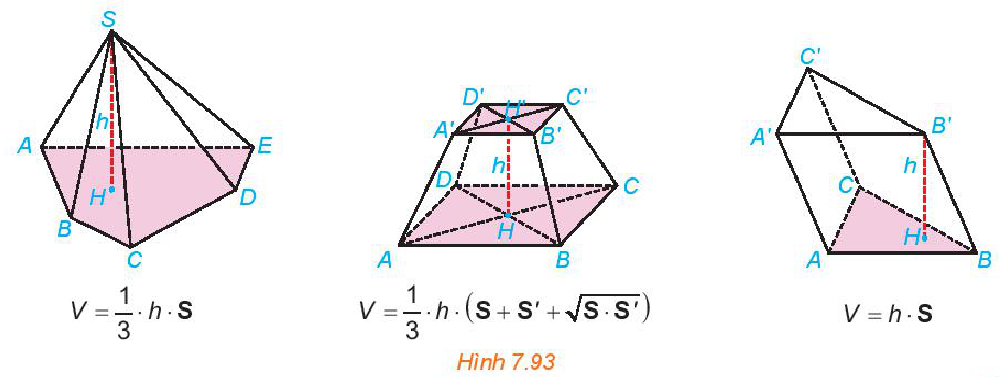
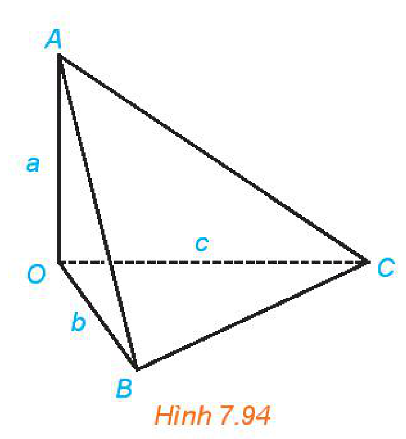
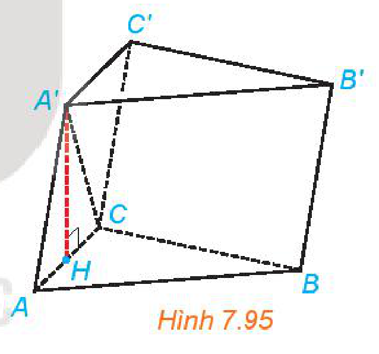
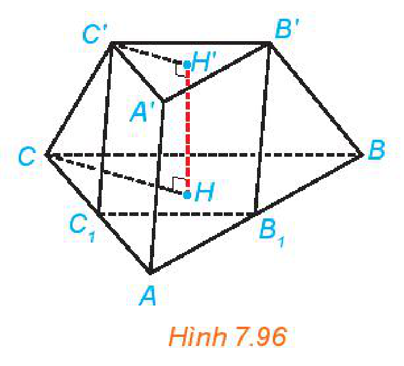
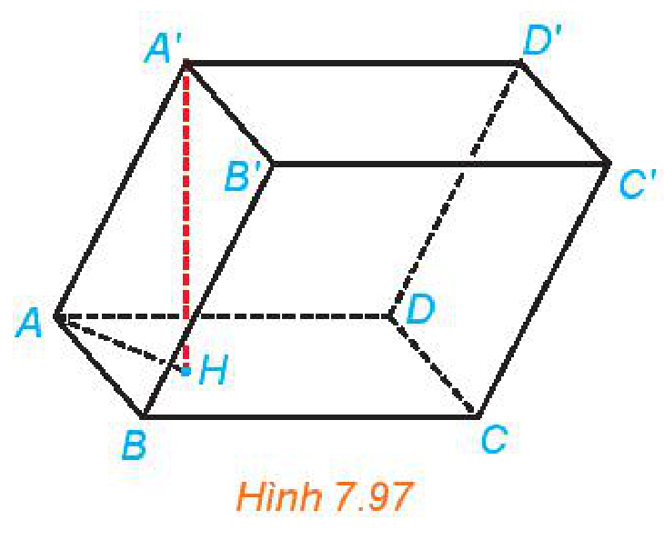
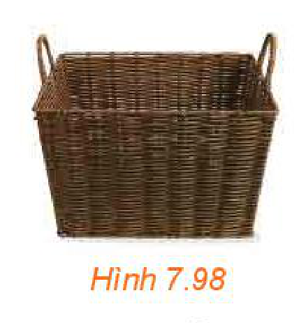
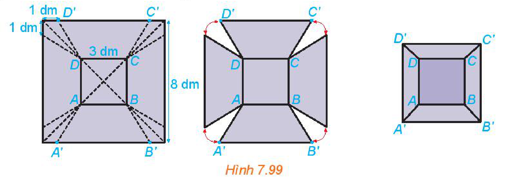

<!-- pdf:62 -->

# BÀI 27: THỂ TÍCH

## 🔤 Thuật ngữ

- Thể tích khối hộp
- Thể tích khối lăng trụ
- Thể tích khối chóp
- Thể tích khối chóp cụt

## 🎯 Mục tiêu

- Nhận biết công thức tính thể tích của khối chóp, khối lăng trụ, khối hộp, khối chóp cụt đều.
- Tính thể tích của khối chóp, khối lăng trụ, khối hộp, khối chóp cụt đều trong một số tình huống đơn giản.
- Vận dụng kiến thức, kĩ năng về thể tích vào một số bài toán thực tế.

## 🔴 Mở đầu

**Thể tích** là một trong những khái niệm toán học xuất hiện thường xuyên trong cuộc sống, đo sự chiếm chỗ của vật thể trong không gian. Bài học này đưa ra công thức thể tích của các hình khối ứng với các hình mà ta đã học.

**HĐ1:** Khi mua máy điều hoà, bác An được hướng dẫn rằng mỗi mét khối của phòng cần công suất điều hoà khoảng $200\text{ BTU}$. Căn phòng bác An cần lắp máy có dạng hình hộp chữ nhật, rộng $4\text{ m}$, dài $5\text{ m}$ và cao $3\text{ m}$. Hỏi bác An cần mua loại điều hoà có công suất bao nhiêu $\text{BTU}$?

*Hình 7.92*

> Phần không gian được giới hạn bởi hình chóp, hình chóp cụt đều, hình lăng trụ, hình hộp tương ứng được gọi là **khối chóp**, **khối chóp cụt đều**, **khối lăng trụ**, **khối hộp**. Đỉnh, mặt, cạnh, đường cao của các khối hình đó lần lượt là đỉnh, mặt, cạnh, đường cao của hình chóp, hình chóp cụt đều, hình lăng trụ, hình hộp tương ứng.
>
> - **Thể tích của khối chóp** có diện tích đáy $S$ và chiều cao $h$ là $V = \dfrac{1}{3} \cdot h \cdot S$.
> - **Thể tích của khối chóp cụt đều** có diện tích đáy lớn $S$, diện tích đáy bé $S'$ và chiều cao $h$ là $V = \dfrac{1}{3} \cdot h \cdot \left(S + S' + \sqrt{S \cdot S'}\right)$.
> - **Thể tích của khối lăng trụ** có diện tích đáy $S$ và chiều cao $h$ là $V = h \cdot S$.

*Hình 7.93*

<!-- pdf:63 -->

**Nhận xét:**

- **Thể tích khối tứ diện** bằng một phần ba tích của chiều cao từ một đỉnh và diện tích mặt đối diện với đỉnh đó.
- **Thể tích của khối hộp** bằng tích của diện tích một mặt và chiều cao của khối hộp ứng với mặt đó.

**Ví dụ 1:** Cho khối tứ diện $OABC$ có các cạnh $OA, OB, OC$ đôi một vuông góc với nhau và $OA = a, OB = b, OC = c$. Tính thể tích của khối tứ diện.

*Hình 7.94*

**Giải:** (H.7.94)

Tam giác vuông $OBC$ có diện tích là $S_{OBC} = \dfrac{1}{2}bc$.

$OA$ vuông góc với mặt phẳng $(OBC)$ nên tứ diện $OABC$ có chiều cao ứng với đỉnh $A$ bằng $OA$.

Vậy thể tích của khối tứ diện là $V_{OABC} = \dfrac{1}{3}AO \cdot S_{OBC} = \dfrac{1}{6}abc$.

**Luyện tập 1:** Cho khối chóp đều $S.ABCD$ có cạnh đáy bằng $a$, cạnh bên bằng $b$. Tính thể tích của khối chóp.

**Ví dụ 2:** Cho khối lăng trụ $ABC.A'B'C'$ có đáy là các tam giác đều cạnh $a$, mặt $(ACC'A')$ vuông góc với hai mặt đáy, tam giác $A'AC$ cân tại $A$ và $AA' = b$ ($a < 2b$). Tính thể tích của khối lăng trụ.

*Hình 7.95*

**Giải:** (H.7.95)

Gọi $A'H$ là đường cao của tam giác cân $A'AC$. Khi đó, $H$ là trung điểm của $AC$.

Do $(ACC'A') \perp (ABC)$ và $A'H \perp AC$ nên $A'H \perp (ABC)$.

Vậy khối lăng trụ có chiều cao là $A'H = \sqrt{AA'^2 - AH^2} = \sqrt{b^2 - \dfrac{a^2}{4}}$.

Tam giác đều $ABC$ có diện tích là $S_{ABC} = \dfrac{a^2\sqrt{3}}{4}$.

Vậy khối lăng trụ có thể tích là $V = A'H \cdot S_{ABC} = \sqrt{b^2 - \dfrac{a^2}{4}} \cdot \dfrac{a^2\sqrt{3}}{4} = \dfrac{a^2\sqrt{3(4b^2 - a^2)}}{8}$.

**Luyện tập 2:** Cho khối chóp cụt đều $ABC.A'B'C'$ có đường cao $HH' = h$, hai mặt đáy $ABC, A'B'C'$ có cạnh tương ứng bằng $2a, a$.

a) Tính thể tích của khối chóp cụt.

b) Gọi $B_1, C_1$ tương ứng là trung điểm của $AB, AC$. Chứng minh rằng $AB_1C_1.A'B'C'$ là một hình lăng trụ. Tính thể tích khối lăng trụ $AB_1C_1.A'B'C'$.

*Hình 7.96*

<!-- pdf:64 -->

**Ví dụ 3:** Cho khối hộp $ABCD.A'B'C'D'$ có $AB = 8\text{ cm}, AD = 5\text{ cm}, AA' = 6\text{ cm}, \widehat{BAD} = 30^\circ$, góc giữa $AA'$ và $(ABCD)$ bằng $45^\circ$. Tính thể tích của khối hộp.

*Hình 7.97*

**Giải:** (H.7.97)

Hình bình hành $ABCD$ có diện tích là

$$S_{ABCD} = 2S_{ABD} = 2\left(\dfrac{1}{2}AB \cdot AD\sin \widehat{BAD}\right) = 20\text{ (cm}^2\text{)}.$$
<!-- ocr-ok: công thức diện tích hình bình hành ABCD bị OCR đọc lệch, đã đối chiếu ảnh -->

Gọi $H$ là hình chiếu của $A'$ trên $(ABCD)$. Khi đó, $\widehat{A'AH}$ bằng góc giữa $AA'$ và $(ABCD)$ nên $\widehat{A'AH} = 45^\circ$. Trong tam giác vuông $A'AH$, ta có $A'H = A'A \cdot \sin \widehat{A'AH} = \dfrac{6\sqrt{2}}{2} = 3\sqrt{2}\text{ (cm)}$.
<!-- ocr-ok: công thức tính A'H và góc A'AH bị OCR đọc lệch, đã đối chiếu ảnh -->

Khối hộp $ABCD.A'B'C'D'$ có chiều cao tương ứng với mặt $ABCD$ bằng $A'H = 3\sqrt{2}\text{ (cm)}$.

Do đó, thể tích của khối hộp là $V = A'A \cdot S_{ABCD} = 60\sqrt{2}\text{ (cm}^3\text{)}$.

**Vận dụng:** Một sọt đựng đồ có dạng hình chóp cụt đều (H.7.98). Đáy và miệng sọt là các hình vuông tương ứng có cạnh bằng $60\text{ cm}, 30\text{ cm}$, cạnh bên của sọt dài $50\text{ cm}$. Tính thể tích của sọt.

*Hình 7.98*

## ✏️ Bài tập

**7.28.** Cho khối chóp đều $S.ABC$, đáy có cạnh bằng $a$, cạnh bên bằng $b$. Tính thể tích của khối chóp đó. Từ đó suy ra thể tích của khối tứ diện đều có cạnh bằng $a$.

**7.29.** Cho khối lăng trụ đứng $ABC.A'B'C'$ có $AA' = 5\text{ cm}, AB = 6\text{ cm}, BC = 2\text{ cm}, \widehat{ABC} = 150^\circ$. Tính thể tích của khối lăng trụ.

**7.30.** Cho khối chóp đều $S.ABCD$, đáy có cạnh $6\text{ cm}$. Tính thể tích của khối chóp đó trong các trường hợp sau:

a) Cạnh bên tạo với mặt đáy một góc bằng $60^\circ$.

b) Mặt bên tạo với mặt đáy một góc bằng $45^\circ$.

**7.31.** Cho khối lăng trụ $ABC.A'B'C'$ có đáy là các tam giác đều cạnh $a$, $A'A = A'B = A'C = b$. Tính thể tích của khối lăng trụ.

**7.32.** Từ một tấm tôn hình vuông có cạnh $8\text{ dm}$, bác Hùng cắt bỏ bốn phần như nhau ở bốn góc, sau đó bác hàn các mép lại để được một chiếc thùng (không có nắp) như Hình 7.99.

a) Giải thích vì sao chiếc thùng có dạng hình chóp cụt.

b) Tính cạnh bên của thùng.

c) Hỏi thùng có thể chứa được nhiều nhất bao nhiêu lít nước?

*Hình 7.99*

## 📷 Danh sách hình trong bài

| Mã hình | Trang PDF | Vị trí trong bài | Chú thích gốc |
| --- | :---: | --- | --- |
| H11-toan-b27-01 | 62 | Mở đầu, HĐ1 | Hình 7.92 |
| H11-toan-b27-02 | 62 | Mở đầu | Hình 7.93 |
| H11-toan-b27-03 | 63 | Mở đầu, Ví dụ 1 | Hình 7.94 |
| H11-toan-b27-04 | 63 | Mở đầu, Ví dụ 2 | Hình 7.95 |
| H11-toan-b27-05 | 63 | Mở đầu, Luyện tập 2 | Hình 7.96 |
| H11-toan-b27-06 | 64 | Mở đầu, Ví dụ 3 | Hình 7.97 |
| H11-toan-b27-07 | 64 | Mở đầu, Vận dụng | Hình 7.98 |
| H11-toan-b27-08 | 64 | Bài tập 7.32 | Hình 7.99 |
