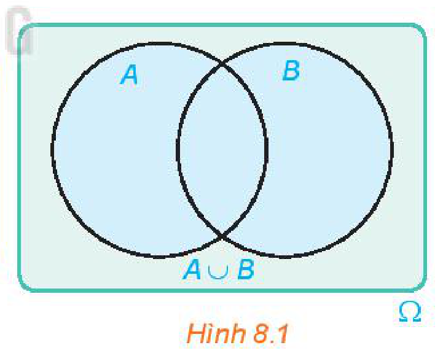
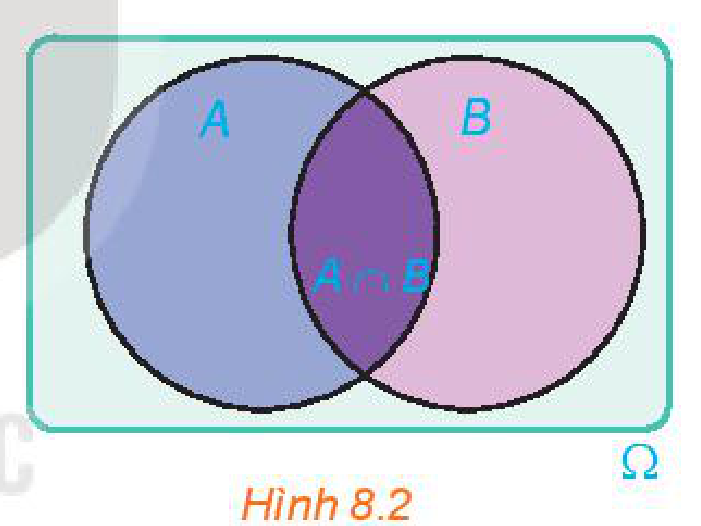

<!-- pdf:67 -->

<!-- Phần giới thiệu Chương VIII (in chung đầu trang PDF 67): CHƯƠNG VIII. CÁC QUY TẮC TÍNH XÁC SUẤT -->

Nếu biết xác suất xảy ra của biến cố $A$, xác suất xảy ra của biến cố $B$, làm thế nào để tính xác suất xảy ra biến cố $A$ hoặc biến cố $B$, xác suất xảy ra biến cố $A$ và biến cố $B$?

Chương này đưa ra các quy tắc tính xác suất nhằm mục đích giúp ta trả lời các câu hỏi trên.

# BÀI 28: BIẾN CỐ HỢP, BIẾN CỐ GIAO, BIẾN CỐ ĐỘC LẬP

## 🔤 Thuật ngữ

- Biến cố hợp
- Biến cố giao
- Biến cố độc lập

## 🎯 Mục tiêu

- Nhận biết các khái niệm biến cố hợp, biến cố giao, biến cố độc lập.

## 🔴 Mở đầu

Trong một cuộc khảo sát về mức sống của người Hà Nội, người khảo sát chọn ngẫu nhiên một gia đình ở Hà Nội. Xét các biến cố sau:

$M$: “Gia đình đó có ti vi”;

$N$: “Gia đình đó có máy vi tính”;

$E$: “Gia đình đó có ti vi hoặc máy vi tính”;

$F$: “Gia đình đó có cả ti vi và máy vi tính”;

$G$: “Gia đình đó có ti vi hoặc máy vi tính nhưng không có cả hai thiết bị nói trên”;

$H$: “Gia đình đó không có cả ti vi và máy vi tính”.

Các biến cố trên rõ ràng có mối liên hệ với nhau. Chúng ta có thể mô tả các mối liên hệ đó một cách cô đọng, súc tích bằng các khái niệm và kí hiệu toán học được không?

<!-- pdf:68 -->

## 1. BIẾN CỐ HỢP

**HĐ1:** Một tổ trong lớp 11A có $10$ học sinh. Điểm kiểm tra học kì I của $10$ bạn này ở hai môn Toán và Ngữ văn được cho như sau:

| Tên học sinh \ Môn | Toán | Ngữ văn |
| :--- | :---: | :---: |
| Bảo | $7$ | $6$ |
| Dung | $5$ | $9$ |
| Định | $5$ | $6$ |
| Lan | $8$ | $7$ |
| Long | $6$ | $8$ |
| Hương | $9$ | $7$ |
| Phúc | $8$ | $6$ |
| Cường | $8$ | $9$ |
| Tuấn | $4$ | $5$ |
| Trang | $10$ | $8$ |
<!-- ocr-ok: đã đối chiếu ảnh trang PDF 68, bảng điểm 10 học sinh -->

> Điểm $8$ trở lên là điểm giỏi.
<!-- ocr-ok: đã đối chiếu ảnh trang PDF 68, lời thoại nhân vật tròn -->

Chọn ngẫu nhiên một học sinh trong tổ. Xét các biến cố sau:

$A$: “Học sinh đó được điểm giỏi môn Ngữ văn”;

$B$: “Học sinh đó được điểm giỏi môn Toán”;

$C$: “Học sinh đó được điểm giỏi môn Ngữ văn hoặc điểm giỏi môn Toán”.

a) Mô tả không gian mẫu và các tập con $A, B, C$ của không gian mẫu.

b) Tìm $A \cup B$.

> Cho $A$ và $B$ là hai biến cố. Biến cố: “$A$ hoặc $B$ xảy ra” được gọi là **biến cố hợp** của $A$ và $B$, kí hiệu là $A \cup B$.
>
> Biến cố hợp của $A$ và $B$ là tập con $A \cup B$ của không gian mẫu $\Omega$.

*Hình 8.1*

**Ví dụ 1:** Một hộp đựng $15$ tấm thẻ cùng loại được đánh số từ $1$ đến $15$. Rút ngẫu nhiên một tấm thẻ trong hộp. Gọi $E$ là biến cố “Số ghi trên tấm thẻ là số lẻ”; $F$ là biến cố “Số ghi trên tấm thẻ là số nguyên tố”.

a) Mô tả không gian mẫu.

b) Nêu nội dung của biến cố hợp $G = E \cup F$. Hỏi $G$ là tập con nào của không gian mẫu?

**Giải:**

a) Không gian mẫu $\Omega = \{1; 2; 3; 4; 5; 6; 7; 8; 9; 10; 11; 12; 13; 14; 15\}$.

<!-- pdf:69 -->

b) $E \cup F$ là biến cố “Số ghi trên tấm thẻ là số lẻ hoặc số nguyên tố”.

Ta có $E = \{1; 3; 5; 7; 9; 11; 13; 15\}$; $F = \{2; 3; 5; 7; 11; 13\}$.

Vậy $G = E \cup F = \{1; 2; 3; 5; 7; 9; 11; 13; 15\}$.

**Luyện tập 1:** Một tổ trong lớp 11B có $4$ học sinh nữ là Hương, Hồng, Dung, Phương và $5$ học sinh nam là Sơn, Tùng, Hoàng, Tiến, Hải. Trong giờ học, giáo viên chọn ngẫu nhiên một học sinh trong tổ đó lên bảng để kiểm tra bài.

Xét các biến cố sau:

$H$: “Học sinh đó là một bạn nữ”;

$K$: “Học sinh đó có tên bắt đầu là chữ cái H”.

a) Mô tả không gian mẫu.

b) Nêu nội dung của biến cố hợp $M = H \cup K$. Mỗi biến cố $H, K, M$ là tập con nào của không gian mẫu?

## 2. BIẾN CỐ GIAO

**HĐ2:** Trở lại tình huống trong HĐ1. Xét biến cố $D$: “Học sinh đó được điểm giỏi môn Ngữ văn và điểm giỏi môn Toán”.

a) Hỏi $D$ là tập con nào của không gian mẫu?

b) Tìm $A \cap B$.

> Cho $A$ và $B$ là hai biến cố. Biến cố: “Cả $A$ và $B$ đều xảy ra” được gọi là **biến cố giao** của $A$ và $B$, kí hiệu là $AB$.
>
> Biến cố giao của $A$ và $B$ là tập con $A \cap B$ của không gian mẫu $\Omega$.

*Hình 8.2*

**Ví dụ 2:** Một tổ trong lớp 11C có $9$ học sinh. Phỏng vấn $9$ bạn này với câu hỏi: “Bạn có biết chơi môn thể thao nào trong hai môn này không?”. Nếu biết thì đánh dấu X vào ô ghi tên môn thể thao đó, không biết thì để trống. Kết quả thu được như sau:

| Tên học sinh \ Môn thể thao | Cầu lông | Bóng bàn |
| :--- | :---: | :---: |
| Bảo | X | |
| Đăng | X | |
| Giang | | X |
| Hoa | | |
| Long | X | X |
| Mai | | |
| Phúc | X | X |
| Tuấn | X | X |
| Yến | X | |
<!-- ocr-ok: đã đối chiếu ảnh trang PDF 69, bảng phỏng vấn môn thể thao -->

<!-- pdf:70 -->

Chọn ngẫu nhiên một học sinh trong tổ. Xét các biến cố sau:

$U$: “Học sinh được chọn biết chơi cầu lông”;

$V$: “Học sinh được chọn biết chơi bóng bàn”.

a) Mô tả không gian mẫu.

b) Nội dung của biến cố giao $T = UV$ là gì? Mỗi biến cố $U, V, T$ là tập con nào của không gian mẫu?

**Giải:**

a) Không gian mẫu $\Omega = \{\text{Bảo}; \text{Đăng}; \text{Giang}; \text{Hoa}; \text{Long}; \text{Mai}; \text{Phúc}; \text{Tuấn}; \text{Yến}\}$.
<!-- ocr-ok: đã đối chiếu ảnh trang PDF 70 -->

b) $T$ là biến cố “Học sinh được chọn biết chơi cả cầu lông và bóng bàn”.

Ta có: $U = \{\text{Bảo}; \text{Đăng}; \text{Long}; \text{Phúc}; \text{Tuấn}; \text{Yến}\}$; $V = \{\text{Giang}; \text{Long}; \text{Phúc}; \text{Tuấn}\}$.
<!-- ocr-ok: đã đối chiếu ảnh trang PDF 70 -->

Vậy $T = U \cap V = \{\text{Long}; \text{Phúc}; \text{Tuấn}\}$.
<!-- ocr-ok: đã đối chiếu ảnh trang PDF 70 -->

**Luyện tập 2:** Một hộp đựng $25$ tấm thẻ cùng loại được đánh số từ $1$ đến $25$. Rút ngẫu nhiên một tấm thẻ trong hộp. Xét các biến cố $P$: “Số ghi trên tấm thẻ là số chia hết cho $4$”; $Q$: “Số ghi trên tấm thẻ là số chia hết cho $6$”.

a) Mô tả không gian mẫu.

b) Nội dung của biến cố giao $S = PQ$ là gì? Mỗi biến cố $P, Q, S$ là tập con nào của không gian mẫu?

**Vận dụng:** Trở lại *tình huống mở đầu*. Sử dụng khái niệm biến cố hợp, biến cố giao, biến cố đối, ta biểu diễn biến cố $G, H$ theo các biến cố $M$ và $N$ như sau:

Biến cố $G$ xảy ra khi và chỉ khi hoặc gia đình đó có ti vi và không có máy vi tính hoặc gia đình đó không có ti vi và có máy vi tính. Vậy $G = M\overline{N} \cup \overline{M}N$.

Biến cố $H$ xảy ra khi và chỉ khi gia đình đó không có cả ti vi và máy vi tính. Vậy $H = \overline{M}\overline{N}$.

Hãy biểu diễn mỗi biến cố $E, F$ theo các biến cố $M$ và $N$.

## 3. BIẾN CỐ ĐỘC LẬP

**HĐ3:** Hai bạn Minh và Sơn, mỗi người gieo đồng thời một con xúc xắc cân đối, đồng chất. Xét hai biến cố sau:

$A$: “Số chấm xuất hiện trên con xúc xắc bạn Minh gieo là số chẵn”;

$B$: “Số chấm xuất hiện trên con xúc xắc bạn Sơn gieo là số chia hết cho $3$”.

Việc xảy ra hay không xảy ra biến cố $A$ có ảnh hưởng tới xác suất xảy ra của biến cố $B$ không? Việc xảy ra hay không xảy ra biến cố $B$ có ảnh hưởng tới xác suất xảy ra của biến cố $A$ không?

<!-- term: Hai biến cố độc lập -->
> Cặp biến cố $A$ và $B$ được gọi là **độc lập** nếu việc xảy ra hay không xảy ra của biến cố này không ảnh hưởng tới xác suất xảy ra của biến cố kia.

<!-- term: Tính chất độc lập của các biến cố đối -->
**Chú ý:** Nếu cặp biến cố $A$ và $B$ độc lập thì các cặp biến cố: $A$ và $\overline{B}$; $\overline{A}$ và $B$; $\overline{A}$ và $\overline{B}$ cũng độc lập.
<!-- ocr-ok: đã đối chiếu ảnh trang PDF 70, OCR bỏ sót chữ Chú ý -->

<!-- pdf:71 -->

**Ví dụ 3:** Một hộp đựng $4$ viên bi màu đỏ và $5$ viên bi màu xanh, có cùng kích thước và khối lượng.

a) Bạn Minh lấy ngẫu nhiên một viên bi, ghi lại màu của viên bi được lấy ra rồi trả lại viên bi vào hộp. Tiếp theo, bạn Hùng lấy ngẫu nhiên một viên bi từ hộp đó. Xét hai biến cố sau:

$A$: “Minh lấy được viên bi màu đỏ”;

$B$: “Hùng lấy được viên bi màu xanh”.

Chứng tỏ rằng hai biến cố $A$ và $B$ độc lập.

b) Bạn Sơn lấy ngẫu nhiên một viên bi và không trả lại vào hộp. Tiếp theo, bạn Tùng lấy ngẫu nhiên một viên bi từ hộp đó. Xét hai biến cố sau:

$C$: “Sơn lấy được viên bi màu đỏ”;

$D$: “Tùng lấy được viên bi màu xanh”.

Chứng tỏ rằng hai biến cố $C$ và $D$ không độc lập.

**Giải:**

a) Nếu $A$ xảy ra, tức là Minh lấy được viên bi màu đỏ. Vì Minh trả lại viên bi đã lấy vào hộp nên trong hộp có $4$ viên bi màu đỏ và $5$ viên bi màu xanh. Vậy $P(B) = \frac{5}{9}$.

Nếu $A$ không xảy ra, tức là Minh lấy được viên bi màu xanh. Vì Minh trả lại viên bi đã lấy vào hộp nên trong hộp vẫn có $4$ viên bi màu đỏ và $5$ viên bi màu xanh. Vậy $P(B) = \frac{5}{9}$.

Như vậy, xác suất xảy ra của biến cố $B$ không thay đổi bởi việc xảy ra hay không xảy ra của biến cố $A$.

Vì Hùng lấy sau Minh nên $P(A) = \frac{4}{9}$ dù biến cố $B$ xảy ra hay không xảy ra.

Vậy $A$ và $B$ độc lập.

b) Nếu $C$ xảy ra, tức là Sơn lấy được viên bi màu đỏ. Vì Sơn không trả lại viên bi đó vào hộp nên trong hộp có $8$ viên bi với $3$ viên bi màu đỏ và $5$ viên bi màu xanh. Vậy $P(D) = \frac{5}{8}$.

Nếu $C$ không xảy ra, tức là Sơn lấy được viên bi màu xanh. Vì Sơn không trả lại viên bi đã lấy vào hộp nên trong hộp có $4$ viên bi màu đỏ và $4$ viên bi màu xanh. Vậy $P(D) = \frac{4}{8}$.

Như vậy, xác suất xảy ra của biến cố $D$ đã thay đổi phụ thuộc vào việc biến cố $C$ xảy ra hay không xảy ra. Do đó, hai biến cố $C$ và $D$ không độc lập.

**Luyện tập 3:** Trở lại tình huống trong HĐ3. Xét hai biến cố sau:

$E$: “Số chấm xuất hiện trên con xúc xắc bạn Minh gieo là số nguyên tố”;

$B$: “Số chấm xuất hiện trên con xúc xắc bạn Sơn gieo là số chia hết cho $3$”.

Hai biến cố $E$ và $B$ độc lập hay không độc lập?

<!-- pdf:72 -->

## ✏️ BÀI TẬP

**8.1.** Một hộp đựng $15$ tấm thẻ cùng loại được đánh số từ $1$ đến $15$. Rút ngẫu nhiên một tấm thẻ và quan sát số ghi trên thẻ. Gọi $A$ là biến cố “Số ghi trên tấm thẻ nhỏ hơn $7$”; $B$ là biến cố “Số ghi trên tấm thẻ là số nguyên tố”.
<!-- ocr-ok: đã đối chiếu ảnh trang PDF 72, OCR dính chữ Rútngẫu và đọc sai chữ tấm -->

a) Mô tả không gian mẫu.

b) Mỗi biến cố $A \cup B$ và $AB$ là tập con nào của không gian mẫu?

**8.2.** Gieo hai con xúc xắc cân đối, đồng chất. Xét các biến cố sau:

$E$: “Số chấm xuất hiện trên hai con xúc xắc đều là số chẵn”;

$F$: “Số chấm xuất hiện trên hai con xúc xắc khác tính chẵn lẻ”;

$K$: “Tích số chấm xuất hiện trên hai con xúc xắc là số chẵn”.

Chứng minh rằng $K$ là biến cố hợp của $E$ và $F$.

**8.3.** Chọn ngẫu nhiên một học sinh trong trường em. Xét hai biến cố sau:

$P$: “Học sinh đó bị cận thị”;

$Q$: “Học sinh đó học giỏi môn Toán”.

Nêu nội dung của các biến cố $P \cup Q$; $PQ$ và $\overline{P}\overline{Q}$.

**8.4.** Có hai chuồng nuôi thỏ. Chuồng I có $5$ con thỏ đen và $10$ con thỏ trắng. Chuồng II có $3$ con thỏ trắng và $7$ con thỏ đen. Từ mỗi chuồng bắt ngẫu nhiên ra một con thỏ. Xét hai biến cố sau:

$A$: “Bắt được con thỏ trắng từ chuồng I”;

$B$: “Bắt được con thỏ đen từ chuồng II”.

Chứng tỏ rằng hai biến cố $A$ và $B$ độc lập.

**8.5.** Có hai chuồng nuôi gà. Chuồng I có $9$ con gà mái và $3$ con gà trống. Chuồng II có $3$ con gà mái và $6$ con gà trống. Bắt ngẫu nhiên một con gà của chuồng I để đem bán rồi dồn các con gà còn lại của chuồng I vào chuồng II. Sau đó bắt ngẫu nhiên một con gà của chuồng II. Xét hai biến cố sau:

$E$: “Bắt được con gà trống từ chuồng I”;

$F$: “Bắt được con gà mái từ chuồng II”.

Chứng tỏ rằng hai biến cố $E$ và $F$ không độc lập.

## 📷 Danh sách hình trong bài

| Mã hình | Trang PDF | Chú thích trong sách | Mô tả ngắn |
| :--- | :---: | :--- | :--- |
| H11-toan-b28-01 | 68 | Hình 8.1 | Biểu đồ Venn minh hoạ biến cố hợp $A \cup B$ trong không gian mẫu $\Omega$ |
| H11-toan-b28-02 | 69 | Hình 8.2 | Biểu đồ Venn minh hoạ biến cố giao $A \cap B$ trong không gian mẫu $\Omega$ |
