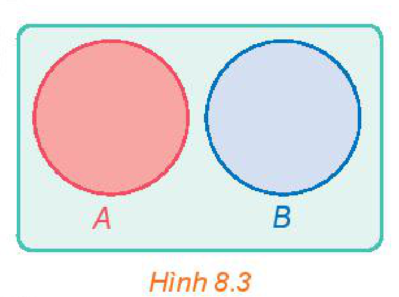

<!-- pdf:73 -->

# BÀI 29: CÔNG THỨC CỘNG XÁC SUẤT

## 🔤 Thuật ngữ

- Công thức cộng xác suất cho hai biến cố xung khắc
- Công thức cộng xác suất

## 🎯 Mục tiêu

- Tính xác suất của biến cố hợp của hai biến cố xung khắc bằng cách sử dụng công thức cộng xác suất.
- Tính xác suất của biến cố hợp của hai biến cố bất kì bằng cách sử dụng công thức cộng xác suất và phương pháp tổ hợp.

## 🔴 Mở đầu

Tại tỉnh X, thống kê cho thấy trong số những người trên $50$ tuổi có $8,2\%$ mắc bệnh tim; $12,5\%$ mắc bệnh huyết áp và $5,7\%$ mắc cả bệnh tim và bệnh huyết áp. Từ đó, ta có thể tính được tỉ lệ dân cư trên $50$ tuổi của tỉnh X không mắc cả bệnh tim và bệnh huyết áp hay không?

## 1. CÔNG THỨC CỘNG XÁC SUẤT CHO HAI BIẾN CỐ XUNG KHẮC

**a) Biến cố xung khắc**

**HĐ1:** Gieo một con xúc xắc cân đối, đồng chất. Xét hai biến cố sau:

$A$: “Số chấm xuất hiện trên con xúc xắc là số chia hết cho $3$”;

$B$: “Số chấm xuất hiện trên con xúc xắc là số chia hết cho $4$”.

Hai biến cố $A$ và $B$ có đồng thời xảy ra hay không? Vì sao?

<!-- term: Hai biến cố xung khắc -->
> Biến cố $A$ và biến cố $B$ được gọi là **xung khắc** nếu $A$ và $B$ không đồng thời xảy ra.
>
> Hai biến cố $A$ và $B$ xung khắc khi và chỉ khi $A \cap B = \varnothing$.

*Hình 8.3*

> ❓ Biến cố $A$ và biến cố đối $\overline{A}$ có xung khắc hay không? Tại sao?

**Ví dụ 1:** Gieo đồng thời hai con xúc xắc cân đối, đồng chất. Xét các biến cố sau:

$A$: “Tổng số chấm xuất hiện trên hai con xúc xắc lớn hơn hoặc bằng $7$”;

$B$: “Tổng số chấm xuất hiện trên hai con xúc xắc nhỏ hơn hoặc bằng $4$”;

$C$: “Tổng số chấm xuất hiện trên hai con xúc xắc là số nguyên tố”.

Trong các cặp biến cố $A$ và $B$; $A$ và $C$; $B$ và $C$, cặp biến cố nào xung khắc? Tại sao?

<!-- pdf:74 -->

**Giải:**

Cặp biến cố $A$ và $B$ là xung khắc vì $A$ và $B$ không đồng thời xảy ra.

Cặp biến cố $A$ và $C$ không xung khắc vì nếu tổng số chấm xuất hiện trên hai con xúc xắc bằng $7$ thì cả $A$ và $C$ xảy ra.

Cặp biến cố $B$ và $C$ không xung khắc vì nếu tổng số chấm xuất hiện trên hai con xúc xắc bằng $3$ thì cả $B$ và $C$ xảy ra.

**Luyện tập 1:** Một tổ học sinh có $8$ bạn, trong đó có $6$ bạn thích môn Bóng đá, $4$ bạn thích môn Cầu lông và $2$ bạn thích cả hai môn Bóng đá và Cầu lông. Chọn ngẫu nhiên một học sinh trong tổ. Xét các biến cố sau:

$E$: “Học sinh được chọn thích môn Bóng đá”;

$F$: “Học sinh được chọn thích môn Cầu lông”.

Hai biến cố $E$ và $F$ có xung khắc không?

**b) Công thức cộng xác suất cho hai biến cố xung khắc**

**HĐ2:** Trở lại tình huống trong HĐ1. Hãy tính $P(A), P(B)$ và $P(A \cup B)$.

<!-- term: Công thức cộng xác suất cho hai biến cố xung khắc -->
Với hai biến cố xung khắc, ta có công thức tính xác suất của biến cố hợp như sau:

> Nếu $A$ và $B$ là hai biến cố xung khắc thì $P(A \cup B) = P(A) + P(B)$.

**Ví dụ 2:** Một hộp đựng $9$ tấm thẻ cùng loại được ghi số từ $1$ đến $9$. Rút ngẫu nhiên đồng thời hai tấm thẻ từ trong hộp. Xét các biến cố sau:

$A$: “Cả hai tấm thẻ đều ghi số chẵn”;

$B$: “Chỉ có một tấm thẻ ghi số chẵn”;

$C$: “Tích hai số ghi trên hai tấm thẻ là một số chẵn”.

a) Chứng minh rằng $C = A \cup B$.

b) Tính $P(C)$.

**Giải:**

a) Biến cố $C$ xảy ra khi và chỉ khi trong hai tấm thẻ có ít nhất một tấm thẻ ghi số chẵn. Nếu cả hai tấm thẻ ghi số chẵn thì biến cố $A$ xảy ra. Nếu chỉ có một tấm thẻ ghi số chẵn thì biến cố $B$ xảy ra. Vậy $C$ là biến cố hợp của $A$ và $B$.

b) Hai biến cố $A$ và $B$ là xung khắc. Do đó $P(C) = P(A \cup B) = P(A) + P(B)$.

Ta cần tính $P(A)$ và $P(B)$.

Không gian mẫu $\Omega$ là tập hợp tất cả các tập con có hai phần tử của tập $\{1; 2; \dots; 9\}$.

Do đó $n(\Omega) = C_9^2 = 36$.

<!-- pdf:75 -->

- Tính $P(A)$: Biến cố $A$ là tập hợp tất cả các tập con có hai phần tử của tập $\{2; 4; 6; 8\}$.

Do đó $n(A) = C_4^2 = 6$. Suy ra $P(A) = \frac{n(A)}{n(\Omega)} = \frac{6}{36}$.

- Tính $P(B)$: Mỗi phần tử của $B$ được hình thành từ hai công đoạn:

*Công đoạn 1:* Chọn một số chẵn từ tập $\{2; 4; 6; 8\}$. Có $4$ cách chọn.
<!-- ocr-ok: đã đối chiếu ảnh trang PDF 75, OCR đọc sai chữ chẵn thành chấn -->

*Công đoạn 2:* Chọn một số lẻ từ tập $\{1; 3; 5; 7; 9\}$. Có $5$ cách chọn.

Theo quy tắc nhân, tập $B$ có $4 \cdot 5 = 20$ (phần tử).

Do đó $n(B) = 20$. Suy ra $P(B) = \frac{n(B)}{n(\Omega)} = \frac{20}{36}$.

Vậy $P(C) = P(A) + P(B) = \frac{6}{36} + \frac{20}{36} = \frac{26}{36} = \frac{13}{18}$.

**Luyện tập 2:** Một hộp đựng $5$ quả cầu màu xanh và $3$ quả cầu màu đỏ, có cùng kích thước và khối lượng. Chọn ngẫu nhiên hai quả cầu trong hộp. Tính xác suất để chọn được hai quả cầu có cùng màu.

## 2. CÔNG THỨC CỘNG XÁC SUẤT

**HĐ3:** Ở một trường trung học phổ thông X, có $19\%$ học sinh học khá môn Ngữ văn, $32\%$ học sinh học khá môn Toán, $7\%$ học sinh học khá cả hai môn Ngữ văn và Toán. Chọn ngẫu nhiên một học sinh của trường X. Xét hai biến cố sau:

$A$: “Học sinh đó học khá môn Ngữ văn”;

$B$: “Học sinh đó học khá môn Toán”.

a) Hoàn thành các mệnh đề sau bằng cách tìm cụm từ thích hợp thay cho dấu “?”.

$P(A)$ là tỉ lệ ...( ? )...; $P(AB)$ là ...( ? )...;

$P(B)$ là ...( ? )...; $P(A \cup B)$ là ...( ? )...

b) Tại sao để tính $P(A \cup B)$ ta không áp dụng được công thức $P(A \cup B) = P(A) + P(B)$?

> Cho hai biến cố $A$ và $B$. Khi đó, ta có:
>
> $P(A \cup B) = P(A) + P(B) - P(AB).$
>
> Công thức này được gọi là **công thức cộng xác suất**.

> ❓ Tại sao công thức cộng xác suất cho hai biến cố xung khắc là hệ quả của công thức cộng xác suất?

**Ví dụ 3:** Trở lại tình huống trong HĐ3. Hãy tính tỉ lệ học sinh học khá môn Ngữ văn hoặc học khá môn Toán của trường X.

**Giải:**

Theo đề bài, ta có:

$P(A) = 19\% = 0,19$; $P(B) = 32\% = 0,32$ và $P(AB) = 7\% = 0,07$.

Theo công thức cộng xác suất, ta có:

$P(A \cup B) = P(A) + P(B) - P(AB) = 0,19 + 0,32 - 0,07 = 0,44$.

<!-- pdf:76 -->

Do đó, xác suất để chọn ngẫu nhiên một học sinh của trường X học khá môn Ngữ văn hoặc học khá môn Toán là $0,44$.

Vậy tỉ lệ học sinh học khá môn Ngữ văn hoặc học khá môn Toán của trường X là $44\%$.

**Luyện tập 3:** Phỏng vấn $30$ học sinh lớp 11A về môn thể thao yêu thích thu được kết quả có $19$ bạn thích môn Bóng đá, $17$ bạn thích môn Bóng bàn và $15$ bạn thích cả hai môn đó. Chọn ngẫu nhiên một học sinh của lớp 11A. Tính xác suất để chọn được học sinh thích ít nhất một trong hai môn Bóng đá hoặc Bóng bàn.

**Vận dụng:** Giải quyết bài toán trong *tình huống mở đầu*.

*Gợi ý.* Chọn ngẫu nhiên một người dân trên $50$ tuổi của tỉnh X. Gọi $A$ là biến cố “Người đó mắc bệnh tim”; $B$ là biến cố “Người đó mắc bệnh huyết áp”; $E$ là biến cố “Người đó không mắc cả bệnh tim và bệnh huyết áp”. Khi đó $\overline{E}$ là biến cố “Người đó mắc bệnh tim hoặc mắc bệnh huyết áp”. Ta có $\overline{E} = A \cup B$. Áp dụng công thức cộng xác suất và công thức xác suất của biến cố đối để tính $P(E)$.

## ✏️ BÀI TẬP

**8.6.** Một hộp đựng $8$ viên bi màu xanh và $6$ viên bi màu đỏ, có cùng kích thước và khối lượng. Bạn Sơn lấy ngẫu nhiên một viên bi từ hộp (lấy xong không trả lại vào hộp). Tiếp đó đến lượt bạn Tùng lấy ngẫu nhiên một viên bi từ hộp đó. Tính xác suất để bạn Tùng lấy được viên bi màu xanh.

**8.7.** Lớp 11A của một trường có $40$ học sinh, trong đó có $14$ bạn thích nhạc cổ điển, $13$ bạn thích nhạc trẻ và $5$ bạn thích cả nhạc cổ điển và nhạc trẻ. Chọn ngẫu nhiên một bạn trong lớp. Tính xác suất để:

a) Bạn đó thích nhạc cổ điển hoặc nhạc trẻ;

b) Bạn đó không thích cả nhạc cổ điển và nhạc trẻ.

**8.8.** Một khu phố có $50$ hộ gia đình nuôi chó hoặc nuôi mèo, trong đó có $18$ hộ nuôi chó, $16$ hộ nuôi mèo và $7$ hộ nuôi cả chó và mèo. Chọn ngẫu nhiên một hộ trong khu phố trên. Tính xác suất để:

a) Hộ đó nuôi chó hoặc nuôi mèo;

b) Hộ đó không nuôi cả chó và mèo.

**8.9.** Một nhà xuất bản phát hành hai cuốn sách A và B. Thống kê cho thấy có $50\%$ người mua sách A; $70\%$ người mua sách B; $30\%$ người mua cả sách A và sách B. Chọn ngẫu nhiên một người mua. Tính xác suất để:

a) Người mua đó mua ít nhất một trong hai sách A hoặc B;

b) Người mua đó không mua cả sách A và sách B.

**8.10.** Tại các trường trung học phổ thông của một tỉnh, thống kê cho thấy có $63\%$ giáo viên môn Toán tham khảo bộ sách giáo khoa A, $56\%$ giáo viên môn Toán tham khảo bộ sách giáo khoa B và $28,5\%$ giáo viên môn Toán tham khảo cả hai bộ sách giáo khoa A và B. Tính tỉ lệ giáo viên môn Toán các trường trung học phổ thông của tỉnh đó không tham khảo cả hai bộ sách giáo khoa A và B.

## 📷 Danh sách hình trong bài

| Mã hình | Trang PDF | Chú thích trong sách | Mô tả ngắn |
| :--- | :---: | :--- | :--- |
| H11-toan-b29-01 | 73 | Hình 8.3 | Biểu đồ Venn minh hoạ hai biến cố xung khắc $A$ và $B$ ($A \cap B = \varnothing$) |
