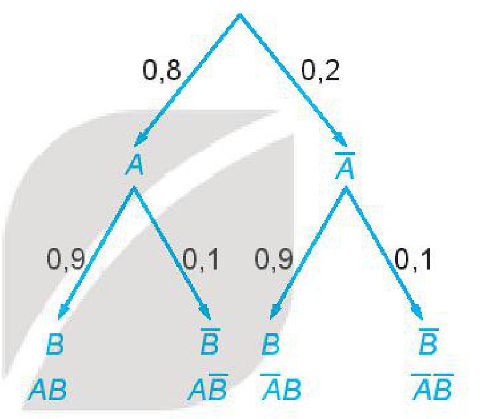

<!-- pdf:77 -->

# BÀI 30: CÔNG THỨC NHÂN XÁC SUẤT CHO HAI BIẾN CỐ ĐỘC LẬP

## 🔤 Thuật ngữ

- Hai biến cố độc lập
- Công thức nhân xác suất cho hai biến cố độc lập

## 🎯 Mục tiêu

- Tính xác suất của biến cố giao của hai biến cố độc lập bằng cách sử dụng công thức nhân xác suất và sơ đồ hình cây.

## 🔴 Mở đầu

Tại vòng chung kết của một đại hội thể thao, vận động viên An thi đấu môn Bắn súng, vận động viên Bình thi đấu môn Bơi lội.

Biết rằng xác suất giành huy chương của vận động viên An và vận động viên Bình tương ứng là $0,8$ và $0,9$. Hỏi xác suất để cả hai vận động viên đạt huy chương là bao nhiêu?

Bài học này sẽ giúp em trả lời câu hỏi trên thông qua việc tìm hiểu công thức nhân xác suất cho hai biến cố độc lập.

## 1. CÔNG THỨC NHÂN XÁC SUẤT CHO HAI BIẾN CỐ ĐỘC LẬP

**HĐ1:** Có hai hộp đựng các quả bóng có cùng kích thước và khối lượng. Hộp I có $6$ quả màu trắng và $4$ quả màu đen. Hộp II có $1$ quả màu trắng và $7$ quả màu đen. Bạn Long lấy ngẫu nhiên một quả bóng từ hộp I, bạn Hải lấy ngẫu nhiên một quả bóng từ hộp II. Xét các biến cố sau:

$A$: “Bạn Long lấy được quả bóng màu trắng”;

$B$: “Bạn Hải lấy được quả bóng màu đen”.

a) Tính $P(A), P(B)$ và $P(AB)$.

b) So sánh $P(AB)$ và $P(A) \cdot P(B)$.

> Nếu hai biến cố $A$ và $B$ độc lập với nhau thì
>
> $P(AB) = P(A) \cdot P(B).$
>
> Công thức này gọi là **công thức nhân xác suất cho hai biến cố độc lập**.

> ❓ Hai biến cố $A$ và $B$ trong HĐ1 độc lập hay không độc lập? Tại sao?

<!-- term: Dấu hiệu nhận biết hai biến cố không độc lập -->
**Chú ý:** Với hai biến cố $A$ và $B$, nếu $P(AB) \ne P(A)P(B)$ thì $A$ và $B$ không độc lập.
<!-- ocr-ok: đã đối chiếu ảnh trang PDF 77 -->

<!-- pdf:78 -->

**Ví dụ 1:** Trở lại *tình huống mở đầu*. Gọi $A$ là biến cố “Vận động viên An đạt huy chương”; $B$ là biến cố “Vận động viên Bình đạt huy chương”.

a) Giải thích tại sao hai biến cố $A$ và $B$ là độc lập.

b) Tính xác suất để cả hai vận động viên đạt huy chương.

c) Sử dụng sơ đồ hình cây, tính xác suất để:

- Cả hai vận động viên không đạt huy chương;
- Vận động viên An đạt huy chương, vận động viên Bình không đạt huy chương;
- Vận động viên An không đạt huy chương, vận động viên Bình đạt huy chương.

**Giải:**

a) Vì hai vận động viên An và Bình thi đấu hai môn thể thao khác nhau nên hai biến cố $A$ và $B$ là độc lập.

b) Vì $A$ và $B$ là hai biến cố độc lập nên áp dụng công thức nhân xác suất, ta có:

$P(AB) = P(A)P(B) = 0,8 \cdot 0,9 = 0,72.$

c) Ta dùng sơ đồ hình cây để mô tả như sau:

Theo sơ đồ hình cây, ta có:

$P(\overline{A}\overline{B}) = 0,2 \cdot 0,1 = 0,02;$

$P(A\overline{B}) = 0,8 \cdot 0,1 = 0,08;$

$P(\overline{A}B) = 0,2 \cdot 0,9 = 0,18.$

**Luyện tập 1:** Các học sinh lớp 11D làm thí nghiệm gieo hai loại hạt giống A và B. Xác suất để hai loại hạt giống A và B nảy mầm tương ứng là $0,92$ và $0,88$. Giả sử việc nảy mầm của hạt A và hạt B là độc lập với nhau. Dùng sơ đồ hình cây, tính xác suất để:

a) Hạt giống A nảy mầm còn hạt giống B không nảy mầm;

b) Hạt giống A không nảy mầm còn hạt giống B nảy mầm;

c) Ít nhất có một trong hai loại hạt giống nảy mầm.

## 2. VẬN DỤNG

**Ví dụ 2:** Số liệu thống kê tại một vùng cho thấy trong các vụ tai nạn ô tô có $0,37\%$ người tử vong; $29\%$ người không thắt dây an toàn và $0,28\%$ người không thắt dây an toàn và tử vong. Chứng tỏ rằng việc không thắt dây an toàn khi lái xe và nguy cơ tử vong khi gặp tai nạn có liên quan với nhau.

> Chú ý trong Mục 1 được sử dụng để phát hiện mối liên quan giữa hai biến cố.
<!-- ocr-ok: đã đối chiếu ảnh trang PDF 78, lời thoại nhân vật tròn -->

**Giải:**

Chọn ngẫu nhiên một người đã bị tai nạn ô tô.

Gọi $A$ là biến cố “Người đó đã tử vong”; $B$ là biến cố “Người đó đã không thắt dây an toàn”.

Khi đó, $AB$ là biến cố “Người đó không thắt dây an toàn và đã tử vong”.

<!-- pdf:79 -->

Ta có $P(A) = 0,37\% = 0,0037$; $P(B) = 29\% = 0,29$; suy ra $P(A)P(B) = 0,0037 \cdot 0,29 = 0,001073$.

Mặt khác $P(AB) = 0,28\% = 0,0028$.

Vì $P(AB) \ne P(A)P(B)$ nên hai biến cố $A$ và $B$ không độc lập.
<!-- ocr-ok: đã đối chiếu ảnh trang PDF 79 -->

Vậy việc không thắt dây an toàn khi lái xe có liên quan tới nguy cơ tử vong khi gặp tai nạn.

**Luyện tập 2:** Để nghiên cứu mối liên quan giữa thói quen hút thuốc lá với bệnh viêm phổi, nhà nghiên cứu chọn một nhóm $5\,000$ người đàn ông. Với mỗi người trong nhóm, nhà nghiên cứu kiểm tra xem họ có nghiện thuốc lá và có bị viêm phổi hay không. Kết quả được thống kê trong bảng sau:

| | Viêm phổi | Không viêm phổi |
| :--- | :---: | :---: |
| Nghiện thuốc lá | $752\text{ người}$ | $1\,236\text{ người}$ |
| Không nghiện thuốc lá | $575\text{ người}$ | $2\,437\text{ người}$ |
<!-- ocr-ok: đã đối chiếu ảnh trang PDF 79 -->

Từ bảng thống kê trên, hãy chứng tỏ rằng việc nghiện thuốc lá và mắc bệnh viêm phổi có liên quan với nhau.

## ✏️ BÀI TẬP

**8.11.** Cho hai biến cố $A$ và $B$ là hai biến cố xung khắc với $P(A) > 0, P(B) > 0$. Chứng tỏ rằng hai biến cố $A$ và $B$ không độc lập.

**8.12.** Một thùng đựng $60$ tấm thẻ cùng loại được đánh số từ $1$ đến $60$. Rút ngẫu nhiên một tấm thẻ trong thùng. Xét hai biến cố sau:

$A$: “Số ghi trên tấm thẻ là ước của $60$” và $B$: “Số ghi trên tấm thẻ là ước của $48$”.
<!-- ocr-ok: đã đối chiếu ảnh trang PDF 79, OCR đọc sai chữ tấm thành tắm -->

Chứng tỏ rằng $A$ và $B$ là hai biến cố không độc lập.

**8.13.** Có hai túi đựng các viên bi có cùng kích thước và khối lượng. Túi I có $3$ viên bi màu xanh và $7$ viên bi màu đỏ. Túi II có $10$ viên bi màu xanh và $6$ viên bi màu đỏ. Từ mỗi túi, lấy ngẫu nhiên ra một viên bi. Tính xác suất để:

a) Hai viên bi được lấy có cùng màu xanh;

b) Hai viên bi được lấy có cùng màu đỏ;

c) Hai viên bi được lấy có cùng màu;

d) Hai viên bi được lấy không cùng màu.

**8.14.** Có hai túi mỗi túi đựng $10$ quả cầu có cùng kích thước và khối lượng được đánh số từ $1$ đến $10$. Từ mỗi túi, lấy ngẫu nhiên ra một quả cầu. Tính xác suất để trong hai quả cầu được lấy ra không có quả cầu nào ghi số $1$ hoặc ghi số $5$.

**8.15.** Trong đợt kiểm tra cuối học kì II lớp 11 của các trường trung học phổ thông, thống kê cho thấy có $93\%$ học sinh tỉnh X đạt yêu cầu; $87\%$ học sinh tỉnh Y đạt yêu cầu. Chọn ngẫu nhiên một học sinh của tỉnh X và một học sinh của tỉnh Y. Giả thiết rằng chất lượng học tập của hai tỉnh là độc lập. Tính xác suất để:

a) Cả hai học sinh được chọn đều đạt yêu cầu;

b) Cả hai học sinh được chọn đều không đạt yêu cầu;

c) Chỉ có đúng một học sinh được chọn đạt yêu cầu;

d) Có ít nhất một trong hai học sinh được chọn đạt yêu cầu.

## 📷 Danh sách hình trong bài

| Mã hình | Trang PDF | Chú thích trong sách | Mô tả ngắn |
| :--- | :---: | :--- | :--- |
| H11-toan-b30-01 | 78 | (không có) | Sơ đồ hình cây tính xác suất đạt huy chương của hai vận động viên An và Bình trong Ví dụ 1c |
