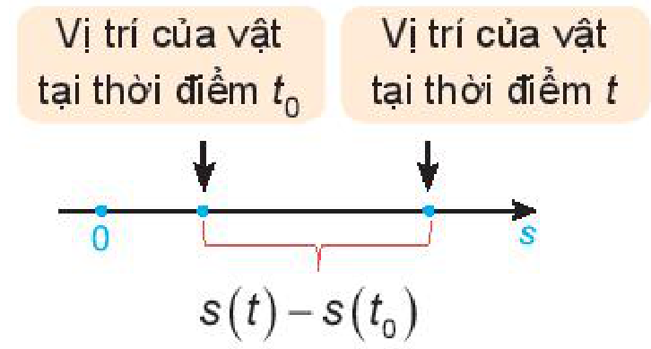
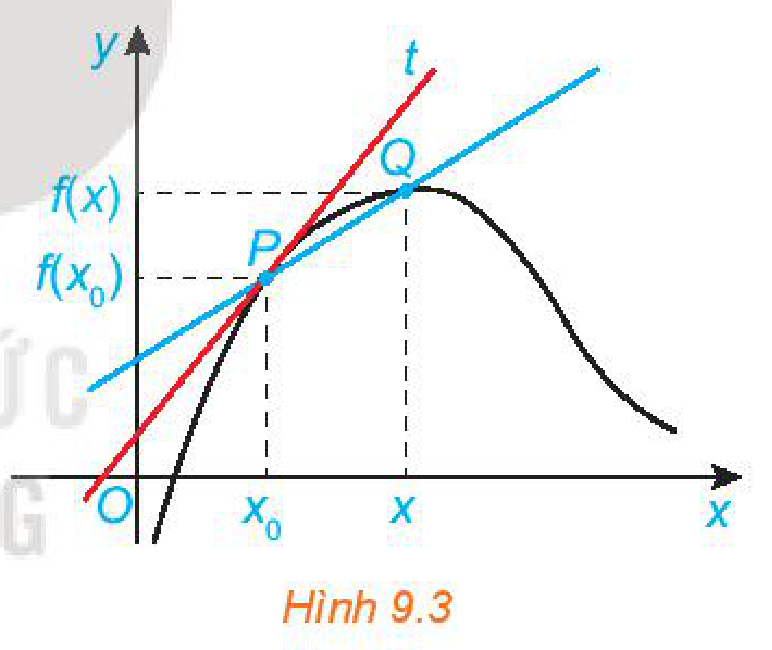
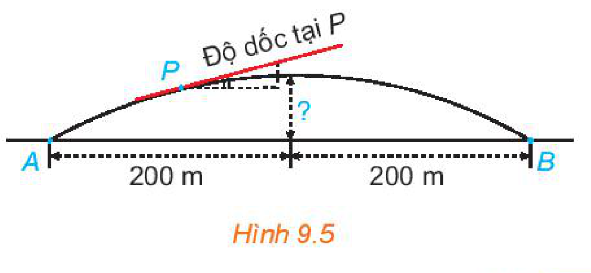
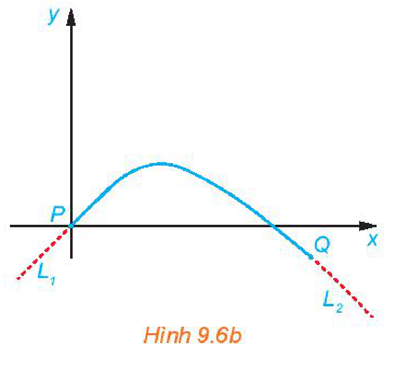

<!-- pdf:82 -->

<!-- Phần giới thiệu Chương IX (in chung đầu trang PDF 82): CHƯƠNG IX. ĐẠO HÀM -->

Chương này trình bày khái niệm và các quy tắc tính đạo hàm, công thức tính đạo hàm của một số hàm số sơ cấp cơ bản, cũng như ý nghĩa hình học và ý nghĩa cơ học của đạo hàm.
<!-- ocr-ok: đã đối chiếu ảnh trang PDF 82, đoạn giới thiệu chương trên nền ảnh tàu lượn -->

# BÀI 31: ĐỊNH NGHĨA VÀ Ý NGHĨA CỦA ĐẠO HÀM

## 🔤 Thuật ngữ

- Đạo hàm tại một điểm
- Đạo hàm trên một khoảng
- Hệ số góc của tiếp tuyến
- Vận tốc tức thời
- Tốc độ biến đổi tức thời

## 🎯 Mục tiêu

- Nhận biết một số bài toán dẫn đến khái niệm đạo hàm.
- Nhận biết định nghĩa đạo hàm. Tính đạo hàm của một số hàm đơn giản bằng định nghĩa.
- Nhận biết ý nghĩa hình học của đạo hàm. Thiết lập phương trình tiếp tuyến của đồ thị hàm số tại một điểm thuộc đồ thị.
- Vận dụng định nghĩa đạo hàm vào giải quyết một số bài toán thực tiễn.

## 🔴 Mở đầu

Nếu một quả bóng được thả rơi tự do từ đài quan sát trên sân thượng của toà nhà Landmark 81 (Thành phố Hồ Chí Minh) cao $461,3\text{ m}$ xuống mặt đất. Có tính được vận tốc của quả bóng khi nó chạm đất hay không? (Bỏ qua sức cản không khí).

*Hình 9.1. Toà nhà Landmark 81*
<!-- ocr-ok: đã đối chiếu ảnh trang PDF 82 -->

## 1. MỘT SỐ BÀI TOÁN DẪN ĐẾN KHÁI NIỆM ĐẠO HÀM

**a) Vận tốc tức thời của một vật chuyển động thẳng**

<!-- term: Phương trình của chuyển động -->
**HĐ1:** Một vật di chuyển trên một đường thẳng (H.9.2). Quãng đường $s$ của chuyển động là một hàm số của thời gian $t$, $s = s(t)$ (được gọi là *phương trình của chuyển động*).
<!-- ocr-ok: đã đối chiếu ảnh trang PDF 82 -->

a) Tính vận tốc trung bình của vật trong khoảng thời gian từ $t_0$ đến $t$.

b) Giới hạn $\lim_{t \to t_0} \frac{s(t) - s(t_0)}{t - t_0}$ cho ta biết điều gì?

*Hình 9.2*

<!-- pdf:83 -->

**b) Cường độ tức thời**

**HĐ2:** Điện lượng $Q$ truyền trong dây dẫn là một hàm số của thời gian $t$, có dạng $Q = Q(t)$.

a) Tính cường độ trung bình của dòng điện trong khoảng thời gian từ $t_0$ đến $t$.

b) Giới hạn $\lim_{t \to t_0} \frac{Q(t) - Q(t_0)}{t - t_0}$ cho ta biết điều gì?

**Nhận xét:** Nhiều bài toán trong Vật lí, Hoá học, Sinh học,... đưa đến việc tìm giới hạn dạng

$\lim_{x \to x_0} \frac{f(x) - f(x_0)}{x - x_0},$

ở đó $y = f(x)$ là một hàm số đã cho.

Giới hạn trên dẫn đến một khái niệm quan trọng trong Toán học, đó là khái niệm **đạo hàm**.

## 2. ĐẠO HÀM CỦA HÀM SỐ TẠI MỘT ĐIỂM

<!-- term: Đạo hàm -->
> Cho hàm số $y = f(x)$ xác định trên khoảng $(a; b)$ và điểm $x_0 \in (a; b)$.
>
> Nếu tồn tại giới hạn hữu hạn
>
> $\lim_{x \to x_0} \frac{f(x) - f(x_0)}{x - x_0}$
>
> thì giới hạn đó được gọi là **đạo hàm của hàm số** $y = f(x)$ tại điểm $x_0$, kí hiệu bởi $f'(x_0)$ (hoặc $y'(x_0)$), tức là
>
> $f'(x_0) = \lim_{x \to x_0} \frac{f(x) - f(x_0)}{x - x_0}.$

<!-- term: Quy tắc tính đạo hàm bằng định nghĩa -->
**Chú ý:** Để tính đạo hàm của hàm số $y = f(x)$ tại điểm $x_0 \in (a; b)$, ta thực hiện theo các bước sau:

1. Tính $f(x) - f(x_0)$.
2. Lập và rút gọn tỉ số $\frac{f(x) - f(x_0)}{x - x_0}$ với $x \in (a; b), x \ne x_0$.
3. Tìm giới hạn $\lim_{x \to x_0} \frac{f(x) - f(x_0)}{x - x_0}$.

**Ví dụ 1:** Tính đạo hàm của hàm số $y = f(x) = x^2 + 2x$ tại điểm $x_0 = 1$.

**Giải:**

Ta có: $f(x) - f(1) = x^2 + 2x - 3 = x^2 - 1 + 2x - 2 = (x - 1)(x + 3)$.

Với $x \ne 1$, $\frac{f(x) - f(1)}{x - 1} = \frac{(x - 1)(x + 3)}{x - 1} = x + 3$.

Tính giới hạn: $\lim_{x \to 1} \frac{f(x) - f(1)}{x - 1} = \lim_{x \to 1} (x + 3) = 4$.

Vậy $f'(1) = 4$.

<!-- pdf:84 -->

Trong thực hành, ta thường trình bày ngắn gọn như sau:

$f'(1) = \lim_{x \to 1} \frac{f(x) - f(1)}{x - 1} = \lim_{x \to 1} \frac{(x^2 + 2x) - 3}{x - 1}$

$= \lim_{x \to 1} \frac{(x - 1)(x + 3)}{x - 1} = \lim_{x \to 1} (x + 3) = 4.$

**Chú ý:** Đặt $h = x - x_0$, khi đó đạo hàm của hàm số đã cho tại điểm $x_0 = 1$ có thể tính như sau:

$f'(1) = \lim_{h \to 0} \frac{f(1 + h) - f(1)}{h} = \lim_{h \to 0} \frac{\left[(1 + h)^2 + 2(1 + h)\right] - (1^2 + 2)}{h}$

$= \lim_{h \to 0} \frac{(h^2 + 4h + 3) - 3}{h} = \lim_{h \to 0} (h + 4) = 4.$

> $f'(x_0) = \lim_{h \to 0} \frac{f(x_0 + h) - f(x_0)}{h}.$

**Luyện tập 1:** Tính đạo hàm của hàm số $y = -x^2 + 2x + 1$ tại điểm $x_0 = -1$.

## 3. ĐẠO HÀM CỦA HÀM SỐ TRÊN MỘT KHOẢNG

**HĐ3:** Tính đạo hàm $f'(x_0)$ tại điểm $x_0$ bất kì trong các trường hợp sau:

a) $f(x) = c$ ($c$ là hằng số);

b) $f(x) = x$.

> Hàm số $y = f(x)$ được gọi là có **đạo hàm trên khoảng** $(a; b)$ nếu nó có đạo hàm $f'(x)$ tại mọi điểm $x$ thuộc khoảng đó, kí hiệu là $y' = f'(x)$.

**Ví dụ 2:** Tìm đạo hàm của hàm số $y = cx^2$, với $c$ là hằng số.

**Giải:**

Với $x_0$ bất kì, ta có:

$f'(x_0) = \lim_{x \to x_0} \frac{cx^2 - cx_0^2}{x - x_0} = \lim_{x \to x_0} \frac{c(x - x_0)(x + x_0)}{x - x_0}$

$= \lim_{x \to x_0} c(x + x_0) = c(x_0 + x_0) = 2cx_0.$

Vậy hàm số $y = cx^2$ (với $c$ là hằng số) có đạo hàm là hàm số $y' = 2cx$.

> $(c)' = 0; (x)' = 1;$
> $(cx^2)' = 2cx.$

<!-- term: Vận tốc tức thời -->
**Chú ý:** Nếu phương trình chuyển động của vật là $s = f(t)$ thì $v(t) = f'(t)$ là **vận tốc tức thời** của vật tại thời điểm $t$.

<!-- pdf:85 -->

**Ví dụ 3:** Giải bài toán trong *tình huống mở đầu* (bỏ qua sức cản của không khí và làm tròn kết quả đến chữ số thập phân thứ nhất).

**Giải:**

Phương trình chuyển động rơi tự do của quả bóng là $s = f(t) = \frac{1}{2}gt^2$ ($g$ là gia tốc rơi tự do, lấy $g = 9,8\text{ m/s}^2$). Do vậy, vận tốc của quả bóng tại thời điểm $t$ là $v(t) = f'(t) = gt = 9,8t$.

Mặt khác, vì chiều cao của toà tháp là $461,3\text{ m}$ nên quả bóng sẽ chạm đất tại thời điểm $t_1$, với $f(t_1) = 461,3$. Từ đó, ta có:

$4,9t_1^2 = 461,3 \Leftrightarrow t_1 = \sqrt{\frac{461,3}{4,9}}\text{ (giây)}.$

Vậy vận tốc của quả bóng khi nó chạm đất là

$v(t_1) = 9,8t_1 = 9,8 \cdot \sqrt{\frac{461,3}{4,9}} \approx 95,1\text{ (m/s)}.$

**Luyện tập 2:** Tìm đạo hàm của các hàm số sau:

a) $y = x^2 + 1$;

b) $y = kx + c$ (với $k, c$ là các hằng số).
<!-- ocr-ok: đã đối chiếu ảnh trang PDF 85, OCR đọc sai chữ hằng thành hăng -->

## 4. Ý NGHĨA HÌNH HỌC CỦA ĐẠO HÀM

**a) Tiếp tuyến của đồ thị hàm số**

**HĐ4:** Nhận biết tiếp tuyến của đồ thị hàm số

Cho hàm số $y = f(x)$ có đồ thị $(C)$ và điểm $P(x_0; f(x_0)) \in (C)$. Xét điểm $Q(x; f(x))$ thay đổi trên $(C)$ với $x \ne x_0$.
<!-- ocr-ok: đã đối chiếu ảnh trang PDF 85, OCR dính chữ Chohàmsố và cóđồthị -->

<!-- term: Cát tuyến của đồ thị hàm số -->
a) Đường thẳng đi qua hai điểm $P, Q$ được gọi là một *cát tuyến* của đồ thị $(C)$ (H.9.3). Tìm hệ số góc $k_{PQ}$ của cát tuyến $PQ$.

b) Khi $x \to x_0$ thì vị trí của điểm $Q(x; f(x))$ trên đồ thị $(C)$ thay đổi như thế nào?
<!-- ocr-ok: đã đối chiếu ảnh trang PDF 85, OCR đọc sai chữ đồ và đổi -->

c) Nếu điểm $Q$ di chuyển trên $(C)$ tới điểm $P$ mà $k_{PQ}$ có giới hạn hữu hạn $k$ thì có nhận xét gì về vị trí giới hạn của cát tuyến $QP$?

*Hình 9.3*

> Hệ số góc của đường thẳng đi qua hai điểm $(x_1; y_1)$ và $(x_2; y_2)$, với $x_1 \ne x_2$, là
> $k = \frac{y_2 - y_1}{x_2 - x_1}.$

> **Tiếp tuyến của đồ thị** hàm số $y = f(x)$ tại điểm $P(x_0; f(x_0))$ là đường thẳng đi qua $P$ với hệ số góc $k = \lim_{x \to x_0} \frac{f(x) - f(x_0)}{x - x_0}$ nếu giới hạn này tồn tại và hữu hạn, nghĩa là $k = f'(x_0)$. Điểm $P$ gọi là **tiếp điểm**.

<!-- pdf:86 -->

<!-- term: Hệ số góc của tiếp tuyến -->
**Nhận xét:** **Hệ số góc của tiếp tuyến** của đồ thị hàm số $y = f(x)$ tại điểm $P(x_0; f(x_0))$ là đạo hàm $f'(x_0)$.

**Ví dụ 4:** Tìm hệ số góc của tiếp tuyến của parabol $y = x^2$ tại điểm có hoành độ $x_0 = -1$.

**Giải:**

Ta có $(x^2)' = 2x$ nên $y'(-1) = 2 \cdot (-1) = -2$. Vậy hệ số góc của tiếp tuyến của parabol $y = x^2$ tại điểm có hoành độ $x_0 = -1$ là $k = -2$.

**Luyện tập 3:** Tìm hệ số góc của tiếp tuyến của parabol $y = x^2$ tại điểm có hoành độ $x_0 = \frac{1}{2}$.

**b) Phương trình tiếp tuyến**

**HĐ5:** Cho hàm số $y = x^2$ có đồ thị là đường parabol $(P)$.

a) Tìm hệ số góc của tiếp tuyến của $(P)$ tại điểm có hoành độ $x_0 = 1$.

b) Viết phương trình tiếp tuyến đó.

<!-- term: Phương trình tiếp tuyến của đồ thị hàm số -->
Từ ý nghĩa hình học của đạo hàm, ta rút ra kết luận sau:

> Nếu hàm số $y = f(x)$ có đạo hàm tại điểm $x_0$ thì **phương trình tiếp tuyến** của đồ thị hàm số tại điểm $P(x_0; y_0)$ là $y - y_0 = f'(x_0)(x - x_0)$, trong đó $y_0 = f(x_0)$.

**Ví dụ 5:** Viết phương trình tiếp tuyến của parabol $(P): y = 3x^2$ tại điểm có hoành độ $x_0 = 1$.

**Giải:**

Từ Ví dụ 2, ta có $y' = 6x$. Do đó, hệ số góc của tiếp tuyến là $k = f'(1) = 6$. Ngoài ra, ta có $f(1) = 3$ nên phương trình tiếp tuyến cần tìm là $y - 3 = 6(x - 1)$ hay $y = 6x - 3$.

**Luyện tập 4:** Viết phương trình tiếp tuyến của parabol $(P): y = -2x^2$ tại điểm có hoành độ $x_0 = -1$.

**Vận dụng:** Người ta xây dựng một cây cầu vượt giao thông hình parabol nối hai điểm có khoảng cách là $400\text{ m}$ (H.9.4). Độ dốc của mặt cầu không vượt quá $10^\circ$ (độ dốc tại một điểm được xác định bởi góc giữa phương tiếp xúc với mặt cầu và phương ngang như Hình 9.5). Tính chiều cao giới hạn từ đỉnh cầu đến mặt đường (làm tròn kết quả đến chữ số thập phân thứ nhất).

*Hình 9.4. Cầu vượt thép tại nút giao Nguyễn Văn Cừ quận Long Biên, Hà Nội*

*Hình 9.5*

<!-- pdf:87 -->

*Hướng dẫn.* Chọn hệ trục toạ độ sao cho đỉnh cầu là gốc toạ độ và mặt cắt của cây cầu có hình dạng parabol $y = -ax^2$ (với $a$ là hằng số dương). Hệ số góc xác định độ dốc của mặt cầu là $k = y' = -2ax, -200 \le x \le 200$.

Do đó, $|k| = 2a|x| \le 400a$. Vì độ dốc của mặt cầu không quá $10^\circ$ nên ta có: $400a \le \tan 10^\circ$.

Từ đó tính được chiều cao giới hạn từ đỉnh cầu đến mặt đường.

## ✏️ BÀI TẬP

**9.1.** Tính (bằng định nghĩa) đạo hàm của các hàm số sau:

a) $y = x^2 - x$ tại $x_0 = 1$;

b) $y = -x^3$ tại $x_0 = -1$.

**9.2.** Sử dụng định nghĩa, tìm đạo hàm của các hàm số sau:

a) $y = kx^2 + c$ (với $k, c$ là các hằng số);
<!-- ocr-ok: đã đối chiếu ảnh trang PDF 87 -->

b) $y = x^3$.

**9.3.** Viết phương trình tiếp tuyến của parabol $y = -x^2 + 4x$, biết:

a) Tiếp điểm có hoành độ $x_0 = 1$;
<!-- ocr-ok: đã đối chiếu ảnh trang PDF 87, OCR đọc sai chữ hoành thành hoảnh -->

b) Tiếp điểm có tung độ $y_0 = 0$.

**9.4.** Một vật được phóng theo phương thẳng đứng lên trên từ mặt đất với vận tốc ban đầu là $19,6\text{ m/s}$ thì độ cao $h$ của nó (tính bằng mét) sau $t$ giây được cho bởi công thức $h = 19,6t - 4,9t^2$. Tìm vận tốc của vật khi nó chạm đất.

**9.5.** Một kĩ sư thiết kế một đường ray tàu lượn, mà mặt cắt của nó gồm một cung đường cong có dạng parabol (H.9.6a), đoạn dốc lên $L_1$ và đoạn dốc xuống $L_2$ là những phần đường thẳng có hệ số góc lần lượt là $0,5$ và $-0,75$. Để tàu lượn chạy êm và không bị đổi hướng đột ngột, $L_1$ và $L_2$ phải là những tiếp tuyến của cung parabol tại các điểm chuyển tiếp $P$ và $Q$ (H.9.6b). Giả sử gốc toạ độ đặt tại $P$ và phương trình của parabol là $y = ax^2 + bx + c$, trong đó $x$ tính bằng mét.

*Hình 9.6a*

*Hình 9.6b*

a) Tìm $c$.

b) Tính $y'(0)$ và tìm $b$.

c) Giả sử khoảng cách theo phương ngang giữa $P$ và $Q$ là $40\text{ m}$. Tìm $a$.

d) Tìm chênh lệch độ cao giữa hai điểm chuyển tiếp $P$ và $Q$.

<!-- pdf:88 -->

<!-- term: Số gia của biến số và số gia của hàm số -->
<!-- term: Tốc độ thay đổi tức thời -->
<!-- term: Chi phí biên và lợi nhuận biên -->
> **💡 Em có biết?**
>
> Giả sử $y$ là một đại lượng phụ thuộc vào một đại lượng thay đổi $x$ khác. Khi đó, $y$ là một hàm số của $x$ và ta viết $y = f(x)$. Nếu $x$ thay đổi từ $x_1$ đến $x_2$ thì sự thay đổi của $x$ (còn gọi là *số gia của $x$*) là $\Delta x = x_2 - x_1$ và sự thay đổi tương ứng của $y$ là $\Delta y = f(x_2) - f(x_1)$.
>
> Tỉ số $\frac{\Delta y}{\Delta x} = \frac{f(x_2) - f(x_1)}{x_2 - x_1}$ gọi là tốc độ thay đổi trung bình của $y$ đối với $x$ trên đoạn $[x_1; x_2]$. Giới hạn của tỉ số này khi $x_2 \to x_1$ (hay khi $\Delta x \to 0$) gọi là *tốc độ thay đổi tức thời của $y$ đối với $x$* tại $x = x_1$.
>
> Như vậy, đạo hàm $f'(a)$ là tốc độ thay đổi tức thời của đại lượng $y = f(x)$ đối với $x$ tại $x = a$.
>
> Nói riêng ở trong kinh tế, nếu $C(x)$ là tổng chi phí khi sản xuất $x$ đơn vị hàng hoá nào đó và $R(x)$ là số tiền thu được khi bán $x$ đơn vị hàng hoá đó thì $P(x) = R(x) - C(x)$ là phần lợi nhuận ứng với $x$ đơn vị hàng hoá. Các nhà kinh tế gọi tốc độ thay đổi tức thời của chi phí theo số lượng sản phẩm được sản xuất là *chi phí biên*:
>
> $mc(x) = \lim_{\Delta x \to 0} \frac{\Delta C}{\Delta x} = C'(x).$
>
> Lấy $\Delta x = 1$ và với số nguyên dương $n$ đủ lớn (để $\Delta x$ tương đối nhỏ so với $n$), ta có:
>
> $C'(n) \approx C(n + 1) - C(n).$
>
> Vì vậy, chi phí biên để sản xuất $n$ đơn vị sản phẩm là chi phí sản xuất một đơn vị sản phẩm tiếp theo (đơn vị sản phẩm thứ $n + 1$). Tương tự, *lợi nhuận biên* khi sản xuất $n$ đơn vị sản phẩm là phần lợi nhuận thu được khi sản xuất đơn vị sản phẩm tiếp theo. Để tối đa hoá lợi nhuận, công ty sẽ tiếp tục sản xuất khi $x$ chưa đạt đến điểm $x_0$ mà ở đó lợi nhuận biên bằng $0$. Khi $x < x_0$, lợi nhuận biên dương và do đó lợi nhuận có thể tăng khi tiếp tục sản xuất. Khi $x > x_0$, lợi nhuận biên âm và lợi nhuận có thể được giữ ở mức cao hơn nếu sản xuất ít đi.
>
> *(Theo Stewart, Calculus, Nhà xuất bản Cengage Learning)*

## 📷 Danh sách hình trong bài

| Mã hình | Trang PDF | Chú thích trong sách | Mô tả ngắn |
| :--- | :---: | :--- | :--- |
| H11-toan-b31-01 | 82 | Hình 9.1. Toà nhà Landmark 81 | Ảnh toà nhà Landmark 81 (Thành phố Hồ Chí Minh) trong tình huống mở đầu |
| H11-toan-b31-02 | 82 | Hình 9.2 | Sơ đồ vị trí của vật chuyển động thẳng tại thời điểm $t_0$ và thời điểm $t$ |
| H11-toan-b31-03 | 85 | Hình 9.3 | Đồ thị hàm số $y = f(x)$ với cát tuyến $PQ$ và tiếp tuyến $t$ tại điểm $P(x_0; f(x_0))$ |
| H11-toan-b31-04 | 86 | Hình 9.4. Cầu vượt thép tại nút giao Nguyễn Văn Cừ quận Long Biên, Hà Nội | Ảnh thực tế cầu vượt thép hình parabol tại nút giao Nguyễn Văn Cừ |
| H11-toan-b31-05 | 86 | Hình 9.5 | Sơ đồ mặt cắt hình parabol của cây cầu vượt và độ dốc tại điểm $P$ |
| H11-toan-b31-06 | 87 | Hình 9.6a | Ảnh đường ray tàu lượn có mặt cắt dạng cung parabol trong Bài tập 9.5 |
| H11-toan-b31-07 | 87 | Hình 9.6b | Đồ thị cung parabol và hai tiếp tuyến $L_1, L_2$ tại các điểm chuyển tiếp $P, Q$ |
