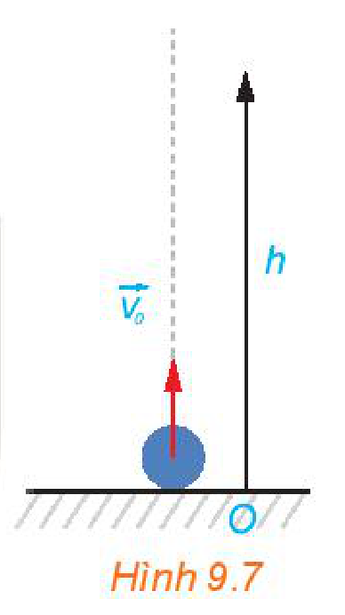
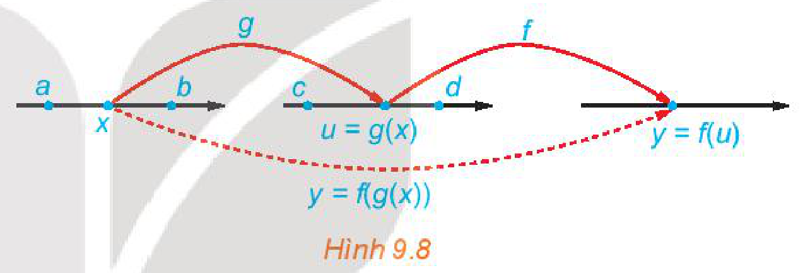

<!-- pdf:89 -->

# BÀI 32: CÁC QUY TẮC TÍNH ĐẠO HÀM

## 🔤 Thuật ngữ

- Đạo hàm của tổng, hiệu
- Đạo hàm của tích, thương
- Đạo hàm của hàm số hợp
- Đạo hàm của các hàm số sơ cấp cơ bản

## 🎯 Mục tiêu

- Tính đạo hàm của một số hàm số sơ cấp cơ bản.
- Sử dụng các công thức tính đạo hàm của tổng, hiệu, tích, thương các hàm số và đạo hàm của hàm số hợp.
- Vận dụng các quy tắc đạo hàm để giải quyết một số bài toán thực tiễn.

## 🔴 Mở đầu

Một vật được phóng theo phương thẳng đứng lên trên từ mặt đất với vận tốc ban đầu $v_0 = 20\text{ m/s}$. Trong Vật lí, ta biết rằng khi bỏ qua sức cản của không khí, độ cao $h$ so với mặt đất (tính bằng mét) của vật tại thời điểm $t$ (giây) sau khi ném được cho bởi công thức sau:

$h = v_0 t - \frac{1}{2}gt^2,$

trong đó $v_0$ là vận tốc ban đầu của vật, $g = 9,8\text{ m/s}^2$ là gia tốc rơi tự do. Hãy tính vận tốc của vật khi nó đạt độ cao cực đại và khi nó chạm đất.

*Hình 9.7*

## 1. ĐẠO HÀM CỦA MỘT SỐ HÀM SỐ THƯỜNG GẶP

**a) Đạo hàm của hàm số $y = x^n$ ($n \in \mathbb{N}^*$)**

**HĐ1:** Nhận biết đạo hàm của hàm số $y = x^n$

a) Tính đạo hàm của hàm số $y = x^3$ tại điểm $x$ bất kì.

b) Dự đoán công thức đạo hàm của hàm số $y = x^n$ ($n \in \mathbb{N}^*$).

> $(x)' = 1; (x^2)' = 2x.$

<!-- term: Đạo hàm của hàm số luỹ thừa -->
> Hàm số $y = x^n$ ($n \in \mathbb{N}^*$) có đạo hàm trên $\mathbb{R}$ và $(x^n)' = nx^{n-1}$.

**b) Đạo hàm của hàm số $y = \sqrt{x}$**

**HĐ2:** Dùng định nghĩa, tính đạo hàm của hàm số $y = \sqrt{x}$ tại điểm $x > 0$.

<!-- term: Đạo hàm của hàm số căn bậc hai -->
> Hàm số $y = \sqrt{x}$ có đạo hàm trên khoảng $(0; +\infty)$ và $(\sqrt{x})' = \frac{1}{2\sqrt{x}}$.

**Ví dụ 1:** Tính đạo hàm của hàm số $y = \sqrt{x}$ tại các điểm $x = 4$ và $x = \frac{1}{4}$.

**Giải:**

Với mọi $x \in (0; +\infty)$, ta có $y' = \frac{1}{2\sqrt{x}}$. Do đó $y'(4) = \frac{1}{2\sqrt{4}} = \frac{1}{4}$ và $y'\left(\frac{1}{4}\right) = \frac{1}{2\sqrt{\frac{1}{4}}} = 1$.
<!-- ocr-ok: đã đối chiếu ảnh trang PDF 89, OCR dính chữ Dođó -->

<!-- pdf:90 -->

## 2. ĐẠO HÀM CỦA TỔNG, HIỆU, TÍCH, THƯƠNG

**HĐ3:** Nhận biết quy tắc đạo hàm của tổng

a) Dùng định nghĩa, tính đạo hàm của hàm số $y = x^3 + x^2$ tại điểm $x$ bất kì.

b) So sánh: $(x^3 + x^2)'$ và $(x^3)' + (x^2)'$.

<!-- term: Đạo hàm của tổng, hiệu, tích, thương -->
> Giả sử các hàm số $u = u(x), v = v(x)$ có đạo hàm trên khoảng $(a; b)$. Khi đó
>
> $(u + v)' = u' + v'; \qquad (u - v)' = u' - v';$
>
> $(uv)' = u'v + uv'; \qquad \left(\frac{u}{v}\right)' = \frac{u'v - uv'}{v^2} \ (v = v(x) \ne 0).$

**Chú ý:**

- Quy tắc đạo hàm của tổng, hiệu có thể áp dụng cho tổng, hiệu của hai hay nhiều hàm số.
- Với $k$ là một hằng số, ta có: $(ku)' = ku'$.
- **Đạo hàm của hàm số nghịch đảo**: $\left(\frac{1}{v}\right)' = -\frac{v'}{v^2}$ ($v = v(x) \ne 0$).

**Ví dụ 2:** Tính đạo hàm của các hàm số sau:

a) $y = \frac{1}{3}x^3 - x^2 + 2x + 1$;

b) $y = \frac{2x + 1}{x - 1}$.

**Giải:**

a) Ta có: $y' = \frac{1}{3}(x^3)' - (x^2)' + 2(x)' + 1'$

$= \frac{1}{3} \cdot 3x^2 - 2x + 2$

$= x^2 - 2x + 2.$

b) Với mọi $x \ne 1$, ta có:

$y' = \frac{(2x + 1)'(x - 1) - (2x + 1)(x - 1)'}{(x - 1)^2}$

$= \frac{2(x - 1) - (2x + 1)}{(x - 1)^2} = -\frac{3}{(x - 1)^2}.$

**Ví dụ 3:** Giải bài toán trong *tình huống mở đầu*.

**Giải:**

Phương trình chuyển động của vật là $h = v_0 t - \frac{1}{2}gt^2$.

Vận tốc của vật tại thời điểm $t$ được cho bởi $v(t) = h' = v_0 - gt$.

Vật đạt độ cao cực đại tại thời điểm $t_1 = \frac{v_0}{g}$, tại đó vận tốc bằng $v(t_1) = v_0 - gt_1 = 0$.

Vật chạm đất tại thời điểm $t_2$ mà $h(t_2) = 0$ nên ta có:

$v_0 t_2 - \frac{1}{2}gt_2^2 = 0 \Leftrightarrow t_2 = 0\text{ (loại)}$ và $t_2 = \frac{2v_0}{g}$.

<!-- pdf:91 -->

Khi chạm đất, vận tốc của vật là $v(t_2) = v_0 - gt_2 = -v_0 = -20\text{ (m/s)}$.

Dấu âm của $v(t_2)$ thể hiện độ cao của vật giảm với vận tốc $20\text{ m/s}$ (tức là chiều chuyển động của vật ngược với chiều dương đã chọn).

**Luyện tập 1:** Tính đạo hàm của các hàm số sau:

a) $y = \frac{\sqrt{x}}{x + 1}$;

b) $y = (\sqrt{x} + 1)(x^2 + 2)$.

## 3. ĐẠO HÀM CỦA HÀM SỐ HỢP

**a) Khái niệm hàm số hợp**

Diện tích của một chiếc đĩa kim loại hình tròn bán kính $r$ được cho bởi $S = \pi r^2$. Bán kính $r$ thay đổi theo nhiệt độ $t$ của chiếc đĩa, tức là $r = r(t)$. Khi đó, diện tích của chiếc đĩa phụ thuộc nhiệt độ $S = S(t) = \pi(r(t))^2$. Ta nói $S(t)$ là *hàm số hợp* của hàm $S = \pi r^2$ với $r = r(t)$.

> Giả sử $u = g(x)$ là hàm số xác định trên khoảng $(a; b)$, có tập giá trị chứa trong khoảng $(c; d)$ và $y = f(u)$ là hàm số xác định trên khoảng $(c; d)$. Hàm số $y = f(g(x))$ được gọi là **hàm số hợp** của hàm số $y = f(u)$ với $u = g(x)$.

*Hình 9.8*

**Ví dụ 4:** Biểu diễn hàm số $y = (2x + 1)^{10}$ dưới dạng hàm số hợp.
<!-- ocr-ok: đã đối chiếu ảnh trang PDF 91, OCR đọc sai chữ diễn thành diến -->

**Giải:**

Hàm số $y = (2x + 1)^{10}$ là hàm số hợp của hàm số $y = u^{10}$ với $u = 2x + 1$.

**b) Đạo hàm của hàm số hợp**

**HĐ4:** Nhận biết quy tắc đạo hàm của hàm số hợp

Cho các hàm số $y = u^2$ và $u = x^2 + 1$.

a) Viết công thức của hàm số hợp $y = (u(x))^2$ theo biến $x$.

b) Tính và so sánh: $y'(x)$ và $y'(u) \cdot u'(x)$.

<!-- term: Đạo hàm của hàm số hợp -->
> Nếu hàm số $u = g(x)$ có đạo hàm $u'_x$ tại $x$ và hàm số $y = f(u)$ có đạo hàm $y'_u$ tại $u$ thì hàm số hợp $y = f(g(x))$ có đạo hàm $y'_x$ tại $x$ là
>
> $y'_x = y'_u \cdot u'_x.$
<!-- ocr-ok: đã đối chiếu ảnh trang PDF 91 -->

**Ví dụ 5:** Tính đạo hàm của hàm số $y = \sqrt{x^2 + 1}$.

**Giải:**

Đặt $u = x^2 + 1$ thì $y = \sqrt{u}$ và $y'_u = \frac{1}{2\sqrt{u}}, u'_x = 2x$.

<!-- pdf:92 -->

Theo công thức đạo hàm của hàm số hợp, ta có: $y'_x = y'_u \cdot u'_x = \frac{2x}{2\sqrt{x^2 + 1}} = \frac{x}{\sqrt{x^2 + 1}}$.

Vậy đạo hàm của hàm số đã cho là $y' = \frac{x}{\sqrt{x^2 + 1}}$.

Trong thực hành, ta thường trình bày ngắn gọn như sau:

$y' = \left(\sqrt{x^2 + 1}\right)' = \frac{(x^2 + 1)'}{2\sqrt{x^2 + 1}} = \frac{2x}{2\sqrt{x^2 + 1}} = \frac{x}{\sqrt{x^2 + 1}}.$

**Luyện tập 2:** Tính đạo hàm của các hàm số sau:

a) $y = (2x - 3)^{10}$;

b) $y = \sqrt{1 - x^2}$.

## 4. ĐẠO HÀM CỦA HÀM SỐ LƯỢNG GIÁC

**a) Đạo hàm của hàm số $y = \sin x$**

**HĐ5:** Xây dựng công thức tính đạo hàm của hàm số $y = \sin x$

a) Với $h \ne 0$, biến đổi hiệu $\sin(x + h) - \sin x$ thành tích.

b) Sử dụng đẳng thức giới hạn $\lim_{h \to 0} \frac{\sin h}{h} = 1$ và kết quả của câu a, tính đạo hàm của hàm số $y = \sin x$ tại điểm $x$ bằng định nghĩa.

<!-- term: Đạo hàm của hàm số lượng giác -->
> - Hàm số $y = \sin x$ có đạo hàm trên $\mathbb{R}$ và $(\sin x)' = \cos x$.
> - Đối với hàm số hợp $y = \sin u$, với $u = u(x)$, ta có: $(\sin u)' = u' \cdot \cos u$.
<!-- ocr-ok: đã đối chiếu ảnh trang PDF 92 -->

**Ví dụ 6:** Tính đạo hàm của hàm số $y = \sin\left(2x + \frac{\pi}{8}\right)$.

**Giải:**

Ta có: $y' = \left(2x + \frac{\pi}{8}\right)' \cdot \cos\left(2x + \frac{\pi}{8}\right) = 2\cos\left(2x + \frac{\pi}{8}\right)$.

**Luyện tập 3:** Tính đạo hàm của hàm số $y = \sin\left(\frac{\pi}{3} - 3x\right)$.

**b) Đạo hàm của hàm số $y = \cos x$**

**HĐ6:** Xây dựng công thức tính đạo hàm của hàm số $y = \cos x$

Bằng cách viết $y = \cos x = \sin\left(\frac{\pi}{2} - x\right)$, tính đạo hàm của hàm số $y = \cos x$.

> - Hàm số $y = \cos x$ có đạo hàm trên $\mathbb{R}$ và $(\cos x)' = -\sin x$.
> - Đối với hàm số hợp $y = \cos u$, với $u = u(x)$, ta có: $(\cos u)' = -u' \cdot \sin u$.
<!-- ocr-ok: đã đối chiếu ảnh trang PDF 92 -->

**Ví dụ 7:** Tính đạo hàm của hàm số $y = \cos\left(4x - \frac{\pi}{3}\right)$.

**Giải:**

Ta có: $y' = -\left(4x - \frac{\pi}{3}\right)' \cdot \sin\left(4x - \frac{\pi}{3}\right) = -4\sin\left(4x - \frac{\pi}{3}\right)$.

<!-- pdf:93 -->

**Luyện tập 4:** Tính đạo hàm của hàm số $y = 2\cos\left(\frac{\pi}{4} - 2x\right)$.

**c) Đạo hàm của các hàm số $y = \tan x$ và $y = \cot x$**

**HĐ7:** Xây dựng công thức tính đạo hàm của các hàm số $y = \tan x$ và $y = \cot x$

a) Bằng cách viết $y = \tan x = \frac{\sin x}{\cos x}$ ($x \ne \frac{\pi}{2} + k\pi, k \in \mathbb{Z}$), tính đạo hàm của hàm số $y = \tan x$.

b) Sử dụng đẳng thức $\cot x = \tan\left(\frac{\pi}{2} - x\right)$ với $x \ne k\pi$ ($k \in \mathbb{Z}$), tính đạo hàm của hàm số $y = \cot x$.
<!-- ocr-ok: đã đối chiếu ảnh trang PDF 93 -->

> - Hàm số $y = \tan x$ có đạo hàm tại mọi $x \ne \frac{\pi}{2} + k\pi$ ($k \in \mathbb{Z}$) và $(\tan x)' = \frac{1}{\cos^2 x}$.
> - Hàm số $y = \cot x$ có đạo hàm tại mọi $x \ne k\pi$ ($k \in \mathbb{Z}$) và $(\cot x)' = -\frac{1}{\sin^2 x}$.
> - Đối với các hàm số hợp $y = \tan u$ và $y = \cot u$, với $u = u(x)$, ta có
>
> $(\tan u)' = \frac{u'}{\cos^2 u}; \ (\cot u)' = -\frac{u'}{\sin^2 u}$ (giả thiết $\tan u$ và $\cot u$ có nghĩa).
<!-- ocr-ok: đã đối chiếu ảnh trang PDF 93 -->

**Ví dụ 8:** Tính đạo hàm của hàm số $y = \tan\left(2x + \frac{\pi}{4}\right)$.

**Giải:**

Ta có: $y' = \frac{\left(2x + \frac{\pi}{4}\right)'}{\cos^2\left(2x + \frac{\pi}{4}\right)} = \frac{2}{\cos^2\left(2x + \frac{\pi}{4}\right)}$.

**Luyện tập 5:** Tính đạo hàm của hàm số $y = 2\tan^2 x + 3\cot\left(\frac{\pi}{3} - 2x\right)$.

**Vận dụng 1:** Một vật chuyển động có phương trình $s(t) = 4\cos\left(2\pi t - \frac{\pi}{8}\right)\text{ (m)}$, với $t$ là thời gian tính bằng giây. Tính vận tốc của vật khi $t = 5$ giây (làm tròn kết quả đến chữ số thập phân thứ nhất).

## 5. ĐẠO HÀM CỦA HÀM SỐ MŨ VÀ HÀM SỐ LÔGARIT

**a) Giới hạn liên quan đến hàm số mũ và hàm số lôgarit**
<!-- ocr-ok: đã đối chiếu ảnh trang PDF 93, OCR dính chữ Giới hạn liên quan đến -->

> - $\lim_{t \to +\infty} \left(1 + \frac{1}{t}\right)^t = e.$
> - $\lim_{t \to -\infty} \left(1 + \frac{1}{t}\right)^t = e.$

**HĐ8:** Giới hạn cơ bản của hàm số mũ và hàm số lôgarit

a) Sử dụng phép đổi biến $t = \frac{1}{x}$, tìm giới hạn $\lim_{x \to 0} (1 + x)^{\frac{1}{x}}$.
<!-- ocr-ok: đã đối chiếu ảnh trang PDF 93 -->

b) Với $y = (1 + x)^{\frac{1}{x}}$, tính $\ln y$ và tìm giới hạn của $\lim_{x \to 0} \ln y$.

c) Đặt $t = e^x - 1$. Tính $x$ theo $t$ và tìm giới hạn $\lim_{x \to 0} \frac{e^x - 1}{x}$.
<!-- ocr-ok: đã đối chiếu ảnh trang PDF 93 -->

<!-- term: Giới hạn cơ bản của hàm số mũ và hàm số lôgarit -->
**Nhận xét:** Ta có các giới hạn sau:

$\lim_{x \to 0} (1 + x)^{\frac{1}{x}} = e; \qquad \lim_{x \to 0} \frac{\ln(1 + x)}{x} = 1; \qquad \lim_{x \to 0} \frac{e^x - 1}{x} = 1.$

<!-- pdf:94 -->

**b) Đạo hàm của hàm số mũ**

**HĐ9:** Xây dựng công thức tính đạo hàm của hàm số mũ

a) Sử dụng giới hạn $\lim_{h \to 0} \frac{e^h - 1}{h} = 1$ và đẳng thức $e^{x+h} - e^x = e^x(e^h - 1)$, tính đạo hàm của hàm số $y = e^x$ tại $x$ bằng định nghĩa.

b) Sử dụng đẳng thức $a^x = e^{x\ln a}$ ($0 < a \ne 1$), hãy tính đạo hàm của hàm số $y = a^x$.

<!-- term: Đạo hàm của hàm số mũ -->
> - Hàm số $y = e^x$ có đạo hàm trên $\mathbb{R}$ và $(e^x)' = e^x$.
>
> Đối với hàm số hợp $y = e^u$, với $u = u(x)$, ta có: $(e^u)' = e^u \cdot u'$.
>
> - Hàm số $y = a^x$ ($0 < a \ne 1$) có đạo hàm trên $\mathbb{R}$ và $(a^x)' = a^x \ln a$.
>
> Đối với hàm số hợp $y = a^u$, với $u = u(x)$, ta có: $(a^u)' = a^u \cdot u' \cdot \ln a$.
<!-- ocr-ok: đã đối chiếu ảnh trang PDF 94 -->

**Ví dụ 9:** Tính đạo hàm của hàm số $y = 2^{x^2 - x}$.

**Giải:**

Ta có: $y' = 2^{x^2 - x} \cdot (x^2 - x)' \cdot \ln 2 = 2^{x^2 - x}(2x - 1)\ln 2$.

**Luyện tập 6:** Tính đạo hàm của các hàm số sau:

a) $y = e^{x^2 - x}$;

b) $y = 3^{\sin x}$.

**c) Đạo hàm của hàm số lôgarit**

**HĐ10:** Xây dựng công thức tính đạo hàm của hàm số lôgarit

a) Sử dụng giới hạn $\lim_{t \to 0} \frac{\ln(1 + t)}{t} = 1$ và đẳng thức $\ln(x + h) - \ln x = \ln\left(\frac{x + h}{x}\right) = \ln\left(1 + \frac{h}{x}\right)$, tính đạo hàm của hàm số $y = \ln x$ tại điểm $x > 0$ bằng định nghĩa.

b) Sử dụng đẳng thức $\log_a x = \frac{\ln x}{\ln a}$ ($0 < a \ne 1$), hãy tính đạo hàm của hàm số $y = \log_a x$.

<!-- term: Đạo hàm của hàm số lôgarit -->
> - Hàm số $y = \ln x$ có đạo hàm trên khoảng $(0; +\infty)$ và $(\ln x)' = \frac{1}{x}$.
>
> Đối với hàm số hợp $y = \ln u$, với $u = u(x)$, ta có: $(\ln u)' = \frac{u'}{u}$.
>
> - Hàm số $y = \log_a x$ có đạo hàm trên khoảng $(0; +\infty)$ và $(\log_a x)' = \frac{1}{x \ln a}$.
>
> Đối với hàm số hợp $y = \log_a u$, với $u = u(x)$, ta có: $(\log_a u)' = \frac{u'}{u \ln a}$.
<!-- ocr-ok: đã đối chiếu ảnh trang PDF 94 -->

**Chú ý:** Với $x < 0$, ta có: $\ln|x| = \ln(-x)$ và $[\ln(-x)]' = \frac{(-x)'}{-x} = \frac{1}{x}$. Từ đó ta có:
<!-- ocr-ok: đã đối chiếu ảnh trang PDF 94 -->

$(\ln|x|)' = \frac{1}{x}, \ \forall x \ne 0.$

<!-- pdf:95 -->

**Ví dụ 10:** Tính đạo hàm của hàm số $y = \ln(x^2 + 1)$.

**Giải:**

Vì $x^2 + 1 > 0$ với mọi $x$ nên hàm số xác định trên $\mathbb{R}$. Ta có: $y' = \frac{(x^2 + 1)'}{x^2 + 1} = \frac{2x}{x^2 + 1}$.

**Luyện tập 7:** Tính đạo hàm của hàm số $y = \log_2(2x - 1)$.

**Vận dụng 2:** Ta đã biết, độ pH của một dung dịch được xác định bởi $\text{pH} = -\log[\text{H}^+]$, ở đó $[\text{H}^+]$ là nồng độ (mol/l) của ion hydrogen. Tính tốc độ thay đổi của pH đối với nồng độ $[\text{H}^+]$.

**BẢNG ĐẠO HÀM**

<!-- term: Bảng đạo hàm của các hàm số sơ cấp cơ bản và hàm số hợp -->
| Đạo hàm của hàm số sơ cấp cơ bản | Đạo hàm của hàm số lượng giác | Đạo hàm của hàm số mũ và lôgarit |
| :--- | :--- | :--- |
| $(x^n)' = nx^{n-1}$ | $(\sin x)' = \cos x$ | $(e^x)' = e^x$ |
| $\left(\frac{1}{x}\right)' = -\frac{1}{x^2}$ | $(\cos x)' = -\sin x$ | $(a^x)' = a^x \ln a$ |
| $(\sqrt{x})' = \frac{1}{2\sqrt{x}}$ | $(\tan x)' = \frac{1}{\cos^2 x}$ | $(\ln x)' = \frac{1}{x}$ |
| | $(\cot x)' = -\frac{1}{\sin^2 x}$ | $(\log_a x)' = \frac{1}{x \ln a}$ |
| $(u^n)' = nu^{n-1} \cdot u'$ | $(\sin u)' = u' \cdot \cos u$ | $(e^u)' = e^u \cdot u'$ |
| $\left(\frac{1}{u}\right)' = -\frac{u'}{u^2}$ | $(\cos u)' = -u' \cdot \sin u$ | $(a^u)' = a^u \cdot u' \cdot \ln a$ |
| $(\sqrt{u})' = \frac{u'}{2\sqrt{u}}$ | $(\tan u)' = \frac{u'}{\cos^2 u}$ | $(\ln u)' = \frac{u'}{u}$ |
| | $(\cot u)' = -\frac{u'}{\sin^2 u}$ | $(\log_a u)' = \frac{u'}{u \ln a}$ |
<!-- ocr-ok: đã đối chiếu ảnh trang PDF 95, bảng tổng hợp công thức đạo hàm -->

## ✏️ BÀI TẬP

**9.6.** Tính đạo hàm của các hàm số sau:

a) $y = x^3 - 3x^2 + 2x + 1$;

b) $y = x^2 - 4\sqrt{x} + 3$.

**9.7.** Tính đạo hàm của các hàm số sau:

a) $y = \frac{2x - 1}{x + 2}$;

b) $y = \frac{2x}{x^2 + 1}$.

**9.8.** Tính đạo hàm của các hàm số sau:

a) $y = x\sin^2 x$;

b) $y = \cos^2 x + \sin 2x$;

c) $y = \sin 3x - 3\sin x$;

d) $y = \tan x + \cot x$.

**9.9.** Tính đạo hàm của các hàm số sau:

a) $y = 2^{3x - x^2}$;

b) $y = \log_3(4x + 1)$.

**9.10.** Cho hàm số $f(x) = 2\sin^2\left(3x - \frac{\pi}{4}\right)$. Chứng minh rằng $|f'(x)| \le 6$ với mọi $x$.
<!-- ocr-ok: đã đối chiếu ảnh trang PDF 95, OCR đọc sai chữ mọi thành moi -->

**9.11.** Một vật chuyển động rơi tự do có phương trình $h(t) = 100 - 4,9t^2$, ở đó độ cao $h$ so với mặt đất tính bằng mét và thời gian $t$ tính bằng giây. Tính vận tốc của vật:

a) Tại thời điểm $t = 5$ giây;

b) Khi vật chạm đất.

**9.12.** Chuyển động của một hạt trên một dây rung được cho bởi $s(t) = 12 + 0,5\sin(4\pi t)$, trong đó $s$ tính bằng centimét và $t$ tính bằng giây. Tính vận tốc của hạt sau $t$ giây. Vận tốc cực đại của hạt là bao nhiêu?

## 📷 Danh sách hình trong bài

| Mã hình | Trang PDF | Chú thích trong sách | Mô tả ngắn |
| :--- | :---: | :--- | :--- |
| H11-toan-b32-01 | 89 | Hình 9.7 | Sơ đồ vật được phóng thẳng đứng lên trên với vận tốc ban đầu $\vec{v}_0$ và độ cao $h$ |
| H11-toan-b32-02 | 91 | Hình 9.8 | Sơ đồ minh hoạ hàm số hợp $y = f(g(x))$ qua biến trung gian $u = g(x)$ |
