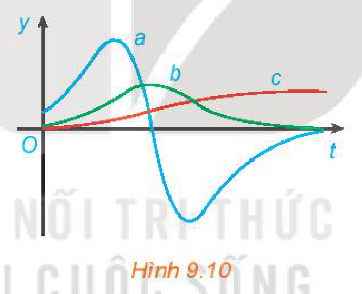

<!-- pdf:98 -->

# BÀI TẬP CUỐI CHƯƠNG IX

## ✏️ A – TRẮC NGHIỆM

**9.18.** Quy tắc tính đạo hàm nào sau đây là **đúng**?

A. $(u + v)' = u' - v'$.

B. $(uv)' = u'v + uv'$.

C. $\left(\frac{1}{v}\right)' = -\frac{1}{v^2}$.

D. $\left(\frac{u}{v}\right)' = \frac{u'v + uv'}{v^2}$.

**9.19.** Cho hàm số $f(x) = x^2 + \sin^3 x$. Khi đó $f'\left(\frac{\pi}{2}\right)$ bằng

A. $\pi$.

B. $2\pi$.

C. $\pi + 3$.

D. $\pi - 3$.

**9.20.** Cho hàm số $f(x) = \frac{1}{3}x^3 - x^2 - 3x + 1$. Tập nghiệm của bất phương trình $f'(x) \le 0$ là

A. $[1; 3]$.

B. $[-1; 3]$.

C. $[-3; 1]$.

D. $[-3; -1]$.

**9.21.** Cho hàm số $f(x) = \sqrt{4 + 3u(x)}$ với $u(1) = 7, u'(1) = 10$. Khi đó $f'(1)$ bằng

A. $1$.

B. $6$.

C. $3$.

D. $-3$.

**9.22.** Cho hàm số $f(x) = x^2 e^{-2x}$. Tập nghiệm của phương trình $f'(x) = 0$ là

A. $\{0; 1\}$.

B. $\{-1; 0\}$.

C. $\{0\}$.

D. $\{1\}$.

**9.23.** Chuyển động của một vật có phương trình $s(t) = \sin\left(0,8\pi t + \frac{\pi}{3}\right)$, ở đó $s$ tính bằng centimét và thời gian $t$ tính bằng giây. Tại các thời điểm vận tốc bằng $0$, giá trị tuyệt đối của gia tốc của vật gần với giá trị nào sau đây nhất?

A. $4,5\text{ cm/s}^2$.

B. $5,5\text{ cm/s}^2$.

C. $6,3\text{ cm/s}^2$.

D. $7,1\text{ cm/s}^2$.

**9.24.** Cho hàm số $y = x^3 - 3x^2 + 4x - 1$ có đồ thị là $(C)$. Hệ số góc nhỏ nhất của tiếp tuyến tại một điểm $M$ trên đồ thị $(C)$ là

A. $1$.

B. $2$.

C. $-1$.

D. $3$.

## ✏️ B – TỰ LUẬN

**9.25.** Tính đạo hàm của các hàm số sau:

a) $y = \left(\frac{2x - 1}{x + 2}\right)^5$;

b) $y = \frac{2x}{x^2 + 1}$;

c) $y = e^x \sin^2 x$;

d) $y = \log(x + \sqrt{x})$.

<!-- pdf:99 -->

**9.26.** Xét hàm số luỹ thừa $y = x^\alpha$ với $\alpha$ là số thực.
<!-- ocr-ok: đã đối chiếu ảnh trang PDF 99 -->

a) Tìm tập xác định của hàm số đã cho.

b) Bằng cách viết $y = x^\alpha = e^{\alpha \ln x}$, tính đạo hàm của hàm số đã cho.

**9.27.** Cho hàm số $f(x) = \sqrt{3x + 1}$. Đặt $g(x) = f(1) + 4(x^2 - 1)f'(1)$. Tính $g(2)$.
<!-- ocr-ok: đã đối chiếu ảnh trang PDF 99 -->

**9.28.** Cho hàm số $f(x) = \frac{x + 1}{x - 1}$. Tính $f''(1)$.
<!-- ocr-ok: đã đối chiếu ảnh trang PDF 99 -->

**9.29.** Cho hàm số $f(x)$ thoả mãn $f(1) = 2$ và $f'(x) = x^2 f(x)$ với mọi $x$. Tính $f''(1)$.
<!-- ocr-ok: đã đối chiếu ảnh trang PDF 99 -->

**9.30.** Viết phương trình tiếp tuyến của đồ thị hàm số $y = x^3 + 3x^2 - 1$ tại điểm có hoành độ bằng $1$.

**9.31.** Đồ thị của hàm số $y = \frac{a}{x}$ ($a$ là hằng số dương) là một đường hypebol. Chứng minh rằng tiếp tuyến tại một điểm bất kì của đường hypebol đó tạo với các trục toạ độ một tam giác có diện tích không đổi.

**9.32.** Hình 9.10 biểu diễn đồ thị của ba hàm số. Hàm số thứ nhất là hàm vị trí của một chiếc ô tô, hàm số thứ hai biểu thị vận tốc và hàm số thứ ba biểu thị gia tốc của ô tô đó. Hãy xác định đồ thị của mỗi hàm số này và giải thích.

*Hình 9.10*

**9.33.** Vị trí của một vật chuyển động thẳng được cho bởi phương trình: $s = f(t) = t^3 - 6t^2 + 9t$, trong đó $t$ tính bằng giây và $s$ tính bằng mét.
<!-- ocr-ok: đã đối chiếu ảnh trang PDF 99 -->

a) Tính vận tốc của vật tại các thời điểm $t = 2$ giây và $t = 4$ giây.

b) Tại những thời điểm nào vật đứng yên?

c) Tìm gia tốc của vật tại thời điểm $t = 4$ giây.

d) Tính tổng quãng đường vật đi được trong $5$ giây đầu tiên.

e) Trong $5$ giây đầu tiên, khi nào vật tăng tốc, khi nào vật giảm tốc?

## 📷 Danh sách hình trong bài

| Mã hình | Trang PDF | Chú thích trong sách | Mô tả ngắn |
| :--- | :---: | :--- | :--- |
| H11-toan-bt-c09-01 | 99 | Hình 9.10 | Đồ thị của ba hàm số $a, b, c$ biểu diễn vị trí, vận tốc và gia tốc của một chiếc ô tô |
