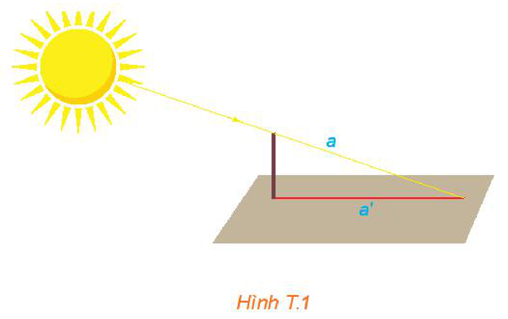
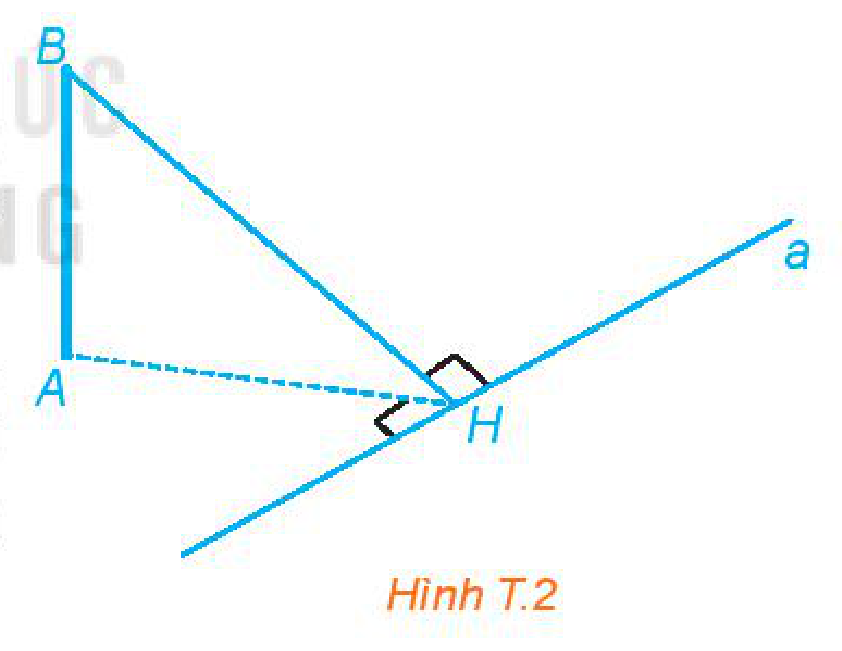
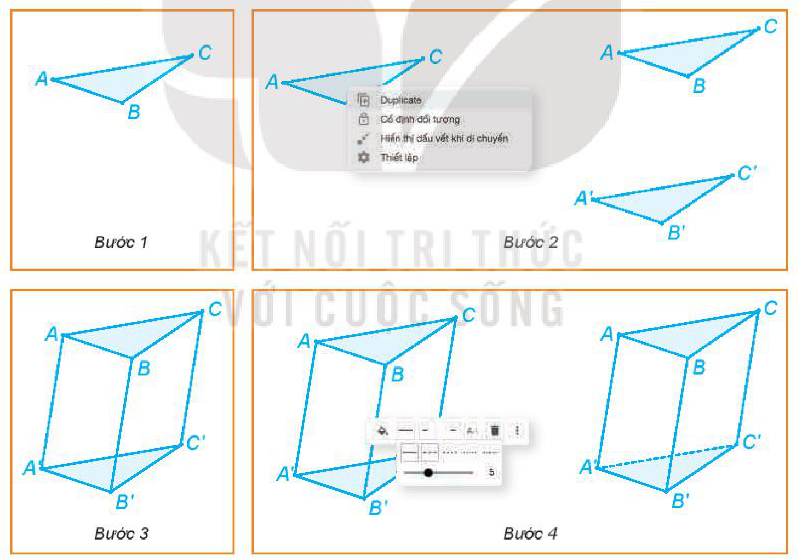
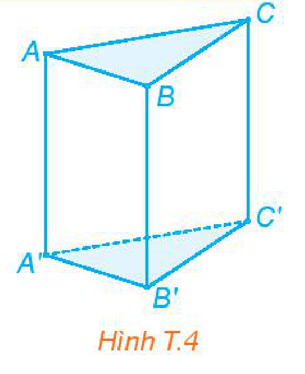

<!-- pdf:103 -->

# HOẠT ĐỘNG THỰC HÀNH TRẢI NGHIỆM HÌNH HỌC

Phụ thuộc vào từng tình huống thực tế cụ thể, ta có thể thực hiện các hoạt động phù hợp để có trải nghiệm Hình học. Sau đây là một số tình huống gợi ý.

## 1. GẤP GIẤY TẠO DỰNG HÌNH KHÔNG GIAN

Từ một tấm bìa hình vuông (quy ước), em hãy cắt, gấp, dán các mép bìa để được các hình sau mà các đường ghép, dán chỉ ở các cạnh của hình:

a) Thùng không nắp hình hộp chữ nhật (đáy liền; không ghép, dán).

b) Thùng không nắp hình lập phương (đáy liền; không ghép, dán).

c) Hình lăng trụ đều không có hai đáy (chỉ dán $1$ cạnh bên, các cạnh còn lại là liền).

d) Thùng không nắp hình lăng trụ lục giác đều (đáy liền; không ghép, dán).

e) Hình chóp tứ giác đều (đáy liền; không ghép, dán).

f) Thùng không nắp hình chóp cụt tứ giác đều.

g) Hình tứ diện đều (chỉ dán $3$ cạnh cùng xuất phát từ một đỉnh nào đó).

- **Dụng cụ cần chuẩn bị:**
  - Một số tấm bìa hình vuông (vừa có độ cứng nhất định, vừa có thể gấp).
  - Thước thẳng có chia vạch đo độ dài, ê ke, compa, bút.
  - Băng dính, kéo.
- **Gợi ý thực hiện:** Xem lại các bài tập về cách tạo thùng không nắp có dạng hình hộp chữ nhật, hình chóp cụt tứ giác đều, từ đó tìm cách làm đối với các hình còn lại.

## 2. ĐO ĐẠC VÀ TÍNH TOÁN

Hãy thực hiện đo và tính góc giữa đường thẳng và mặt phẳng, số đo góc nhị diện, khoảng cách từ một điểm đến một mặt phẳng, khoảng cách giữa hai đường thẳng chéo nhau, thể tích của một khối hình, trong một số tình huống bắt gặp hoặc trong một số tình huống tạo dựng. Sau đây là một số gợi ý:

**a) Đo góc giữa đường thẳng chứa tia sáng mặt trời và mặt đất phẳng**

- **Dụng cụ cần chuẩn bị:**
  - Cọc nhỏ thẳng cao $1\text{ m}$, thước dây đo độ dài, hình hộp chữ nhật.
  - Máy tính cầm tay, giấy, bút.

<!-- pdf:104 -->

- **Gợi ý thực hiện (H.T.1):**
  - Dưới ánh sáng mặt trời, dựng cọc thẳng vuông góc với mặt đất (có thể đặt hình hộp chữ nhật trên mặt đất để tạo phương vuông góc với mặt đất).
  - Đánh dấu bóng trên mặt đất của đầu cọc.
  - Đường thẳng $a$ nối đầu cọc và bóng của nó chính là đường thẳng chứa tia sáng mặt trời.
  - Vì cọc được dựng vuông góc với mặt đất nên đường thẳng $a'$ chứa bóng trên mặt đất của nó chính là hình chiếu vuông góc của đường thẳng $a$ trên mặt phẳng chứa mặt đất.
  - Góc giữa $a$ và $a'$ là góc cần đo và có tang bằng tỉ số giữa độ dài của cọc và độ dài bóng của nó trên mặt đất.

*Hình T.1*

**Chú ý:** Trong trường hợp mặt đất là mặt phẳng nằm ngang thì có thể dùng dây dọi để tạo phương vuông góc với mặt đất.

**b) Trên mặt đất phẳng kẻ một vạch thẳng $a$ và dựng một cọc thẳng, vuông góc với mặt đất sao cho chân cọc không thuộc đường thẳng $a$. Hãy đo và tính góc nhị diện có đỉnh là đường thẳng $a$ và có hai cạnh tương ứng chứa chân cọc (ở mặt đất) và ngọn cọc.**

- **Dụng cụ cần chuẩn bị:**
  - Máy tính cầm tay, giấy, bút, phấn, một hình hộp chữ nhật.
  - Cọc nhỏ, thẳng cao $1\text{ m}$, thước dây đo khoảng cách, một đoạn dây dài $5\text{ m}$.
- **Gợi ý thực hiện (H.T.2):**
  - Dùng dây kéo căng và kẻ vạch thẳng $a$.
  - Dựng cọc vuông góc với mặt đất, chân cọc không thuộc đường thẳng $a$ (đặt hình hộp chữ nhật trên mặt đất để xác định phương vuông góc với mặt đất).
  - Gọi vị trí chân cọc là $A$ (trên mặt đất), ngọn cọc là $B$, hình chiếu vuông góc của chân cọc trên đường thẳng $a$ là $H$. Khi đó $\widehat{BHA}$ là góc phẳng của góc nhị diện cần đo.
  - Vì $\tan\widehat{BHA} = \frac{AB}{AH}$ nên để tìm số đo của góc $\widehat{BHA}$, ta cần đo $AH$ và $AB$.
  - Đo trực tiếp $AB$.
  - Có thể xác định và đo trực tiếp $AH$ hoặc đo gián tiếp thông qua diện tích. (Lấy hai điểm $M, N$ trên vạch $a$, đo các cạnh và dùng công thức Heron để tính diện tích tam giác $AMN$, sau đó tính chiều cao kẻ từ $A$ của tam giác $AMN$.)

*Hình T.2*

**c) Đo và tính thể tích hình được tạo dựng ở Mục 1**

- **Dụng cụ cần chuẩn bị:** Như ở Mục 1 (có thể dùng hình chóp đều, hình chóp cụt đều, hình lăng trụ đều đã được tạo sẵn để bỏ qua bước tạo hình).

<!-- pdf:105 -->

- **Gợi ý thực hiện:** Đối với mỗi hình này ta có thể dùng thước để đo độ dài các cạnh. Từ đó, dựa vào kiến thức về các hình này để suy ra chiều cao và diện tích của mặt cần thiết, từ đó tính thể tích.

## 3. VẼ HÌNH VỚI PHẦN MỀM GEOGEBRA

<!-- term: Các bước vẽ hình lăng trụ với phần mềm GeoGebra -->
Em có thể vẽ hình trên máy tính với phần mềm GeoGebra, chẳng hạn để vẽ một hình lăng trụ, em có thể thực hiện theo các bước sau:

*Bước 1.* Vẽ một đáy của hình lăng trụ.

Chọn công cụ Đa giác và vẽ một đa giác với số cạnh tuỳ ý.

*Bước 2.* Vẽ đáy thứ hai của hình lăng trụ.

Chọn đa giác vừa vẽ và thực hiện lệnh “Duplicate” để nhận được một bản sao của đa giác đó. Kéo và thả bản sao đến vị trí mới.

*Bước 3.* Vẽ các cạnh của hình lăng trụ.

Nối các đỉnh của đa giác ban đầu với các đỉnh tương ứng thuộc bản sao của nó.

*Bước 4.* Hoàn thành hình lăng trụ.

Chọn các đường khuất và thay nét liền thành nét đứt.

Hình T.3 minh hoạ các bước vẽ hình lăng trụ tam giác $ABC.A'B'C'$.

*Hình T.3*

**Chú ý:** Để vẽ hình lăng trụ đứng, em chỉ cần di chuyển bản sao của đáy sao cho đường nối các đỉnh tương ứng là các đường thẳng đứng (H.T.4).

*Hình T.4*

## 📷 Danh sách hình trong bài

| Mã hình | Trang PDF | Chú thích trong sách | Mô tả ngắn |
| :--- | :---: | :--- | :--- |
| H11-toan-hd-thtn-04-01 | 104 | Hình T.1 | Sơ đồ dựng cọc thẳng vuông góc với mặt đất để đo góc giữa tia sáng mặt trời $a$ và bóng $a'$ |
| H11-toan-hd-thtn-04-02 | 104 | Hình T.2 | Sơ đồ đo và tính góc phẳng nhị diện $\widehat{BHA}$ giữa chân cọc $A$, ngọn cọc $B$ và vạch thẳng $a$ |
| H11-toan-hd-thtn-04-03 | 105 | Hình T.3 | Minh hoạ 4 bước vẽ hình lăng trụ tam giác $ABC.A'B'C'$ trên phần mềm GeoGebra |
| H11-toan-hd-thtn-04-04 | 105 | Hình T.4 | Hình lăng trụ đứng tam giác $ABC.A'B'C'$ vẽ trên phần mềm GeoGebra |
