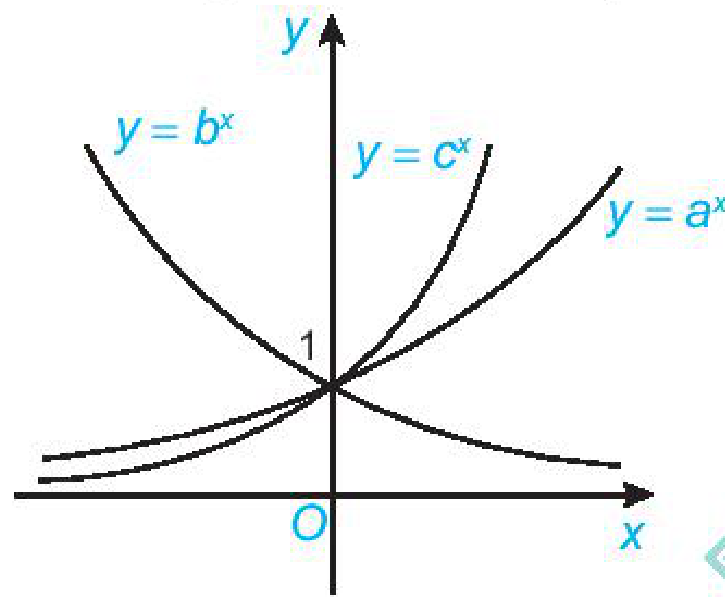
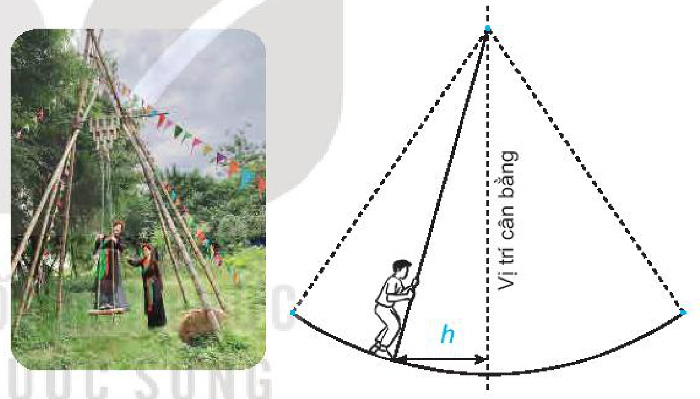

<!-- pdf:106 -->

# BÀI TẬP ÔN TẬP CUỐI NĂM

## ✏️ A – TRẮC NGHIỆM

**1.** Khẳng định nào sau đây là **sai**?

A. $\cos(\alpha + \beta) = \cos\alpha\cos\beta + \sin\alpha\sin\beta$.

B. $\sin\left(\frac{\pi}{2} + \alpha\right) = \cos\alpha$.

C. $\sin(\alpha + \beta) = \sin\alpha\cos\beta + \cos\alpha\sin\beta$.

D. $\cos 2\alpha = \cos^2\alpha - \sin^2\alpha$.

**2.** Khẳng định nào sau đây là **đúng**?

A. Hàm số $y = \sin x$ tuần hoàn với chu kì $\pi$.

B. Hàm số $y = \cos x$ tuần hoàn với chu kì $2\pi$.

C. Hàm số $y = \tan x$ tuần hoàn với chu kì $2\pi$.

D. Hàm số $y = \cot x$ tuần hoàn với chu kì $2\pi$.

**3.** Cho dãy số $(u_n)$ với $u_n = 5^n$. Số hạng $u_{2n}$ bằng
<!-- ocr-ok: đã đối chiếu ảnh trang PDF 106 -->

A. $2 \cdot 5^n$.

B. $25^n$.

C. $10^n$.

D. $5^{n^2}$.

**4.** Hãy cho biết dãy số $(u_n)$ nào dưới đây là dãy số tăng, nếu biết công thức số hạng tổng quát của nó là

A. $\frac{1}{n^2 + 1}$.

B. $2^{-n}$.

C. $\log_{\frac{1}{2}} n$.

D. $\frac{n}{n + 1}$.

**5.** Khẳng định nào sau đây là **sai**?

A. Nếu $\lim_{x \to x_0} f(x) = L \ge 0$ thì $\lim_{x \to x_0} \sqrt{f(x)} = \sqrt{L}$.

B. $\lim_{x \to 0^-} \frac{1}{x} = -\infty$.

C. Nếu $|q| \le 1$ thì $\lim_{n \to +\infty} q^n = 0$.

D. $\lim_{n \to +\infty} \frac{\sin n}{n + 1} = 0$.

**6.** Hàm số nào dưới đây **không** liên tục trên $\mathbb{R}$?

A. $y = \tan x$.

B. $y = \frac{2x^2 + 3x - 1}{x^2 + 1}$.

C. $y = \sin x$.

D. $y = |x|$.

**7.** Cho $0 < a \ne 1$. Giá trị của biểu thức $\log_a\left(a^3 \cdot \sqrt[4]{a}\right) + \left(\sqrt[3]{a}\right)^{\log_a 8}$ bằng
<!-- ocr-ok: đã đối chiếu ảnh trang PDF 106 -->

A. $\frac{19}{4}$.

B. $9$.

C. $\frac{21}{4}$.

D. $\frac{47}{12}$.

**8.** Cho đồ thị ba hàm số mũ $y = a^x, y = b^x$ và $y = c^x$ như trong hình vẽ dưới đây. Khẳng định nào sau đây là **đúng**?

A. $a > c > b$.

B. $b > a > c$.

C. $c > a > b$.

D. $c > b > a$.

<!-- pdf:107 -->

**9.** Nếu $f(x) = \sin^2 x + xe^{2x}$ thì $f''(0)$ bằng

A. $4$.

B. $5$.

C. $6$.

D. $0$.

**10.** Phương trình tiếp tuyến của đồ thị hàm số $y = -2x^3 + 6x^2 - 5$ tại điểm $M(3; -5)$ thuộc đồ thị là

A. $y = 18x + 49$.

B. $y = 18x - 49$.

C. $y = -18x - 49$.

D. $y = -18x + 49$.

**11.** Cho hình chóp $S.ABC$ có đáy $ABC$ là tam giác đều cạnh $a$ và $SA \perp (ABC), SA = a\sqrt{2}$. Khoảng cách từ $A$ đến mặt phẳng $(SBC)$ bằng
<!-- ocr-ok: đã đối chiếu ảnh trang PDF 107 -->

A. $\frac{6a}{11}$.

B. $\frac{a\sqrt{66}}{11}$.

C. $\frac{a\sqrt{6}}{11}$.

D. $\frac{a\sqrt{11}}{11}$.

**12.** Cho hình hộp $ABCD.A'B'C'D'$ có đáy $ABCD$ là hình chữ nhật. Biết $AC = AA' = 2a$. Giá trị lớn nhất của thể tích hình hộp $ABCD.A'B'C'D'$ bằng

A. $8a^3$.

B. $6a^3$.

C. $4a^3$.

D. $a^3$.

**13.** Cho tứ diện đều $ABCD$ có cạnh bằng $a$. Gọi $M, N$ lần lượt là trung điểm của cạnh $AC$ và cạnh $AD$. Thể tích khối chóp $B.CMND$ bằng

A. $\frac{a^3\sqrt{2}}{12}$.

B. $\frac{a^3\sqrt{2}}{16}$.

C. $\frac{a^3\sqrt{2}}{24}$.

D. $\frac{a^3\sqrt{2}}{8}$.

**14.** Cho lăng trụ tam giác đều $ABC.A'B'C'$ có $AB = 1, AA' = 2$. Thể tích khối lăng trụ $ABC.A'B'C'$ bằng
<!-- ocr-ok: đã đối chiếu ảnh trang PDF 107 -->

A. $\frac{\sqrt{3}}{2}$.

B. $\frac{\sqrt{3}}{6}$.

C. $\frac{\sqrt{3}}{4}$.

D. $\frac{\sqrt{3}}{8}$.

**15.** Cho hình lập phương $ABCD.A'B'C'D'$ có $AC' = \sqrt{3}$. Khoảng cách giữa hai đường thẳng $AB'$ và $BC'$ bằng
<!-- ocr-ok: đã đối chiếu ảnh trang PDF 107 -->

A. $\frac{1}{3}$.

B. $\frac{\sqrt{3}}{3}$.

C. $\frac{\sqrt{3}}{2}$.

D. $\frac{1}{2}$.

*Sử dụng dữ kiện sau để trả lời các câu hỏi 16, 17.*

Cho mẫu số liệu ghép nhóm về thu nhập của các công nhân tại một doanh nghiệp lớn:

| Mức thu nhập (triệu đồng/tháng) | $[0; 5)$ | $[5; 10)$ | $[10; 15)$ | $[15; 20)$ | $[20; 25)$ |
| :--- | :---: | :---: | :---: | :---: | :---: |
| Số công nhân | $7$ | $18$ | $35$ | $57$ | $28$ |
<!-- ocr-ok: đã đối chiếu ảnh trang PDF 107 -->

**16.** Nhóm chứa trung vị là

A. $[5; 10)$.

B. $[10; 15)$.

C. $[15; 20)$.

D. $[20; 25)$.

**17.** Nhóm chứa mốt là

A. $[5; 10)$.

B. $[10; 15)$.

C. $[15; 20)$.

D. $[20; 25)$.

**18.** Vận động viên Tùng thi bắn súng. Biết rằng xác suất để Tùng bắn trúng vòng $10$ là $0,2$. Mỗi vận động viên được bắn hai lần và hai lần bắn là độc lập. Vận động viên đạt huy chương vàng nếu cả hai lần bắn trúng vòng $10$. Xác suất để vận động viên Tùng đạt huy chương vàng là

A. $0,04$.

B. $0,035$.

C. $0,05$.

D. $0,045$.

<!-- pdf:108 -->

**19.** Hai bạn Sơn và Tùng, mỗi người gieo một con xúc xắc. Xác suất để số chấm xuất hiện trên cả hai con xúc xắc của Sơn và Tùng lớn hơn $1$ là

A. $\frac{27}{36}$.

B. $\frac{25}{36}$.

C. $\frac{26}{35}$.

D. $\frac{28}{37}$.

**20.** Hai bạn An và Bình tham gia một trò chơi độc lập với nhau. Xác suất để An và Bình giành giải thưởng tương ứng là $0,8$ và $0,6$. Xác suất để có ít nhất một bạn giành giải thưởng là

A. $0,94$.

B. $0,924$.

C. $0,92$.

D. $0,93$.

## ✏️ B – TỰ LUẬN

**21.** Rút gọn các biểu thức sau:

a) $A = \frac{1 - 2\sin^2 x}{1 + \sin 2x} - \frac{1 - \tan x}{1 + \tan x}$;

b) $B = \frac{\sin 4x}{1 + \cos 4x} \cdot \frac{\cos 2x}{1 + \cos 2x} - \cot\left(\frac{3\pi}{2} - x\right)$;

c) $C = 2(\cos^4 x - \sin^4 x)\sin 2x$.

**22.** Mùa xuân ở hội Lim (tỉnh Bắc Ninh) thường có trò chơi đu. Khi người chơi đu nhún cây đu sẽ đưa người chơi dao động qua lại quanh vị trí cân bằng. Giả sử khoảng cách $h$ (tính bằng mét) từ người chơi đu đến vị trí cân bằng được tính theo thời gian $t$ ($t \ge 0$ và được tính bằng giây) bởi hệ thức $h = |d|$ với $d = 3\cos\left[\frac{\pi}{3}(2t - 1)\right]$, trong đó ta quy ước rằng $d > 0$ khi vị trí cân bằng ở về phía sau lưng người chơi đu và $d < 0$ trong trường hợp ngược lại.

a) Tìm các thời điểm trong vòng $2$ giây đầu tiên mà người chơi đu ở xa vị trí cân bằng nhất.

b) Tìm các thời điểm trong vòng $2$ giây đầu tiên mà người chơi đu cách vị trí cân bằng $2\text{ m}$ (tính chính xác đến $0,01$ giây).

**23.** Cho cấp số nhân $(u_n)$ biết rằng ba số $u_1, u_4$ và $u_7$ lần lượt là các số hạng thứ nhất, thứ hai và thứ mười của một cấp số cộng có công sai $d \ne 0$. Hãy tìm công bội $q$ của cấp số nhân đó.

**24.** Một công ty đề xuất kí hợp đồng với một người lao động theo một trong hai loại hợp đồng sau:

*Hợp đồng A:* Lương $200$ triệu đồng cho năm đầu tiên và sau mỗi năm tăng thêm $10$ triệu đồng.

*Hợp đồng B:* Lương $180$ triệu đồng cho năm đầu tiên và sau mỗi năm tăng thêm $5\%$.

<!-- pdf:109 -->

Kí hiệu $u_n, v_n$ tương ứng là lương nhận được (triệu đồng) của năm thứ $n$ ứng với các hợp đồng $A$ và $B$.

a) Tính $u_2, u_3$ và $u_n$ theo $n$. Nếu người lao động đó làm việc cho công ty trong thời gian $5$ năm theo hợp đồng $A$ thì tổng số tiền lương người đó nhận được là bao nhiêu?

b) Tính $v_2, v_3$ và $v_n$ theo $n$. Nếu người lao động đó làm việc cho công ty trong thời gian $5$ năm theo hợp đồng $B$ thì tổng số tiền lương người đó nhận được là bao nhiêu?

c) Sau bao nhiêu năm thì lương hằng năm theo hợp đồng $B$ vượt lương hằng năm theo hợp đồng $A$?

**25.** Tính các giới hạn sau:

a) $\lim_{n \to +\infty} \frac{1 + 3 + 5 + \dots + (2n - 1)}{n^2 + 2n + 3}$;

b) $\lim_{n \to +\infty} \left(1 + \frac{2}{3} + \frac{4}{9} + \dots + \frac{2^n}{3^n}\right)$;

c) $\lim_{x \to -2} \frac{2x^2 + 3x - 2}{x^2 - 4}$;

d) $\lim_{x \to -\infty} \left(\sqrt{4x^2 + x + 1} + 2x\right)$.

**26.** Tìm các giá trị của tham số $m$ để:

a) Hàm số $f(x) = \begin{cases} \frac{x^2 + 4x + 3}{x + 1} & \text{khi } x \ne -1 \\ m^2 & \text{khi } x = -1 \end{cases}$ liên tục tại điểm $x = -1$;

b) Hàm số $g(x) = \begin{cases} 2x + m & \text{khi } x \le 1 \\ \frac{x^3 - x^2 + 2x - 2}{x - 1} & \text{khi } x > 1 \end{cases}$ liên tục trên $\mathbb{R}$.

**27.** Giải các phương trình và bất phương trình sau:

a) $3^{\frac{1}{x}} = 4$;

b) $2^{x^2 - 3x} = 4$;

c) $\log_4(x + 1) + \log_4(x - 3) = 3$;

d) $\left(\frac{1}{5}\right)^{x^2 - 2x} \ge \frac{1}{125}$;

e) $\left(2 - \sqrt{3}\right)^x \le \left(2 + \sqrt{3}\right)^{x + 2}$;

f) $\log(3x^2 + 1) > \log(4x)$.

**28.** Để xác định tính acid và tính bazơ của các dung dịch, người ta sử dụng khái niệm độ pH. Độ pH của một dung dịch được cho bởi công thức $\text{pH} = -\log[\text{H}^+]$, trong đó $[\text{H}^+]$ là nồng độ của ion hydrogen (tính bằng mol/lít).

a) Tính độ pH của một dung dịch có nồng độ ion hydrogen là $0,1\text{ mol/lít}$.

b) Độ pH sẽ biến đổi như thế nào nếu nồng độ ion hydrogen giảm?

c) Xác định nồng độ ion hydrogen trong bia biết độ pH của bia là khoảng $4,5$.

**29.** Tính đạo hàm của các hàm số sau:

a) $y = 3x^2 - 2\sqrt{x}$;

b) $y = \sqrt{1 + 2x - x^2}$;

c) $y = \tan\frac{x}{2} - \cot\frac{x}{2}$;

d) $y = e^{ex} + \ln x^2$.

**30.** Một chất điểm chuyển động có phương trình $s(t) = t^3 - 3t^2 - 9t + 2$, ở đó thời gian $t > 0$ tính bằng giây và quãng đường $s$ tính bằng mét.
<!-- ocr-ok: đã đối chiếu ảnh trang PDF 109 -->

a) Tính vận tốc của chất điểm tại thời điểm $t = 2$ giây.

b) Tính gia tốc của chất điểm tại thời điểm $t = 3$ giây.

c) Tính gia tốc của chất điểm tại thời điểm vận tốc bằng $0$.

d) Tính vận tốc của chất điểm tại thời điểm gia tốc bằng $0$.

<!-- pdf:110 -->

**31.** Cho tứ diện $OABC$ có $OA = OB = OC = a, \widehat{AOB} = \widehat{AOC} = 60^\circ$ và $\widehat{BOC} = 90^\circ$.
<!-- ocr-ok: đã đối chiếu ảnh trang PDF 110 -->

a) Chứng minh rằng $(OBC) \perp (ABC)$.

b) Tính theo $a$ khoảng cách từ $O$ đến mặt phẳng $(ABC)$ và thể tích khối tứ diện $OABC$.

**32.** Cho hình chóp $S.ABCD$ có đáy $ABCD$ là hình vuông cạnh $a$. Biết $SA \perp (ABCD)$ và $SA = a\sqrt{2}$. Mặt phẳng $(P)$ đi qua điểm $A$ và vuông góc với đường thẳng $SC$, cắt các cạnh $SC, SB, SD$ lần lượt tại $M, E, F$.
<!-- ocr-ok: đã đối chiếu ảnh trang PDF 110 -->

a) Chứng minh rằng $AE \perp (SBC)$.

b) Tính theo $a$ thể tích khối chóp $S.ABCD$ và hình chóp $S.AEMF$.

**33.** Cho hình lăng trụ tam giác đều $ABC.A'B'C'$ có $AB = a, AA' = a\sqrt{2}$. Gọi $M, N$ lần lượt là trung điểm của cạnh $BB'$ và $CC'$. Mặt phẳng $(A'MN)$ cắt đường thẳng $AB, AC$ tương ứng tại $H$ và $K$.
<!-- ocr-ok: đã đối chiếu ảnh trang PDF 110 -->

a) Chứng minh rằng $MN \parallel HK$.

b) Tính theo $a$ thể tích khối chóp $A'.AHK$.

**34.** Cho hình chóp $S.ABCD$ có đáy $ABCD$ là hình thoi cạnh $a$ và $\widehat{BAD} = 60^\circ$. Biết $SA \perp (ABCD)$ và $SA = a$.
<!-- ocr-ok: đã đối chiếu ảnh trang PDF 110 -->

a) Chứng minh rằng $BD \perp SC$.

b) Tính theo $a$ khoảng cách giữa hai đường thẳng $BD$ và $SC$.

**35.** Cho hình chóp $S.ABCD$ có đáy $ABCD$ là hình chữ nhật, $AD = a, AB = a\sqrt{2}$. Biết $SA \perp (ABCD)$ và $SA = a\sqrt{3}$. Gọi $M$ là trung điểm của cạnh $CD$.
<!-- ocr-ok: đã đối chiếu ảnh trang PDF 110 -->

a) Chứng minh rằng $BD \perp (SAM)$.

b) Tính theo $a$ thể tích khối chóp $S.ABMD$.

**36.** Trong đại dịch Covid-19, một doanh nghiệp muốn hỗ trợ các gia đình thuộc nhóm $25\%$ hộ gia đình có thu nhập thấp nhất ở một địa phương. Một mẫu số liệu ghép nhóm về thu nhập của các hộ gia đình ở địa phương này được cho trong bảng sau:

| Thu nhập (triệu đồng/tháng) | $[2; 5)$ | $[5; 8)$ | $[8; 11)$ | $[11; 14)$ | $[14; 17)$ | $[17; 20)$ |
| :--- | :---: | :---: | :---: | :---: | :---: | :---: |
| Số hộ gia đình | $8$ | $17$ | $35$ | $56$ | $27$ | $15$ |
<!-- ocr-ok: đã đối chiếu ảnh trang PDF 110 -->

Dựa trên mẫu số liệu trên, hãy xác định hộ gia đình có thu nhập dưới bao nhiêu sẽ nhận được hỗ trợ của doanh nghiệp đó?

**37.** Hai bạn Dũng và Cường tham gia một kì thi học sinh giỏi môn Toán. Xác suất để Dũng và Cường đạt giải tương ứng là $0,85$ và $0,9$. Tính xác suất để:

a) Có ít nhất một trong hai bạn đạt giải;

b) Có đúng một bạn đạt giải.

**38.** Một máy bay có $4$ động cơ trong đó $2$ động cơ ở cánh phải và $2$ động cơ ở cánh trái. Chuyến bay hạ cánh an toàn khi trên mỗi cánh của nó có ít nhất một động cơ không bị lỗi. Giả sử mỗi động cơ ở cánh phải có xác suất bị lỗi là $0,01$ và mỗi động cơ ở cánh trái có xác suất bị lỗi là $0,015$. Các động cơ hoạt động độc lập với nhau. Tính xác suất để chuyến bay hạ cánh an toàn.

## 📷 Danh sách hình trong bài

| Mã hình | Trang PDF | Chú thích trong sách | Mô tả ngắn |
| :--- | :---: | :--- | :--- |
| H11-toan-on-tap-cuoi-nam-01 | 106 | (không có) | Đồ thị ba hàm số mũ $y = a^x, y = b^x, y = c^x$ trên mặt phẳng toạ độ $Oxy$ trong Câu 8 |
| H11-toan-on-tap-cuoi-nam-02 | 108 | (không có) | Ảnh trò chơi đánh đu ở hội Lim và sơ đồ dao động của người chơi đu quanh vị trí cân bằng trong Câu 22 |
