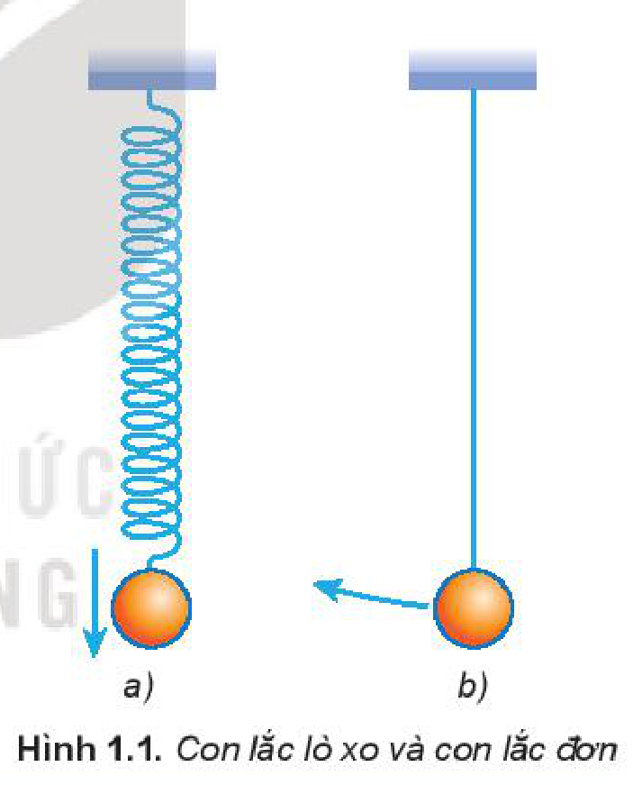
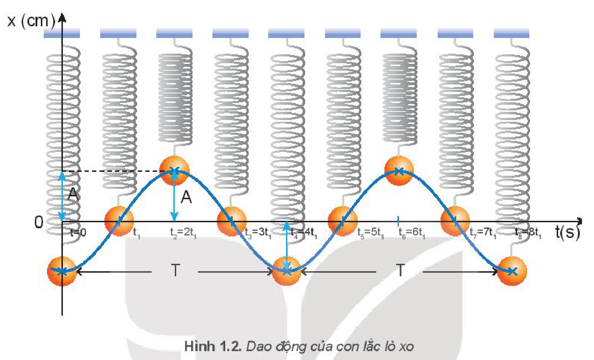
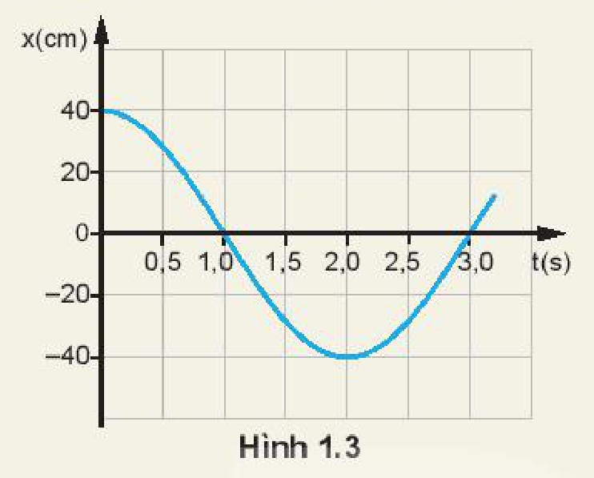
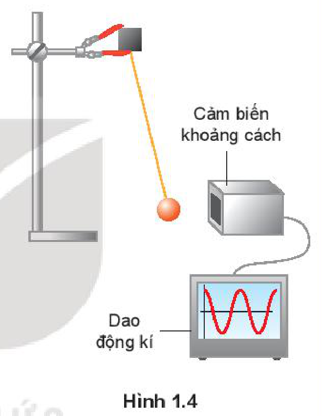
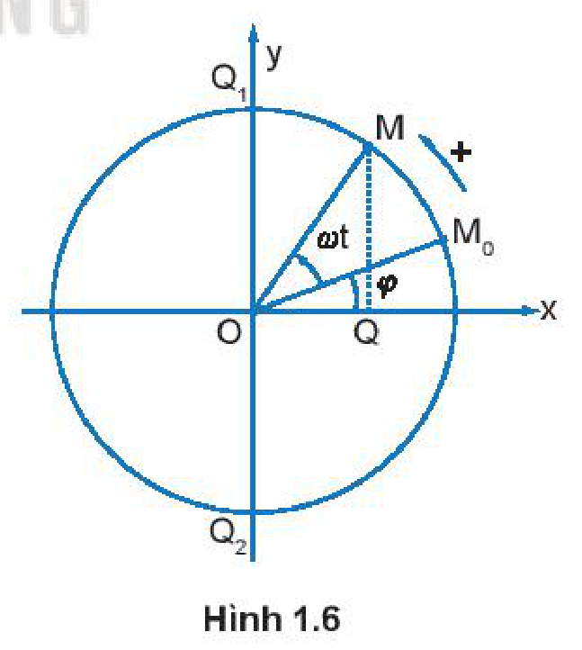
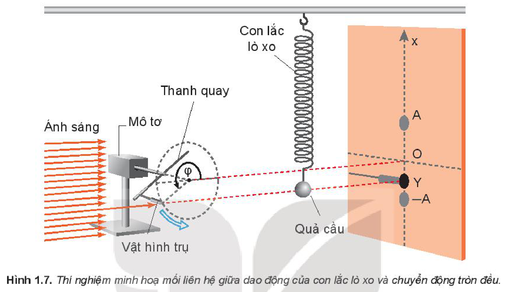

<!-- pdf:8 -->

# BÀI 1: DAO ĐỘNG ĐIỀU HOÀ

## 🔴 Mở đầu

> Trong cuộc sống hằng ngày và trong kĩ thuật ta thường gặp những vật dao động, ví dụ như dây đàn ghi ta rung động, chiếc đu đung đưa, pít-tông chuyển động lên xuống trong xi lanh của động cơ,... Chuyển động của những vật này được gọi là dao động cơ. Vậy dao động cơ có những đặc điểm gì chung?

## I. NHỮNG ĐẶC ĐIỂM CỦA DAO ĐỘNG CƠ

### 1. Thí nghiệm

> **Hoạt động:**
>
> *Chuẩn bị:*
>
> Sử dụng con lắc lò xo hoặc con lắc đơn (Hình 1.1).
>
> *Tiến hành:*
>
> Treo một vật nhỏ, nặng vào đầu tự do của một lò xo nhẹ (Hình 1.1 a) hoặc một dây nhẹ không dãn ta có **con lắc lò xo** hoặc **con lắc đơn** (Hình 1.1b).
> 1. Xác định vị trí cân bằng của vật.
> 2. Kéo vật lệch khỏi vị trí cân bằng rồi thả ra cho chuyển động. Quan sát chuyển động của mỗi vật và cho nhận xét về đặc điểm chung của chúng.

> **Câu hỏi:** Nêu những ví dụ về dao động cơ mà em biết.

### 2. Dao động cơ

Vật chuyển động qua lại quanh **vị trí cân bằng**. Chuyển động như vậy gọi là **dao động cơ**.

Dao động cơ của một vật có thể là *tuần hoàn* hoặc không tuần hoàn. Nếu sau những khoảng thời gian bằng nhau, vật trở lại vị trí cũ theo hướng cũ thì dao động của vật đó là tuần hoàn. Ví dụ: Dao động của con lắc đồng hồ là tuần hoàn, dao động của cành cây đu đưa khi gió thổi là không tuần hoàn.
<!-- term: Dao động tuần hoàn -->

Dao động tuần hoàn có thể có mức độ phức tạp khác nhau. Dao động tuần hoàn đơn giản nhất là **dao động điều hoà**.

<!-- pdf:9 -->

## II. DAO ĐỘNG ĐIỀU HOÀ

### 1. Đồ thị của dao động điều hoà

Ta hãy quan sát dao động của một con lắc lò xo dọc theo trục $x$ thẳng đứng tại các thời điểm khác nhau như Hình 1.2. Gọi $t = 0$ là thời điểm bắt đầu quan sát, $x = 0$ là vị trí cân bằng của quả cầu.

Đường cong trên Hình 1.2 là **đồ thị dao động** của con lắc. Nó cho biết vị trí của quả cầu trên trục $x$ tại những thời điểm khác nhau. Đường cong này có dạng *hình sin*.

### 2. Phương trình của dao động điều hoà

Tương ứng với đồ thị hình sin trên là hàm sin hoặc cosin.

Ta chọn:

$x = A\cos(\omega t + \varphi) \quad (1.1)$

là hàm tương ứng với đồ thị Hình 1.2, còn được gọi là **phương trình của dao động điều hoà**.

Trong phương trình này $A$, $\omega$ và $\varphi$ là các hằng số.

- $x$ là **li độ dao động**.
- $A$ là **biên độ dao động**.
- $(\omega t + \varphi)$ là **pha của dao động** ở thời điểm $t$.
- $\varphi$ là **pha ban đầu**.

Dao động được mô tả bằng phương trình $x = A\cos(\omega t + \varphi)$ gọi là **dao động điều hoà**. Vật nặng của con lắc đang dao động điều hoà gọi là **vật dao động điều hoà**.

> **Câu hỏi:**
>
> Một vật dao động điều hoà có phương trình
> $x = 2\cos\left(4\pi t + \frac{\pi}{2}\right)\text{ (cm)}$
> Hãy xác định:
> a) Biên độ và pha ban đầu của dao động.
> b) Pha và li độ của dao động khi $t = 2\text{ s}$.

<!-- pdf:10 -->

> **Hoạt động:**
>
> Đồ thị li độ - thời gian của một con lắc đơn dao động điều hoà được mô tả trên Hình 1.3.
> 1. Hãy mô tả dao động điều hoà của con lắc đơn.
> 2. Xác định biên độ và li độ của con lắc ở các thời điểm $t = 0$, $t = 0,5\text{ s}$, $t = 2,0\text{ s}$.
>
> 

> **Câu hỏi:**
>
> Pít-tông của một động cơ đốt trong dao động trên một đoạn thẳng dài $16\text{ cm}$ và làm cho trục khuỷu của động cơ quay đều (Hình 1.5). Xác định biên độ dao động của một điểm trên mặt pít-tông.
>
> 

> **Em có biết:**
>
> Người ta tạo ra dao động điều hoà của một con lắc đơn với biên độ dao động nhỏ (góc lệch cực đại $\alpha_0 \le 10^\circ$) bằng cách kết nối cảm biến khoảng cách với máy tính để xác định vị trí của vật dao động (Hình 1.4). Trên màn hình máy tính cho đồ thị của dao động là dạng hình sin.
>
> 

> **Em có biết:**
>
> Mối liên hệ giữa dao động điều hoà và chuyển động tròn đều.
>
> Điểm $M$ chuyển động tròn đều với tốc độ góc $\omega$. Gọi $Q$ là hình chiếu của $M$ trên trục $Ox$ (Hình 1.6). Điểm $Q$ dao động điều hoà với phương trình.
> $$x = OM\cos(\omega t + \varphi)$$
> Ta có thể làm thí nghiệm để xác nhận mối liên hệ này:
> Ban đầu cho con lắc lò xo dao động theo phương thẳng đứng. Tiếp sau, điều chỉnh mô tơ sao cho khi mô tơ bắt đầu quay thì bóng của vật hình trụ trùng với bóng của con lắc trên màn và khi mô tơ quay được một vòng thì quả cầu cũng thực hiện được một dao động (Hình 1.7).
>
> 

<!-- pdf:11 -->

> Quan sát thí nghiệm cho thấy khi vật hình trụ gắn ở đầu một thanh quay tròn đều dưới ánh sáng của chiếc đèn chiếu thì bóng của đầu vật hình trụ và của quả cầu của con lắc trên màn luôn trùng nhau và dao động quanh vị trí cân bằng $O$.
>
> 

## 📌 Em đã học

- Dao động điều hoà là dao động trong đó li độ của vật là một hàm cosin (hay sin) của thời gian.
- Phương trình của dao động điều hoà là $x = A\cos(\omega t + \varphi)$, trong đó: $x$ là li độ; $A$ là biên độ; $\varphi$ là pha ban đầu.

## ✏️ Em có thể

- Xác định được biên độ của pít-tông chuyển động trong xi lanh của động cơ đốt trong.
- Mô tả được dao động điều hoà của con lắc đồng hồ.

## 📷 Danh sách hình trong bài

| Mã hình | Số hình SGK | Trang PDF | Chú thích |
| --- | --- | --- | --- |
| H11-vat_ly-b01-01 | Hình 1.1 | 8 | Con lắc lò xo và con lắc đơn |
| H11-vat_ly-b01-02 | Hình 1.2 | 9 | Dao động của con lắc lò xo |
| H11-vat_ly-b01-03 | Hình 1.3 | 10 | Đồ thị li độ - thời gian của một con lắc đơn dao động điều hoà |
| H11-vat_ly-b01-04 | Hình 1.4 | 10 | Kết nối cảm biến khoảng cách với máy tính để xác định vị trí của vật dao động |
| H11-vat_ly-b01-05 | Hình 1.5 | 10 | Pít-tông của một động cơ đốt trong |
| H11-vat_ly-b01-06 | Hình 1.6 | 10 | Mối liên hệ giữa dao động điều hoà và chuyển động tròn đều |
| H11-vat_ly-b01-07 | Hình 1.7 | 11 | Thí nghiệm minh hoạ mối liên hệ giữa dao động của con lắc lò xo và chuyển động tròn đều |
