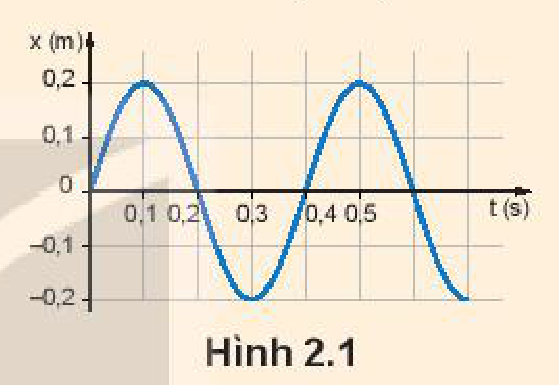
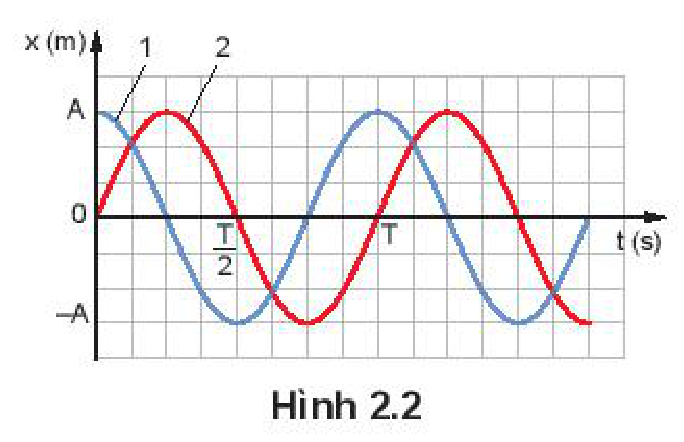
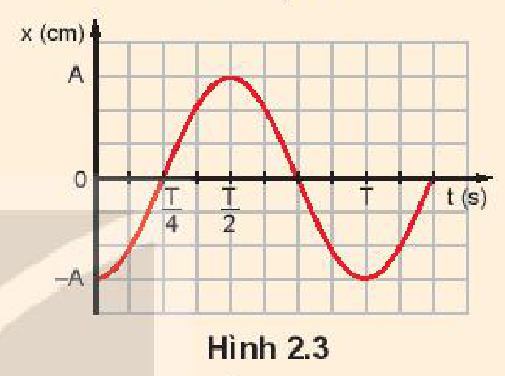
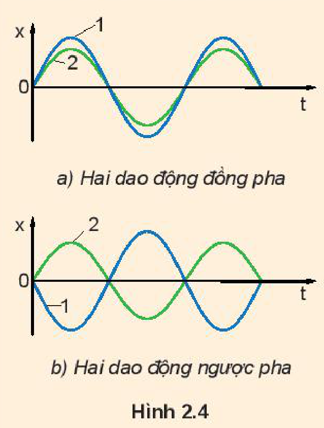
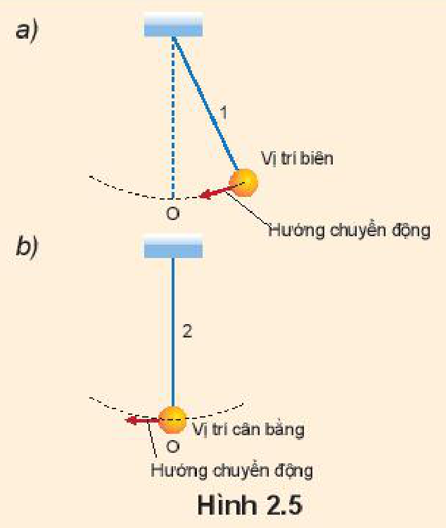
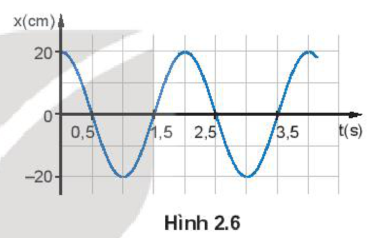
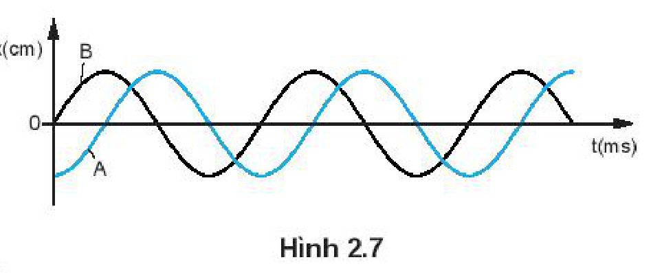

<!-- pdf:12 -->

# BÀI 2: MÔ TẢ DAO ĐỘNG ĐIỀU HOÀ

## 🔴 Mở đầu

> Để vẽ đồ thị hoặc viết phương trình của một dao động điều hoà cần biết những đại lượng vật lí nào?

## I. CÁC ĐẠI LƯỢNG ĐẶC TRƯNG CỦA DAO ĐỘNG ĐIỀU HOÀ

Từ đồ thị và phương trình của dao động điều hoà ở Bài 1 ta có thể xác định được các đại lượng dùng để mô tả dao động điều hoà.

- **Li độ**: $x$ là độ dịch chuyển từ vị trí cân bằng đến vị trí của vật tại thời điểm $t$.
- **Biên độ**: $A$ là độ dịch chuyển cực đại của vật tính từ vị trí cân bằng.
- **Chu kì**: là khoảng thời gian để vật thực hiện được một dao động, kí hiệu là $T$.
  Đơn vị của chu kì dao động là giây (s).
- **Tần số**: là số dao động mà vật thực hiện được trong một giây, kí hiệu là $f$.

Ta có:

$f = \frac{1}{T} \quad (2.1)$

Đơn vị của tần số là $\frac{1}{\text{s}}$, gọi là **héc** (kí hiệu là Hz).

- **Tần số góc**

Theo đồ thị Hình 2.1 cứ sau mỗi chu kì thì dao động của vật lại lặp lại như cũ. Như vậy, theo phương trình dao động ta phải có:

$x = A\cos[\omega(t + T)] = A\cos\omega t$

Theo tính chất của hàm cosin ta suy ra:

$\omega T = 2\pi$ hay $\omega = \frac{2\pi}{T}\text{ (rad/s)} \quad (2.2)$

Đại lượng $\omega$ được gọi là **tần số góc**.

Trong dao động điều hoà của mỗi vật thì bốn đại lượng biên độ, chu kì, tần số và tần số góc là những *đại lượng không đổi, không phụ thuộc vào thời điểm quan sát. Với các vật khác nhau thì các đại lượng này khác nhau. Vì thế chúng là những đại lượng đặc trưng cho dao động điều hoà.*

> **Câu hỏi:**
>
> Hình 2.1 là đồ thị dao động điều hoà của một vật.
>
> 
>
> Hãy xác định:
> - Biên độ, chu kì, tần số của dao động.
> - Nêu thời điểm mà vật có li độ $x = 0$; $x = 0,1\text{ m}$.

> **Câu hỏi:** Từ Hình 2.1 hãy xác định tần số góc của dao động của vật.

<!-- pdf:13 -->

## II. PHA BAN ĐẦU. ĐỘ LỆCH PHA

### 1. Pha ban đầu

Hình 2.2 là đồ thị của hai vật dao động điều hoà cùng chu kì, cùng biên độ nhưng dao động 1 luôn đạt tới giá trị cực đại sớm hơn dao động 2 một thời gian là $\frac{T}{4}$.

Từ đồ thị ta thấy, tại thời điểm ban đầu ($t = 0$) vật dao động điều hoà 1 đang ở **vị trí biên** $x = A$ và sẽ dịch chuyển về **vị trí cân bằng**, còn vật dao động điều hoà 2 đang ở vị trí cân bằng và sẽ dịch chuyển về phía $x > 0$.

Các phương trình dao động tương ứng với đồ thị Hình 2.2 có pha ban đầu $\varphi$ lần lượt là:

$x_1 = A\cos(\omega t)$ với $\varphi_1 = 0$

$x_2 = A\cos\left(\omega t - \frac{\pi}{2}\right)$ với $\varphi_2 = -\frac{\pi}{2}$

Như vậy, **pha ban đầu** $\varphi$ *cho biết tại thời điểm bắt đầu quan sát vật dao động điều hoà ở đâu và sẽ đi về phía nào. Nó có giá trị nằm trong khoảng từ $-\pi$ đến $\pi\text{ (rad)}$.*

> **Câu hỏi:**
>
> Hình 2.3 là đồ thị dao động điều hoà của một con lắc.
>
> 
>
> Hãy cho biết:
> - Vị trí và hướng dịch chuyển của con lắc tại thời điểm ban đầu.
> - Pha ban đầu của dao động.

### 2. Độ lệch pha giữa hai dao động cùng chu kì

Đồ thị Hình 2.2 còn cho thấy tại bất kì thời điểm nào thì **độ lệch pha** giữa hai dao động trên cũng bằng $\frac{\pi}{2}$.

Trong khoa học và trong kĩ thuật, **độ lệch pha** *quan trọng hơn pha, vì nó là đại lượng không đổi*, không phụ thuộc vào thời điểm quan sát.

Nếu $\varphi_1 > \varphi_2$ thì dao động 1 sớm pha hơn dao động 2.

Nếu $\varphi_1 < \varphi_2$ thì dao động 1 trễ pha hơn dao động 2.

Nếu $\varphi_1 = \varphi_2$ thì dao động 1 cùng (đồng) pha với dao động 2.
<!-- term: Hai dao động đồng pha -->

Nếu $\varphi_1 = \varphi_2 \pm \pi$ thì dao động 1 ngược pha với dao động 2.
<!-- term: Hai dao động ngược pha -->

> **Câu hỏi:**
>
> Hãy chứng minh rằng độ lệch pha giữa hai dao động cùng chu kì bằng độ lệch pha ban đầu.
>
> 

<!-- pdf:14 -->

> **Câu hỏi:**
>
> Hai con lắc 1 và 2 dao động điều hoà tại cùng thời điểm quan sát vị trí của chúng được biểu diễn trên Hình 2.5 a, b. Hỏi dao động của con lắc nào sớm pha hơn và sớm hơn bao nhiêu?
>
> 

## III. BÀI TẬP VÍ DỤ VỀ CÁC ĐẠI LƯỢNG ĐẶC TRƯNG CỦA DAO ĐỘNG ĐIỀU HOÀ

*Ví dụ 1:* Đồ thị li độ – thời gian của một vật dao động điều hoà được mô tả trên Hình 2.6.

a) Xác định biên độ, chu kì, tần số, tần số góc, pha ban đầu và viết phương trình của dao động.

b) Xác định pha của dao động tại thời điểm $t = 2,5\text{ s}$.

*Giải:*

a) Từ đồ thị ta xác định được:

Biên độ : $A = 20\text{ cm}$; chu kì $T = 2,5 - 0,5 = 2,0\text{ s}$.

Áp dụng công thức: $\omega = \frac{2\pi}{T} = 2\pi f \Rightarrow \omega = \pi\text{ (rad/s)}$; $f = 0,5\text{ Hz}$.

Khi $t = 0$, $x = A\cos\varphi \Rightarrow \cos\varphi = 1 \Rightarrow \varphi = 0\text{ (rad)}$.

Do đó phương trình dao động của vật được viết: $x = 20\cos(\pi t)\text{ (cm)}$.

b) Từ phương trình dao động ta có: $\varphi = \pi t + \frac{\pi}{2}$, thay $t = 2,5\text{ s}$ vào suy ra $\varphi = 3\pi\text{ (rad)}$

*Ví dụ 2:* Hai vật dao động điều hoà A và B có cùng tần số nhưng lệch pha nhau được mô tả trên Hình 2.7.

a) Xác định li độ của B khi A có li độ cực đại.

b) Xác định li độ của A khi B có li độ cực đại.

c) Hãy cho biết A hay B đạt tới li độ cực đại trước (không kể thời điểm $t = 0$).

d) Xác định độ lệch pha của dao động A so với dao động B.

*Giải:*

Từ đồ thị, cho thấy:

a) Khi A có li độ cực đại thì B có li độ $x = 0$.

b) Khi B có li độ cực đại thì A có li độ $x = 0$.

c) A có li độ cực đại trước B.

d) Dao động A sớm pha $\frac{\pi}{2}$ so với dao động B.

<!-- pdf:15 -->

> **Hoạt động:**
>
> 1. Xét một vật dao động điều hoà có biên độ $10\text{ cm}$, tần số $5\text{ Hz}$. Tại thời điểm ban đầu ($t = 0$) vật có li độ cực đại theo chiều dương.
>    - Xác định chu kì, tần số góc, pha ban đầu của dao động.
>    - Viết phương trình và vẽ đồ thị ($x - t$) của dao động.
> 2. Cho hai con lắc đơn dao động điều hoà. Biết phương trình dao động của con lắc thứ nhất là $x = 20\cos\left(20\pi t + \frac{\pi}{2}\right)\text{ (cm)}$. Con lắc thứ hai có cùng biên độ và tần số nhưng lệch về thời gian so với con lắc thứ nhất một phần tư chu kì. Viết phương trình dao động của con lắc thứ hai.

> **Câu hỏi:**
>
> 1. Đại lượng nào dưới đây đặc trưng cho độ lệch về thời gian giữa hai dao động điều hoà cùng chu kì?
>    A. Li độ.
>    B. Pha.
>    C. Pha ban đầu.
>    D. Độ lệch pha.
> 2. Hãy chứng minh rằng độ lệch pha giữa hai dao động điều hoà cùng tần số là đại lượng không đổi và bằng độ lệch pha ban đầu.

## 📌 Em đã học

- Chu kì $T$ là khoảng thời gian để vật thực hiện một dao động.
  Đơn vị của chu kì là giây (s).
- Tần số $f$ là số dao động mà vật thực hiện được trong một giây.
  Đơn vị của tần số là một trên giây ($1/\text{s}$), gọi là héc (kí hiệu là Hz).
- Trong dao động điều hoà, giữa **tần số góc** $\omega$, chu kì $T$ và tần số $f$ có mối liên hệ:
  $\omega = \frac{2\pi}{T} = 2\pi f.$
  Đơn vị của tần số góc là rađian trên giây ($\text{rad/s}$).
- **Độ lệch pha** giữa hai dao động điều hoà cùng chu kì luôn bằng độ lệch pha ban đầu.

## ✏️ Em có thể

- Dùng đồ thị li độ – thời gian có dạng hình sin hoặc phương trình của dao động điều hoà để xác định các đại lượng như biên độ chu kì, tần số, tần số góc và pha ban đầu của dao động đó.
- Biết cách xác định độ lệch pha giữa hai dao động điều hoà cùng chu kì.

## 📷 Danh sách hình trong bài

| Mã hình | Số hình SGK | Trang PDF | Chú thích |
| --- | --- | --- | --- |
| H11-vat_ly-b02-01 | Hình 2.1 | 12 | Đồ thị dao động điều hoà của một vật |
| H11-vat_ly-b02-02 | Hình 2.2 | 13 | Đồ thị của hai vật dao động điều hoà cùng chu kì, cùng biên độ |
| H11-vat_ly-b02-03 | Hình 2.3 | 13 | Đồ thị dao động điều hoà của một con lắc |
| H11-vat_ly-b02-04 | Hình 2.4 | 13 | a) Hai dao động đồng pha; b) Hai dao động ngược pha |
| H11-vat_ly-b02-05 | Hình 2.5 | 14 | Vị trí và hướng chuyển động của hai con lắc dao động điều hoà |
| H11-vat_ly-b02-06 | Hình 2.6 | 14 | Đồ thị li độ – thời gian của một vật dao động điều hoà |
| H11-vat_ly-b02-07 | Hình 2.7 | 14 | Đồ thị hai vật dao động điều hoà A và B cùng tần số nhưng lệch pha nhau |
