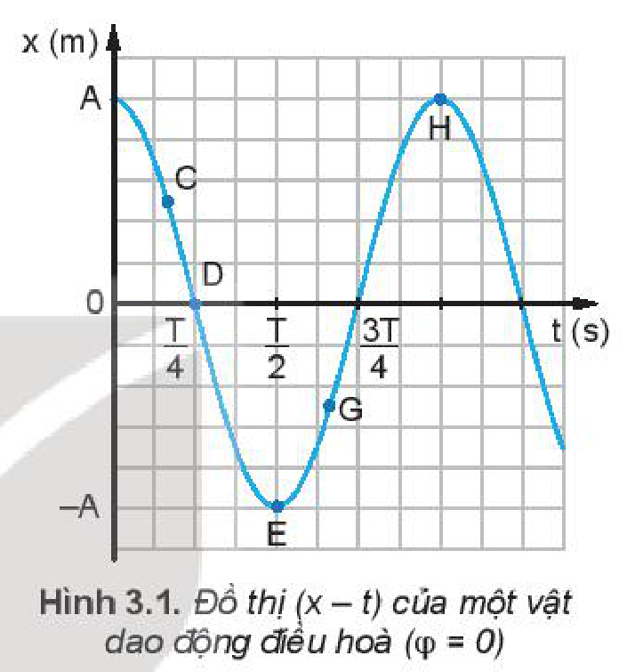
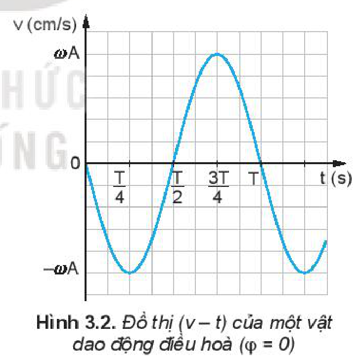
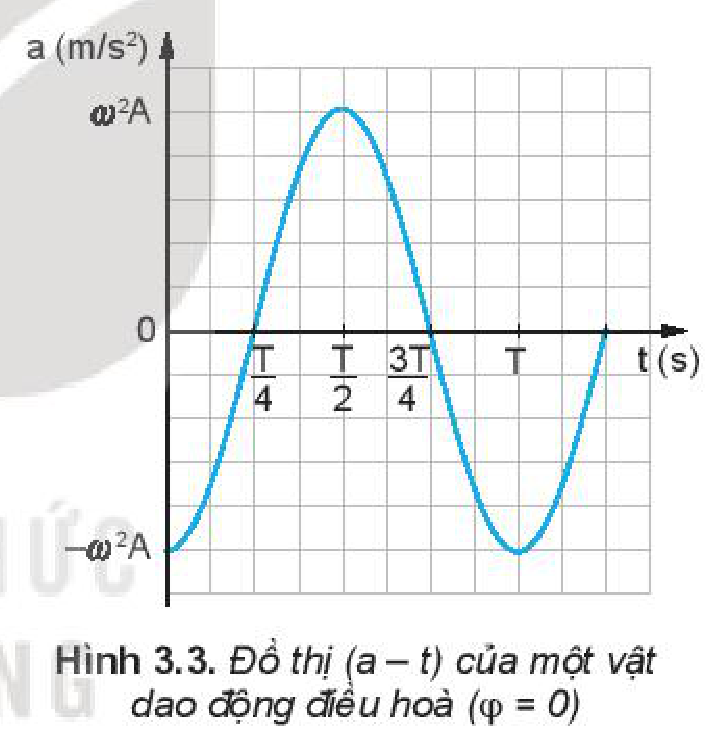
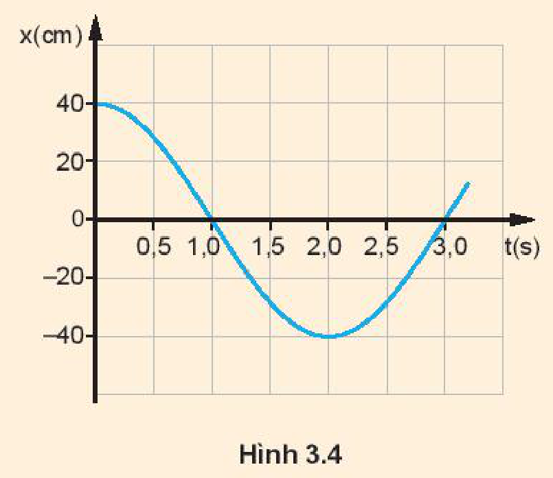

<!-- pdf:16 -->

# BÀI 3: VẬN TỐC, GIA TỐC TRONG DAO ĐỘNG ĐIỀU HOÀ

## 🔴 Mở đầu

> Ta có thể dựa vào đồ thị $(x - t)$ của dao động điều hoà để xác định vận tốc và gia tốc của vật được không?

## I. VẬN TỐC CỦA VẬT DAO ĐỘNG ĐIỀU HOÀ

Như đã biết, **vận tốc tức thời** của một vật được xác định bằng công thức:
$v = \frac{\Delta x}{\Delta t}$ (với $\Delta t$ rất nhỏ), tức là bằng *độ dốc của đồ thị* $(x - t)$ *tại điểm đang xét*.

Để đơn giản, ta hãy xét một vật dao động điều hoà có đồ thị $(x - t)$ được chỉ trên Hình 3.1. Ta nhận thấy độ dốc của đồ thị, tức vận tốc của vật, có giá trị cực đại khi ở vị trí cân bằng rồi giảm dần đến $0$ khi vật ra đến vị trí biên. Sau đó độ dốc của đồ thị lại tăng dần đến giá trị cực đại khi vật về đến vị trí cân bằng.

### 1. Phương trình của vận tốc

Khi học phép tính đạo hàm chúng ta sẽ biết $v = \frac{\Delta x}{\Delta t}$ (với $\Delta t$ rất nhỏ) chính là **đạo hàm** của li độ $x$ theo thời gian, kí hiệu là $x'$.

$x = A\cos(\omega t + \varphi)$

$v = x' = -\omega A\sin(\omega t + \varphi) \quad (3.1)$

Công thức $(3.1)$ là **phương trình của vận tốc**, có thể biến đổi như sau:

$v = \omega A\sqrt{1 - \cos^2(\omega t + \varphi)}$

Thay $x = A\cos(\omega t + \varphi)$ vào ta được:

$v = \pm\omega\sqrt{A^2 - x^2} \quad (3.2)$

- Khi vật ở vị trí cân bằng thì $v = \pm\omega A$.
- Khi vật ở vị trí biên thì $v = 0$.

### 2. Đồ thị của vận tốc

Hình 3.2 là **đồ thị của vận tốc** của một dao động điều hoà với $\varphi = 0$. Nó cũng là một đường hình sin.

> **Hoạt động:**
>
> Đặt một thước kẻ (loại $20\text{ cm}$) cho mép của thước tiếp xúc với đồ thị li độ - thời gian (Hình 3.1) ở một số điểm C, D, E, G, H. Từ độ dốc của thước hãy so sánh độ lớn vận tốc của vật tại các điểm C, E, H.

<!-- pdf:17 -->

> **Câu hỏi:**
>
> 1. So sánh đồ thị của vận tốc (Hình 3.2) với đồ thị của li độ (Hình 3.1), hãy cho biết vận tốc sớm pha hay trễ pha bao nhiêu so với li độ.
> 2. Trong các khoảng thời gian từ $0$ đến $\frac{T}{4}$, từ $\frac{T}{4}$ đến $\frac{T}{2}$, từ $\frac{T}{2}$ đến $\frac{3T}{4}$, từ $\frac{3T}{4}$ đến $T$, vận tốc của dao động điều hoà thay đổi như thế nào?

## II. GIA TỐC CỦA VẬT DAO ĐỘNG ĐIỀU HOÀ

Tương tự như vận tốc, **gia tốc tức thời** của một vật được xác định bằng công thức:
$a = \frac{\Delta v}{\Delta t}$ (với $\Delta t$ rất nhỏ), tức là bằng độ dốc của đồ thị vận tốc tại điểm đang xét. Ta nhận thấy độ dốc của đồ thị Hình 3.2, hay gia tốc của vật, có giá trị bằng $0$ khi vật ở vị trí cân bằng, rồi tăng đến giá trị cực đại khi vật ở vị trí biên.

### 1. Phương trình của gia tốc

Như vậy, gia tốc tức thời của một vật là đạo hàm của vận tốc theo thời gian, kí hiệu là $v'$.

$a = v' = -\omega^2 A\cos(\omega t + \varphi) \quad (3.3)$

Công thức $3.3$ là **phương trình của gia tốc**.

Thay $x = A\cos(\omega t + \varphi)$ vào $(3.3)$ ta được:

$a = -\omega^2 x \quad (3.4)$

Từ công thức $(3.4)$ ta thấy:

- Khi vật ở vị trí cân bằng $a = 0$.
- Khi vật ở vị trí biên gia tốc có giá trị $a = \pm\omega^2 A$.

### 2. Đồ thị của gia tốc

Hình 3.3 là **đồ thị của gia tốc** (với $\varphi = 0$), nó cũng là một đường hình sin như li độ và vận tốc.

> **Hoạt động:**
>
> 1. Dùng thước kẻ (loại $20\text{ cm}$) để xác định xem trên đồ thị $(v - t)$ Hình 3.2, tại thời điểm nào độ dốc của đồ thị bằng $0$ và tại thời điểm nào độ dốc của đồ thị cực đại. Từ đó, so sánh độ lớn của gia tốc trên đồ thị $(a - t)$ Hình 3.3 ở các thời điểm tương ứng.
> 2. Phương trình dao động của một vật là $x = 5\cos 4\pi t\text{ (cm)}$. Hãy viết phương trình vận tốc, gia tốc và vẽ đồ thị li độ, vận tốc, gia tốc theo thời gian của vật.

> **Câu hỏi:**
>
> 1. So sánh đồ thị Hình 3.3 và Hình 3.1 ta có nhận xét gì về pha của li độ và gia tốc của một dao động.
> 2. Trong các khoảng thời gian từ $0$ đến $\frac{T}{4}$, từ $\frac{T}{4}$ đến $\frac{T}{2}$, từ $\frac{T}{2}$ đến $\frac{3T}{4}$, từ $\frac{3T}{4}$ đến $T$, gia tốc của dao động thay đổi như thế nào?

<!-- pdf:18 -->

> **Câu hỏi:**
>
> 1. Một vật dao động điều hoà trên trục $Ox$. Khi vật qua vị trí cân bằng thì tốc độ của nó là $20\text{ cm/s}$. Khi vật có tốc độ là $10\text{ cm/s}$ thì gia tốc của nó có độ lớn là $40\sqrt{3}\text{ cm/s}^2$. Tính biên độ dao động của vật.
> 2. Hình 3.4 là đồ thị li độ – thời gian của một vật dao động điều hoà. Sử dụng đồ thị để tính các đại lượng sau:
>    a) Tốc độ của vật ở thời điểm $t = 0\text{ s}$.
>    b) Tốc độ cực đại của vật.
>    c) Gia tốc của vật tại thời điểm $t = 1,0\text{ s}$.
>
> 

## 📌 Em đã học

- Phương trình của vận tốc và gia tốc của một vật dao động điều hoà có li độ là $x = A\cos(\omega t + \varphi)$:
  $v = -\omega A\sin(\omega t + \varphi)$
  $a = -\omega^2 A\cos(\omega t + \varphi)$
- Đồ thị của vận tốc, gia tốc theo thời gian là đường hình sin. Vận tốc của vật dao động sớm pha $\frac{\pi}{2}$ so với li độ, còn gia tốc của vật dao động ngược pha so với li độ.
- Vectơ gia tốc luôn hướng về vị trí cân bằng và có độ lớn tỉ lệ với độ lớn của li độ.
- Tại **vị trí biên**, vận tốc của vật bằng $0$, còn gia tốc của vật có độ lớn cực đại. Tại **vị trí cân bằng**, gia tốc của vật bằng $0$ còn vận tốc của vật có độ lớn cực đại.

## ✏️ Em có thể

- Sử dụng được đồ thị mô tả dao động điều hoà thu được trên dao động kí có thể suy ra các đại lượng vận tốc, gia tốc của vật trong dao động điều hoà.

## 📷 Danh sách hình trong bài

| Mã hình | Số hình SGK | Trang PDF | Chú thích |
| --- | --- | --- | --- |
| H11-vat_ly-b03-01 | Hình 3.1 | 16 | Đồ thị (x – t) của một vật dao động điều hoà (φ = 0) |
| H11-vat_ly-b03-02 | Hình 3.2 | 16 | Đồ thị (v – t) của một vật dao động điều hoà (φ = 0) |
| H11-vat_ly-b03-03 | Hình 3.3 | 17 | Đồ thị (a – t) của một vật dao động điều hoà (φ = 0) |
| H11-vat_ly-b03-04 | Hình 3.4 | 18 | Đồ thị li độ – thời gian của một vật dao động điều hoà |
