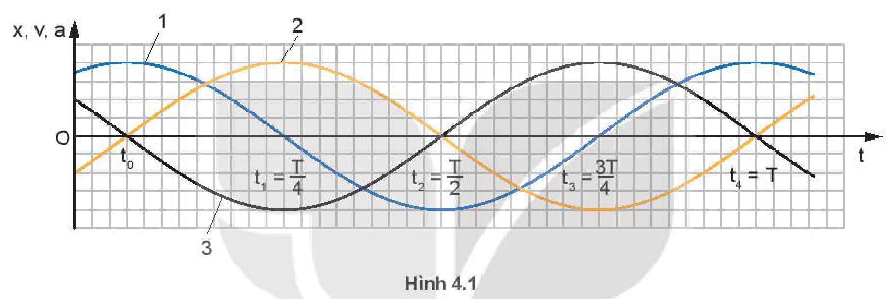
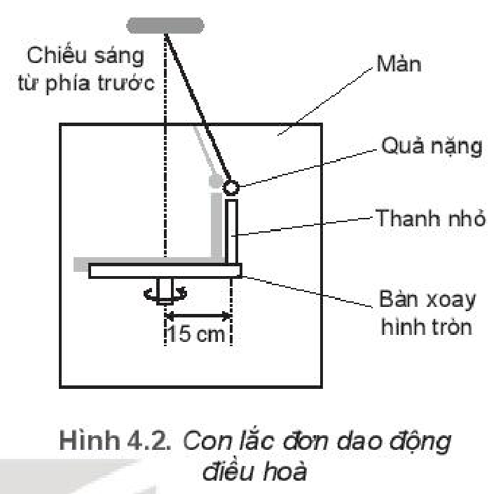
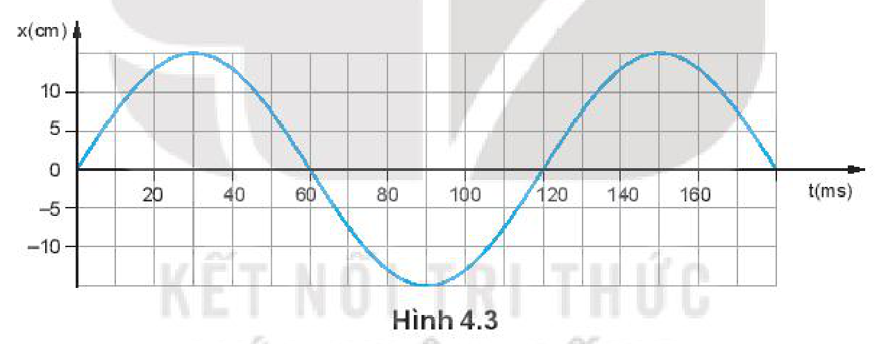
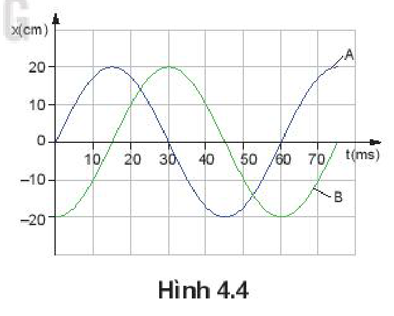

<!-- pdf:19 -->

# BÀI 4: BÀI TẬP VỀ DAO ĐỘNG ĐIỀU HOÀ

## 🔴 Mở đầu

> Khi biết phương trình hoặc đồ thị của vật dao động điều hoà, làm thế nào để xác định được vận tốc và gia tốc của vật?

## I. BÀI TẬP VÍ DỤ

*Ví dụ 1:* Cho phương trình của một vật dao động điều hoà:

$x = 5\cos\left(10\pi t + \frac{\pi}{6}\right)\text{ (cm)}$

Xác định biên độ $A$, tần số $f$, pha ban đầu $\varphi$, và li độ $x_1$ tại thời điểm $t_1 = 0,05\text{ s}$.

*Giải:*

So sánh phương trình dao động của vật với phương trình dạng cơ bản $x = A\cos(\omega t + \varphi)$:

Ta có:

- Biên độ $A = 5\text{ cm}$
- Tần số $f = \frac{\omega}{2\pi} = \frac{10\pi}{2\pi} = 5\text{ Hz}$
- Pha ban đầu $\varphi = \frac{\pi}{6}\text{ (rad)}$
- Li độ lúc $t_1$:

$x_1 = 5\cos\left(10\pi \cdot 0,05 + \frac{\pi}{6}\right) = 5\cos\left(\frac{4\pi}{6}\right) = -2,5\text{ cm}.$

> **Câu hỏi:**
>
> 1. Nếu đề bài cho phương trình dao động không đúng dạng cơ bản $x = A\cos(\omega t + \varphi)$ thì ta xác định pha ban đầu như thế nào?
> 2. Có thể sử dụng mối liên hệ giữa dao động điều hoà và chuyển động tròn đều để xác định pha ban đầu, thời gian để vật đi từ điểm này đến điểm khác trong dao động điều hoà được không?

*Ví dụ 2:* Một vật dao động điều hoà với tần số $2\text{ Hz}$. Tại thời điểm ban đầu vật có li độ $x = 5\text{ cm}$ và vận tốc $v = -30\text{ cm/s}$. Xác định:

a) Biên độ và pha ban đầu của dao động.

b) Giá trị cực đại của vận tốc và gia tốc của vật khi dao động.

*Giải:*

a) Tần số góc của dao động: $\omega = 2\pi f = 4\pi\text{ (rad/s)}$.

Khi $t = 0$ $\begin{cases} x_0 = A\cos\varphi = 5\text{ cm} \\ v_0 = -\omega A\sin\varphi = -30\text{ cm/s} \end{cases}$

<!-- pdf:20 -->

Biên độ và pha ban đầu của dao động:

$A = \sqrt{x^2 + \frac{v^2}{\omega^2}} = \sqrt{5^2 + \frac{(-30)^2}{(4\pi)^2}} \approx 5,54\text{ cm}$

$\tan\varphi = \frac{\omega x_0}{v_0} = \frac{30}{4\pi \cdot 5} = \frac{3}{2\pi} \Rightarrow \varphi \approx 0,44\text{ rad}$

b) Vận tốc cực đại của vật: $v_{\max} = \omega A = 4\pi \cdot 5,54 \approx 70\text{ cm/s}$.

Gia tốc cực đại của vật: $a_{\max} = \omega^2 A = (4\pi)^2 \cdot 5,54 \cdot 10^{-2} \approx 8,8\text{ m/s}^2$.

*Ví dụ 3:* Một vật dao động điều hoà với tần số góc $\omega = 1\text{ rad/s}$, có đồ thị của li độ $x$, vận tốc $v$ và gia tốc $a$ theo thời gian $t$ được mô tả trên Hình 4.1.

Hãy chỉ đúng đồ thị của li độ $(x - t)$, vận tốc $(v - t)$, gia tốc $(a - t)$ theo thời gian $t$ trên Hình 4.1.

*Giải:*

Ta đã biết:

- Vận tốc $v$ sớm pha $\frac{\pi}{2}$ so với li độ và trễ pha $\frac{\pi}{2}$ so với gia tốc.
- Gia tốc $a$ ngược pha so với li độ và sớm pha $\frac{\pi}{2}$ so với vận tốc.

Do đó, trên Hình 4.1 đường 2 là đồ thị li độ $x(t)$, đường 1 là đồ thị vận tốc $v(t)$, đường 3 là đồ thị gia tốc $a(t)$.

## II. BÀI TẬP LUYỆN TẬP

1. Một vật dao động điều hoà có phương trình là $x = 2\cos\left(4\pi t - \frac{\pi}{6}\right)\text{ (cm)}$. Hãy cho biết biên độ, tần số góc, chu kì, tần số, pha ban đầu và pha của dao động ở thời điểm $t = 1\text{ s}$.

2. Một vật dao động điều hoà dọc theo trục $Ox$, quanh điểm gốc $O$, với biên độ $A = 10\text{ cm}$ và chu kì $T = 2\text{ s}$. Tại thời điểm $t = 0$, vật có li độ $x = A$.
   a) Viết phương trình dao động của vật.
   b) Xác định thời điểm đầu tiên vật qua vị trí có li độ $x = 5\text{ cm}$.

<!-- pdf:21 -->

3. Hình 4.2 là sơ đồ của một bàn xoay hình tròn, có gắn một thanh nhỏ cách tâm bàn $15\text{ cm}$. Bàn xoay được chiếu sáng bằng nguồn sáng rộng, song song, hướng chiếu sáng từ phía trước màn để bóng đổ lên màn hình. Một con lắc đơn dao động điều hoà phía sau bàn xoay với biên độ bằng khoảng cách từ thanh nhỏ đến tâm bàn xoay. Tốc độ quay của bàn quay được điều chỉnh là $3\pi\text{ rad/s}$. Vị trí bóng của thanh nhỏ con lắc luôn trùng nhau.
   a) Tại sao nói dao động của bóng của thanh nhỏ và quả nặng là đồng pha?
   b) Viết phương trình dao động của con lắc. Chọn gốc thời gian là lúc con lắc ở vị trí hiển thị trong Hình 4.2.
   c) Bàn xoay đi một góc $60^\circ$ từ vị trí ban đầu, tính li độ của con lắc và tốc độ của nó tại thời điểm này.

4. Hình 4.3 là đồ thị li độ – thời gian của một vật dao động điều hoà.
   a) Xác định biên độ, chu kì, tần số, tần số góc và pha ban đầu của vật dao động.
   b) Viết phương trình của dao động của vật.

5. Đồ thị li độ – thời gian của hai vật dao động điều hoà A và B có cùng tần số nhưng lệch pha nhau Hình 4.4.
   a) Xác định li độ dao động của vật B khi vật A có li độ cực đại và ngược lại.
   b) Hãy cho biết vật A hay vật B đạt tới li độ cực đại trước.
   c) Xác định độ lệch pha giữa dao động của vật A so với dao động của vật B.

## 📌 Em đã học

- Cách xác định các đại lượng biên độ, chu kì, tần số, tần số góc pha,... khi biết phương trình hoặc đồ thị của vật dao động điều hoà và ngược lại.

## ✏️ Em có thể

- Xác định được chu kì, tần số, tần số góc và viết phương trình của vật dao động điều hoà (Ví dụ Đồng hồ quả lắc).

## 📷 Danh sách hình trong bài

| Mã hình | Số hình SGK | Trang PDF | Chú thích |
| --- | --- | --- | --- |
| H11-vat_ly-b04-01 | Hình 4.1 | 20 | Đồ thị của li độ x, vận tốc v và gia tốc a theo thời gian t |
| H11-vat_ly-b04-02 | Hình 4.2 | 21 | Con lắc đơn dao động điều hoà |
| H11-vat_ly-b04-03 | Hình 4.3 | 21 | Đồ thị li độ – thời gian của một vật dao động điều hoà |
| H11-vat_ly-b04-04 | Hình 4.4 | 21 | Đồ thị li độ – thời gian của hai vật dao động điều hoà A và B |
