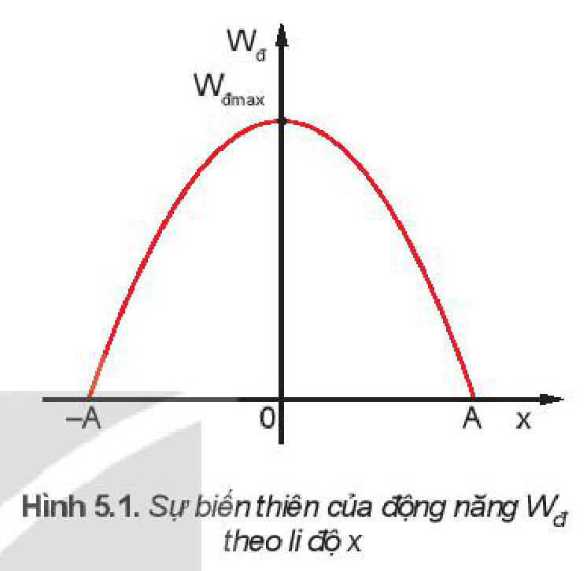
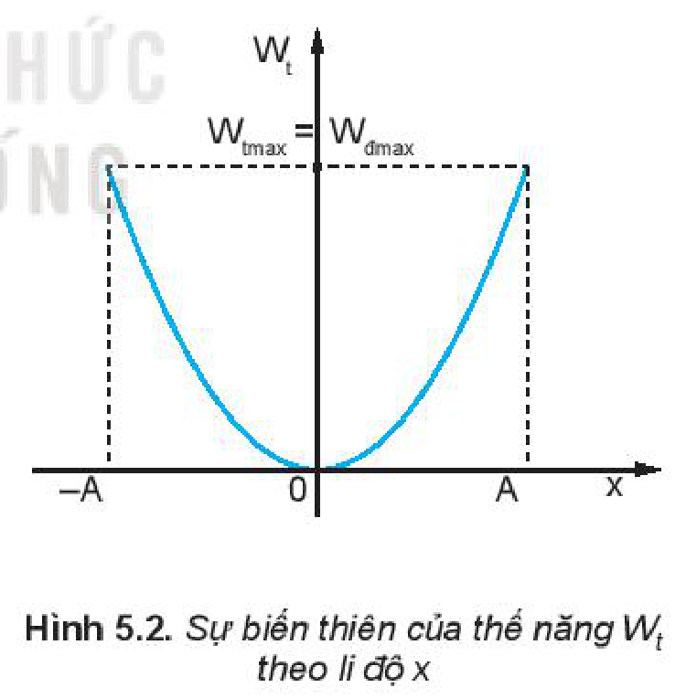
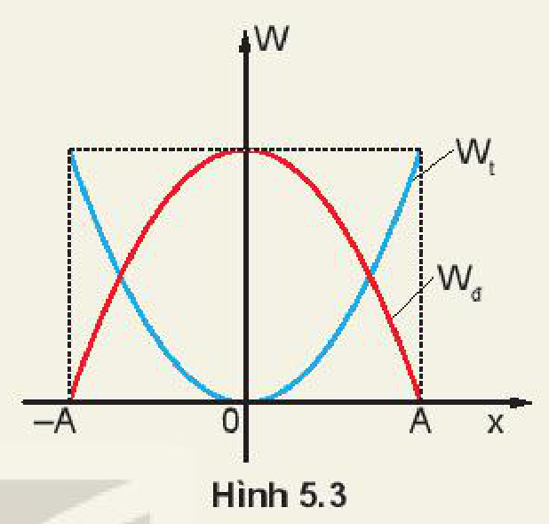
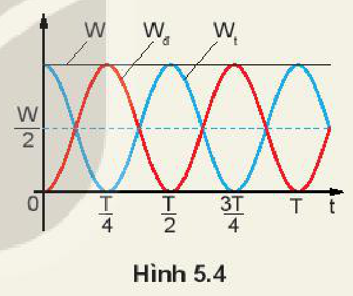
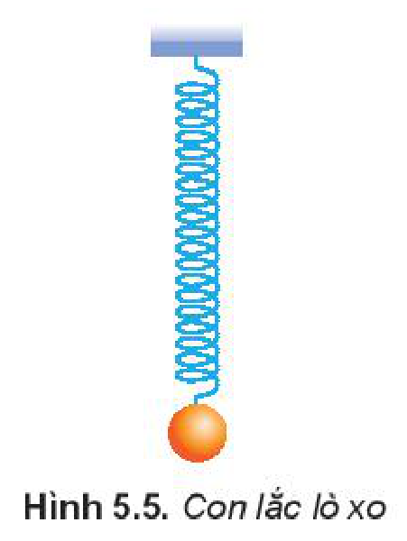
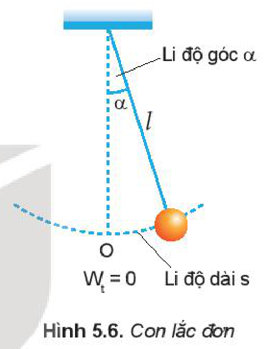
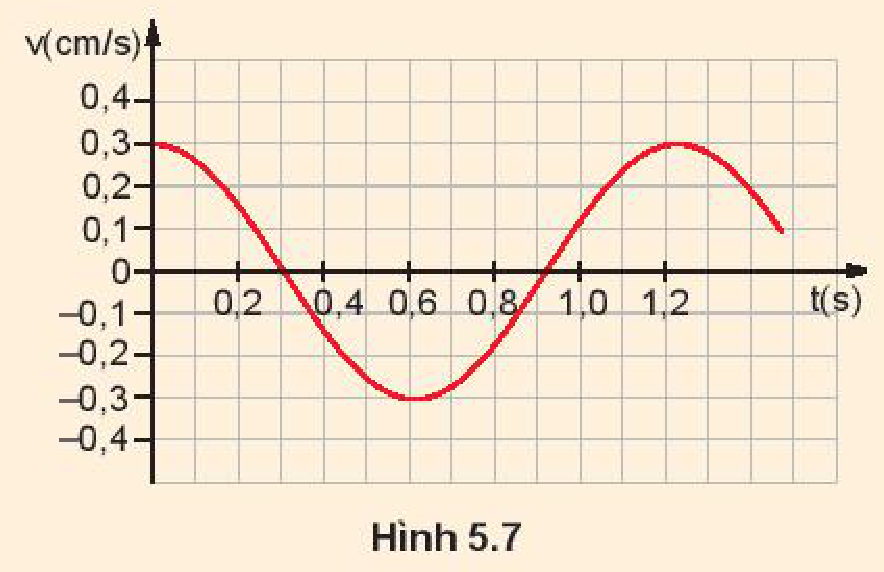

<!-- pdf:22 -->

# BÀI 5: ĐỘNG NĂNG. THẾ NĂNG. SỰ CHUYỂN HOÁ GIỮA ĐỘNG NĂNG VÀ THẾ NĂNG TRONG DAO ĐỘNG ĐIỀU HOÀ

## 🔴 Mở đầu

> Ở lớp 10, khi học về chuyển động của vật, ta đã biết có sự chuyển hoá giữa động năng và thế năng của vật. Vậy trong dao động điều hoà có sự chuyển hoá tương tự không?

## I. ĐỘNG NĂNG

- **Động năng** của vật dao động điều hoà được xác định bởi biểu thức:
  $W_\text{đ} = \frac{1}{2}mv^2$. Thay $v = -\omega A\sin(\omega t + \varphi)$ vào, ta được:
  $W_\text{đ} = \frac{1}{2}m\omega^2 A^2\sin^2(\omega t + \varphi)$
  $W_\text{đ} = \frac{1}{2}m\omega^2 A^2[1 - \cos^2(\omega t + \varphi)]$
  Thay $x = A\cos(\omega t + \varphi)$ vào ta được:
  $W_\text{đ} = \frac{1}{2}m\omega^2(A^2 - x^2) \quad (5.1)$
- Công thức $(5.1)$ cho biết sự biến thiên của động năng theo li độ $x$.

Hình 5.1 là đồ thị chỉ sự biến thiên của động năng theo li độ $x$. Đó là một đường parabol có bề lõm hướng xuống và có giá trị cực đại: $W_{\text{đmax}} = \frac{1}{2}m\omega^2 A^2$.

Đồ thị cho thấy, khi vật đi từ vị trí cân bằng tới vị trí biên thì động năng của vật đang từ cực đại giảm đến $0$. Khi vật đi từ vị trí biên về vị trí cân bằng thì động năng của vật tăng từ $0$ đến giá trị cực đại.

## II. THẾ NĂNG

- Theo định luật bảo toàn năng lượng, nếu bỏ qua ma sát thì động năng của vật không mất đi mà chuyển dần thành **thế năng** của vật và ngược lại. Vì thế ta có thể viết:
  $W_\text{t} = \frac{1}{2}W_{\text{đmax}} - W_{\text{đ}(x)}$
  $= \frac{1}{2}m\omega^2 A^2 - \left[\frac{1}{2}m\omega^2 A^2 - \frac{1}{2}m\omega^2 x^2\right]$
  $W_\text{t} = \frac{1}{2}m\omega^2 x^2 \quad (5.2)$
  Công thức $(5.2)$ cho biết sự biến thiên của thế năng theo li độ.
- Đồ thị biến thiên của thế năng theo li độ $x$ cũng là một đường parabol nhưng bề lõm hướng lên như Hình 5.2 và có giá trị cực đại: $W_{\text{tmax}} = W_{\text{đmax}} = \frac{1}{2}m\omega^2 A^2$.

<!-- pdf:23 -->

## III. CƠ NĂNG

Trong dao động điều hoà, có sự chuyển hoá qua lại giữa động năng và thế năng của vật, còn **cơ năng**, tức tổng động năng và thế năng thì được bảo toàn.

$W = W_\text{đ} + W_\text{t} = \frac{1}{2}m\omega^2 A^2 \quad (5.3)$

> **Hoạt động:**
>
> 1. Hình 5.3 là đồ thị động năng và thế năng của một vật dao động điều hoà theo li độ. Hãy phân tích sự chuyển hoá giữa động năng và thế năng bằng đồ thị.
>
> 
>
> 2. Hình 5.4 là đồ thị động năng và thế năng của một vật dao động điều hoà theo thời gian.
>    a) Động năng và thế năng của vật thay đổi như thế nào trong các khoảng thời gian: từ $0$ đến $\frac{T}{4}$, từ $\frac{T}{4}$ đến $\frac{T}{2}$, từ $\frac{T}{2}$ đến $\frac{3T}{4}$, từ $\frac{3T}{4}$ đến $T$.
>    b) Tại các thời điểm: $t = 0$; $t = \frac{T}{8}$; $t = \frac{T}{4}$; $t = \frac{3T}{8}$, động năng và thế năng của vật có giá trị như thế nào (tính theo $W$). Nghiệm lại để thấy ở mỗi thời điểm đó $W_\text{đ} + W_\text{t} = W$.
>
> 

## IV. CƠ NĂNG CỦA CON LẮC ĐƠN VÀ CON LẮC LÒ XO

### 1. Con lắc lò xo

Ta biết nếu bỏ qua ma sát thì dao động của con lắc lò xo là dao động điều hoà. Thế năng của con lắc lò xo là **thế năng đàn hồi** của lò xo khi bị biến dạng.

Người ta đã chứng minh được rằng, nếu chọn mốc thế năng ở vị trí cân bằng thì thế năng của con lắc lò xo khi vật ở li độ $x$ là:
$W_\text{t} = \frac{1}{2}kx^2 \quad (5.4)$
với $k$ là **độ cứng của lò xo**.

So sánh $(5.4)$ với $(5.2)$ ta suy ra $\omega = \sqrt{\frac{k}{m}}$ và chu kì của con lắc lò xo là: $T = 2\pi\sqrt{\frac{m}{k}}$ $(5.5)$
<!-- term: Chu kì của con lắc lò xo -->

> **Hoạt động:**
>
> Làm thí nghiệm để xác nhận rằng khi góc lệch $\alpha_0 \le 10^\circ$ thì chu kì của con lắc đơn gần như không phụ thuộc vào biên độ dao động.

<!-- pdf:24 -->

Cơ năng của con lắc lò xo là:

$W = W_\text{đ} + W_\text{t} = \frac{1}{2}mv^2 + \frac{1}{2}kx^2$

$W = \frac{1}{2}m\omega^2 A^2\sin^2(\omega t + \varphi) + \frac{1}{2}m\omega^2 A^2\cos^2(\omega t + \varphi)$

$= \frac{1}{2}m\omega^2 A^2[\sin^2(\omega t + \varphi) + \cos^2(\omega t + \varphi)]$

$= \frac{1}{2}m\omega^2 A^2 =$ hằng số. $(5.6)$

### 2. Con lắc đơn

- Vị trí của con lắc đơn được xác định bằng **li độ dài** $s$ hay **li độ góc** $\alpha$ (Hình 5.6).
- Thế năng của con lắc đơn là **thế năng trọng trường**.

Chọn mốc thế năng ở vị trí cân bằng thì thế năng của con lắc ở li độ góc $\alpha$ là :

$W_\text{t} = mgl(1 - \cos\alpha) \quad (5.7)$

Ta có: $(1 - \cos\alpha) = 2\sin^2\frac{\alpha}{2}$, với $\alpha$ nhỏ $\sin\frac{\alpha}{2} \approx \frac{\alpha}{2}$ ($\alpha$ tính theo rad)
<!-- ocr-ok: đối chiếu ảnh trang PDF 24 khớp nguyên văn (OCR đọc sai kí hiệu góc alpha) -->

Khi đó $W_\text{t} = mgl\frac{\alpha^2}{2}$, với $\alpha = \frac{s}{l}$

Suy ra: $W_\text{t} = mgl\frac{s^2}{2l^2} = \frac{1}{2}m\frac{g}{l}s^2$ $(5.8)$

Tại vị trí biên, li độ dài $s$ của con lắc cực đại bằng $A$. Khi đó, động năng của con lắc bằng $0$, do đó thế năng của con lắc bằng cơ năng.

So sánh biểu thức $(5.8)$ và $(5.3)$, ta suy ra $\omega = \sqrt{\frac{g}{l}}$.
<!-- term: Tần số góc của con lắc đơn -->

Biểu thức $(5.8)$ được viết: $W_\text{t} = \frac{1}{2}m\omega^2 A^2\cos^2(\omega t + \varphi)$

Động năng của con lắc ở li độ góc $\alpha$ là động năng của vật $m$:

$W_\text{đ} = \frac{1}{2}mv^2 = \frac{1}{2}m\omega^2 A^2\sin^2(\omega t + \varphi) \quad (5.9)$

Tương tự với con lắc lò xo ta có: $W = \frac{1}{2}m\omega^2 A^2 = \text{hằng số}$.

> **Hoạt động:**
>
> Một con lắc lò xo có độ cứng $k$ và vật nặng có khối lượng $m$.
> 1. Tính chu kì $T$.
> 2. Đo chu kì $T$ bằng đồng hồ. So sánh hai kết quả thu được với kết quả tính ở Câu 1.

<!-- pdf:25 -->

> **Câu hỏi:**
>
> 1. Một con lắc lò xo có vật nặng khối lượng $0,4\text{ kg}$, dao động điều hoà. Đồ thị vận tốc $v$ theo thời gian $t$ như Hình 5.7. Tính:
>    a) Vận tốc cực đại của vật;
>    b) Động năng cực đại của vật;
>    c) Thế năng cực đại của con lắc;
>    d) Độ cứng $k$ của lò xo.
>
> 
>
> 2. Một con lắc lò xo gồm lò xo có độ cứng $k = 100\text{ N/m}$, vật nặng có khối lượng $m = 200\text{ g}$, dao động điều hoà với biên độ $A = 5\text{ cm}$.
>    a) Xác định li độ của vật tại thời điểm động năng của vật bằng 3 lần thế năng của con lắc.
>    b) Xác định tốc độ của vật khi vật qua vị trí cân bằng.
>    c) Xác định thế năng của con lắc khi vật có li độ $x = -2,5\text{ cm}$.

## 📌 Em đã học

- Một vật có khối lượng $m$ dao động điều hoà với tần số góc $\omega$ và biên độ $A$. Tại li độ $x$:
  - Động năng của vật là:
    $W_\text{đ} = \frac{1}{2}mv^2$
  - Thế năng của con lắc là:
    $W_\text{t} = \frac{1}{2}m\omega^2 x^2$
- Cơ năng của con lắc là:
  $W = \frac{1}{2}mv^2 + \frac{1}{2}m\omega^2 x^2 = \frac{1}{2}m\omega^2 A^2 =$ hằng số

## ✏️ Em có thể

- Phân tích sự chuyển hoá giữa động năng và thế năng trong dao động điều hoà ở một số ví dụ trong đời sống.

## 📷 Danh sách hình trong bài

| Mã hình | Số hình SGK | Trang PDF | Chú thích |
| --- | --- | --- | --- |
| H11-vat_ly-b05-01 | Hình 5.1 | 22 | Sự biến thiên của động năng Wđ theo li độ x |
| H11-vat_ly-b05-02 | Hình 5.2 | 22 | Sự biến thiên của thế năng Wt theo li độ x |
| H11-vat_ly-b05-03 | Hình 5.3 | 23 | Đồ thị động năng và thế năng của một vật dao động điều hoà theo li độ |
| H11-vat_ly-b05-04 | Hình 5.4 | 23 | Đồ thị động năng và thế năng của một vật dao động điều hoà theo thời gian |
| H11-vat_ly-b05-05 | Hình 5.5 | 23 | Con lắc lò xo |
| H11-vat_ly-b05-06 | Hình 5.6 | 24 | Con lắc đơn |
| H11-vat_ly-b05-07 | Hình 5.7 | 25 | Đồ thị vận tốc v theo thời gian t của con lắc lò xo |
