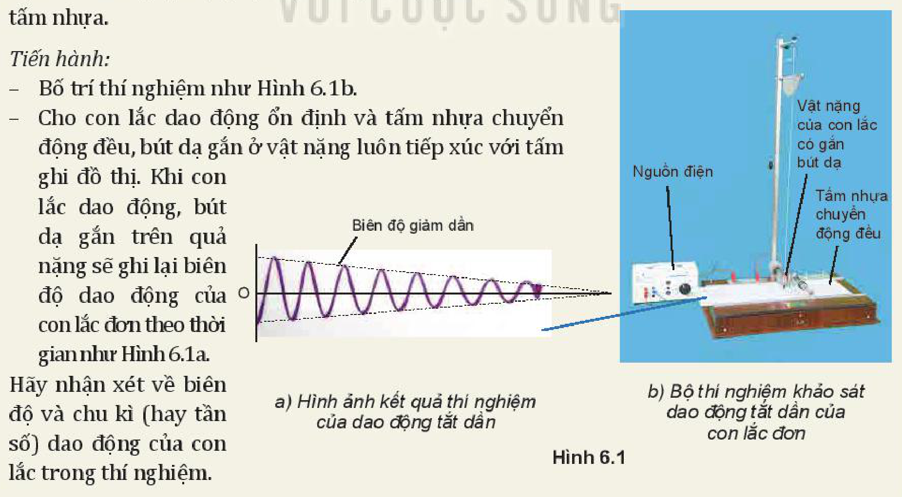
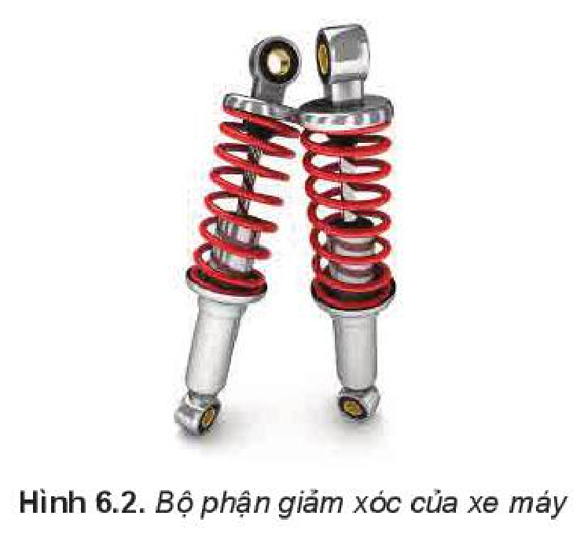
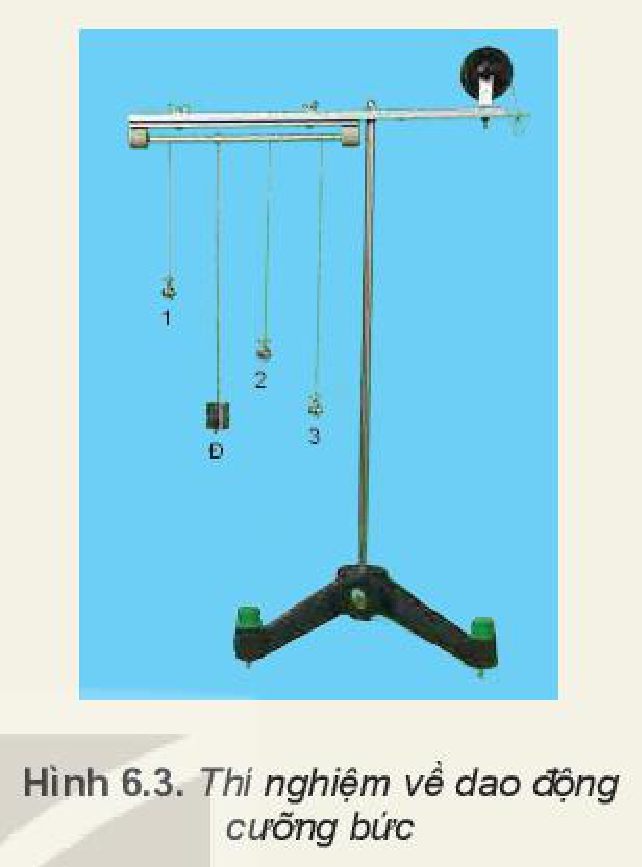
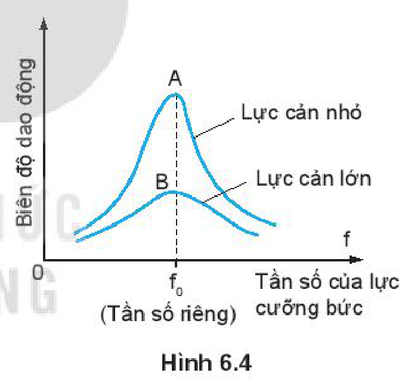

<!-- pdf:26 -->

# BÀI 6: DAO ĐỘNG TẮT DẦN. DAO ĐỘNG CƯỠNG BỨC. HIỆN TƯỢNG CỘNG HƯỞNG

## 🔴 Mở đầu

> Một em bé đang chơi xích đu trong sân. Tại sao để xích đu tiếp tục dao động, người mẹ thỉnh thoảng lại đẩy nhẹ vào em bé?

## I. DAO ĐỘNG TẮT DẦN

### 1. Thí nghiệm dao động tắt dần

Trong các bài trước, ta đã giả thiết không có ma sát tác dụng vào con lắc. Con lắc dao động với biên độ và **tần số riêng** (kí hiệu là $f_0$) không đổi.

Trong thực tế, khi kéo con lắc ra khỏi vị trí cân bằng rồi thả cho nó dao động thì biên độ của nó giảm dần (Hình 6.1). Dao động như vậy gọi là **dao động tắt dần**.

> **Câu hỏi:** Hãy giải thích tại sao dao động của em bé chơi xích đu trong ví dụ ở đầu bài lại tắt dần nếu không có người mẹ thỉnh thoảng đẩy nhẹ vào em bé.

> **Hoạt động:**
>
> **Thí nghiệm**
>
> *Chuẩn bị:*
> Con lắc có quả nặng gắn bút dạ; tấm nhựa để ghi đồ thị của dao động; bộ phận tạo chuyển động đều cho tấm nhựa.
>
> *Tiến hành:*
> - Bố trí thí nghiệm như Hình 6.1b.
> - Cho con lắc dao động ổn định và tấm nhựa chuyển động đều, bút dạ gắn ở vật nặng luôn tiếp xúc với tấm ghi đồ thị. Khi con lắc dao động, bút dạ gắn trên quả nặng sẽ ghi lại biên độ dao động của con lắc đơn theo thời gian như Hình 6.1a.
>
> Hãy nhận xét về biên độ và chu kì (hay tần số) dao động của con lắc trong thí nghiệm.
>
> 

<!-- pdf:27 -->

> *Kết quả thí nghiệm:*
>
> Trong phần 1, khi con lắc dao động, nó chịu lực ma sát ở chỗ treo và ở chỗ tiếp xúc giữa bút dạ với tấm nhựa. Ngoài ra, nó còn chịu lực cản của không khí. Lực ma sát và lực cản của không khí đều làm tiêu hao cơ năng của con lắc, chuyển hoá dần cơ năng thành nhiệt năng. Vì thế, biên độ dao động của con lắc giảm dần và cuối cùng con lắc dừng lại.
>
> *Nguyên nhân làm dao động của vật tắt dần là do lực ma sát và lực cản của môi trường.*

### 2. Ứng dụng

Bộ phận giảm xóc của xe máy Hình 6.2 là ứng dụng của dao động tắt dần.

Khi xe máy đi qua chỗ mấp mô, xe bị nảy lên và dao động. Nếu dao động kéo dài làm người ngồi trên xe khó chịu. Vì thế, người ta lắp thêm một bộ phận giảm xóc để làm tắt dao động của khung xe.

> **Câu hỏi:** Hãy tìm trong thực tế ví dụ về dao động tắt dần và cho biết trong mỗi trường hợp thì dao động tắt dần là có lợi hay có hại.

## II. DAO ĐỘNG CƯỠNG BỨC

### 1. Khái niệm dao động cưỡng bức

**Dao động cưỡng bức** là dao động xảy ra dưới tác dụng của ngoại lực tuần hoàn có tần số $f$ bất kì. Khi dao động ổn định tần số dao động cưỡng bức bằng tần số của ngoại lực.

Ví dụ:

Khi đến bến xe buýt, xe chỉ tạm dừng nên không tắt máy, thân xe vẫn dao động. Dao động đó là dao động cưỡng bức dưới tác dụng của **lực cưỡng bức** tuần hoàn gây ra bởi chuyển động của pít-tông trong xi lanh của máy nổ.

### 2. Đặc điểm

Dao động cưỡng bức khi ổn định có những đặc điểm sau đây:

- Dao động cưỡng bức có biên độ không đổi và có tần số bằng tần số của lực cưỡng bức.
- Biên độ của dao động cưỡng bức không chỉ phụ thuộc vào biên độ của lực cưỡng bức mà còn phụ thuộc cả vào độ chênh lệch giữa tần số của lực cưỡng bức và tần số riêng của hệ dao động. Khi tần số của lực cưỡng bức càng gần tần số riêng thì biên độ dao động của hệ càng lớn.

> **Câu hỏi:** Tìm thêm ví dụ về dao động cưỡng bức.

<!-- pdf:28 -->

> **Hoạt động:**
>
> **Thí nghiệm**
>
> *Chuẩn bị:*
> - Một thanh cứng hình trụ hai đầu thanh được gắn vào hai ổ trục để thanh có thể xoay dễ dàng quanh trục của nó.
> - Một con lắc điều khiển Đ, ba con lắc thử 1, 2 và 3 được treo vào thanh cứng hình trụ.
> - Bố trí thí nghiệm như Hình 6.3.
>
> *Tiến hành:*
> - Hãy dự đoán xem, trong thí nghiệm Hình 6.3, nếu con lắc điều khiển Đ được kéo sang một bên theo phương vuông góc với thanh rồi thả ra cho dao động thì các con lắc khác có dao động không? Con lắc nào dao động mạnh nhất? Tại sao?
> - Làm thí nghiệm để kiểm tra.
>
> *Nhận xét:*
> So sánh kết quả quan sát được với dự đoán.
>
> 

## III. HIỆN TƯỢNG CỘNG HƯỞNG

### 1. Định nghĩa

Từ kết quả thí nghiệm trên, ta có thể rút ra điều kiện để xảy ra hiện tượng cộng hưởng.

*Hiện tượng biên độ dao động cưỡng bức tăng đến giá trị cực đại khi tần số $f$ của lực cưỡng bức tiến đến bằng tần số riêng $f_0$ của hệ dao động gọi là* ***hiện tượng cộng hưởng***.

Đường cong trên đồ thị Hình 6.4 gọi là **đồ thị cộng hưởng**. Đồ thị càng nhọn khi lực cản của môi trường càng nhỏ (điểm A).

Điều kiện $f = f_0$ gọi là **điều kiện cộng hưởng**.

### 2. Giải thích

Khi tần số của lực cưỡng bức bằng tần số riêng của hệ dao động thì hệ được cung cấp năng lượng một cách nhịp nhàng, đúng lúc, do đó biên độ dao động của hệ tăng dần lên. Biên độ dao động đạt tới giá trị cực đại khi tốc độ tiêu hao năng lượng do ma sát bằng tốc độ cung cấp năng lượng cho hệ.

Trong trò chơi đu, người đu phải tác dụng lực vào đu bằng cách nhún người khi đu bắt đầu đổi chiều ở vị trí cao nhất. Trong trò chơi này, người chơi và đu đóng vai trò là một con lắc, lực nhún của của người chơi đóng vai trò là ngoại lực. Vì ngoại lực luôn tác dụng vào con lắc tại những thời điểm nhất định (có cùng tần số với tần số dao động của đu) nên mặc dù người chơi chỉ cần nhún nhẹ nhàng cũng có thể đưa được đu lên rất cao.

<!-- pdf:29 -->

### 3. Hiện tượng cộng hưởng trong đời sống

Cộng hưởng là một hiện tượng vật lí quan trọng có thể xuất hiện trong nhiều tình huống khác nhau. Trong một số trường hợp, hiện tượng cộng hưởng có lợi; như:

- Hộp đàn của các đàn ghi ta, violon,... là những **hộp cộng hưởng** được cấu tạo sao cho không khí trong hộp có thể dao động cộng hưởng với nhiều tần số dao động khác nhau của dây đàn.
- Nguyên tắc hoạt động của lò vi sóng dựa trên cộng hưởng. Ở các lò vi sóng này, sóng được sử dụng có tần số phù hợp với tần số dao động riêng của các phân tử nước trong thực phẩm. Các phân tử nước đóng vai trò là hệ cộng hưởng cũng dao động cưỡng bức, nên hấp thụ năng lượng của sóng được sử dụng và nóng lên.

Tuy nhiên, trong một số trường hợp khác hiện tượng cộng hưởng lại có hại.

Nhiều hệ dao động như toà nhà, cầu, bệ máy, khung xe,... đều có một hay nhiều tần số riêng. Do vậy khi thiết kế cần tránh không để cho các hệ ấy chịu tác dụng của những lực cưỡng bức mạnh có tần số bằng tần số riêng ấy. Nếu không chúng sẽ làm cho các hệ dao động mạnh dẫn đến đổ hoặc gãy. Câu chuyện về một cái cầu bắc ngang qua sông Fontanka (Phô-tan-ca) ở Saint Petersburg (Xanh Pê-téc-bua) ở nước Nga được thiết kế đủ vững chắc cho 300 người đi qua. Nhưng nó đã bị sập khi một trung đội bộ binh gồm 36 người đi đều qua vào năm 1960. Hay câu chuyện về một cây cầu khác được xây dựng năm 1940 qua eo biển Tacoma (Ta-cô-ma) ở nước Mỹ có thể chịu nhiều ô tô có tải trọng lớn đi qua nhưng cũng đã bị đổ sập dưới tác dụng của gió.

(Nguồn: http://www.history.com)

> **Câu hỏi:** Đánh giá được sự có lợi hay có hại của cộng hưởng trong các ví dụ nêu trên.

## 📌 Em đã học

- Dao động có biên độ giảm dần theo thời gian gọi là dao động tắt dần.
- Nguyên nhân làm dao động tắt dần là do lực ma sát và lực cản của môi trường.
- Dao động chịu tác dụng của một ngoại lực cưỡng bức tuần hoàn gọi là dao động cưỡng bức. Dao động cưỡng bức có biên độ không đổi và có tần số bằng tần số của lực cưỡng bức.
- Hiện tượng biên độ dao động cưỡng bức tăng đến giá trị cực đại khi tần số $f$ của lực cưỡng bức tiến đến bằng tần số riêng $f_0$ của hệ dao động gọi là hiện tượng cộng hưởng.
- Tuỳ từng trường hợp mà hiện tượng cộng hưởng có thể có lợi hoặc có thể có hại.

## ✏️ Em có thể

- Lấy được ví dụ thực tế về dao động tắt dần, dao động cưỡng bức và hiện tượng cộng hưởng.
- Nhận biết được sự có lợi hay có hại của cộng hưởng và vận dụng nó vào cuộc sống.

## 📷 Danh sách hình trong bài

| Mã hình | Số hình SGK | Trang PDF | Chú thích |
| --- | --- | --- | --- |
| H11-vat_ly-b06-01 | Hình 6.1 | 26 | a) Hình ảnh kết quả thí nghiệm của dao động tắt dần; b) Bộ thí nghiệm khảo sát dao động tắt dần của con lắc đơn |
| H11-vat_ly-b06-02 | Hình 6.2 | 27 | Bộ phận giảm xóc của xe máy |
| H11-vat_ly-b06-03 | Hình 6.3 | 28 | Thí nghiệm về dao động cưỡng bức |
| H11-vat_ly-b06-04 | Hình 6.4 | 28 | Đồ thị cộng hưởng |
