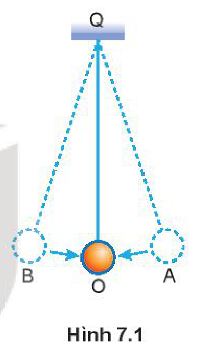
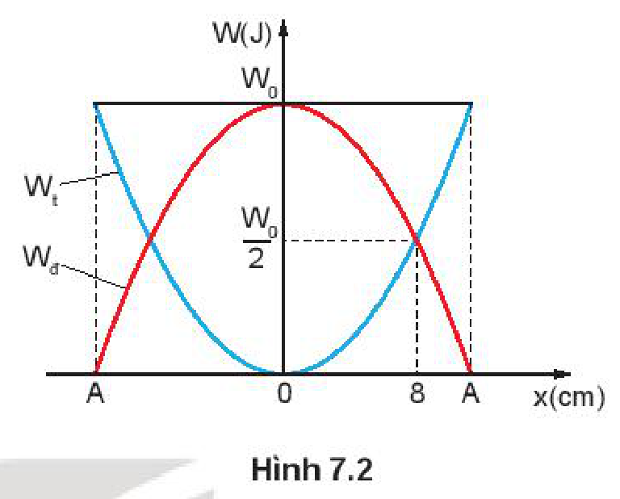
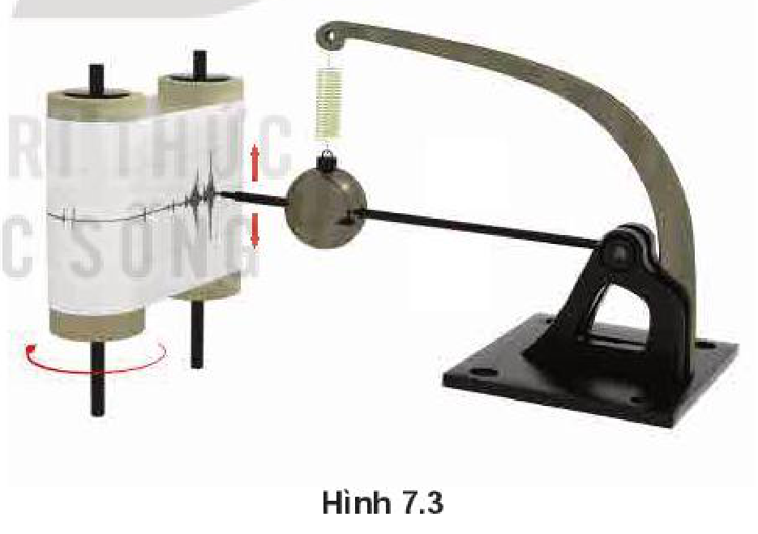
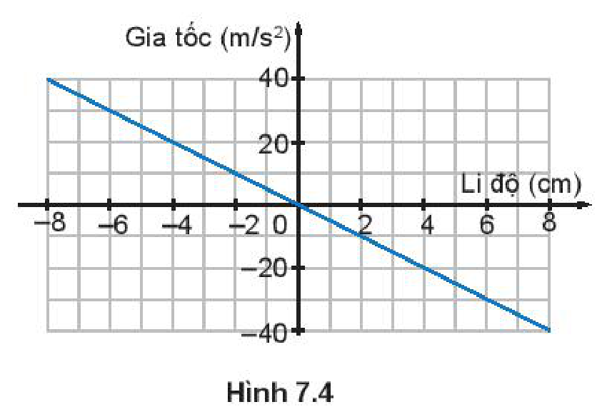
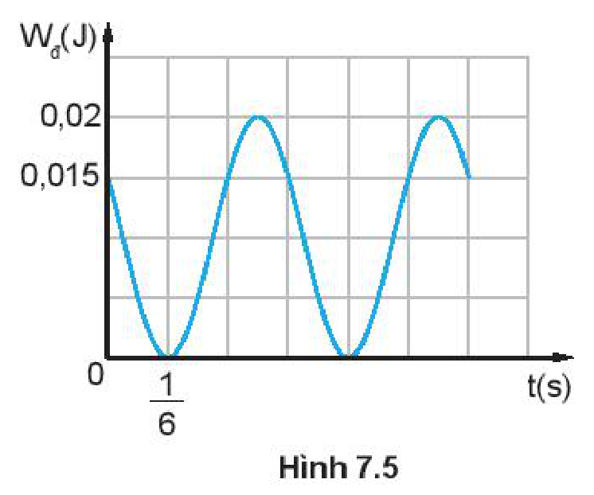

<!-- pdf:30 -->

# BÀI 7: BÀI TẬP VỀ SỰ CHUYỂN NĂNG LƯỢNG TRONG DAO ĐỘNG ĐIỀU HOÀ

## 🔴 Mở đầu

> Ta có thể sử dụng định luật bảo toàn cơ năng để tìm li độ và vận tốc của vật dao động điều hoà được không?

## I. CÁC VÍ DỤ

*Ví dụ 1:* Một con lắc đơn gồm vật nặng có kích thước nhỏ, có khối lượng $m$, treo ở đầu một sợi dây mềm không giãn có độ dài $l$ và có khối lượng không đáng kể (Hình 7.1). Đưa vật nặng ra khỏi vị trí cân bằng $O$ sao cho dây treo hợp với $QO$ một góc $\alpha_0$ ($\alpha_0 \le 10^\circ$) rồi thả nhẹ cho con lắc dao động điều hoà trên cung tròn $\overset{\frown}{AOB}$.

a) Tính thế năng của con lắc; động năng của vật ở các vị trí A, O, B và vị trí bất kì (li độ góc $\alpha$).

b) Ở vị trí nào động năng bằng thế năng?

*Giải:*

a) Chọn mốc để tính thế năng của vật là vị trí cân bằng $O$ thì:

- Thế năng và động năng của vật tại các vị trí A và B là:
  $W_\text{t} = W_{\text{tmax}} = mgl(1 - \cos\alpha_0) = mgl\left(2\sin^2\frac{\alpha_0}{2}\right) \approx mgl\frac{\alpha_0^2}{2}$ (với $\alpha_0$ tính theo rad)
  $W_\text{đ} = 0.$
- Thế năng và động năng của vật tại vị trí O là:
  $W_\text{t} = 0.$
  $W_\text{đ} = W_{\text{tmax}} = mgl(1 - \cos\alpha_0) \approx mgl\frac{\alpha_0^2}{2}$
- Thế năng và động năng của vật tại vị trí bất kì (li độ góc $\alpha$) là:
  $W_\text{t} = mgl(1 - \cos\alpha) \approx mgl\frac{\alpha^2}{2}$ (với $\alpha$ tính theo rad)
  $W_\text{đ} = W_{\text{tmax}} - W_\text{t} \approx mgl\left(\frac{\alpha_0^2}{2} - \frac{\alpha^2}{2}\right)$

b) Khi $W_\text{đ} = W_\text{t}$, áp dụng **định luật bảo toàn cơ năng**:

$W = W_{\text{tmax}} = W_\text{đ} + W_\text{t} = 2W_\text{t} \Leftrightarrow mgl\frac{\alpha_0^2}{2} = 2mgl\frac{\alpha^2}{2} \Rightarrow \alpha = \pm\frac{\alpha_0}{\sqrt{2}}.$

Vậy ở các vị trí có li độ góc $\alpha = \pm\frac{\alpha_0}{\sqrt{2}}$ thì động năng bằng thế năng.

*Ví dụ 2:* Một vật có khối lượng $m = 200\text{ g}$ dao động điều hoà với tần số góc $\omega = 2\pi\text{ rad/s}$, biên độ $A = 10\text{ cm}$. Xác định thế năng của con lắc tại thời điểm vật có tốc độ $v = 10\text{ cm/s}$.

<!-- pdf:31 -->

*Giải:*

Ta đã biết trong dao động điều hoà cơ năng được bảo toàn $W = W_\text{t} + W_\text{đ}$.

Suy ra thế năng:

$W_\text{t} = W - W_\text{đ} = \frac{m\omega^2 A^2}{2} - \frac{mv^2}{2} = \frac{m}{2}(\omega^2 A^2 - v^2) = \frac{0,2}{2}\left(2^2 \cdot \pi^2 \cdot (0,1)^2 - 0,1^2\right) = 0,038\text{ J}.$

*Ví dụ 3:* Một con lắc lò xo có độ cứng $k = 100\text{ N/m}$ dao động điều hoà. Gọi $W_\text{t}$, $W_\text{đ}$ lần lượt là thế năng của lò xo và động năng của vật, $W_0$ là cơ năng của con lắc lò xo. Đồ thị biểu diễn sự phụ thuộc của thế năng $W_\text{t}$ và động năng $W_\text{đ}$ của con lắc vào li độ $x$ như Hình 7.2. Tính $W_0$.

*Giải:*

Từ đồ thị ta xác định được:

Khi $x = \pm 8\text{ cm} = \pm 0,08\text{ m}$ thì $W_\text{đ} = W_\text{t}$.

Mặt khác vì $W_0 = W_\text{t} + W_\text{đ}$ nên khi $W_\text{đ} = W_\text{t}$ ta có:

$W_0 = 2W_\text{t} = 2 \cdot \frac{1}{2}kx^2 = 0,64\text{ J}.$

## II. BÀI TẬP LUYỆN TẬP

1. Hình 7.3 mô tả một **máy đo địa chấn** đơn giản hoạt động theo nguyên tắc sau đây: Khi xảy ra động đất thì hệ gồm lò xo và vật nặng của máy đo sẽ dao động theo tần số của địa chấn. Bút dạ gắn với vật nặng sẽ ghi lại đồ thị của địa chấn trên cuộn giấy quay đều. Biết sóng địa chấn có tần số nằm trong khoảng từ $30\text{ Hz}$ đến $40\text{ Hz}$.
   Hãy giải thích tại sao tần số riêng của hệ (vật nặng + lò xo) trong máy địa chấn phải có giá trị nhỏ hơn tần số này rất nhiều.

2. Đồ thị Hình 7.4 mô tả mối liên hệ giữa gia tốc và li độ của một vật dao động điều hoà.
   Sử dụng số liệu trong đồ thị Hình 7.4 để tính tần số của dao động.

<!-- pdf:32 -->

3. Hình 7.5 là đồ thị động năng theo thời gian của một vật khối lượng $0,4\text{ kg}$ dao động điều hoà. Tại thời điểm ban đầu vật đang chuyển động theo chiều dương, lấy $\pi^2 = 10$. Viết phương trình dao động của vật.

4. Một vật có khối lượng $m$ dao động điều hoà với tần số góc $\omega$ và biên độ $A$.
   a) Khi vật có li độ bằng một nửa biên độ thì động năng và thế năng chiếm bao nhiêu phần trăm so với cơ năng?
   b) Tại li độ nào thì thế năng bằng động năng?

## 📌 Em đã học

- Cách xác định các đại lượng vận tốc, gia tốc, năng lượng, động năng, thế năng,... khi biết phương trình hoặc đồ thị của vật dao động điều hoà và ngược lại.

## ✏️ Em có thể

- Phân tích được sự chuyển hoá năng lượng trong dao động điều hoà trong một số bài tập cụ thể.

## 📷 Danh sách hình trong bài

| Mã hình | Số hình SGK | Trang PDF | Chú thích |
| --- | --- | --- | --- |
| H11-vat_ly-b07-01 | Hình 7.1 | 30 | Con lắc đơn dao động điều hoà trên cung tròn AOB |
| H11-vat_ly-b07-02 | Hình 7.2 | 31 | Đồ thị biểu diễn sự phụ thuộc của thế năng Wt và động năng Wđ của con lắc vào li độ x |
| H11-vat_ly-b07-03 | Hình 7.3 | 31 | Máy đo địa chấn đơn giản |
| H11-vat_ly-b07-04 | Hình 7.4 | 31 | Đồ thị mô tả mối liên hệ giữa gia tốc và li độ của một vật dao động điều hoà |
| H11-vat_ly-b07-05 | Hình 7.5 | 32 | Đồ thị động năng theo thời gian của một vật dao động điều hoà |
