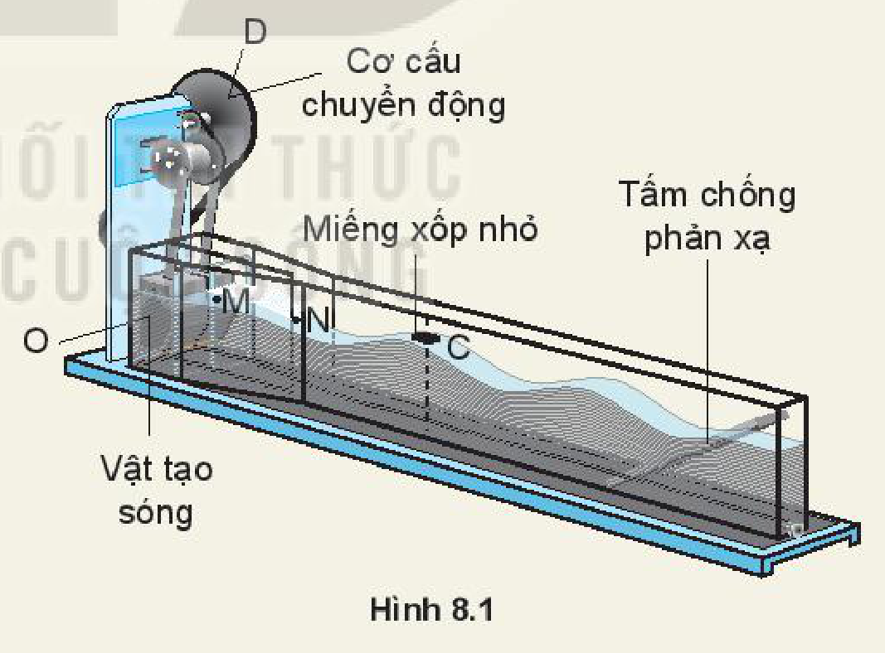
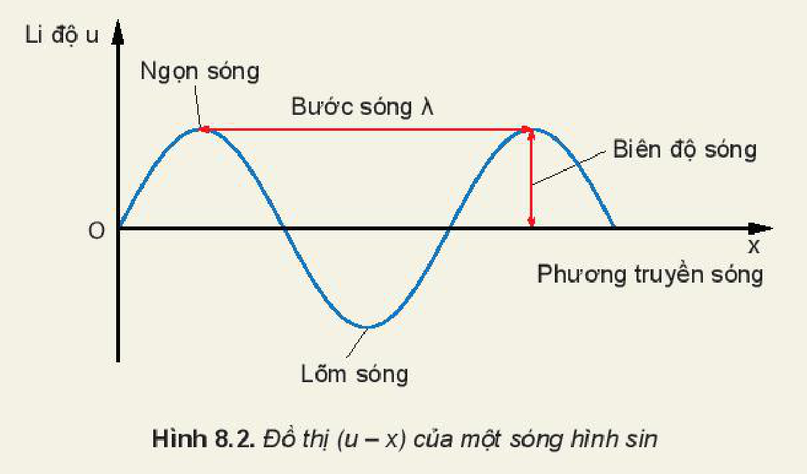
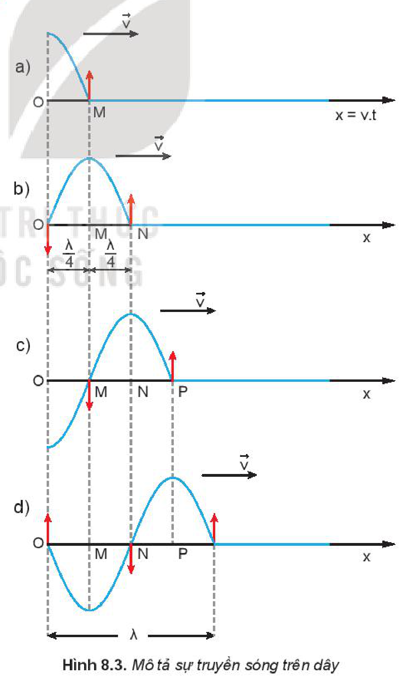
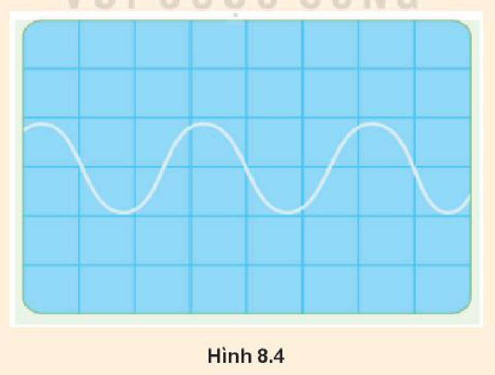

<!-- pdf:34 -->

# BÀI 8: MÔ TẢ SÓNG

## 🔴 Mở đầu

> Trong cuộc sống hằng ngày, chúng ta thường gặp hay nghe đến nhiều loại sóng như: sóng nước, sóng âm, sóng vô tuyến, sóng biển, sóng địa chấn,... Vậy sóng được hình thành như thế nào và có những đặc điểm gì?
<!-- ocr-ok: đối chiếu ảnh trang PDF 34 khớp nguyên văn hộp Mở đầu -->

## I. THÍ NGHIỆM TẠO SÓNG MẶT NƯỚC

> **Hoạt động:**
>
> *Chuẩn bị:*
>
> Thiết bị tạo sóng mặt nước bằng kênh tạo sóng (Hình 8.1). Đề xuất cách đo các đại lượng đặc trưng như: biên độ sóng, bước sóng, chu kì của sóng và tốc độ truyền sóng trên mặt nước.
>
> 
>
> *Tiến hành:*
>
> Đặt một miếng xốp nhỏ $\text{C}$ trên mặt nước. Khi quay đĩa $\text{D}$ làm cho vật tạo sóng $\text{O}$ dao động lên xuống, thì dao động đó được truyền cho các phần tử nước từ gần ra xa.
>
> *Kết quả:*
>
> - Quan sát qua thành kênh thẳng đứng, ta thấy mặt cắt của nước có dạng hình sin.
> - Miếng xốp $\text{C}$ dao động lên xuống tại chỗ, còn những biến dạng của mặt nước lan truyền đi từ nguồn sóng $\text{O}$ ra xa cho ta hình ảnh về sóng có trên mặt nước. $\text{O}$ là **nguồn sóng**, nước là **môi trường truyền sóng**, đường thẳng $\text{OC}$ là **phương truyền sóng**.
> - Đồ thị sóng được mô tả như trên Hình 8.2.

<!-- pdf:35 -->

> Hình 8.2 là đồ thị một **sóng hình sin** lan truyền trên mặt nước theo phương $Ox$.
>
> 

## II. GIẢI THÍCH SỰ TẠO THÀNH SÓNG

Trong thí nghiệm Hình 8.1 các phần tử nước sát nguồn $\text{O}$ dao động theo phương thẳng đứng. Nhờ có *lực liên kết* giữa các phần tử nước mà các phần tử nước ở điểm $\text{M}$ lân cận điểm $\text{O}$ dao động theo. Đến lượt các phần tử nước ở điểm $\text{N}$ lân cận điểm $\text{M}$ dao động. Ta nói có sự truyền dao động từ điểm này sang điểm khác tạo nên sóng mặt nước.

Như vậy, có hai nguyên nhân tạo nên sóng truyền trong một môi trường. Đó là nguồn dao động từ bên ngoài tác dụng lên môi trường tại điểm $\text{O}$ và có lực liên kết giữa các phần tử của môi trường.
<!-- term: Nguyên nhân tạo nên sóng -->

> **Hoạt động:**
>
> Hãy quan sát chuyển động của miếng xốp trong thí nghiệm Hình 8.1 và cho biết miếng xốp có chuyển động ra xa nguồn cùng với sóng không?

Các phần tử môi trường chỉ dao động trong một phạm vi không gian rất hẹp, trong khi sóng truyền đi rất xa.

<!-- pdf:36 -->

> **Em có biết:**
>
> Tốc độ truyền sóng chỉ phụ thuộc vào tính chất của môi trường truyền sóng không phụ thuộc vào tần số dao động của nguồn hay của các phần tử của môi trường có sóng truyền qua.

*Sự lệch pha của các phần tử môi trường trên phương truyền sóng*

Giả sử có một sóng mặt nước hình sin lan truyền từ nguồn $\text{O}$ theo phương $Ox$ (Hình 8.3).

Tại thời điểm bắt đầu quan sát ($t = 0$) phần tử nước tại $\text{O}$ bắt đầu đi lên, còn các điểm khác chưa dao động.

> **Câu hỏi:** Trong đồ thị của sóng Hình 8.3d, các điểm nào trong các điểm $\text{M, N, P}$ trên phương $Ox$ dao động lệch pha $\frac{\pi}{2}$, ngược pha, đồng pha với nhau?

Tại $t = \frac{T}{4}$ phần tử nước tại $\text{O}$ đi lên đến vị trí biên, trong khi đó sóng truyền đến điểm $\text{M}$ cách $\text{O}$ một đoạn $d = v \cdot \frac{T}{4} = \frac{\lambda}{4}$. Phần tử nước tại $\text{M}$ trễ pha hơn phần tử nước tại $\text{O}$ là $\frac{\pi}{2}$. Hình 8.3a cho biết hình dạng của sóng tại $t = \frac{T}{4}$.
<!-- term: Độ lệch pha trên phương truyền sóng -->

Tại $t = \frac{T}{2}$, phần tử nước tại $\text{O}$ về đến vị trí cân bằng, phần tử nước tại $\text{M}$ đi lên đến vị trí biên, còn sóng lan đến điểm $\text{N}$ cách $\text{M}$ một khoảng bằng $\frac{\lambda}{2}$. Điểm $\text{N}$ trễ pha hơn điểm $\text{M}$ là $\frac{\pi}{2}$, hay trễ pha hơn phần tử nước tại $\text{O}$ là $\pi$. Hình dạng sóng được mô tả ở Hình 8.3b.

Tại $t = \frac{3T}{4}$, $t = T$, hình dạng của sóng được chỉ trên Hình 8.3 c, d.

## III. CÁC ĐẠI LƯỢNG ĐẶC TRƯNG CỦA SÓNG

- **Biên độ sóng** là độ lệch lớn nhất của phần tử sóng khỏi vị trí cân bằng. Sóng có biên độ càng lớn thì phần tử sóng dao động càng mạnh.
- **Bước sóng** là khoảng cách từ một phần tử môi trường bất kì trên phương truyền sóng đến phần tử gần nhất có trạng thái dao động hoàn toàn tương tự. Bước sóng được kí hiệu là $\lambda$, đơn vị là mét.
- **Chu kì sóng** chính bằng chu kì dao động của phần tử sóng. Chu kì kí hiệu là $T$, đơn vị là giây.
- **Tần số sóng**: đại lượng $f = \frac{1}{T}$ được gọi là tần số sóng.
- **Tốc độ truyền sóng** là tốc độ lan truyền dao động trong không gian.

<!-- pdf:37 -->

- Giữa các đại lượng $\lambda, T$ (hay $f$) có mối liên hệ sau đây: $\lambda = vT = \frac{v}{f}$.
- **Cường độ sóng** được định nghĩa là năng lượng sóng được truyền qua một đơn vị diện tích vuông góc với phương truyền sóng trong một đơn vị thời gian. Đơn vị cường độ sóng là $\text{W/m}^2$.

> **Câu hỏi:**
>
> 1. Trên mặt hồ yên lặng, một người làm cho con thuyền dao động tạo ra sóng trên mặt nước. Thuyền thực hiện được $24$ dao động trong $40\text{ s}$, mỗi dao động tạo ra một ngọn sóng cao $12\text{ cm}$ so với mặt hồ yên lặng và ngọn sóng tới bờ cách thuyền $10\text{ m}$ sau $5\text{ s}$. Với số liệu này, hãy xác định:
>    a) Chu kì dao động của thuyền.
>    b) Tốc độ lan truyền của sóng.
>    c) Bước sóng.
>    d) Biên độ sóng.
> 2. Hình 8.4 là đồ thị $(u - t)$ của một sóng âm trên màn hình của một dao động kí. Biết mỗi cạnh của ô vuông theo phương ngang trên hình tương ứng với $1\text{ ms}$. Tính tần số của sóng.
> 3. Trong thí nghiệm ở Hình 8.1, nếu ta thay đổi tần số dao động của nguồn sóng thì đại lượng nào sau đây không thay đổi?
>    A. Chu kì sóng.
>    B. Bước sóng.
>    C. Tần số sóng.
>    D. Tốc độ truyền sóng.
>
> 

<!-- pdf:38 -->

## 📌 Em đã học

- **Sóng cơ** là những biến dạng cơ lan truyền trong một môi trường đàn hồi.
- Biên độ sóng $A$ là độ cao hay độ sâu của một ngọn sóng so với mức cân bằng. Biên độ sóng bằng biên độ dao động của nguồn sóng.
- Chu kì $T$ của sóng là khoảng thời gian để hai ngọn sóng liên tiếp chạy qua một điểm đang xét. Chu kì của sóng bằng chu kì dao động của nguồn sóng.
- Tần số $f$ của sóng là số các ngọn sóng đi qua một điểm đang xét trong một đơn vị thời gian. Tần số sóng bằng tần số dao động của nguồn sóng.
- Tốc độ truyền sóng $v$ là tốc độ lan truyền biến dạng.
- Bước sóng $\lambda$ là khoảng cách giữa hai ngọn sóng liên tiếp. Bước sóng bằng quãng đường mà sóng truyền được trong một chu kì.
- Các đại lượng $\lambda, T$ (hay $f$) và $v$ có mối liên hệ sau đây: $\lambda = vT = \frac{v}{f}$.
- Sự lệch pha giữa các phần tử dao động trên phương truyền sóng tạo nên hình ảnh của sóng.
<!-- term: Ngọn sóng -->

## ✏️ Em có thể

- Dùng đồ thị $(u - x)$ của một sóng hình sin để nêu được các đại lượng đặc trưng của sóng.

## 📷 Danh sách hình trong bài

| Mã hình | Số hình SGK | Trang PDF | Chú thích |
| --- | --- | --- | --- |
| H11-vat_ly-b08-01 | Hình 8.1 | 34 | Thiết bị tạo sóng mặt nước bằng kênh tạo sóng |
| H11-vat_ly-b08-02 | Hình 8.2 | 35 | Đồ thị $(u - x)$ của một sóng hình sin |
| H11-vat_ly-b08-03 | Hình 8.3 | 35 | Mô tả sự truyền sóng trên dây |
| H11-vat_ly-b08-04 | Hình 8.4 | 37 | Đồ thị $(u - t)$ của một sóng âm trên màn hình của một dao động kí |
