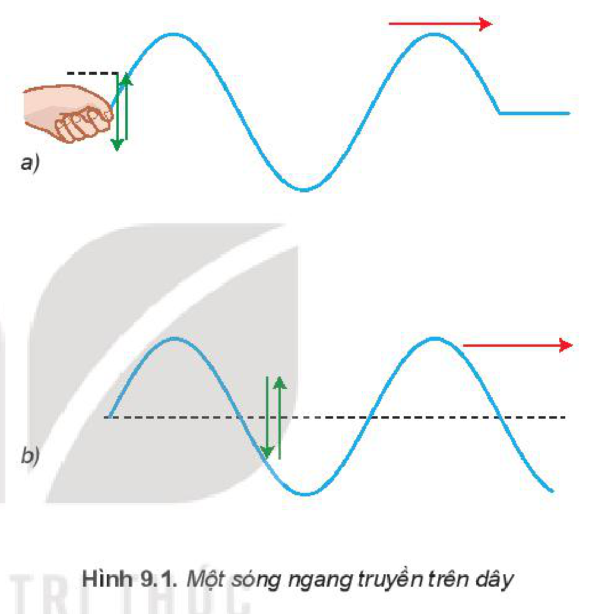
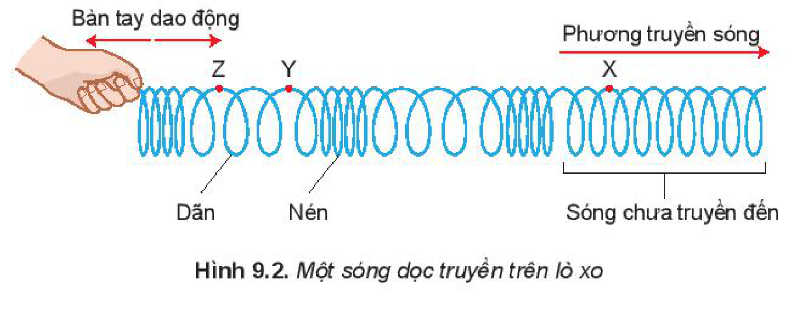
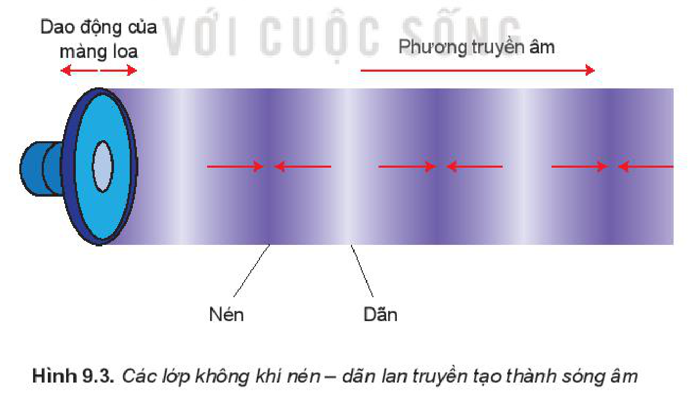
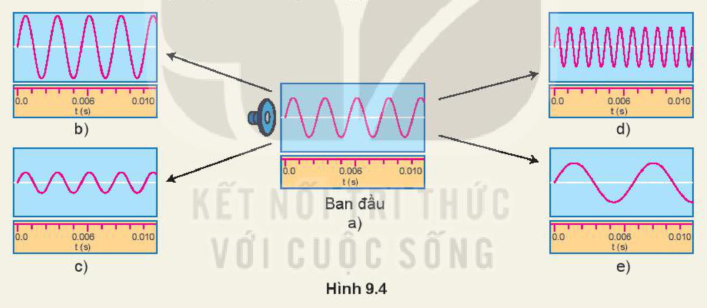

<!-- pdf:39 -->

# BÀI 9: SÓNG NGANG, SÓNG DỌC, SỰ TRUYỀN NĂNG LƯỢNG CỦA SÓNG CƠ

## 🔴 Mở đầu

> Sóng mặt nước và sóng âm truyền trong không khí có đặc điểm gì chung và riêng?

## I. SÓNG NGANG

Trong thí nghiệm ở Hình 8.1 các phần tử nước tại $\text{O}$, rồi tại $\text{M}$ dao động lên, xuống theo phương thẳng đứng, trong khi sóng truyền từ $\text{O}$ đến $\text{M}$ theo phương ngang.

*Sóng trong đó các phần tử của môi trường dao động theo phương vuông góc với phương truyền sóng gọi là **sóng ngang**.*

> **Câu hỏi:** Hình 9.1 mô tả một sóng ngang truyền trên dây đàn hồi. Hãy quan sát các mũi tên, từ đó chỉ ra phương dao động của các phần tử của dây và phương truyền sóng.

## II. SÓNG DỌC

Đặt một lò xo ống dài và mềm trên mặt bàn nhẵn. Dùng tay cầm một đầu lò xo và cho bàn tay dao động dọc theo trục của lò xo. Các vòng của lò xo ở sát bàn tay lần lượt bị nén rồi bị dãn. Nhờ có lực đàn hồi giữa các vòng lò xo mà các biến dạng nén – dãn lan truyền đi xa dọc theo trục của lò xo (Hình 9.2).

*Sóng trong đó các phần tử của môi trường dao động theo phương trùng với phương truyền sóng gọi là **sóng dọc**.*

<!-- pdf:40 -->

> **Hoạt động:**
>
> Dựa vào Hình 9.1 và Hình 9.2, hãy chỉ ra điểm giống và khác nhau giữa sóng dọc và sóng ngang.

## III. QUÁ TRÌNH TRUYỀN NĂNG LƯỢNG BỞI SÓNG

Trong thí nghiệm Hình 8.1, khi sóng lan truyền đến đâu thì các phần tử nước ở đó bắt đầu dao động. Năng lượng dao động mà các phần tử nước này có được là do *sóng mang năng lượng* của nguồn đến cho chúng.
<!-- term: Sự truyền năng lượng của sóng cơ -->

Các phần tử nước chỉ dao động tại chỗ, quanh vị trí cân bằng của nó chứ không chuyển động theo sóng. Điều đó chứng tỏ sóng mang năng lượng mà không mang các phần tử nước đi theo.

Đối với sóng dọc trên lò xo thì năng lượng được truyền đi bằng sự nén, dãn liên tiếp của các vòng lò xo.

Mọi sóng cơ khác như sóng âm đều mang năng lượng đi xa theo cách như vậy.

## IV. SỬ DỤNG MÔ HÌNH SÓNG ĐỂ GIẢI THÍCH MỘT SỐ TÍNH CHẤT CỦA ÂM

Sóng dọc chạy trên lò xo là mô hình giúp ta hiểu được sự lan truyền và một số tính chất của sóng âm.

**Nguồn âm** dao động làm cho các phần tử không khí trên dao động theo phương truyền âm, các phần tử không khí dao động lệch pha nhau tạo nên các lớp không khí nén, dãn giống như ở lò xo. Các nén, dãn này truyền đi tạo thành **sóng âm** theo mọi hướng trong không khí Hình 9.3 chỉ xét sóng âm truyền theo hướng $Ox$. Khi sóng âm truyền đến tai người làm cho màng nhĩ dao động, do đó ta *nghe được* âm thanh.

Như vậy, dù sóng âm không nhìn thấy nhưng ta lại có thể nghe được âm. Biên độ của sóng âm càng lớn thì biên độ dao động của màng nhĩ càng lớn, âm nghe càng to. Tần số của sóng âm càng lớn thì tần số dao động của màng nhĩ càng lớn, âm nghe càng cao.
<!-- term: Độ to của âm -->
<!-- term: Độ cao của âm -->

<!-- pdf:41 -->

> **Em có biết:**
>
> Ánh sáng là sóng, mang năng lượng và truyền được trong chân không. Ánh sáng cũng có những đại lượng đặc trưng như chu kì, tần số, bước sóng và tốc độ truyền sóng. Trong chân không, ánh sáng nhìn thấy có bước sóng nằm trong khoảng từ $0,38\ \mu\text{m}$ đến $0,76\ \mu\text{m}$.

> **Lưu ý:** **Âm nghe được** có tần số nằm trong khoảng từ $16\text{ Hz}$ đến $20\text{ }000\text{ Hz}$.

> **Hoạt động:**
>
> Quan sát Hình 9.4 mô tả biên độ và tần số của âm qua dao động kí để trả lời các câu hỏi sau:
>
> - Ở Hình 9.4a loa phát ra âm có chu kì bằng bao nhiêu?
>
> So với Hình 9.4a:
>
> - Ở hình nào biên độ âm lớn hơn nhưng tần số không thay đổi so?
> - Ở hình nào tần số âm giảm nhưng không giảm biên độ?
> - Ở hình nào biên độ âm giảm nhưng không giảm tần số?
>
> 

> **Câu hỏi:**
>
> 1. Tại thời điểm mà sóng trên lò xo được chỉ trên Hình 9.2. Hãy xác định:
>    a) Sóng đã truyền được bao nhiêu bước sóng?
>    b) Trong các điểm $\text{X, Y, Z}$ điểm nào là điểm chưa dao động?
> 2. Dải tần số mà một học sinh có thể nghe thấy từ $30\text{ Hz}$ đến $16\text{ }000\text{ Hz}$. Tốc độ truyền âm trong không khí là $330\text{ m/s}$. Tính bước sóng ngắn nhất của âm thanh trong không khí mà bạn học sinh đó nghe được.

<!-- pdf:42 -->

## 📌 Em đã học

- Sóng trong đó các phần tử của môi trường dao động theo phương vuông góc với phương truyền sóng gọi là sóng ngang.
- Sóng trong đó các phần tử của môi trường dao động theo phương trùng với phương truyền sóng gọi là sóng dọc.
- Quá trình truyền sóng là quá trình truyền năng lượng.
- Nguồn sóng là nguồn năng lượng. Sóng mang năng lượng của nguồn đến mọi nơi trên phương truyền sóng.
- Mọi sóng mang năng lượng đi xa mà không mang các phần tử vật chất đi cùng. Đó là điểm khác biệt căn bản giữa chuyển động của sóng và chuyển động của hạt.

## ✏️ Em có thể

- Nêu được ví dụ trong thực tế chứng tỏ sóng truyền năng lượng.
- Nêu được ví dụ về sóng dọc và sóng ngang trong thực tiễn.
- Sử dụng mô hình sóng để giải thích được một số tính chất đơn giản của âm.

## 📷 Danh sách hình trong bài

| Mã hình | Số hình SGK | Trang PDF | Chú thích |
| --- | --- | --- | --- |
| H11-vat_ly-b09-01 | Hình 9.1 | 39 | Một sóng ngang truyền trên dây |
| H11-vat_ly-b09-02 | Hình 9.2 | 39 | Một sóng dọc truyền trên lò xo |
| H11-vat_ly-b09-03 | Hình 9.3 | 40 | Các lớp không khí nén – dãn lan truyền tạo thành sóng âm |
| H11-vat_ly-b09-04 | Hình 9.4 | 41 | Mô tả biên độ và tần số của âm qua dao động kí |
