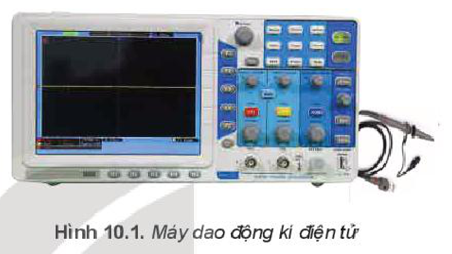
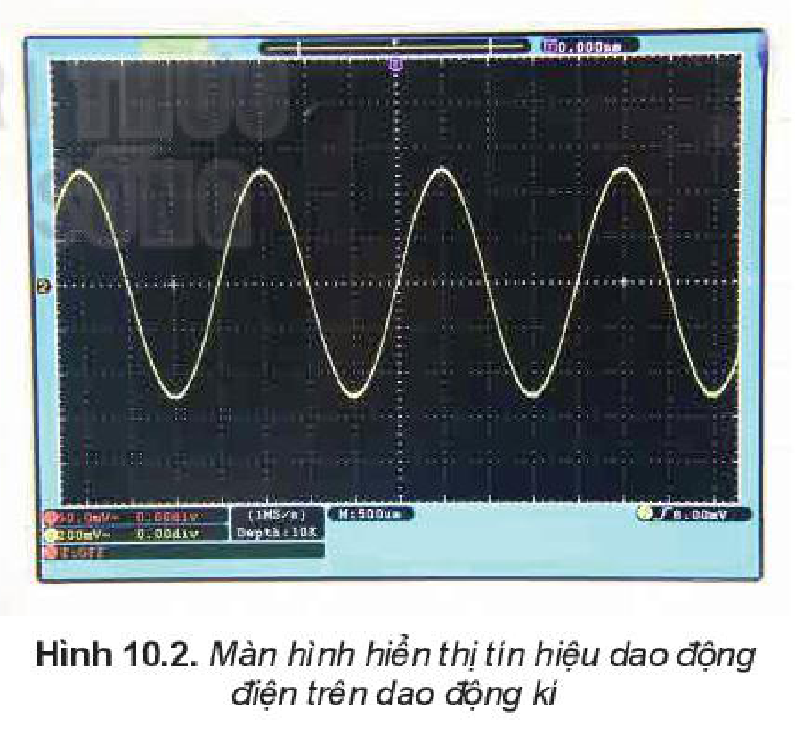
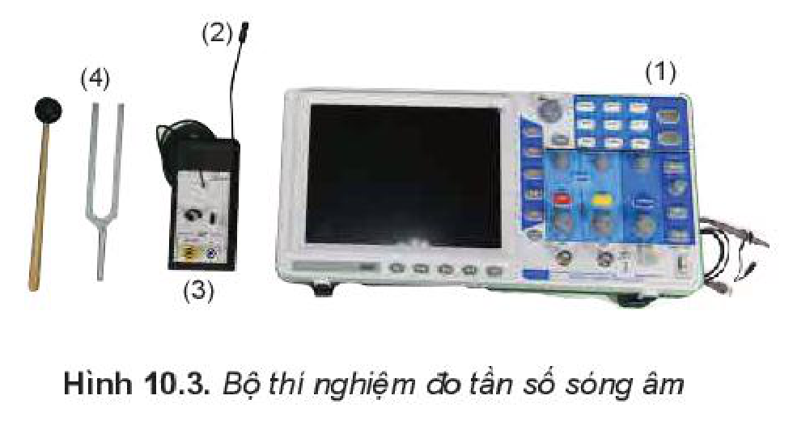
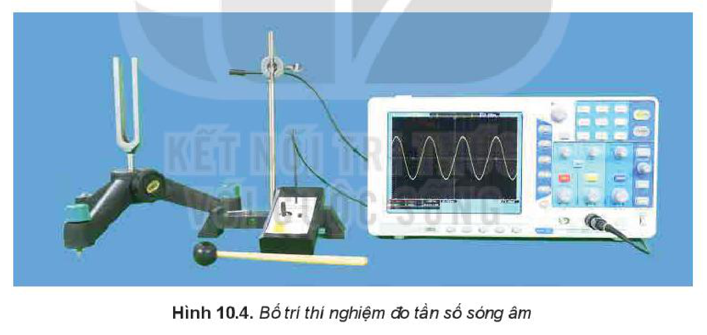

<!-- pdf:43 -->

# BÀI 10: THỰC HÀNH: ĐO TẦN SỐ CỦA SÓNG ÂM

## 🔴 Mở đầu

> Để chỉnh các dây đàn, có thể so sánh tần số âm của nhạc cụ với âm phát ra từ âm thoa có tần số xác định. Làm thế nào kiểm tra tần số âm được ghi trên âm thoa bằng dụng cụ thí nghiệm?

## I. GIỚI THIỆU DAO ĐỘNG KÍ ĐIỆN TỬ

**Dao động kí** là thiết bị dùng để hiển thị trên màn hình dạng tín hiệu đưa vào cần quan sát. Khoảng tần số đo được phụ thuộc vào từng loại dao động kí.

Dao động kí có các tính năng cơ bản sau:

- Đo cường độ của tín hiệu dao động điện.
- Đo tần số, chu kì, khoảng thời gian của tín hiệu dao động điện.

> **Lưu ý:** Mỗi dao động kí chỉ đo được tín hiệu có hiệu điện thế nhất định, nếu vượt quá có thể hỏng thiết bị.

Cách sử dụng dao động kí để đo tín hiệu:

- Nối que đo vào chân cắm tín hiệu vào.
- Chọn dạng tín hiệu đo AC hoặc DC.
- Nối dao động kí với bộ nguồn và bật công tắc.
- Sử dụng dây đo nối với đầu tín hiệu cần đo.
- Nhấn nút TRIGGER để chế độ là Auto.
- Nhấn nút VOLTS/DIV điều chỉnh biên độ dao động.
- Nhấn nút SEC/DIV điều chỉnh giá trị tương ứng với một ô hiển thị trên màn hình.
- Sử dụng nút điều chỉnh lên xuống đồ thị tín hiệu.

> **Hoạt động:**
>
> Quan sát màn hình hiển thị tín hiệu dao động điện trên dao động kí (Hình 10.2), hãy xác định tần số dao động của tín hiệu.

<!-- pdf:44 -->

## II. THỰC HÀNH ĐO TẦN SỐ SÓNG ÂM

### 1. Dụng cụ thí nghiệm

- Dao động kí điện tử và dây đo (1).
- Micro (2).
- Bộ khuếch đại tín hiệu (3).
- **Âm thoa** và búa cao su (4).
- Giá đỡ và kẹp giữ âm thoa.

### 2. Thiết kế phương án thí nghiệm

> **Hoạt động:**
>
> Quan sát thí nghiệm Hình 10.4. Trả lời các câu hỏi sau:
>
> 1. Sóng âm truyền tới dao động kí như thế nào?
> 2. Tại sao tần số dao động của tín hiệu đưa vào dao động kí lại bằng tần số dao động của âm thoa?
> 3. Thiết kế phương án thí nghiệm để đo tần số sóng âm với các dụng cụ thí nghiệm trên.
> 4. Làm thế nào để giảm ảnh hưởng của tiếng ồn bên ngoài đến phép đo?

### 3. Tiến hành thí nghiệm

- Bố trí thí nghiệm như Hình 10.4.
- Đặt micro cách âm thoa một khoảng $20\text{ cm}$.
- Nối micro và bộ khuếch đại vào dao động kí, bật dao động kí.
- Dùng búa cao su gõ âm thoa.
- Xác định chu kì của sóng trên màn hình. Đọc giá trị $T$ và ghi vào mẫu Bảng 10.1.
- Lặp lại các bước thí nghiệm 4, 5 hai lần.

> **Lưu ý:** Để dao động kí hiển thị dòng điện từ micro đi vào dao động kí thực hiện như sau:
>
> - Nối dây đo với cổng tín hiệu vào.
> - Nối bộ khuếch đại tín hiệu micro vào dây đo.
> - Đặt TRIGGER MODE ở chế độ AUTO.
> - Điều chỉnh VOLTS/DIV cho tới khi thấy sóng trên màn hình.

<!-- pdf:45 -->

### 4. Kết quả thí nghiệm

*Bảng 10.1*

| Đại lượng | Lần 1 | Lần 2 | Lần 3 | Giá trị trung bình |
| --- | --- | --- | --- | --- |
| Chu kì $T(\text{s})$ | ? | ? | ? | ? |
| Tần số $f(\text{Hz})$ | ? | ? | ? | ? |
<!-- ocr-ok: đối chiếu ảnh trang PDF 45 khớp nguyên văn Bảng 10.1 -->

> **Hoạt động:**
>
> So sánh tần số sóng âm đo được với tần số ghi trên âm thoa.

Ghi lại kết quả đo chu kì và xử lí kết quả thí nghiệm:

- Tính tần số sóng âm và ghi kết quả vào mẫu Bảng 10.1.
- Tính giá trị trung bình, sai số của phép đo chu kì và tần số.

## 📌 Em đã học

- Đo được tần số của sóng âm bằng cách sử dụng dao động kí.

## ✏️ Em có thể

- Sử dụng một số phần mềm trên điện thoại thông minh để chỉnh dây đàn ghita.

> **Em có biết:**
>
> Các nhạc cụ có thể phát ra các nốt nhạc cơ bản có tần số như Bảng 10.2.
>
> Với các quãng tám khác nhau thì tần số các nốt nhạc cũng có sự thay đổi.
>
> *Bảng 10.2. Bảng tần số các nốt nhạc cơ bản*
>
> | Nốt nhạc (Kí hiệu) | Tần số (Hz) |
> | --- | --- |
> | Đô (C) | 262 |
> | Rê (D) | 294 |
> | Mi (E) | 330 |
> | Pha (F) | 349 |
> | Son (G) | 392 |
> | La (A) | 440 |
> | Si (B) | 494 |

## 📷 Danh sách hình trong bài

| Mã hình | Số hình SGK | Trang PDF | Chú thích |
| --- | --- | --- | --- |
| H11-vat_ly-b10-01 | Hình 10.1 | 43 | Máy dao động kí điện tử |
| H11-vat_ly-b10-02 | Hình 10.2 | 43 | Màn hình hiển thị tín hiệu dao động điện trên dao động kí |
| H11-vat_ly-b10-03 | Hình 10.3 | 44 | Bộ thí nghiệm đo tần số sóng âm |
| H11-vat_ly-b10-04 | Hình 10.4 | 44 | Bố trí thí nghiệm đo tần số sóng âm |
