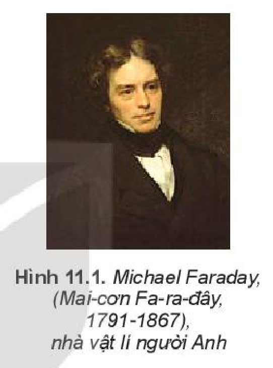
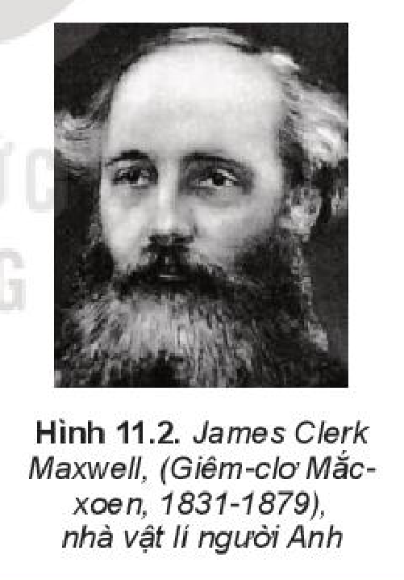
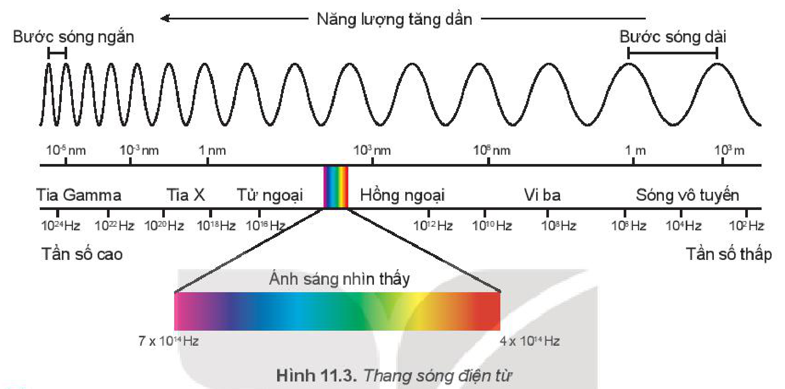
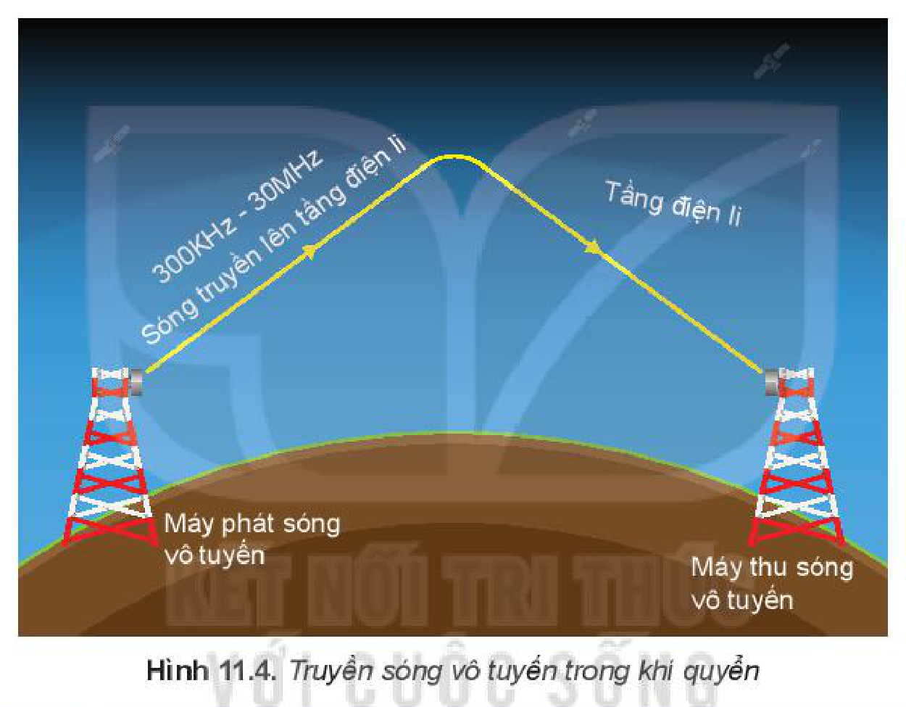
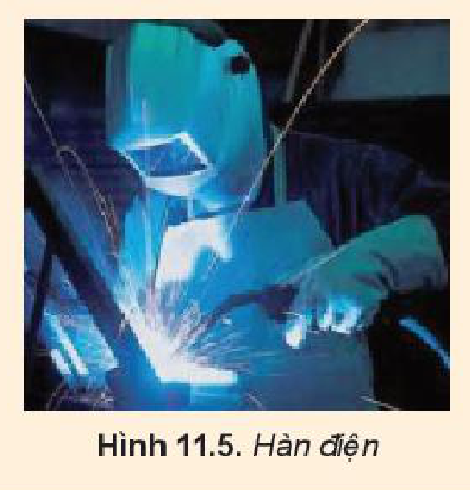

<!-- pdf:46 -->

# BÀI 11: SÓNG ĐIỆN TỪ

## 🔴 Mở đầu

> Chỉ với một chiếc điện thoại thông minh hay chiếc máy tính được kết nối với internet, ta có thể trao đổi thông tin với nhau trên khắp toàn cầu. Vậy tại sao thông tin lại có thể lan truyền được trong không gian?

## I. SÓNG ĐIỆN TỪ

Các thiết bị như ti vi, điện thoại di động, lò vi sóng đều sử dụng *sóng điện từ*. Vậy sóng điện từ là gì?

Dựa vào các thí nghiệm nghiên cứu về mối liên hệ giữa dòng điện và từ trường, nhà bác học Faraday đã xây dựng lí thuyết điện từ. Lí thuyết này đã được phát triển và ứng dụng rộng rãi cho tới ngày nay.

Maxwell đã mở rộng lí thuyết này và dựa vào đó tiên đoán **điện từ trường** biến thiên sẽ lan truyền khắp không gian dưới dạng sóng. Sóng này gọi là sóng điện từ. Qua rất nhiều nghiên cứu ông đã đi tới kết luận:

***Sóng điện từ** là điện từ trường lan truyền trong không gian.*

Khi tính toán, Maxwell đã chỉ ra được tốc độ của tất cả các sóng điện từ truyền trong chân không có giá trị bằng $3 \cdot 10^8\text{ m/s}$, đúng bằng **tốc độ ánh sáng trong chân không**. Đây là cơ sở để ông khẳng định rằng ánh sáng chính là sóng điện từ. Sóng điện từ bao gồm một dải rộng tần số (hoặc bước sóng), *gọi là **thang sóng điện từ**.*

> **Câu hỏi:**
>
> Một **vệ tinh địa tĩnh** (vệ tinh thông tin) chuyển động trên quỹ đạo tròn ngay phía trên xích đạo của Trái Đất, quay cùng hướng và cùng chu kì tự quay của Trái Đất ở độ cao $36\text{ }600\text{ km}$ so với đài phát hình trên mặt đất. Đài phát nằm trên đường thẳng nối vệ tinh và tâm Trái Đất. Coi Trái Đất là một hình cầu có bán kính $R = 6\text{ }400\text{ km}$. Vệ tinh nhận sóng truyền hình từ đài phát rồi phát lại tức thời tín hiệu đó về Trái Đất. Biết sóng có bước sóng $\lambda = 0,5\text{ m}$; tốc độ truyền sóng $c = 3 \cdot 10^8\text{ m/s}$. Tính khoảng thời gian lớn nhất mà sóng truyền hình đi từ đài phát đến một điểm trên mặt Trái Đất, vẽ hình minh hoạ.

<!-- pdf:47 -->

## II. THANG SÓNG ĐIỆN TỪ

Sự khác nhau về bước sóng (hay tần số) của các loại sóng điện từ đã dẫn đến sự khác nhau về tính chất và tác dụng của chúng.

Toàn bộ thang sóng điện từ, từ sóng dài nhất (hàng chục km) đến sóng ngắn nhất (cỡ $10^{-12}\text{ m}$ đến $10^{-15}\text{ m}$) đã được khám phá và sử dụng (Hình 11.3).

> **Lưu ý:** Không có sự phân chia rõ ràng giữa các dải trong phổ của sóng điện từ. Ví dụ, sóng vi ba đôi khi được coi là sự chia nhỏ của sóng vô tuyến, dãy gồm tia X và tia $\gamma$ có khoảng trùng nhau.

### 1. Ánh sáng nhìn thấy

- Dải bước sóng của **ánh sáng nhìn thấy** là một phần của thang sóng điện từ (Hình 11.3). Quang phổ của ánh sáng nhìn thấy là một dải màu biến thiên liên tục từ tím đến đỏ. Bước sóng của ánh sáng nhìn thấy nằm trong khoảng từ $0,38\ \mu\text{m}$ đến $0,76\ \mu\text{m}$, trong đó ánh sáng đỏ có bước sóng dài nhất khoảng $0,76\ \mu\text{m}$, ánh sáng tím có bước sóng ngắn nhất khoảng $0,38\ \mu\text{m}$.
- Nguồn phát ra ánh sáng nhìn thấy như: Mặt Trời, một số loại đèn, tia chớp, ngọn lửa,...

> **Câu hỏi:** So sánh tần số của ánh sáng đỏ và ánh sáng tím.

### 2. Tia hồng ngoại (IR)

- **Tia hồng ngoại** là sóng điện từ không nhìn thấy có bước sóng nằm trong khoảng từ $0,76\ \mu\text{m}$ đến $1\text{ mm}$.
- Nguồn phát tia hồng ngoại: Vật có nhiệt độ cao hơn môi trường xung quanh thì phát được tia hồng ngoại ra môi trường. Nguồn thông dụng là bóng đèn dây tóc, bếp gas, bếp than, điốt hồng ngoại,...

### 3. Tia tử ngoại (UV)

- **Tia tử ngoại** là sóng điện từ không nhìn thấy có bước sóng ngắn hơn bước sóng nằm trong khoảng từ $10\text{ nm}$ đến $400\text{ nm}$.

<!-- pdf:48 -->

- Nguồn phát tia tử ngoại: Vật có nhiệt độ trên $2000\text{ }^\circ\text{C}$ thì phát được tia tử ngoại, nhiệt độ của vật càng cao thì bước sóng tử ngoại càng nhỏ. Hồ quang điện, đèn hơi thuỷ ngân là nguồn phát tia tử ngoại mạnh.

### 4. Sóng vô tuyến

**Sóng vô tuyến** có bước sóng nằm trong khoảng từ $1\text{ mm}$ đến $100\text{ km}$. Chúng được phát ra từ an ten và được sử dụng để "mang" các thông tin như âm thanh, hình ảnh đi rất xa. Sóng này bị phản xạ bởi **tầng điện li** trước khi tới máy thu (Hình 11.4). Trong đó, **sóng VHF** (Very High Frequency) (bước sóng rất ngắn) từ $1\text{ m}$ đến $10\text{ m}$ và **sóng UHF** (Ultra High Frequency) (bước sóng cực ngắn) từ $10\text{ cm}$ đến $1\text{ m}$ có thể truyền thẳng đến máy thu, không bị phản xạ bởi tầng điện li. Chúng được sử dụng cho các đài phát thanh và truyền hình địa phương. **Sóng vi ba** (bước sóng khoảng vài cm) được sử dụng cho viễn thông quốc tế và chuyển tiếp truyền hình qua vệ tinh thông tin và cho mạng điện thoại di động qua tháp vi ba.

> **Câu hỏi:**
>
> 1. Giải thích tại sao mỗi khi cho phóng hồ quang người thợ hàn cần mặt nạ che mặt (Hình 11.5).
> 2. Giải thích tại sao Mặt Trời là một nguồn năng lượng khổng lồ phát ra tia tử ngoại mà con người và các sinh vật trên Trái Đất vẫn có thể sinh sống dưới ánh nắng mặt trời được.
>
> 

### 5. Tia Rơn ghen (tia X)

**Tia X** có bước sóng nhỏ hơn tia tử ngoại (khoảng từ $30\text{ pm}$ đến $3\text{ nm}$).

Nguồn phát **tia X**: Tia X được tạo ra khi các electron chuyển động với tốc độ cao tới đập vào tấm kim loại có nguyên tử lượng lớn trong ống tia X.

<!-- pdf:49 -->

Ngoài các công dụng về chuẩn đoán và chữa trị một số bệnh trong y học, tia X còn được sử dụng trong công nghiệp để tìm khuyết tật trong các vật đúc bằng kim loại và trong các tinh thể; sử dụng trong giao thông để kiểm tra hành lí của hành khách khi đi máy bay,...

### 6. Tia gamma ($\gamma$)

**Tia gamma** có bước sóng nhỏ nhất trong thang sóng điện từ, khoảng từ $10^{-5}\text{ nm}$ đến $0,1\text{ nm}$.

Trong y học, tia gamma được dùng trong phẫu thuật, điều trị các căn bệnh liên quan đến khối u, dị dạng mạch máu, các bệnh chức năng của não. Bên cạnh lĩnh vực y tế, tia gamma còn được ứng dụng trong lĩnh vực công nghiệp. Tia gamma giúp phát hiện, các khuyết tật bằng hình ảnh rõ ràng với độ chính xác cao.

> **Hoạt động:**
>
> Bảng 11.1 cho biết phạm vi của bước sóng trong chân không của các dải chính tạo nên thang sóng điện từ.
>
> Hãy xác định phạm vi của tần số tương ứng với các dải bước sóng đó.
>
> *Bảng 11.1. Bước sóng trong chân không của thang sóng điện từ*
>
> | Loại bức xạ | Phạm vi bước sóng | Phạm vi tần số (Hz) |
> | --- | --- | --- |
> | Sóng vô tuyến | Từ $1\text{ mm}$ đến $100\text{ km}$ | ... |
> | Sóng vi ba | Từ $1\text{ mm}$ đến $1\text{ m}$ | ... |
> | Tia hồng ngoại | Từ $0,76\ \mu\text{m}$ đến $1\text{ mm}$ | ... |
> | Ánh sáng nhìn thấy | Từ $0,38\ \mu\text{m}$ đến $0,76\ \mu\text{m}$ | ... |
> | Tia tử ngoại | Từ $10\text{ nm}$ đến $400\text{ nm}$ | ... |
> | Tia X | Từ $30\text{ pm}$ đến $3\text{ nm}$ | ... |
>
> 1. Nêu tên sóng điện từ trong chân không ứng với mỗi bước sóng.
>    a) $1\text{ km}$;
>    b) $3\text{ cm}$;
>    c) $5\ \mu\text{m}$;
>    d) $500\text{ nm}$;
>    e) $50\text{ nm}$;
>    g) $10^{-12}\text{ m}$.
> 2. Nêu loại sóng điện từ ứng với mỗi tần số sau:
>    a) $200\text{ kHz}$;
>    b) $100\text{ MHz}$;
>    c) $5 \cdot 10^{14}\text{ Hz}$;
>    d) $10^{18}\text{ Hz}$.

## 📌 Em đã học

- Sóng điện từ là điện từ trường lan truyền trong không gian.
- Sóng điện từ truyền trong chân không với tốc độ bằng tốc độ ánh sáng $c = 3 \cdot 10^8\text{ m/s}$.
- Dải bước sóng của thang sóng điện từ

## ✏️ Em có thể

- Nhận biết được các loại bức xạ trong thang sóng điện từ dựa vào bước sóng hoặc tần số của nó.

## 📷 Danh sách hình trong bài

| Mã hình | Số hình SGK | Trang PDF | Chú thích |
| --- | --- | --- | --- |
| H11-vat_ly-b11-01 | Hình 11.1 | 46 | Michael Faraday, (Mai-cơn Fa-ra-đây, 1791-1867), nhà vật lí người Anh |
| H11-vat_ly-b11-02 | Hình 11.2 | 46 | James Clerk Maxwell, (Giêm-clơ Mắc-xoen, 1831-1879), nhà vật lí người Anh |
| H11-vat_ly-b11-03 | Hình 11.3 | 47 | Thang sóng điện từ |
| H11-vat_ly-b11-04 | Hình 11.4 | 48 | Truyền sóng vô tuyến trong khí quyển |
| H11-vat_ly-b11-05 | Hình 11.5 | 48 | Hàn điện |
