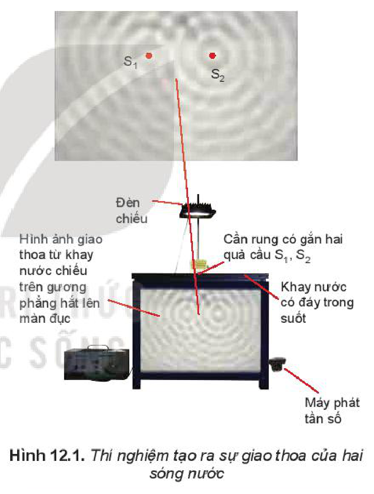
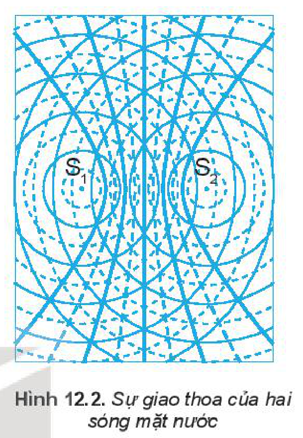
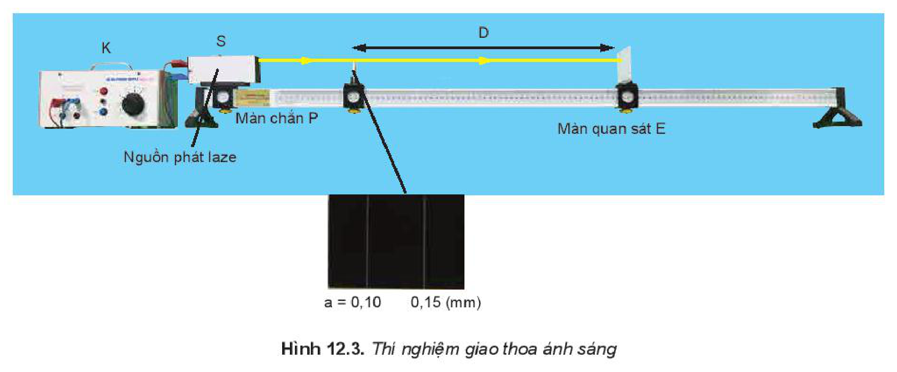
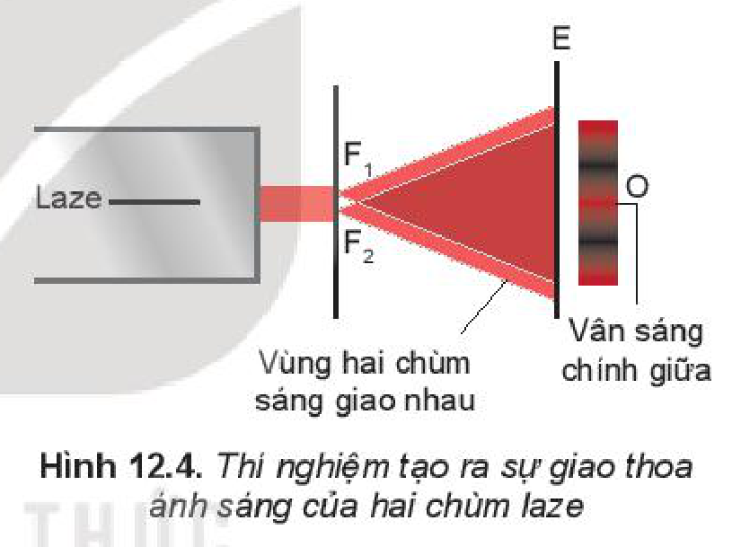
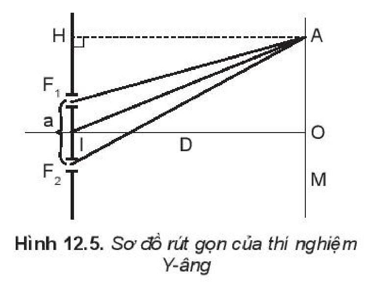

<!-- pdf:50 -->

# BÀI 12: GIAO THOA SÓNG

## 🔴 Mở đầu

> Cho hai loa giống nhau cùng phát âm thanh như hình bên, dịch chuyển một micro có nối với dao động kí phía trước hai loa để ghi đồ thị sóng âm thì thấy có những điểm tại đó biên độ sóng âm thu được rất lớn ($\text{L}$) và những điểm biên độ rất bé ($\text{B}$) nằm xen kẽ. Hiện tượng thú vị này giải thích như thế nào?

## I. HIỆN TƯỢNG GIAO THOA CỦA HAI SÓNG MẶT NƯỚC

### 1. Thí nghiệm

> **Hoạt động:**
>
> *Chuẩn bị:*
>
> - Đèn chiếu.
> - Cần rung có gắn một quả cầu
> - Cần rung có gắn hai quả cầu.
> - Khay nước có đáy trong suốt.
> - Gương phẳng đặt hợp với đáy khay nước một góc $45^\circ$ để thu hình ảnh giao thoa chiếu trên màn thẳng đứng.
>
> *Tiến hành:*
>
> Bước 1: Cho cần rung có gắn một quả cầu dao động, quan sát hình ảnh sóng trên màn thẳng đứng.
>
> Bước 2: Cho cần rung có gắn hai quả cầu dao động, quan sát hình ảnh sóng trên màn thẳng đứng và rút ra nhận xét.
>
> Bước 3: Dùng bút nối các điểm dao động cực đại (các điểm tối) trên màn ta thu được các đường cong liền nét như trên Hình 12.2. Tương tự ta nối các điểm dao động cực tiểu trên màn ta thu được các đường cong đứt nét như trên Hình 12.2.

> *Kết quả:*
>
> Đối với cần rung có gắn một quả cầu, hình ảnh trên màn thẳng đứng cho thấy có các hình tròn sáng, tối đồng tâm xen kẽ, lan truyền từ tâm dao động ra xa.
>
> Đối với cần rung có gắn hai quả cầu, hình ảnh trên màn thẳng đứng ta thấy ảnh của các gợn sóng là các đường sáng và tối ổn định. Các đường này được biểu diễn như trong Hình 12.2

<!-- pdf:51 -->

### 2. Giải thích

a) Để giải thích hiện tượng trên, ta cần biết thêm một đặc điểm nữa của chuyển động sóng: Mỗi nguồn sóng phát ra một sóng có các gợn sóng là những đường tròn giống hệt như khi không có các nguồn sóng khác ở bên cạnh.
<!-- term: Sự độc lập của các sóng -->

Những điểm nào cách nguồn một khoảng bằng $k\lambda$ thì dao động đồng pha với nguồn, còn những điểm nào cách nguồn một khoảng $\left(k + \frac{1}{2}\right)\lambda$ thì dao động ngược pha với với nguồn.

b) Trong thí nghiệm ta đã dùng hai nguồn sóng giống hệt nhau dao động theo phương vuông góc với mặt nước. Vì thế, trên mặt nước có những điểm đứng yên, do hai sóng gặp nhau ở đó dao động ngược pha, triệt tiêu nhau. Có những điểm dao động rất mạnh do hai sóng ở đó dao động đồng pha.
<!-- term: Cực đại giao thoa -->
<!-- term: Cực tiểu giao thoa -->

c) Ánh sáng truyền qua những điểm đứng yên không bị cản trở, nên cho ảnh là những hypebol rất sáng. Còn ánh sáng truyền qua những điểm dao động mạnh thì bị tán xạ nên cho ảnh là những đường hypebol nhoè và tối.

*Hiện tượng hai sóng gặp nhau tạo nên các gợn sóng ổn định gọi là **hiện tượng giao thoa** của hai sóng. Các gợn sóng ổn định gọi là các **vân giao thoa**.*

### 3. Điều kiện để xảy ra giao thoa

Để xảy ra hiện tượng giao thoa hai nguồn sóng phải:

- Dao động cùng phương, cùng tần số.
- Có độ lệch pha không đổi theo thời gian.

Hai nguồn như vậy gọi là **hai nguồn kết hợp**. Hai sóng do hai nguồn kết hợp phát ra gọi là **hai sóng kết hợp**.

Hiện tượng giao thoa là một hiện tượng đặc trưng của sóng. Vì thế, mọi quá trình vật lí nào gây ra được hiện tượng giao thoa cũng tất yếu là một quá trình sóng.

> **Câu hỏi:** Giải thích hiện tượng nêu ở mục khởi động của đầu bài.

## II. THÍ NGHIỆM CỦA YOUNG (Y-ÂNG) VỀ GIAO THOA ÁNH SÁNG

### 1. Thí nghiệm

Tương tự như sóng nước, làm thí nghiệm về giao thoa của hai nguồn sóng ánh sáng kết hợp.
<!-- term: Thí nghiệm Young về giao thoa ánh sáng -->

Thí nghiệm được bố trí như Hình 12.3.

Ánh sáng phát ra từ nguồn $\text{S}$ chiếu vào hai khe hẹp $\text{F}_1, \text{F}_2$. Hai khe hẹp này là hai nguồn kết hợp.
<!-- term: Thí nghiệm Young về giao thoa ánh sáng -->

<!-- pdf:52 -->

Hình ảnh giao thoa ánh sáng quan sát được trên màn $\text{E}$ như Hình 12.4.

> **Câu hỏi:** Trong thí nghiệm trên, nếu thay nguồn sáng laze trong thí nghiệm trên bằng bóng đèn dây tóc phát ánh sáng trắng thì vân sáng chính giữa sẽ có màu gì.

Trong vùng hai chùm sáng gặp nhau lại có những vạch tối và vạch sáng xen kẽ như trên Hình 12.4 đã khẳng định ánh sáng có tính chất sóng. Những **vạch tối** (vân tối) là chỗ hai sóng ánh sáng triệt tiêu lẫn nhau. Những **vạch sáng** (vân sáng) là chỗ hai sóng ánh sáng tăng cường lẫn nhau. Những vạch sáng và tối xen kẽ nhau chính là **hệ vân giao thoa** của hai sóng ánh sáng.

### 2. Công thức xác định bước sóng $\lambda$ của ánh sáng

Hình 12.5 là sơ đồ rút gọn của thí nghiệm Y-âng. Gọi:

- $\text{O}$ là vị trí tại đó xuất hiện **vân sáng chính giữa**.
- $a$ là khoảng cách giữa hai khe: $a = \text{F}_1\text{F}_2$.
- $D$ là khoảng cách từ hai khe đến màn quan sát: $D = \text{IO}$.
- $i$ là **khoảng vân**. Đó là khoảng cách giữa hai vân sáng hoặc hai vân tối liên tiếp.

*Nếu đo được $a, D$ và $i$ thì sẽ xác định được bước sóng $\lambda$ theo công thức sau: $\lambda = \frac{ia}{D}$.*
<!-- ocr-ok: đối chiếu ảnh trang PDF 52 khớp nguyên văn công thức bước sóng -->

<!-- pdf:53 -->

> **Câu hỏi:**
>
> 1. Trong thí nghiệm ở Hình 12.1, tốc độ truyền sóng trên mặt nước là $50\text{ cm/s}$, cần rung có tần số $40\text{ Hz}$. Tính khoảng cách giữa hai điểm cực đại giao thoa cạnh nhau trên đoạn thẳng $\text{S}_1\text{S}_2$.
> 2. Trong một thí nghiệm Y-âng về giao thoa ánh sáng với $a = 0,2\text{ mm}$, $D = 1,2\text{ m}$, người ta đo được $i = 0,36\text{ mm}$. Tính bước sóng $\lambda$ và tần số $f$ của bức xạ.
> 3. Trong một thí nghiệm Y-âng, biết $a = 0,15\text{ mm}$, $D = 1,20\text{ m}$, khoảng cách giữa $12$ vân sáng liên tiếp là $5,2\text{ mm}$. Tính bước sóng ánh sáng.

## 📌 Em đã học

- **Hai nguồn sóng kết hợp** là hai nguồn có cùng tần số và có độ lệch pha không đổi theo thời gian. Hai sóng do hai nguồn kết hợp phát ra là **hai sóng kết hợp**.
- Hiện tượng giao thoa là hiện tượng khi hai sóng kết hợp gặp nhau thì có những điểm ở đó hai sóng luôn đồng pha thì dao động mạnh; có những điểm ở đó hai sóng luôn ngược pha thì đứng yên.
- Bước sóng $\lambda$ của ánh sáng được xác định theo hệ thức: $\lambda = \frac{ia}{D}$.
  (trong đó: $a$ là khoảng cách giữa hai nguồn kết hợp, $D$ là khoảng cách từ hai nguồn kết hợp đến màn quan sát, $i$ là khoảng vân).

## ✏️ Em có thể

- Từ hiện tượng giao thoa sóng nước, giải thích hiện được tượng giao thoa của các sóng khác như sóng âm, sóng ánh sáng.

## 📷 Danh sách hình trong bài

| Mã hình | Số hình SGK | Trang PDF | Chú thích |
| --- | --- | --- | --- |
| H11-vat_ly-b12-01 | Hình 12.1 | 50 | Thí nghiệm tạo ra sự giao thoa của hai sóng nước |
| H11-vat_ly-b12-02 | Hình 12.2 | 51 | Sự giao thoa của hai sóng mặt nước |
| H11-vat_ly-b12-03 | Hình 12.3 | 52 | Thí nghiệm giao thoa ánh sáng |
| H11-vat_ly-b12-04 | Hình 12.4 | 52 | Thí nghiệm tạo ra sự giao thoa ánh sáng của hai chùm laze |
| H11-vat_ly-b12-05 | Hình 12.5 | 52 | Sơ đồ rút gọn của thí nghiệm Y-âng |
