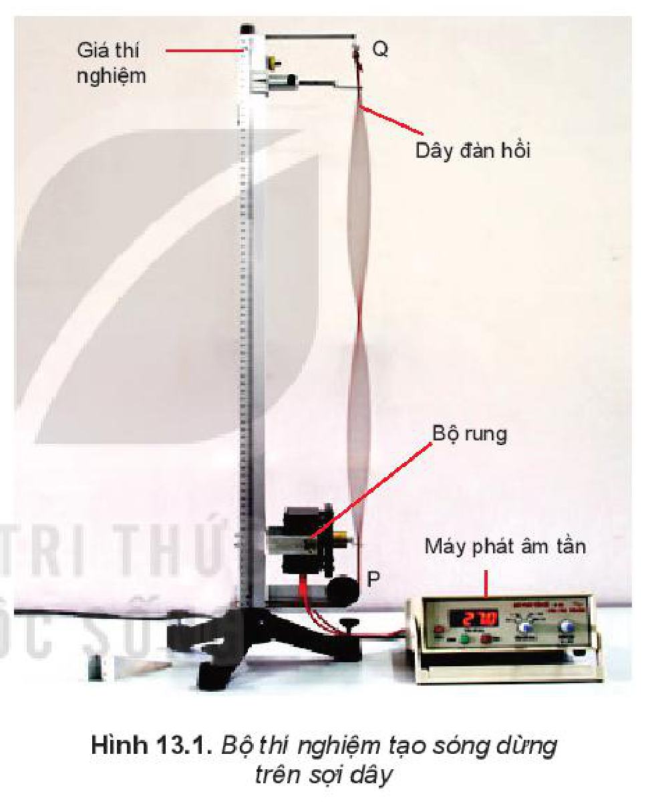
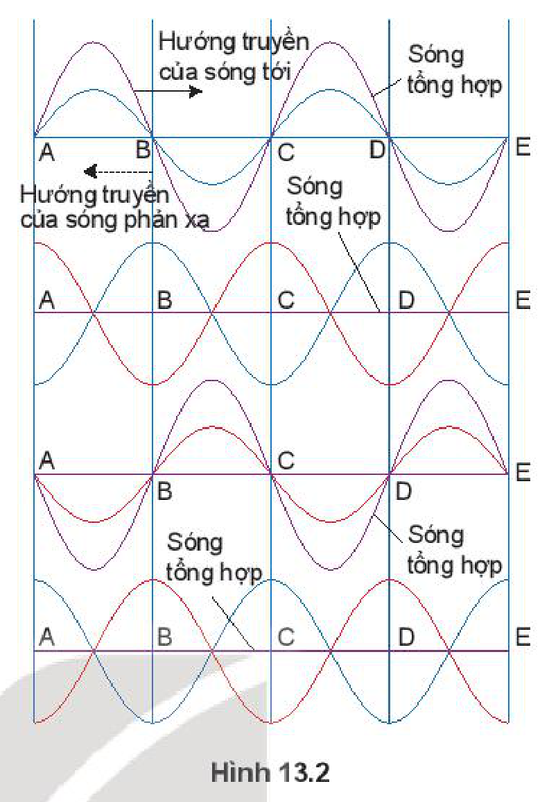
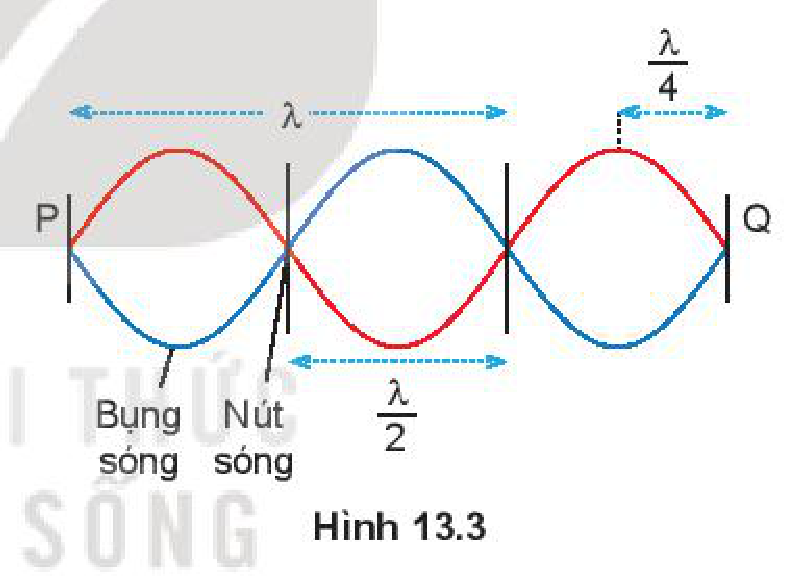
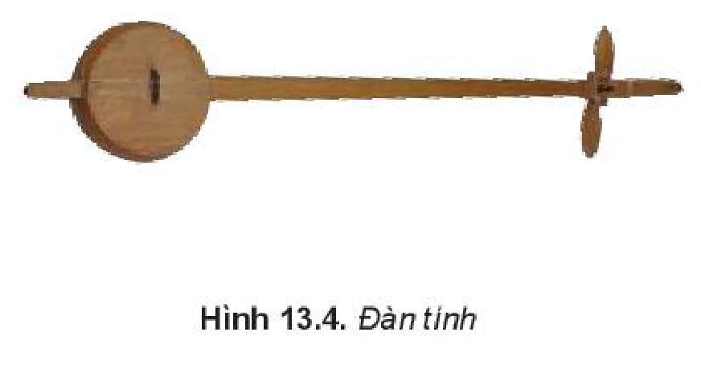
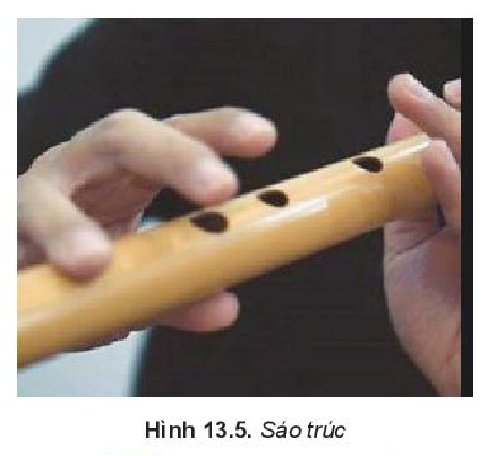
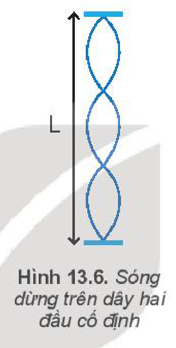
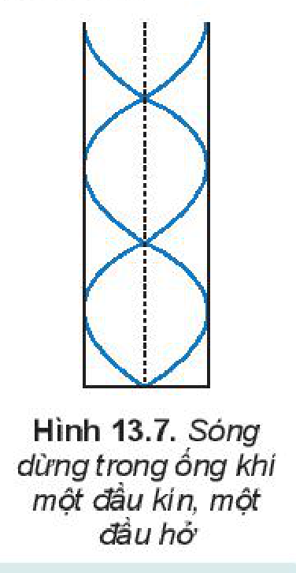

<!-- pdf:54 -->

# BÀI 13: SÓNG DỪNG

## 🔴 Mở đầu

> Khi vỗ tay đều trước miệng các ống của đàn K'lông pút có độ dài khác nhau như hình bên, thì thấy âm phát ra ở các miệng ống trầm bổng khác nhau. Sóng âm lan truyền trong mỗi ống không phải là **sóng chạy**. Vậy đó là loại sóng gì và có những đặc điểm nào?

## I. THÍ NGHIỆM TẠO SÓNG DỪNG

> **Hoạt động:**
>
> Bố trí thí nghiệm như Hình 13.1
>
> *Chuẩn bị*
>
> - Giá thí nghiệm.
> - Dây đàn hồi $\text{PQ}$.
> - Bộ rung.
> - Máy phát âm tần.
>
> *Tiến hành*
>
> Bước 1: Giữ cho dây căng, đầu $\text{P}$ mắc vào ròng rọc, đầu rung mắc vào dây Hình 13.1.
>
> Bước 2: Cho bộ rung hoạt động để rung đầu $\text{P}$. Điều chỉnh tần số của bộ rung cho đến khi trên dây xuất hiện những điểm dao động với biên độ cực đại và có những điểm đứng yên. Hiện tượng như vậy gọi là hiện tượng sóng dừng. Ghi lại tần số của bộ rung.
>
> Bước 3: Thay đổi tần số của bộ rung cho đến khi lại quan sát được những điểm dao động với biên độ cực đại và những điểm đứng yên. Ghi lại tần số mới của bộ rung.

> **Câu hỏi:** Từ kết quả thí nghiệm rút ra điều kiện để có sóng dừng.

## II. GIẢI THÍCH SỰ TẠO THÀNH SÓNG DỪNG

### 1. Đặc điểm của sóng dừng

**Sóng dừng** được tạo thành mỗi khi có hai sóng cùng biên độ, cùng bước sóng lan truyền theo hai hướng ngược nhau. Hai sóng này gặp nhau, giao thoa nhau tạo nên sóng tổng hợp là sóng dừng. Những điểm tại đó hai sóng ngược pha nhau thì không dao động và được gọi là **nút sóng**.

<!-- pdf:55 -->

Những điểm tại đó hai sóng đồng pha với nhau thì dao động với biên độ cực đại và được gọi là **bụng sóng** (Hình 13.2).

Trong thực tế ta thường gặp một trong hai sóng là sóng phản xạ của sóng kia.

Sóng dừng là tổng hợp của nhiều sóng tới và sóng phản xạ.

> **Câu hỏi:** Hãy xác định số nút và số bụng của sóng dừng trên sợi dây Hình 13.3.

### 2. Điều kiện để có sóng dừng

*Điều kiện để có sóng dừng trên một sợi dây có hai đầu cố định là chiều dài của sợi dây phải bằng một số nguyên lần nửa bước sóng (Hình 13.3).*
<!-- term: Điều kiện sóng dừng hai đầu cố định -->

$$L = n\frac{\lambda}{2} \quad (13.1)$$
<!-- ocr-ok: đối chiếu ảnh trang PDF 55 khớp nguyên văn công thức (13.1) -->

với $n = 1, 2, 3,...$

## III. SÓNG DỪNG TRONG CÁC NHẠC CỤ

Việc các nhạc cụ phát ra các nốt nhạc cao, thấp khác nhau thường phụ thuộc vào các việc tạo ra các sóng dừng khác nhau.

### 1. Sóng dừng đối với nhạc cụ dây

Đối với các loại nhạc cụ dây như đàn ghita, violon, đàn tính, đàn cò,... thì hai đầu dây đàn được giữ cố định. Khi ta gảy đàn, trên dây xuất hiện sóng dừng. Theo công thức $(13.1)$, nó phát ra một âm có bước sóng $\lambda = 2L$ hay có tần số $f = \frac{v}{2L}$. Khi ấn ngón tay vào các phím khác nhau ta đã thay đổi chiều dài của dây đàn, do đó âm phát ra có độ cao, thấp khác nhau. Để khuếch đại âm, đàn ghita còn có một thùng đàn đóng vai trò **hộp cộng hưởng**.

> **Câu hỏi:** Hãy giải thích sự tạo thành sóng dừng trên dây $\text{PQ}$ ở thí nghiệm Hình 13.1.

<!-- pdf:56 -->

### 2. Sóng dừng đối với nhạc cụ khí

Đối với các loại nhạc cụ khí như sáo, kèn, khi ta thổi, cột không khí dao động tạo ra sóng dừng. Bằng cách thay đổi lỗ không bị bịt ta thay đổi chiều dài cột không khí dao động. Do đó các nốt nhạc phát ra cũng bị thay đổi (Hình 13.5).

> **Câu hỏi:**
>
> 1. Một dây đàn hồi dài $0,6\text{ m}$ hai đầu cố định dao động với một bụng sóng.
>    a) Tính bước sóng $\lambda$ của sóng trên dây.
>    b) Nếu dây dao động với $3$ bụng sóng thì bước sóng là bao nhiêu?
> 2. Trên sợi dây đàn hồi, có chiều dài $L = 1,2\text{ m}$ người ta tạo ra sóng dừng có hình dạng được mô tả ở Hình 13.6. Biết tần số rung của sợi dây là $f = 13,3\text{ Hz}$. Xác định tốc độ truyền sóng trên dây.

> **Câu hỏi:** Tìm điều kiện để có sóng dừng trong cột không khí một đầu cố định, một đầu tự do (Hình 13.7).

## 📌 Em đã học

- Hai sóng cùng biên độ, cùng tần số lan truyền theo hai hướng ngược nhau trên một dây giao thoa với nhau tạo nên một sóng tổng hợp gọi là sóng dừng.
- Trong sóng dừng có những điểm luôn đứng yên gọi là nút sóng và những điểm luôn dao động với biên độ cực đại gọi là bụng sóng. Hai nút liên tiếp cách nhau $\frac{\lambda}{2}$, xen giữa chúng là một bụng sóng.
- Điều kiện để có sóng dừng trên một dây có hai đầu cố định là chiều dài của dây phải bằng một số nguyên lần nửa bước sóng.
  $$L = n\frac{\lambda}{2}\text{ với }n = 1, 2, 3,...$$
- Điều kiện để có sóng dừng trên dây một đầu cố định, một đầu tự do hoặc trong ống khí một đầu kín, một đầu hở là chiều dài của dây hoặc của cột không khí phải bằng một số lẻ lần một phần tư bước sóng.
  $$L = (2n + 1)\frac{\lambda}{4}\text{ với }n = 0, 1, 2, 3,...$$
<!-- term: Điều kiện sóng dừng một đầu tự do -->

## ✏️ Em có thể

- Giải thích được sự hình thành sóng dừng trong thực tế. Ví dụ trong ống sáo, đàn K'lông pút.

## 📷 Danh sách hình trong bài

| Mã hình | Số hình SGK | Trang PDF | Chú thích |
| --- | --- | --- | --- |
| H11-vat_ly-b13-01 | Hình 13.1 | 54 | Bộ thí nghiệm tạo sóng dừng trên sợi dây |
| H11-vat_ly-b13-02 | Hình 13.2 | 55 | Sự tạo thành sóng dừng từ sự giao thoa của sóng tới và sóng phản xạ |
| H11-vat_ly-b13-03 | Hình 13.3 | 55 | Bụng sóng và nút sóng của sóng dừng trên dây hai đầu cố định |
| H11-vat_ly-b13-04 | Hình 13.4 | 55 | Đàn tính |
| H11-vat_ly-b13-05 | Hình 13.5 | 56 | Sáo trúc |
| H11-vat_ly-b13-06 | Hình 13.6 | 56 | Sóng dừng trên dây hai đầu cố định |
| H11-vat_ly-b13-07 | Hình 13.7 | 56 | Sóng dừng trong ống khí một đầu kín, một đầu hở |
