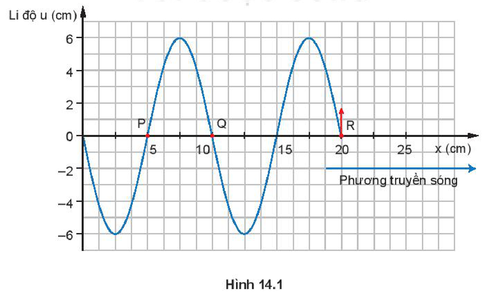
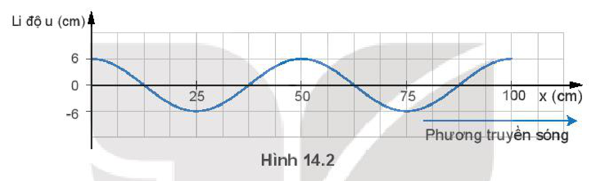

<!-- pdf:57 -->

# BÀI 14: BÀI TẬP VỀ SÓNG

## 🔴 Mở đầu

> Có thể sử dụng mối liên hệ nào để xác định các đại lượng $\lambda, v, f, T$?

## I. CÁC VÍ DỤ

*Ví dụ 1:* Một sóng âm có tần số $192\text{ Hz}$ và truyền đi được quãng đường $91,4\text{ m}$ trong $0,27\text{ s}$. Hãy tính:

a) Tốc độ truyền sóng.

b) Bước sóng.

c) Nếu tần số sóng là $442\text{ Hz}$ thì bước sóng và chu kì là bao nhiêu?

*Giải:*

a) $v = \frac{s}{t} = \frac{91,4}{0,27} = 338,5\text{ m/s}$.

b) Sử dụng công thức $v = \lambda f$

$$\Rightarrow \lambda = \frac{v}{f} = \frac{338,5}{192} = 1,76\text{ m}.$$
<!-- ocr-ok: đối chiếu ảnh trang PDF 57 khớp nguyên văn công thức -->

c) $\lambda' = \frac{v}{f'} = \frac{338,5}{442} = 0,77\text{ m}$;

$$T' = \frac{1}{f'} = \frac{1}{442} = 0,002\text{ s}.$$
<!-- ocr-ok: đối chiếu ảnh trang PDF 57 khớp nguyên văn công thức -->

*Ví dụ 2:* Trong thí nghiệm Hình 8.1, cần rung dao động với tần số $50\text{ Hz}$. Người ta đo được bán kính của $2$ gợn sóng hình tròn liên tiếp lần lượt bằng: $12,4\text{ cm}$ và $14,3\text{ cm}$. Tính tốc độ truyền sóng.

*Giải:*

Bước sóng là khoảng cách giữa hai gợn sóng liên tiếp, theo đề bài ta có:

$$\lambda = 14,3 - 12,4 = 1,90\text{ cm};$$
<!-- ocr-ok: đối chiếu ảnh trang PDF 57 khớp nguyên văn công thức -->

Áp dụng công thức $v = \lambda f$, tính tốc độ truyền sóng: $v = 1,9 \cdot 50 = 95\text{ cm/s}$.

*Ví dụ 3:* Một sóng hình sin đang lan truyền từ trái sang phải trên một dây dài Hình 14.1 là hình ảnh của sóng ở một thời điểm xét. Cho biết tốc độ truyền sóng $v = 1\text{ m/s}$.

<!-- pdf:58 -->

a) Tính tần số của sóng.

b) Hỏi điểm $\text{Q, P}$ và $\text{O}$ đang chuyển động lên hay xuống?

*Giải:*

a) Từ đồ thị ta được $\lambda = 10\text{ cm} = 0,1\text{ m}$.

Sử dụng công thức: $\lambda = \frac{v}{f}$

Ta suy ra tần số của sóng: $f = \frac{v}{\lambda} = \frac{1}{0,1} = 10\text{ Hz}$.

b) Căn cứ vào sóng lan truyền tới điểm $\text{R}$ bắt đầu đi lên.

- Điểm $\text{Q}$ cách $\text{R}$ đúng một bước sóng nên dao động cùng pha. Do vậy, tại điểm $\text{Q}$ sóng phải bắt đầu chuyển động đi lên.
- Điểm $\text{P}$ cách $\text{R}$ $1,5$ lần bước sóng nên dao động ngược pha. Do vậy, tại điểm $\text{P}$ sóng phải bắt đầu chuyển động đi xuống.
- Điểm $\text{O}$ cách $\text{R}$ đúng hai bước sóng nên dao động cùng pha. Do vậy, tại điểm $\text{O}$ sóng phải bắt đầu chuyển động đi lên.

*Ví dụ 4:* Trong một thí nghiệm về giao thoa ánh sáng với hai khe Y-âng, khoảng cách giữa hai khe hẹp là $a = 2\text{ mm}$, khoảng cách giữa mặt phẳng chứa hai khe với màn quan sát là $D = 1,2\text{ m}$. Khe sáng hẹp phát đồng thời hai **bức xạ đơn sắc** màu đỏ $\lambda_1 = 0,66\ \mu\text{m}$ và màu lục $\lambda_2 = 0,55\ \mu\text{m}$.

a) Tính khoảng vân của hai ánh sáng màu đỏ và màu lục.

b) Tính khoảng cách ngắn nhất giữa hai vân sáng cùng màu với vân sáng trung tâm.

*Giải:*

a) Với ánh sáng đỏ $\lambda_1 = 0,66\ \mu\text{m}$

$$i_1 = \frac{\lambda_1 D}{a} = \frac{0,66 \cdot 10^{-3} \cdot 1,2 \cdot 10^3}{2} \approx 0,40\text{ mm}.$$
<!-- ocr-ok: đối chiếu ảnh trang PDF 58 khớp nguyên văn công thức -->

Với ánh sáng lục $\lambda_2 = 0,55\ \mu\text{m}$

$$i_2 = \frac{\lambda_2 D}{a} = \frac{0,55 \cdot 10^{-3} \cdot 1,2 \cdot 10^3}{2} = 0,35\text{ mm}.$$
<!-- ocr-ok: đối chiếu ảnh trang PDF 58 khớp nguyên văn SGK (SGK in 0,35 mm) -->

b) Vân chính giữa ứng với $k = 0$ là chung cho cả hai bức xạ, tức là tại đó cả hai bức xạ đều cho vân sáng và vân có màu là màu hỗn hợp của màu đỏ và màu lục, tức là màu vàng – da cam.

Vân đầu tiên cùng màu với vân này ở tại điểm $\text{A}$ và cách tâm $\text{O}$ của vân chính giữa một khoảng $x = \text{OA}$ sao cho: $k_1 i_1 = k_2 i_2$ với $k \in \mathbb{Z}$.

Ta nhận thấy $6k_1 = 5k_2$.

Do vậy, giá trị nhỏ nhất của $k_1$ là $5$ và của $k_2$ là $6$, tức là:

$$\text{OA} = 0,33 \cdot 6 = 1,98\text{ mm}$$
<!-- ocr-ok: đối chiếu ảnh trang PDF 58 khớp nguyên văn công thức -->

<!-- pdf:59 -->

## II. BÀI TẬP LUYỆN TẬP

1. Một lò xo có chiều dài $1,2\text{ m}$, đầu trên gắn vào một nhánh âm thoa, đầu dưới treo một quả cân. Dao động của âm thoa được duy trì bằng một nam châm điện để có tần số $50\text{ Hz}$. Khi đó, trên lò xo có sóng dừng và trên lò xo chỉ có một nhóm vòng dao động với biên độ cực đại. Tính tốc độ truyền sóng trên lò xo.
2. Một sóng hình sin được mô tả như Hình 14.2.
   a) Xác định bước sóng của sóng.
   b) Nếu chu kì của sóng là $1\text{ s}$ thì tần số và tốc độ truyền sóng bằng bao nhiêu?
   c) Bước sóng sẽ bằng bao nhiêu nếu tần số tăng lên $5\text{ Hz}$ và tốc độ truyền sóng không đổi? Vẽ đồ thị $(u - x)$ trong trường hợp này và đánh dấu rõ bước sóng trên đồ thị.

3. Trong một thí nghiệm Y-âng về giao thoa ánh sáng, hai khe được chiếu bằng ánh sáng đơn sắc. Khoảng cách giữa hai khe là $0,6\text{ mm}$. Khoảng vân trên màn quan sát đo được là $1\text{ mm}$. Từ vị trí ban đầu, nếu tịnh tiến màn quan sát một đoạn $25\text{ cm}$ lại gần mặt phẳng chứa hai khe thì khoảng vân mới trên màn là $0,8\text{ mm}$. Tính bước sóng của ánh sáng dùng trong thí nghiệm.

## 📌 Em đã học

- Cách xác định các đại lượng đặc trưng (chu kì, bước sóng, tốc độ truyền sóng,...) khi biết phương trình hoặc đồ thị của sóng và ngược lại.

## ✏️ Em có thể

- Giải thích được cách đo bước sóng ánh sáng qua thí nghiệm giao thoa ánh sáng với khe Y-âng thông qua mối liên hệ giữa các đại lượng $i, D, a, \lambda$.

## 📷 Danh sách hình trong bài

| Mã hình | Số hình SGK | Trang PDF | Chú thích |
| --- | --- | --- | --- |
| H11-vat_ly-b14-01 | Hình 14.1 | 57 | Đồ thị $(u - x)$ của sóng hình sin trong Ví dụ 3 |
| H11-vat_ly-b14-02 | Hình 14.2 | 59 | Đồ thị $(u - x)$ của sóng hình sin trong Bài tập 2 |
