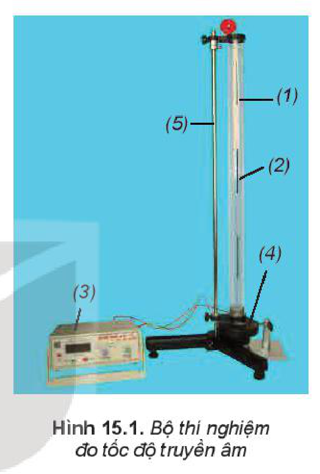
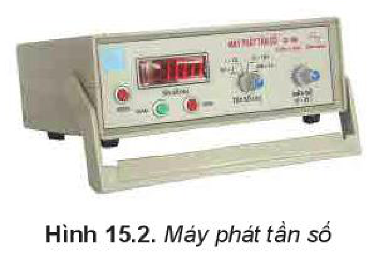

<!-- pdf:60 -->

# BÀI 15: THỰC HÀNH: ĐO TỐC ĐỘ TRUYỀN ÂM

## 🔴 Mở đầu

> Âm thanh truyền trong một môi trường có tốc độ xác định, làm thế nào đo được tốc độ truyền âm trong không khí bằng dụng cụ thí nghiệm?

## I. DỤNG CỤ THÍ NGHIỆM

- Ống trụ làm bằng thuỷ tinh hữu cơ trong suốt, có đường kính trong $40\text{ mm}$, dài $670\text{ mm}$, có chia độ $0 \div 660\text{ mm}$ (1).
- Pít-tông làm bằng thép bọc nhựa, có vạch dấu, nối với dây kéo và ròng rọc, có thể di chuyển dễ dàng trong ống (2).
- **Máy phát tần số** phát ra tín hiệu có dạng *sin* (3).
- Một loa nhỏ (4).
- Giá đỡ ống trụ (5).

## II. THIẾT KẾ PHƯƠNG ÁN THÍ NGHIỆM

Lắp ống trụ đã được lồng pít-tông ở trong ống lên giá đỡ, ghép loa sát đầu dưới của ống trụ (Hình 15.1).

> **Lưu ý:** Có thể sử dụng âm thoa La thay cho loa.

> **Hoạt động:**
>
> Nối máy phát tần số với loa, bật công tắc nguồn của máy phát tần số, điều chỉnh biên độ và tần số để nghe rõ âm (hoặc dùng búa cao su gõ vào một nhánh của âm thoa), đồng thời dịch chuyển dần pít-tông ra xa loa. Trả lời câu hỏi sau:
>
> a) Khi pít-tông di chuyển, độ to của âm thanh nghe được thay đổi như thế nào?
> b) Khoảng cách giữa hai vị trí liên tiếp của pít-tông mà âm thanh nghe được to nhất cho phép xác định đại lượng nào của sóng âm?
> c) Cần đo đại lượng nào để tính được tốc độ truyền âm?
<!-- term: Đo tốc độ truyền âm bằng sóng dừng -->

## III. TIẾN HÀNH THÍ NGHIỆM

1. Điều chỉnh máy phát tần số đến giá trị $500\text{ Hz}$.
2. Dùng dây kéo pít-tông di chuyển trong ống thuỷ tinh, cho đến lúc âm thanh nghe được to nhất. Xác định vị trí âm thanh nghe được là lớn nhất lần 1. Đo chiều dài cột khí $l_1$. Ghi số liệu vào Bảng 15.1.

Thực hiện thao tác thêm hai lần nữa.

<!-- pdf:61 -->

3. Tiếp tục kéo pít-tông di chuyển trong ống thuỷ tinh, cho đến lúc lại nghe được âm thanh to nhất. Xác định vị trí của pít-tông mà âm thanh nghe được là to nhất lần 2. Đo chiều dài cột khí $l_2$. Ghi số liệu vào mẫu Bảng 15.1

Thực hiện thao tác thêm hai lần nữa.

> **Em có biết:**
>
> Sử dụng một số phần mềm trên điện thoại hay máy tính có thể thay thế cho máy phát âm tần.

## IV. KẾT QUẢ THÍ NGHIỆM

*Bảng 15.1*

Tần số nguồn âm $f = ... \pm ...\text{ Hz}$.

| Chiều dài cột không khí khi âm to nhất (cm) | Lần 1 | Lần 2 | Lần 3 | Giá trị trung bình ($\bar{l}$) | Sai số $\Delta l$ |
| --- | --- | --- | --- | --- | --- |
| $l_1$ | ? | ? | ? | ? | ? |
| $l_2$ | ? | ? | ? | ? | ? |
<!-- ocr-ok: đối chiếu ảnh trang PDF 61 khớp nguyên văn Bảng 15.1 -->

> **Hoạt động:**
>
> Xử lí kết quả thí nghiệm
>
> a) Tính chiều dài cột không khí giữa hai vị trí của pít-tông khi âm to nhất $d = l_2 - l_1 = ?$
> b) Tính tốc độ truyền âm $v = \lambda \cdot f = 2df = ?$
> c) Tính sai số: $\delta v = \delta d + \delta f = ?$
>    $\Delta v = ?$
> d) Giải thích tại sao không xác định tốc độ truyền âm qua $l_1, l_2$ mà cần xác định qua $l_2 - l_1$.

## 📌 Em đã học

- Cách đo tốc độ truyền âm trong không khí nhờ hiện tượng sóng dừng.

## ✏️ Em có thể

- Chế tạo chiếc đàn K'lông Pút bằng các ống nứa hoặc ống nhựa rỗng, có độ dài khác nhau và có thể phát ra được âm có tần số bằng tần số các nốt nhạc cơ bản.

> **Em có biết:**
>
> Âm có thể truyền trong các môi trường chất rắn, chất lỏng và chất khí với tốc độ khác nhau. Tốc độ truyền âm trong một số môi trường như Bảng 15.2.
>
> *Bảng 15.2*
>
> | Môi trường | Tốc độ (m/s) |
> | --- | --- |
> | Không khí | 340 |
> | Gỗ | 3400 |
> | Nước | 1500 |
> | Thép | 6100 |
> | Thuỷ tinh | 5500 |

## 📷 Danh sách hình trong bài

| Mã hình | Số hình SGK | Trang PDF | Chú thích |
| --- | --- | --- | --- |
| H11-vat_ly-b15-01 | Hình 15.1 | 60 | Bộ thí nghiệm đo tốc độ truyền âm |
| H11-vat_ly-b15-02 | Hình 15.2 | 60 | Máy phát tần số |
