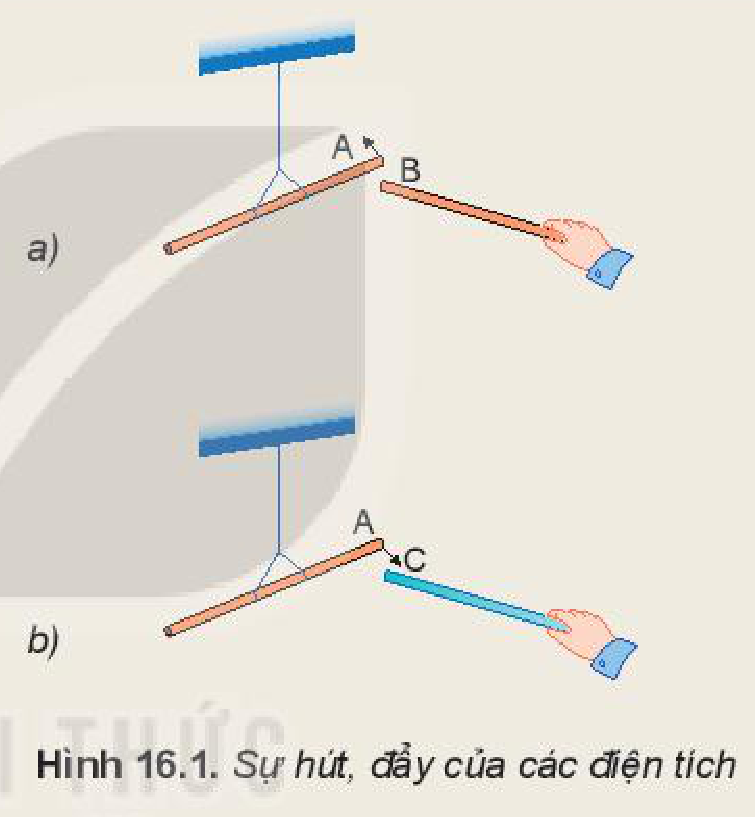
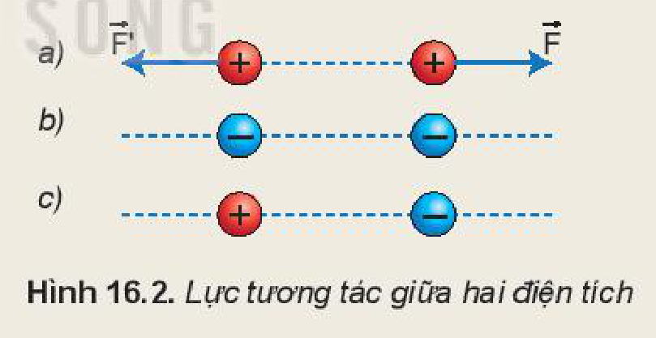
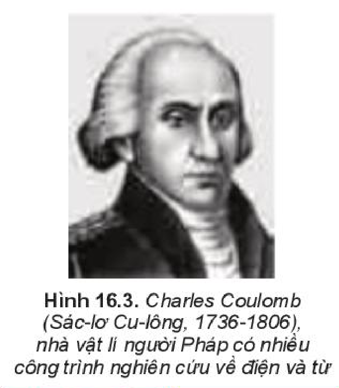
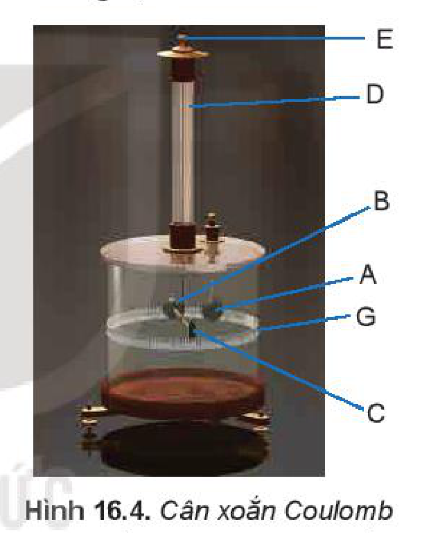
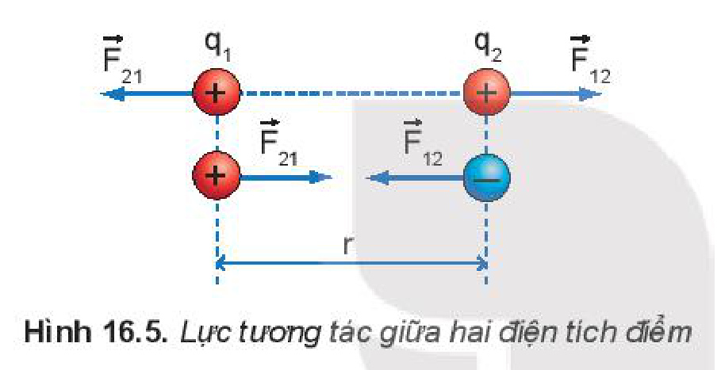
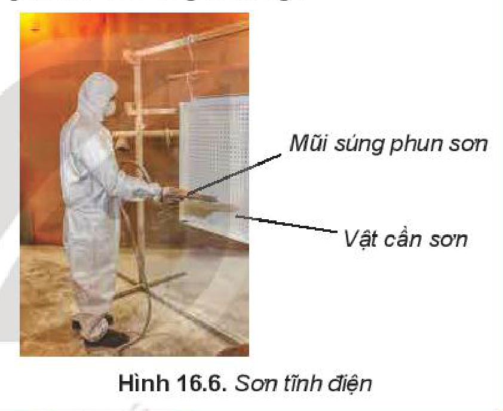
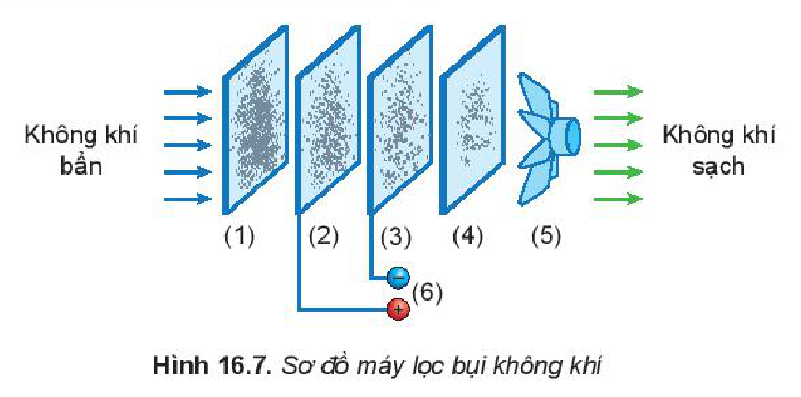

<!-- pdf:63 -->

# BÀI 16: LỰC TƯƠNG TÁC GIỮA HAI ĐIỆN TÍCH

## 🔴 Mở đầu

> Em đã biết các điện tích cùng dấu đẩy nhau, khác dấu hút nhau. Theo em, độ lớn của lực tương tác giữa hai điện tích phụ thuộc như thế nào vào độ lớn của các điện tích và khoảng cách giữa chúng?

## I. LỰC HÚT VÀ LỰC ĐẨY GIỮA CÁC ĐIỆN TÍCH

> **Hoạt động:**
>
> - Treo thanh nhựa A bằng một dây chỉ để nó có thể quay tự do rồi dùng len cọ xát một đầu của nó.
> - Quan sát, mô tả và giải thích hiện tượng xảy ra khi:
>   a) Dùng len cọ xát một đầu thanh nhựa B rồi đưa lại gần đầu đã được cọ xát của thanh nhựa A (Hình 16.1a).
>   b) Dùng lụa cọ xát một đầu thanh thuỷ tinh C rồi đưa lại gần đầu đã được cọ xát của thanh nhựa A (Hình 16.1b).
>
> 
>
> - Dựa vào Hình 16.2a, vẽ các vectơ lực biểu diễn tương tác giữa các điện tích trong các hình còn lại.
> - Vẽ vectơ lực của ba điện tích đặt tại các đỉnh của một tam giác đều. Biết các điện tích trên đều cùng dấu và cùng độ lớn.
>
> 

Từ những thí nghiệm trên có thể rút ra kết luận:

- Có hai loại điện tích trái dấu. Điện tích xuất hiện ở thanh thuỷ tinh khi được cọ xát vào len được quy ước gọi là **điện tích dương**, điện tích xuất hiện ở thanh nhựa được cọ xát vào vải được quy ước gọi là **điện tích âm**.
- Các điện tích cùng loại đẩy nhau.
- Các điện tích khác loại hút nhau.

Lực hút, đẩy giữa các điện tích được gọi chung là **lực tương tác giữa các điện tích** (thường gọi tắt là **lực điện**).

<!-- pdf:64 -->

> **Hoạt động:** Độ lớn của lực tương tác giữa các điện tích có phụ thuộc như thế nào vào khoảng cách giữa các điện tích? Đề xuất phương án thí nghiệm để kiểm tra dự đoán.

## II. ĐỊNH LUẬT COULOMB (CU-LÔNG)

### 1. Đơn vị điện tích, điện tích điểm

Người ta kí hiệu giá trị của điện tích bằng chữ "$q$". Trong hệ SI đơn vị đo điện tích là **Coulomb** (C), lấy theo tên của nhà vật lí người Pháp Charles Coulomb (Sác-lơ Cu-lông).

**Điện tích điểm** là vật tích điện có kích thước nhỏ so với khoảng cách tới điểm mà ta xét. Trong các thí nghiệm vật lí, người ta coi các quả cầu tích điện có bán kính nhỏ so với khoảng cách giữa chúng là các điện tích điểm, khoảng cách giữa các điện tích điểm này là khoảng cách giữa tâm của các quả cầu.

### 2. Định luật Coulomb

Coulomb cho rằng độ lớn của lực tương tác giữa hai điện tích phụ thuộc vào giá trị của các điện tích và khoảng cách giữa chúng. Ông dùng cân xoắn (Hình 16.4) để xác định mối liên hệ giữa độ lớn lực tương tác giữa hai quả cầu tích điện với điện tích của hai quả cầu và khoảng cách giữa chúng.

Các kết quả thí nghiệm được phát biểu thành định luật sau đây mang tên ông:

*Lực tương tác giữa hai điện tích điểm có phương trùng với đường thẳng nối hai điện tích điểm, có độ lớn tỉ lệ thuận với tích giá trị của hai điện tích điểm và tỉ lệ nghịch với bình phương khoảng cách giữa chúng.*

$$F = \frac{k|q_1 q_2|}{r^2} \quad (16.1)$$
<!-- ocr-ok: đối chiếu ảnh trang PDF 64 khớp công thức (16.1) -->

> **Em có biết:**
>
> **Thí nghiệm cân xoắn Coulomb**
>
> 
>
> $A$: Quả cầu kim loại được giữ cố định.
> $B$: Quả cầu kim loại giống hệt $A$, được gắn vào một đầu của thanh ngang làm bằng chất cách điện.
> $C$: Quả cầu đối trọng của $B$ để giữ thanh ngang cân bằng.
> $D$: Dây treo có tính đàn hồi chống lại sự xoắn.
> $E$: Chốt quay để thay đổi vị trí của thanh ngang.
> $G$: Bảng chia độ.
>
> Tích điện cho quả cầu $A$. Cho quả cầu $A$ chưa tích điện tiếp xúc với quả cầu $B$. Khi đó quả cầu $A$ sẽ truyền cho quả cầu $B$ một nửa điện tích của mình và đẩy quả cầu này ra xa nhờ lực tĩnh điện. Lực đẩy tĩnh điện của hai quả cầu làm xoắn dây treo $D$. Góc xoắn giữa hai quả cầu được xác định nhờ bảng chia độ $G$ trên hình trụ. Từ đó, xác định được độ lớn của lực tương tác giữa hai quả cầu và quan hệ của lực này với độ lớn của điện tích và khoảng cách giữa hai quả cầu.
<!-- term: Cân xoắn Coulomb -->

Trong đó $r$ là khoảng cách giữa hai điện tích điểm $q_1, q_2$; $k$ là hệ số tỉ lệ có độ lớn phụ thuộc vào môi trường trong đó đặt điện tích và đơn vị sử dụng. Khi các điện tích đặt trong chân không và hệ đơn vị sử dụng là SI thì $k$ được xác định bởi:

<!-- pdf:65 -->

$$k = \frac{1}{4\pi\varepsilon_0}$$
<!-- ocr-ok: đối chiếu ảnh trang PDF 65 khớp công thức k -->

Trong đó $\varepsilon_0$ là một **hằng số điện** $\varepsilon_0 = 8,85 \cdot 10^{-12}\text{ C}^2/\text{Nm}^2$. Do đó, định luật Coulomb đối với các điện tích điểm đặt trong chân không có biểu thức:

$$F = \frac{|q_1 q_2|}{4\pi\varepsilon_0 r^2} \quad (16.2)$$
<!-- ocr-ok: đối chiếu ảnh trang PDF 65 khớp công thức (16.2) -->

hoặc $F = \frac{k|q_1 q_2|}{r^2}$, với $k = 9 \cdot 10^9\text{ Nm}^2/\text{C}^2 \quad (16.3)$

> **Lưu ý:** Vì không khí khô có tính chất điện giống của chân không nên người ta thường áp dụng biểu thức (16.2), (16.3) cho cả hai môi trường chân không và không khí.

> **Câu hỏi:**
>
> 1. Hãy nêu tên các đại lượng và tên các đơn vị trong biểu thức (16.2) và (16.3).
> 2. Nếu khoảng cách giữa hai điện tích điểm tăng lên 2 lần và giá trị của mỗi điện tích điểm tăng lên 3 lần thì lực điện tương tác giữa chúng tăng hay giảm bao nhiêu lần?
> 3. Hãy vẽ các vectơ lực điện tương tác giữa hai điện tích điểm $q_1 = 10^{-5}\text{ C}$ và $q_2 = 10^{-7}\text{ C}$ đặt cách nhau $10\text{ cm}$ trong chân không theo tỉ lệ $1\text{ cm}$ ứng với khoảng cách $2\text{ cm}$ và lực $0,4\text{ N}$. Lấy $k = 9 \cdot 10^9\text{ Nm}^2/\text{C}^2$.

## III. BÀI TẬP VỀ ĐỊNH LUẬT COULOMB

### 1. Bài tập ví dụ

Người ta dùng máy phát tĩnh điện để tích điện cho hai quả cầu kim loại nhỏ đặt cách nhau $10\text{ cm}$ trong không khí. Tính lực điện tương tác giữa hai quả cầu khi:

a) Hai quả cầu được tích điện cùng dấu và cùng độ lớn $9,45 \cdot 10^{-7}\text{ C}$.
b) Đưa hai quả cầu cách nhau $20\text{ cm}$.
c) Đưa hai quả cầu về vị trí cũ và làm giảm điện tích của một quả cầu đi một nửa.

*Giải:*

a) Theo định luật Coulomb:

$$F = \frac{|q_1 q_2|}{4\pi\varepsilon_0 r^2} = \frac{(9,45 \cdot 10^{-7})^2}{4 \cdot 3,14 \cdot 8,85 \cdot 10^{-12} \cdot 10^{-2}} \approx 0,8\text{ N}.$$
<!-- ocr-ok: đối chiếu ảnh trang PDF 65 khớp lời giải bài tập ví dụ -->

b) Vì lực điện tỉ lệ nghịch với bình phương khoảng cách giữa hai điện tích nên khi khoảng cách tăng lên 2 lần thì $F$ giảm đi 4 lần: $F \approx 0,2\text{ N}$.

c) Vì lực điện tỉ lệ thuận với tích của $q_1$ và $q_2$ nên khi $q_1$ giảm đi một nửa thì lực cũng giảm đi một nửa: $F \approx 0,4\text{ N}$.

### 2. Bài tập luyện tập

1. Người ta có thể dùng lực tĩnh điện để tách các trang sách bị dính chặt vào nhau mà không làm chúng hỏng. Hãy mô tả cách làm này.
2. Có thể dùng định luật Coulomb để xác định độ lớn của lực tương tác giữa các điện tích trong các thí nghiệm ở Hình 16.1 không? Tại sao?
3. Xác định lực điện tương tác giữa electron và proton của nguyên tử hydrogen. Biết khoảng cách từ electron trong nguyên tử hydrogen đến hạt nhân của nguyên tử này là $5 \cdot 10^{-11}\text{ m}$; điện tích của electron và proton có độ lớn bằng nhau $1,6 \cdot 10^{-19}\text{ C}$. Lấy $\varepsilon_0 = 8,85 \cdot 10^{-12}\ \frac{\text{C}^2}{\text{N}\cdot\text{m}^2}$.

<!-- pdf:66 -->

4. Hai điện tích điểm $q_1 = 15\ \mu\text{C}$; $q_2 = -6\ \mu\text{C}$ đặt cách nhau $0,2\text{ m}$ trong không khí. Phải đặt một điện tích $q_3$ ở vị trí nào để lực điện tác dụng lên điện tích này bằng $0$?

> **Em có biết:**
>
> Hình 16.6 mô tả một ứng dụng của lực điện vào thực tế: **Sơn tĩnh điện** (còn gọi là **sơn khô tĩnh điện**). Mũi của "súng sơn" được nối với cực dương của một máy phát tĩnh điện, vật cần sơn được nối với cực âm của máy này.
>
> Các hạt sơn cực nhỏ khi bay ra khỏi mũi của súng sơn mang điện dương nên bị vật cần sơn mang điện âm hút dính chặt vào. Cách sơn tĩnh điện tiết kiệm được sơn, ít làm ô nhiễm môi trường, có nước sơn bền lâu hơn so với cách phun sơn thông thường.
>
> 

## 📌 Em đã học

- Có hai loại điện tích khác dấu là điện tích dương và điện tích âm.
- Các điện tích cùng dấu đẩy nhau, khác dấu hút nhau.
- Trong hệ SI đơn vị điện tích là Coulomb (C).
- **Định luật Coulomb**: *Lực tương tác giữa hai điện tích điểm có phương trùng với đường thẳng nối hai điện tích điểm, có độ lớn tỉ lệ thuận với tích giá trị của hai điện tích điểm và tỉ lệ nghịch với bình phương khoảng cách giữa chúng.*
- Biểu thức của định luật Coulomb đối với môi trường chân không:

$$F = \frac{|q_1 q_2|}{4\pi\varepsilon_0 r^2} \text{ ; } F = \frac{k|q_1 q_2|}{r^2} \text{ với } k = 9 \cdot 10^9\text{ Nm}^2/\text{C}^2$$
<!-- ocr-ok: đối chiếu ảnh trang PDF 66 khớp công thức trong hộp Em đã học -->

## ✏️ Em có thể

- Có thể trình bày được nguyên tắc hoạt động của máy lọc không khí trong gia đình dựa trên sơ đồ (Hình 16.7).

1: Lớp lọc bụi có kích thước lớn.
2, 3: Lưới lọc tĩnh điện.
4: Lớp lọc vi khuẩn, mùi.
5: Quạt.
6: Nguồn điện.

## 📷 Danh sách hình trong bài

| Mã hình | Số hình SGK | Trang PDF | Chú thích |
| --- | --- | --- | --- |
| H11-vat_ly-b16-01 | Hình 16.1 | 63 | Sự hút, đẩy của các điện tích |
| H11-vat_ly-b16-02 | Hình 16.2 | 63 | Lực tương tác giữa hai điện tích |
| H11-vat_ly-b16-03 | Hình 16.3 | 64 | Charles Coulomb (Sác-lơ Cu-lông, 1736-1806), nhà vật lí người Pháp có nhiều công trình nghiên cứu về điện và từ |
| H11-vat_ly-b16-04 | Hình 16.4 | 64 | Cân xoắn Coulomb |
| H11-vat_ly-b16-05 | Hình 16.5 | 65 | Lực tương tác giữa hai điện tích điểm |
| H11-vat_ly-b16-06 | Hình 16.6 | 66 | Sơn tĩnh điện |
| H11-vat_ly-b16-07 | Hình 16.7 | 66 | Sơ đồ máy lọc bụi không khí |
