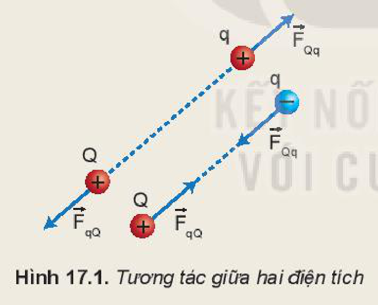
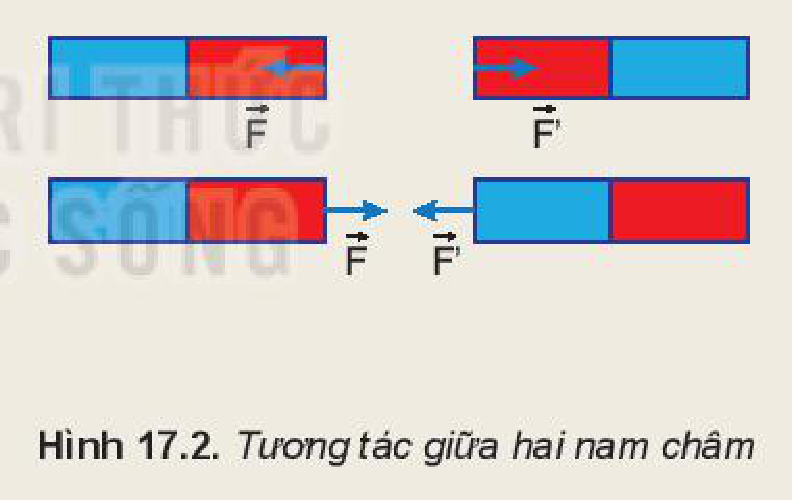
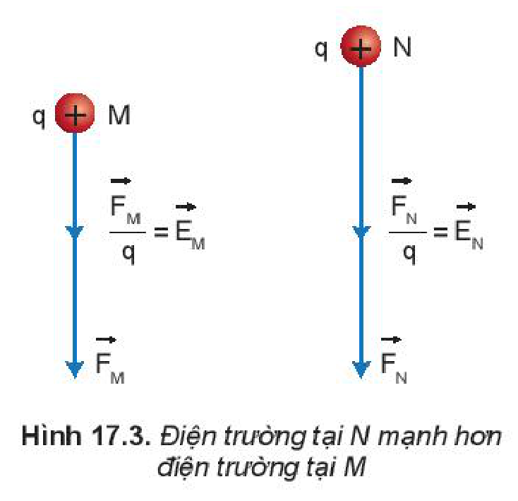
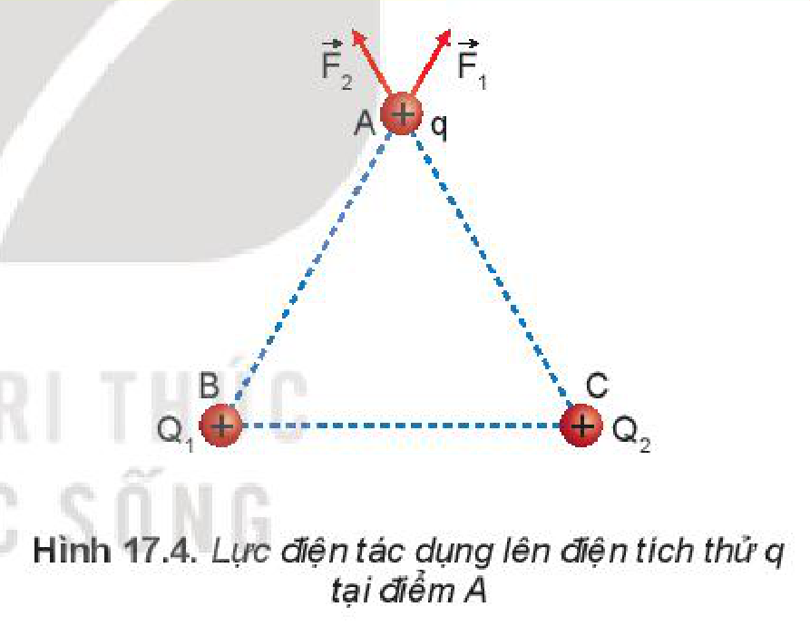
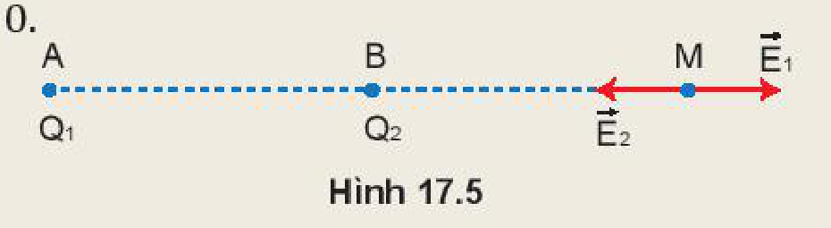
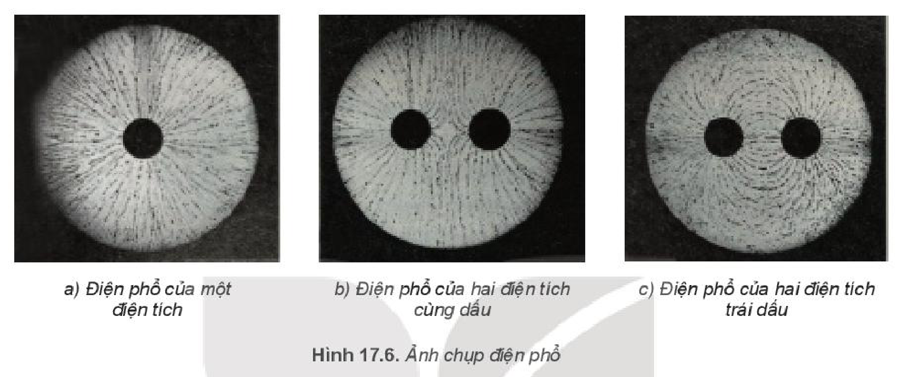
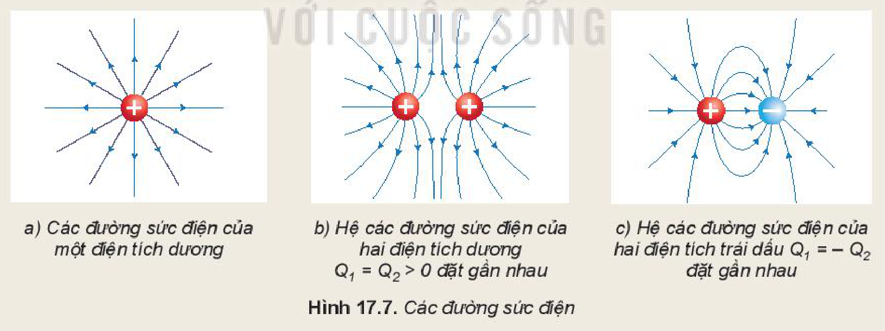

<!-- pdf:67 -->

# BÀI 17: KHÁI NIỆM ĐIỆN TRƯỜNG

## 🔴 Mở đầu

> Hai quả cầu tích điện cùng dấu được treo bằng hai sợi dây mảnh không dẫn điện như hình bên. Tại sao chúng không tiếp xúc nhưng vẫn tương tác được với nhau?

## I. KHÁI NIỆM ĐIỆN TRƯỜNG

> **Hoạt động:**
>
> Đặt điện tích $q$ cách điện tích $Q$ một khoảng $r$ (Hình 17.1):
>
> 1. Có phải không khí đã truyền tương tác điện từ điện tích $Q$ tới điện tích $q$?
> 2. Vùng không gian bao quanh một nam châm có từ trường. Tương tự như vậy, vùng không gian bao quanh một điện tích có điện trường. Ta có thể phát hiện sự tồn tại của điện trường bằng cách nào?
>
> 
>
> 

- Xung quanh nam châm có từ trường, từ trường sẽ truyền tương tác từ nam châm này tới nam châm khác (Hình 17.2). Tương tự như nam châm, xung quanh điện tích có một điện trường, điện trường sẽ truyền tương tác giữa các điện tích, đó là một **trường lực**.
- **Điện trường** được tạo ra bởi điện tích, là dạng vật chất tồn tại xung quanh điện tích và truyền tương tác giữa các điện tích.

> **Lưu ý:** Trong bài này ta chỉ xét điện trường của các điện tích đứng yên.

<!-- pdf:68 -->

## II. CƯỜNG ĐỘ ĐIỆN TRƯỜNG

- Người ta sử dụng điện tích dương có điện tích nhỏ, được gọi là **điện tích thử**, để phát hiện lực điện tác dụng lên nó, qua đó nhận biết được độ mạnh yếu của điện trường tại điểm ta xét. Đại lượng đặc trưng cho độ mạnh yếu của điện trường được gọi là **cường độ điện trường**.
- Theo công thức (16.2), độ lớn của lực điện $F$ tỉ lệ với độ lớn của điện tích $q$. Tỉ số $\frac{F}{q}$ chính bằng độ lớn của lực điện tác dụng lên điện tích $1\text{ C}$, do đó tỉ số này được lấy làm số đo cường độ điện trường tại điểm đặt điện tích thử $q$.

**Cường độ điện trường** tại một điểm được đo bằng tỉ số giữa lực điện tác dụng lên một điện tích dương đặt tại điểm đó và độ lớn của điện tích đó.

$$E = \frac{F}{q} \quad (17.1)$$
<!-- ocr-ok: đối chiếu ảnh trang PDF 68 khớp công thức (17.1) -->

- Trong hệ SI, đơn vị của cường độ điện trường là vôn trên mét ($\text{V/m}$).
- Vì lực là đại lượng vectơ, $q$ là đại lượng vô hướng nên cường độ điện trường $E$ là đại lượng vectơ. **Vectơ cường độ điện trường** $\vec{E}$ tại một điểm được xác định bằng tỉ số giữa vectơ lực điện $\vec{F}$ tác dụng lên một điện tích $q$ đặt tại điểm đó và trị số của điện tích đó:

$$\vec{E} = \frac{\vec{F}}{q} \quad (17.2)$$
<!-- ocr-ok: đối chiếu ảnh trang PDF 68 khớp công thức (17.2) -->

> **Hoạt động:**
>
> Hãy chứng tỏ rằng vectơ cường độ điện trường $\vec{E}$ có:
>
> + Phương trùng với phương của lực điện tác dụng lên điện tích.
> + Chiều cùng với chiều của lực điện khi $q > 0$, ngược chiều với chiều của lực điện khi $q < 0$.
> + Độ lớn của vectơ cường độ điện trường $\vec{E}$ bằng độ lớn của lực điện tác dụng lên điện tích $1\text{ C}$ đặt tại điểm ta xét.

- Từ công thức (16.2), ta xác định được độ lớn cường độ điện trường do một điện tích điểm $Q$ đặt trong chân không hoặc trong không khí gây ra tại một điểm cách nó một khoảng $r$ có giá trị bằng:

$$E = \frac{|Q|}{4\pi\varepsilon_0 r^2} \quad (17.3)$$
<!-- ocr-ok: đối chiếu ảnh trang PDF 68 khớp công thức (17.3) -->

> **Hoạt động:** Xét điện trường của điện tích $Q = 6 \cdot 10^{-14}\text{ C}$, sử dụng đoạn thẳng dài $1\text{ cm}$ để biểu diễn cho độ lớn vectơ cường độ điện trường $E = \frac{10^{-10}}{6\pi\varepsilon_0}\text{ (V/m)}$. Hãy tính và vẽ vectơ cường độ điện trường tại một điểm cách $Q$ một khoảng $2\text{ cm}$ và $3\text{ cm}$.

<!-- pdf:69 -->

> **Câu hỏi:**
>
> 1. Hãy chứng tỏ rằng: Độ lớn cường độ điện trường tại một điểm trong công thức (17.1) bằng độ lớn của lực điện tác dụng lên một đơn vị điện tích đặt tại điểm đó.
> 2. Một điện tích điểm $Q = 6 \cdot 10^{-13}\text{ C}$ đặt trong chân không.
>    a) Xác định phương, chiều, độ lớn của cường độ điện trường do điện tích điểm $Q$ gây ra tại một điểm cách nó một khoảng $1\text{ cm}$, $2\text{ cm}$, $3\text{ cm}$.
>    b) Nhận xét về cường độ điện trường ở những điểm gần điện tích $Q$ và ở những điểm cách xa điện tích $Q$.
>    c) Từ các nhận xét trên, em hãy mô tả cường độ điện trường do một điện tích điểm dương $Q$ đặt trong chân không gây ra tại một điểm cách nó một khoảng $r$. Vẽ hình minh hoạ.

> **Em có biết:**
>
> Trong cơn dông, thường xuất hiện những đám mây tích điện do các hạt nước trong đó nhiễm điện, chúng tạo ra những vùng điện trường mạnh quanh các đám mây này. Khi các đám mây tích điện trái dấu tới gần nhau có thể xảy ra hiện tượng phóng điện mà ta gọi là **sét**.

> **Hoạt động:** Nếu trong không gian có hai điện tích điểm dương $Q_1 = Q_2$ được đặt ở hai điểm B và C, một điện tích thử $q$ được đặt tại một điểm A như Hình 17.4. Hãy mô tả bằng hình vẽ lực điện tổng hợp do $Q_1$ và $Q_2$ tác dụng lên điện tích thử $q$.

- Muốn tính vectơ cường độ điện trường của hệ điện tích tại điểm A bất kì ta cũng có vectơ cường độ điện trường $\vec{E}_1 = \frac{\vec{F}_1}{q}$ do $Q_1$ gây ra tại điểm A, vectơ cường độ điện trường $\vec{E}_2 = \frac{\vec{F}_2}{q}$ do $Q_2$ gây ra tại điểm A,... tổng các vectơ cường độ điện trường $\vec{E}_1, \vec{E}_2,...$ theo quy tắc tổng hợp vectơ ta sẽ có vectơ cường độ điện trường tổng hợp của hệ điện tích gây ra tại điểm A. **Vectơ cường độ điện trường tổng hợp** chính bằng thương số của vectơ lực điện tổng hợp chia cho trị số của điện tích $q$: $\vec{E} = \frac{\vec{F}}{q}$

Như vậy, **cường độ điện trường của hệ điện tích điểm** được tổng hợp từ cường độ điện trường theo công thức (17.2) hay (17.3) của mỗi điện tích điểm.

$$\vec{E} = \vec{E}_1 + \vec{E}_2 + \vec{E}_3 + \dots$$
<!-- ocr-ok: đối chiếu ảnh trang PDF 69 khớp công thức tổng hợp cường độ điện trường -->

<!-- pdf:70 -->

> **Câu hỏi:**
>
> 1. Đặt điện tích điểm $Q_1 = 6 \cdot 10^{-8}\text{ C}$ tại điểm A và điện tích điểm $Q_2 = -2 \cdot 10^{-8}\text{ C}$ tại điểm B cách A một khoảng bằng $3\text{ cm}$ (Hình 17.5). Hãy xác định những điểm mà cường độ điện trường tại đó bằng $0$.
>
> 
>
> 2. Cho tam giác ABC vuông tại A có $AB = 3\text{ cm}$ và $AC = 4\text{ cm}$. Tại điểm B ta đặt điện tích $Q_1 = 4,5 \cdot 10^{-8}\text{ C}$, tại điểm C ta đặt điện tích $Q_2 = 2 \cdot 10^{-8}\text{ C}$.
>    a) Tính độ lớn của cường độ điện trường do mỗi điện tích trên gây ra tại A.
>    b) Tính cường độ điện trường tổng cộng tại A.

> **Em có biết:**
>
> - Trong thực tế, một quả cầu có điện tích phân bố đều trong toàn bộ thể tích hoặc phân bố đều trên mặt cầu thì điện trường bên ngoài quả cầu tương đương với điện trường của một điện tích điểm đặt tại tâm cầu và có điện tích bằng với điện tích của quả cầu. Ta thấy công thức $E = \frac{|Q|}{4\pi\varepsilon_0 r^2}$ vẫn được vận dụng để tìm cường độ điện trường trong trường hợp này. Do đó trong các thí nghiệm đơn giản về điện trường người ta thường sử dụng các quả cầu tích điện để thuận tiện trong đo đạc, nghiên cứu và tính toán.
> - Thực nghiệm cho thấy, ngay sát bề mặt của Trái Đất luôn có một điện trường có phương thẳng đứng, hướng từ trên xuống dưới và cường độ vào khoảng từ $100\text{ V/m}$ đến $200\text{ V/m}$. Các hạt **bụi mịn** lơ lửng trong không khí được phân loại dựa vào kích thước của chúng như pm1, pm2.5, pm10,... con số đứng sau chữ pm chỉ đường kính tối đa của hạt bụi tính theo đơn vị $\mu\text{m}$. Ví dụ pm2.5 là hạt bụi mịn có đường kính tối đa bằng $2,5\ \mu\text{m}$. Những hạt bụi mịn này thường tích điện dương nên không thể bay lên cao và phân tán đi xa được và là nguyên nhân chính gây ô nhiễm môi trường ở các thành phố lớn.

> **Câu hỏi:** Một hạt bụi mịn loại pm2.5 có điện tích bằng $1,6 \cdot 10^{-19}\text{ C}$ lơ lửng trong không khí nơi có điện trường của Trái Đất bằng $120\text{ V/m}$. Bỏ qua trọng lực, tính lực điện của Trái Đất tác dụng lên hạt bụi mịn và từ đó giải thích lí do hạt bụi loại này thường lơ lửng trong không khí.

<!-- pdf:71 -->

## III. ĐIỆN PHỔ

Để quan sát điện trường của hệ hai điện tích, người ta thực hiện thí nghiệm như sau: Cho vào bể chứa dầu một ít hạt cách điện mịn (mạt cưa chẳng hạn) rồi khuấy đều để các hạt lơ lửng trong dầu. Đặt một hoặc hai quả cầu kim loại tích điện trong bể chứa dầu đó, ta thấy các hạt cách điện sẽ nằm dọc theo các đường nhất định (Hình 17.6). Hình ảnh các đường như trên gọi là **điện phổ**.

> **Hoạt động:**
>
> 1. Em hãy quan sát Hình 17.6 và đưa ra nhận xét về đặc điểm của điện phổ:
>    a) Ở những vùng có điện trường mạnh hơn tức là ở gần điện tích hơn.
>    b) Ở những vùng có điện trường yếu hơn tức là ở xa điện tích hơn.
>    c) Ở điện trường có một điện tích và điện trường có nhiều điện tích.
>    d) Ở vùng gần điện tích dương và ở vùng gần điện tích âm.
>
> 
>
> 2. Từ quan sát Hình 17.7 và các nhận xét trên, em hãy vẽ các đường sức điện của một điện tích âm; các đường sức điện của hai điện tích âm $Q_1 = Q_2 < 0$ đặt gần nhau.

<!-- pdf:72 -->

## 📌 Em đã học

- Điện trường được tạo ra bởi điện tích, là dạng vật chất tồn tại quanh điện tích và truyền tương tác giữa các điện tích.
- Vectơ cường độ điện trường $\vec{E}$ tại một điểm được xác định bằng tỉ số giữa vectơ lực điện $\vec{F}$ tác dụng lên một điện tích $q$ đặt tại điểm đó và giá trị của điện tích đó:

$$\vec{E} = \frac{\vec{F}}{q}$$
<!-- ocr-ok: đối chiếu ảnh trang PDF 72 khớp công thức trong hộp Em đã học -->

- Độ lớn của cường độ điện trường do một điện tích điểm $Q$ đặt trong chân không hoặc trong không khí gây ra tại một điểm cách nó một khoảng $r$ có giá trị bằng:

$$E = \frac{|Q|}{4\pi\varepsilon_0 r^2}$$
<!-- ocr-ok: đối chiếu ảnh trang PDF 72 khớp công thức trong hộp Em đã học -->

- Khi cho một hoặc một số quả cầu tích điện vào trong một bể dầu đã trộn đều các hạt cách điện. Hệ các đường được tạo thành từ các hạt cách điện được gọi là **điện phổ** của điện tích hoặc hệ điện tích nói trên.
- Công thức tính độ lớn cường độ điện trường của một điện tích điểm được vận dụng để tính cường độ điện trường của một hệ điện tích điểm hay tính cường độ điện trường của vật hình cầu tích điện đều.
- **Đường sức điện** xuất phát ở điện tích dương và kết thúc ở điện tích âm.

## ✏️ Em có thể

- Xác định phương, chiều, độ lớn của vectơ cường độ điện trường tại một điểm bất kì trong điện trường.
- Tính được độ lớn cường độ điện trường và mô tả được vectơ cường độ điện trường do một điện tích điểm gây ra tại một điểm trong không gian.
- Vẽ được hệ các đường sức điện trong trường hợp một điện tích hoặc hệ hai điện tích.
- Vận dụng công thức $E = \frac{|Q|}{4\pi\varepsilon_0 r^2}$ để tính toán và mô tả điện trường của hệ nhiều điện tích, vật tích điện hình cầu,...
- Dùng hình ảnh điện phổ để qua đó giải thích được ngay sát sát bề mặt của Trái Đất có điện trường theo phương thẳng đứng hướng từ trên xuống dưới.

## 📷 Danh sách hình trong bài

| Mã hình | Số hình SGK | Trang PDF | Chú thích |
| --- | --- | --- | --- |
| H11-vat_ly-b17-01 | Hình 17.1 | 67 | Tương tác giữa hai điện tích |
| H11-vat_ly-b17-02 | Hình 17.2 | 67 | Tương tác giữa hai nam châm |
| H11-vat_ly-b17-03 | Hình 17.3 | 68 | Điện trường tại N mạnh hơn điện trường tại M |
| H11-vat_ly-b17-04 | Hình 17.4 | 69 | Lực điện tác dụng lên điện tích thử q tại điểm A |
| H11-vat_ly-b17-05 | Hình 17.5 | 70 | Hai điện tích điểm đặt tại A và B |
| H11-vat_ly-b17-06 | Hình 17.6 | 71 | Ảnh chụp điện phổ |
| H11-vat_ly-b17-07 | Hình 17.7 | 71 | Các đường sức điện |
