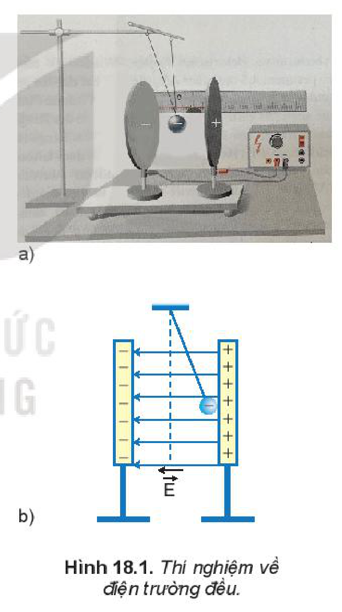
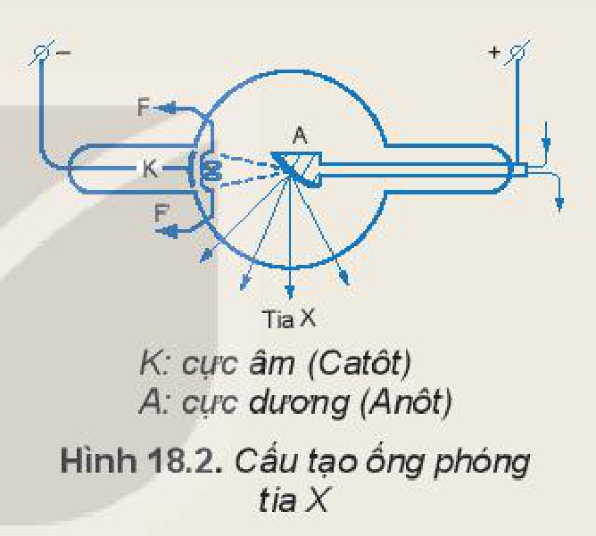
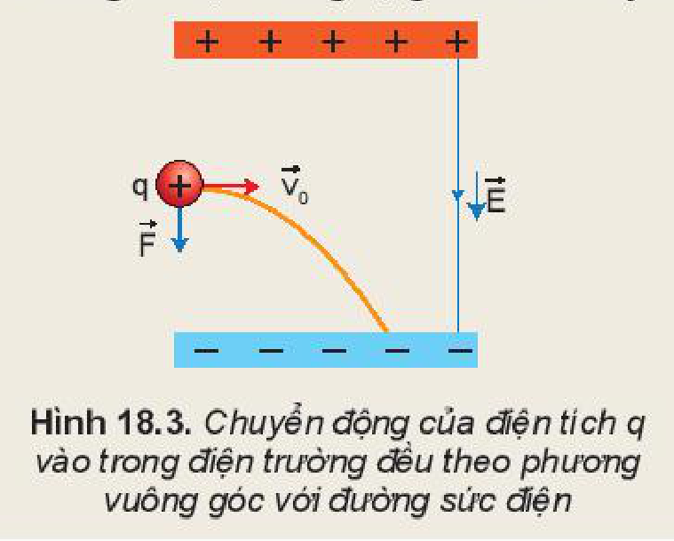
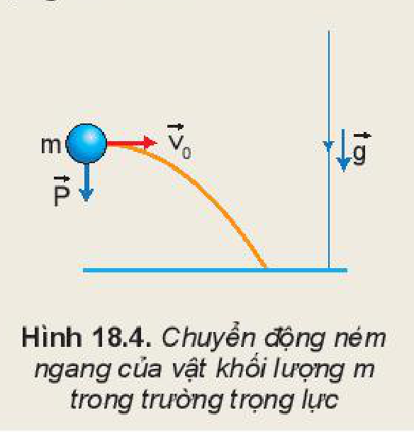
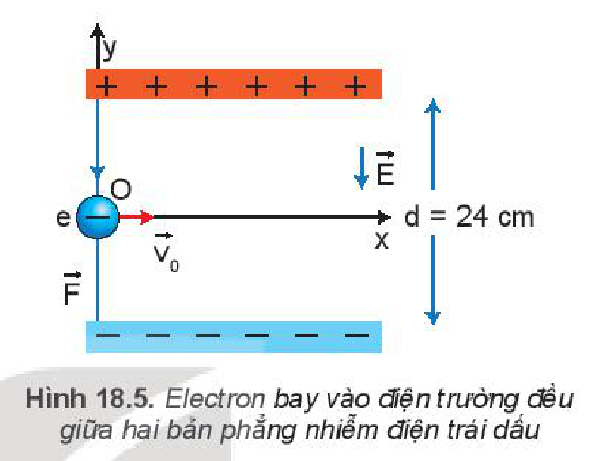
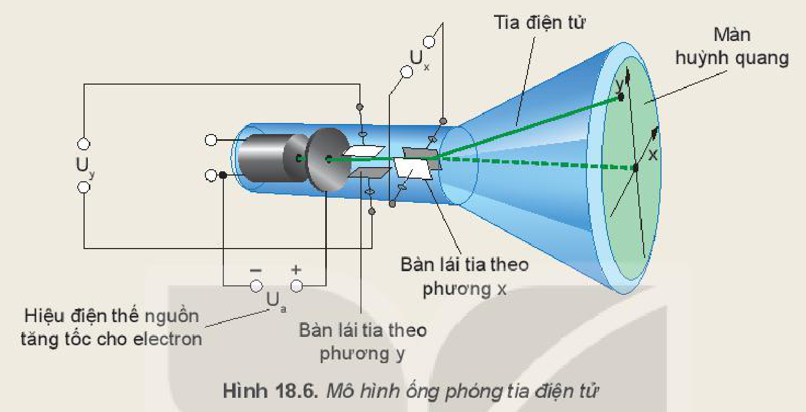

<!-- pdf:73 -->

# BÀI 18: ĐIỆN TRƯỜNG ĐỀU

## 🔴 Mở đầu

> Chúng ta đã biết, cường độ điện trường tại mỗi điểm thường sẽ có giá trị khác nhau. Vậy có tồn tại những vùng điện trường mà cường độ điện trường tại mỗi điểm có giá trị như nhau không?

## I. KHÁI NIỆM ĐIỆN TRƯỜNG ĐỀU

**Điện trường đều** là điện trường mà cường độ điện trường tại mỗi điểm có giá trị bằng nhau về độ lớn, giống nhau về phương và chiều.

## II. ĐIỆN TRƯỜNG ĐỀU GIỮA HAI BẢN PHẲNG NHIỄM ĐIỆN ĐẶT SONG SONG

Chúng ta có thể tạo ra điện trường đều bằng cách sử dụng hai bản kim loại được đặt song song và cách nhau một khoảng $d$. Hai bản kim loại này có hình dạng và kích thước giống hệt nhau, kích thước của hai bản lớn so với khoảng cách giữa chúng. Tích điện trái dấu cho hai bản kim loại này, khi đó hiệu điện thế giữa hai bản là $U$ (Hình 18.1). Trong thí nghiệm này dây treo điện tích $q < 0$ luôn lệch so với phương thẳng đứng một góc không đổi tại mọi điểm trong không gian giữa hai bản kim loại. Điều đó chứng tỏ điện trường giữa hai bản kim loại là đều.

Các đường sức của điện trường giữa hai bản phẳng song song cách đều và vuông góc với các bản phẳng, chúng xuất phát từ bản tích điện dương và kết thúc ở bản tích điện âm.

Cường độ điện trường giữa hai bản phẳng nhiễm điện trái dấu đặt song song có độ lớn bằng tỉ số giữa hiệu điện thế giữa hai bản phẳng và khoảng cách giữa chúng:
<!-- term: Cường độ điện trường giữa hai bản phẳng -->

$$E = \frac{U}{d} \quad (18.1)$$
<!-- ocr-ok: đối chiếu ảnh trang PDF 73 khớp công thức (18.1) -->

Trong đó $U$ là hiệu điện thế giữa hai bản phẳng, đơn vị là vôn (V).
$d$ là khoảng cách giữa hai bản phẳng, đơn vị là mét (m).
$E$ là cường độ điện trường giữa hai bản phẳng, đơn vị là vôn/mét ($\text{V/m}$).

*Bài tập ví dụ:*

Hai bản phẳng kim loại đặt song song, cách nhau một khoảng $d = 20\text{ cm}$. Đặt vào hai bản này một hiệu điện thế một chiều $U = 1000\text{ V}$. Một hạt bụi mịn pm 2.5 có điện tích $q = 16 \cdot 10^{-19}\text{ C}$ bay vào điện trường giữa hai bản phẳng. Hãy xác định phương, chiều và độ lớn của lực điện tác dụng lên hạt bụi đó.

<!-- pdf:74 -->

*Giải:*

Độ lớn của cường độ điện trường đều giữa hai bản phẳng là

$$E = \frac{U}{d} = \frac{1000}{0,2} = 5\,000\text{ (V/m)}$$
<!-- ocr-ok: đối chiếu ảnh trang PDF 74 khớp công thức giải bài tập ví dụ -->

Vectơ cường độ điện trường có phương vuông góc với hai bản phẳng, chiều hướng từ bản tích điện dương đến bản tích điện âm.

Lực điện tác dụng lên điện tích $q > 0$ sẽ cùng phương và cùng chiều với vectơ cường độ điện trường tức là cùng phương và cùng chiều với đường sức, do đó lực sẽ có phương vuông góc với các bản phẳng và chiều đi từ điện tích đến phía bản nhiễm điện âm.

Từ công thức $\vec{E} = \frac{\vec{F}}{q}$ ta tính được độ lớn của lực điện tác dụng lên hạt bụi:

$$F = qE = 16 \cdot 10^{-19} \cdot 5000 = 8 \cdot 10^{-15}\text{ N}.$$
<!-- ocr-ok: đối chiếu ảnh trang PDF 74 khớp công thức tính lực F -->

> **Câu hỏi:**
>
> Để chuẩn đoán hình ảnh trong y học người ta thường sử dụng tia X (hay tia Rơn Ghen) để chụp X quang và chụp CT. Cho rằng vùng điện trường giữa hai cực của ống tia X (Hình 18.2) là một điện trường đều. Khoảng cách giữa hai cực bằng $2\text{ cm}$, hiệu điện thế giữa hai cực là $120\text{ KV}$. Hãy tính lực điện trường tác dụng lên electron.
>
> 

## III. TÁC DỤNG CỦA ĐIỆN TRƯỜNG ĐỀU ĐỐI VỚI CHUYỂN ĐỘNG CỦA MỘT ĐIỆN TÍCH

> **Hoạt động:**
>
> 1. Giữa hai bản phẳng song song nhiễm điện có cường độ điện trường đều là $E$. Một điện tích $q > 0$ có khối lượng $m$ bay vào trong điện trường đều trên với vận tốc $\vec{v}_0$ theo phương vuông góc với đường sức. Môi trường giữa hai bản phẳng nhiễm điện là chân không. Biết rằng trong hiện tượng này, trọng lực là rất nhỏ so với lực điện. Hãy so sánh vectơ lực điện tác dụng lên điện tích $q$ trong Hình 18.3 với vectơ trọng lực tác dụng lên vật khối lượng $m$ chuyển động ném ngang trong trường trọng lực như Hình 18.4. Từ đó chỉ ra rằng có sự tương tự giữa hai chuyển động nói trên.
>
> 
>
> 

<!-- pdf:75 -->

> 2. Hãy thảo luận về tác dụng của điện trường đều lên chuyển động của điện tích bay vào điện trường đều theo phương vuông góc với đường sức điện:
>    a) Ảnh hưởng như thế nào đến vận tốc của chuyển động?
>    b) Từ đó dự đoán dạng quỹ đạo chuyển động.

*Bài tập ví dụ:*

Hai bản phẳng có kích thước lớn và bằng nhau, đặt song song với nhau, cách nhau một khoảng $d = 24\text{ cm}$ như Hình 18.5. Hiệu điện thế giữa hai bản phẳng là $48\text{ V}$. Một electron ($q = -1,6 \cdot 10^{-19}\text{ C}$, $m = 9,1 \cdot 10^{-31}\text{ kg}$) bay vào chính giữa hai bản phẳng theo phương vuông góc với các đường sức điện trường với vận tốc $200\text{ m/s}$. Bỏ qua điện trường Trái Đất, lực cản môi trường, trọng lực tác dụng lên electron. Hãy viết phương trình quỹ đạo của chuyển động.

*Giải:*

Đặt gốc toạ độ đúng tại điểm electron bắt đầu bay vào điện trường đều. Trục $Ox$ có hướng trùng với vectơ vận tốc ban đầu, trục $Oy$ hướng thẳng đứng lên trên.

Độ lớn cường độ điện trường giữa hai bản phẳng là:

$$E = \frac{U}{d} = \frac{48}{24 \cdot 10^{-2}} = 200\text{ (V/m)}$$
<!-- ocr-ok: đối chiếu ảnh trang PDF 75 khớp công thức tính E -->

Chú ý rằng vectơ cường độ điện trường hướng từ trên xuống dưới và ngược chiều với $Oy$ nên hình chiếu trên phương $Oy$ sẽ có giá trị âm.

Lực điện tác dụng lên electron chiếu trên phương $Oy$ có giá trị bằng:

$$F = -qE = -q\frac{U}{d}$$
<!-- ocr-ok: đối chiếu ảnh trang PDF 75 khớp công thức tính F -->

- Phương trình chuyển động theo phương $Ox$: $x = v_0 \cdot t \quad (1)$
- Phương trình chuyển động theo phương $Oy$: $y = \frac{1}{2} a_y \cdot t^2 = \frac{1}{2} \frac{F}{m} \cdot t^2 = -\frac{1}{2} \frac{qU}{md} t^2 \quad (2)$
- Từ (1) và (2) ta thu được phương trình quỹ đạo của chuyển động:

$$y = -\frac{1}{2} \cdot \frac{qU}{md} \left(\frac{x}{v_0}\right)^2 = 4\,395 \cdot x^2\text{ (m)} \quad (3)$$
<!-- ocr-ok: đối chiếu ảnh trang PDF 75 khớp phương trình quỹ đạo (3) -->

Từ phương trình (3) cho thấy electron sẽ chuyển động theo cung parabol có bề lõm hướng lên bản phẳng nhiễm điện dương và khi gặp bản phẳng này chuyển động sẽ kết thúc.

Với trường hợp điện tích dương bay vào trong điện trường đều, giải tương tự ta có quỹ đạo chuyển động là cung parabol có bề lõm hướng xuống dưới.

<!-- pdf:76 -->

> **Hoạt động:**
>
> **Dao động kí** là một loại thiết bị dùng để hiển thị dạng tín hiệu đưa vào. Cấu tạo của một dao động kí gồm 4 bộ phận chính: Ống phóng tia điện tử, màn huỳnh quang, súng điện tử, hệ thống lái tia (Hình 18.6). Ống phóng tia điện tử phát ra electron bay qua hai bản lái tia theo phương $x$ và phương $y$ rồi đập lên màn huỳnh quang tạo ra mỗi điểm sáng trên màn.
>
> 
>
> Hãy giải thích nguyên tắc hoạt động lái tia điện tử của các bản lái tia trong Hình 18.6.

## IV. ỨNG DỤNG

> **Hoạt động:**
>
> Hãy tìm hiểu về công nghệ ion âm lọc không khí được sử dụng rất phổ biến hiện nay (để lọc không khí trong ô tô, trong gia đình, trong nhà xưởng,...). Máy hút ẩm (Hình 18.7) trong trường hợp này các ion âm được phát ra theo phương vuông góc với đường sức điện trường.
>
> Hãy nêu tác dụng của điện trường đều của Trái Đất đối với chuyển động của chùm ion âm để giải thích cho khả năng lọc bụi của chúng.
>
> 

<!-- pdf:77 -->

> **Em có biết:**
>
> - Chúng ta đã biết, ngay sát bề mặt của Trái Đất luôn có một điện trường có phương thẳng đứng, hướng từ trên xuống dưới, có cường độ vào khoảng từ $100\text{ V/m}$ đến $200\text{ V/m}$. Do đó, khi xét trong một không gian hẹp gần bề mặt của Trái Đất, các đường sức điện trường có thể coi là song song và cách đều, trong khoảng không gian hẹp đó, điện trường do Trái Đất sinh ra có thể coi là điện trường đều.
> - Các hạt bụi, bụi siêu mịn như sợi bông, bụi khói xe,... thường nhiễm điện dương, phân tán trong không khí nhưng tập trung nhiều ở gần mặt đất, rất có hại cho sức khoẻ khi chúng ta hít vào trong phổi. **Công nghệ ion âm lọc không khí** là một công nghệ tiên tiến áp dụng trên nhiều sản phẩm như máy lọc không khí, máy hút ẩm, máy điều hoà,... để làm sạch không khí bằng cách tạo ra ion âm để diệt khuẩn trong không khí, làm trung hoà các bụi mịn tích điện dương làm chúng rơi xuống đất.

> **Câu hỏi:** Máy lọc không khí tạo ra chùm các ion âm $\text{OH}^-$ (mỗi ion $\text{OH}^-$ có khối lượng $m = 2,833 \cdot 10^{-26}\text{ kg}$, điện tích $-1,6 \cdot 10^{-19}\text{ C}$) có vận tốc ban đầu từ $20\text{ m/s}$ đến $40\text{ m/s}$ theo phương song song với mặt đất và cách mặt đất $50\text{ cm}$. Điện trường đều đo được ở bề mặt Trái Đất là $114\text{ V/m}$. Bỏ qua trọng lực và các loại lực cản khác. Hãy xác định quỹ đạo của chùm ion âm này.

## 📌 Em đã học

- Điện trường đều là điện trường mà cường độ điện trường các điểm đều có giá trị bằng nhau về độ lớn, giống nhau về phương và chiều. Các đường sức trong điện trường đều là các đường thẳng song song và cách đều nhau.
- Điện trường giữa hai bản phẳng nhiễm điện trái dấu đặt song song là điện trường đều. Cường độ điện trường giữa hai bản phẳng này có độ lớn bằng tỉ số giữa hiệu điện thế giữa hai bản phẳng và khoảng cách giữa chúng: $E = \frac{U}{d}$.
- Khi một điện tích bay vào điện trường đều theo phương vuông góc với đường sức, dưới tác dụng của lực điện trường: vận tốc theo phương song song với đường sức bị biến đổi; vận tốc theo phương vuông góc với đường sức không thay đổi. Kết quả là vận tốc của điện tích liên tục đổi phương và tăng dần độ lớn, quỹ đạo chuyển động trở thành đường parabol.
<!-- term: Tác dụng của điện trường đều lên điện tích -->

## ✏️ Em có thể

- Mô tả được ảnh hưởng của điện trường đều lên chuyển động của một điện tích khi bay vào điện trường đều theo phương vuông góc với các đường sức. Từ đó giải thích được nguyên tắc lái tia điện tử trong ống phóng tia điện tử.
- Giải thích được cơ chế gia tốc cho electron trong ống phóng tia X, từ đó giúp điều khiển một số đặc tính của chùm tia X theo mong muốn.

## 📷 Danh sách hình trong bài

| Mã hình | Số hình SGK | Trang PDF | Chú thích |
| --- | --- | --- | --- |
| H11-vat_ly-b18-01 | Hình 18.1 | 73 | Thí nghiệm về điện trường đều |
| H11-vat_ly-b18-02 | Hình 18.2 | 74 | Cấu tạo ống phóng tia X |
| H11-vat_ly-b18-03 | Hình 18.3 | 74 | Chuyển động của điện tích q vào trong điện trường đều theo phương vuông góc với đường sức điện |
| H11-vat_ly-b18-04 | Hình 18.4 | 74 | Chuyển động ném ngang của vật khối lượng m trong trường trọng lực |
| H11-vat_ly-b18-05 | Hình 18.5 | 75 | Electron bay vào điện trường đều giữa hai bản phẳng nhiễm điện trái dấu |
| H11-vat_ly-b18-06 | Hình 18.6 | 76 | Mô hình ống phóng tia điện tử |
| H11-vat_ly-b18-07 | Hình 18.7 | 76 | Máy hút ẩm có công nghệ ion âm lọc không khí |
