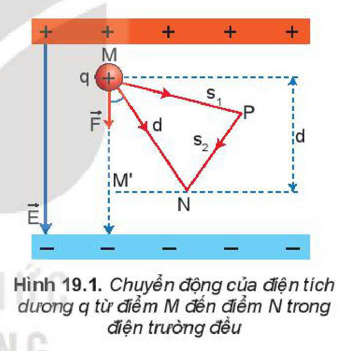
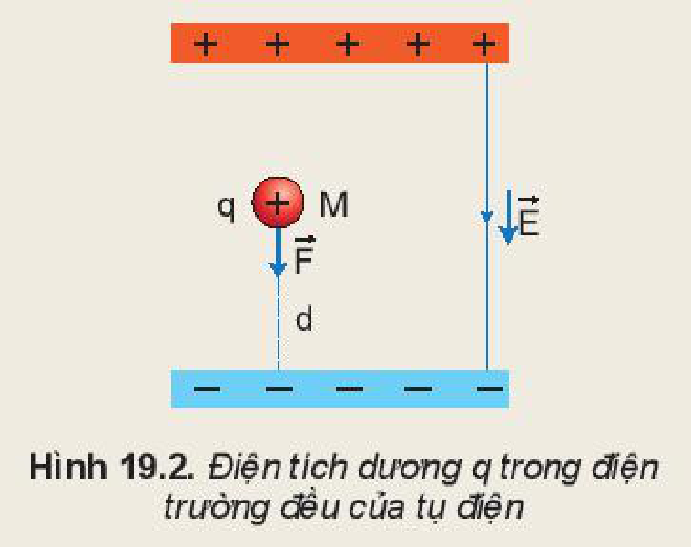

<!-- pdf:78 -->

# BÀI 19: THẾ NĂNG ĐIỆN

## 🔴 Mở đầu

> Chúng ta đã biết, có sự tương tự giữa chuyển động của một điện tích $q$ trong điện trường đều với chuyển động của một vật khối lượng $m$ trong trường trọng lực. Như vậy thì điện tích $q$ trong điện trường có tồn tại thế năng tương tự như vật khối lượng $m$ trong trọng trường không?

## I. CÔNG CỦA LỰC ĐIỆN

Một điện tích dương $q$ dịch chuyển trong điện trường đều từ điểm M tới điểm N luôn chịu tác dụng của lực điện không đổi (Hình 19.1). Để tính công của lực điện trong dịch chuyển này ta có thể xét chuyển động theo các quỹ đạo khác nhau như theo đường thẳng MN, theo một đường gấp khúc MPN,... Kết quả cho thấy: ***Công của lực điện** làm dịch chuyển của điện tích $q$ từ điểm M đến điểm N trong điện trường đều bằng $qEh$, không phụ thuộc vào hình dạng của đường đi mà chỉ phụ thuộc vào vị trí của điểm đầu M và vị trí của điểm cuối N của độ dịch chuyển trong điện trường.*

$$A_{MN} = qEd \quad (19.1)$$
<!-- ocr-ok: đối chiếu ảnh trang PDF 78 khớp công thức (19.1) -->

trong đó: $d$ là độ dài đại số của đoạn $\text{MM}'$, là hình chiếu của đoạn MN trên một đường sức điện.

Với điện trường bất kì, người ta cũng chứng minh được rằng ***công của lực điện trường** làm dịch chuyển của điện tích $q$ không phụ thuộc vào hình dạng của đường đi mà chỉ phụ thuộc vào vị trí của điểm đầu M và vị trí của điểm cuối N của độ dịch chuyển*. Đây là tính chất chung của một số trường lực như trường tĩnh điện, trường trọng lực,...

Vì lực điện tỉ lệ với điện tích $q$ nên công của lực điện làm dịch chuyển điện tích $q$ từ điểm M đến điểm N cũng tỉ lệ với điện tích $q$.

## II. THẾ NĂNG CỦA MỘT ĐIỆN TÍCH TRONG ĐIỆN TRƯỜNG

### 1. Thế năng của một điện tích trong điện trường đều

Thế năng của một điện tích $q$ trong điện trường đều đặc trưng cho khả năng sinh công của điện trường đều khi đặt điện tích $q$ tại điểm ta xét. Số đo thế năng của điện tích $q$ trong điện trường đều của một tụ điện được tính bằng công mà điện trường đều có thể sinh ra khi dịch chuyển điện tích $q$ từ điểm ta xét tới bản cực âm của tụ điện.
<!-- term: Thế năng điện trong điện trường đều -->

<!-- pdf:79 -->

> **Hoạt động:**
>
> Một điện tích dương $q$ được đặt tại điểm M trong điện trường đều của một tụ điện có độ lớn của cường độ điện trường là $E$ (Hình 19.2).
>
> 1. Chứng minh rằng công mà điện trường đều của tụ điện có thể sinh ra khi dịch chuyển điện tích dương $q$ từ điểm M tới bản cực âm là $A = qEd$.
> 2. Hãy nhận xét về công $A$ khi ta thay $q$ bằng một điện tích âm.
>
> 

- Bản cực âm của tụ điện thường được chọn làm mốc để tính thế năng. Với điện trường của một điện tích hoặc của một hệ điện tích bất kì, người ta thường chọn điểm mốc ở vô cực vì ở đó điện trường và lực điện trường đều bằng không.
- **Thế năng của điện tích trong điện trường** còn gọi là **thế năng điện**. Thế năng của một điện tích $q$ trong điện trường đều đặc trưng cho khả năng sinh công của điện trường đều khi đặt điện tích $q$ tại điểm đang xét.
- Số đo thế năng của điện tích $q$ tại điểm M trong điện trường đều bằng công của lực điện có thể sinh ra khi điện tích $q$ di chuyển từ điểm M tới điểm mốc để tính thế năng:

$$W_M = qEd \quad (19.2)$$
<!-- ocr-ok: đối chiếu ảnh trang PDF 79 khớp công thức (19.2) -->

trong đó $d$ là khoảng cách từ M đến bản cực âm, $W_M$ là thế năng điện của điện tích $q$ tại điểm M.

### 2. Thế năng của một điện tích trong điện trường bất kì

- Tương tự như trường hợp điện trường đều, với điện trường bất kì ta có thể phát biểu: *Thế năng của một điện tích $q$ trong điện trường đặc trưng cho khả năng sinh công của điện trường khi đặt điện tích $q$ tại điểm đang xét.*
- Số đo thế năng của điện tích $q$ tại điểm M trong điện trường bằng công của lực điện có thể sinh ra khi điện tích $q$ di chuyển từ điểm M tới điểm mốc để tính thế năng.

Chú ý rằng, khi chọn mốc thế năng tại vô cực, ta có *số đo thế năng của điện tích $q$ tại điểm M trong điện trường bằng công của lực điện trong dịch chuyển của điện tích $q$ từ điểm M tới vô cực*:

$$W_M = A_{M\infty} \quad (19.3)$$
<!-- ocr-ok: đối chiếu ảnh trang PDF 79 khớp công thức (19.3) -->

- Vì độ lớn của lực điện tỉ lệ thuận với điện tích $q$ nên thế năng tại điểm M cũng tỉ lệ với điện tích $q$

$$W_M = V_M q \quad (19.4)$$
<!-- ocr-ok: đối chiếu ảnh trang PDF 79 khớp công thức (19.4) -->

Hệ số tỉ lệ $V$ không phụ thuộc vào điện tích $q$ mà chỉ phụ thuộc vào điện trường và vị trí của điểm M.

<!-- pdf:80 -->

> **Câu hỏi:**
>
> 1. Chứng tỏ rằng, công của lực điện trong sự dịch chuyển của điện tích $q$ từ điểm M đến điểm N sẽ bằng độ giảm thế năng của điện tích $q$ trong điện trường. Hãy mở rộng cho trường hợp M ở xa vô cùng.
> 2. Trong điện trường bất kì, khi chọn mốc là ở xa vô cùng, có trường hợp mà số đo thế năng sẽ có giá trị âm không? Hãy vẽ hình minh hoạ.

## 📌 Em đã học

- Công của lực điện trường trong sự dịch chuyển của điện tích $q$ không phụ thuộc vào hình dạng của đường đi mà chỉ phụ thuộc vào vị trí của điểm đầu M và điểm cuối N của chuyển động.
- Thế năng của một điện tích $q$ trong điện trường đặc trưng cho khả năng sinh công của điện trường khi đặt điện tích $q$ tại điểm đang xét.
- Trong điện trường đều: $W_M = qEd$.
- Trong điện trường bất kì: $W_M = A_{M\infty}$.

## ✏️ Em có thể

- Xác định được thế năng điện của quả cầu tích điện đều đặt trong điện trường đều của Trái Đất.
- Xác định được công dịch chuyển một điện tích giữa hai điểm trong điện trường đều của Trái Đất.

## 📷 Danh sách hình trong bài

| Mã hình | Số hình SGK | Trang PDF | Chú thích |
| --- | --- | --- | --- |
| H11-vat_ly-b19-01 | Hình 19.1 | 78 | Chuyển động của điện tích dương q từ điểm M đến điểm N trong điện trường đều |
| H11-vat_ly-b19-02 | Hình 19.2 | 79 | Điện tích dương q trong điện trường đều của tụ điện |
