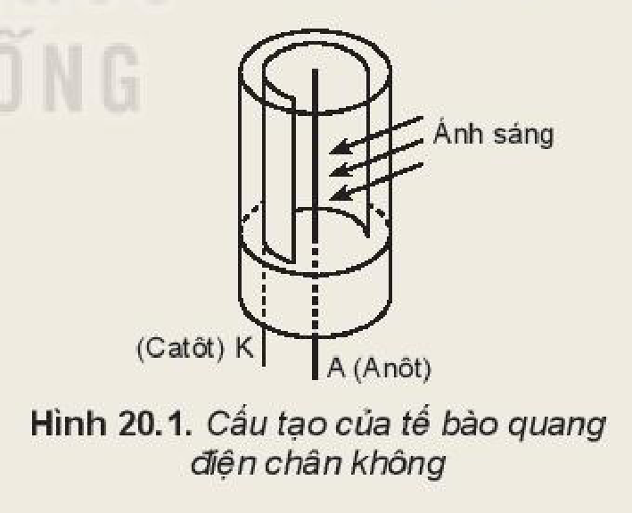
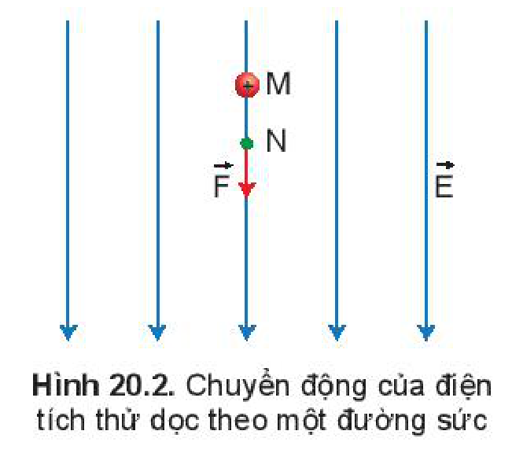
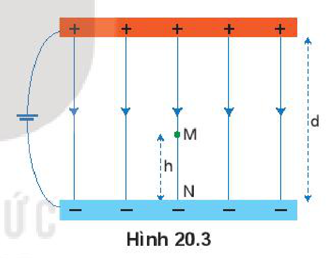

<!-- pdf:81 -->

# BÀI 20: ĐIỆN THẾ

## 🔴 Mở đầu

> Trong thực tế chúng ta gặp những đường dây dẫn điện cao thế, trung thế, hạ thế. Từ "thế" ở đây được hiểu như thế nào? Có liên quan tới thế năng điện đã học ở Bài 19 hay không?

## I. ĐIỆN THẾ TẠI MỘT ĐIỂM TRONG ĐIỆN TRƯỜNG

> **Hoạt động:**
>
> 1. Để đặt một điện tích $q$ vào điểm M trong điện trường chúng ta cần cung cấp thế năng $W_M$ cho điện tích $q$. Điều này tương ứng với việc thực hiện một công $A$ dịch chuyển điện tích $q$ từ vô cực về điểm M. Hãy vận dụng công thức (19.4) và (19.5) để thu được công thức:
>
> $$V = \frac{A}{q}$$
>
> 2. Tỉ số $V = \frac{A}{q}$ như trên được gọi là **điện thế của điện trường tại điểm M**.
>    a) Hãy dự đoán điện thế $V$ đặc trưng cho đại lượng nào của điện trường.
>    b) Xác định độ lớn điện tích $q$ khi điện thế $V$ có giá trị bằng công $A$ thực hiện để dịch chuyển điện tích $q$ từ vô cực về điểm M.

***Điện thế** tại một điểm trong điện trường đặc trưng cho điện trường tại điểm đó về thế năng, được xác định bằng công dịch chuyển một đơn vị điện tích dương từ vô cực về điểm đó.*

$$V = \frac{A}{q} \quad (20.1)$$
<!-- ocr-ok: đối chiếu ảnh trang PDF 81 khớp công thức (20.1) -->

Đơn vị của điện thế là vôn (kí hiệu là V), ngoài ra người ta còn dùng đơn vị kilôvôn (kV) $1\text{ kV} = 1\,000\text{ V}$.

> **Lưu ý:**
>
> a) Điện thế có giá trị đại số, dấu của điện thế phụ thuộc vào dấu của công $A$ và dấu của điện tích $q$.
>
> b) Cũng như chọn mốc thế năng, ngoài việc chọn mốc điện thế ở vô cực thì trong điện trường đều giữa hai bản phẳng người ta thường chọn mốc điện thế là bản nhiễm điện âm, còn mặt đất thường được chọn là mốc điện thế trong thực tiễn cuộc sống và kĩ thuật.

Chúng ta đã được học và đo hiệu điện thế. **Hiệu điện thế** $U_{MN}$ mà chúng ta đo được chính là giá trị của hiệu giữa điện thế tại M và điện thế tại N

$$U_{MN} = V_M - V_N \quad (20.2)$$
<!-- ocr-ok: đối chiếu ảnh trang PDF 81 khớp công thức (20.2) -->

Vì vậy $U$ và $V$ đều có chung đơn vị là vôn.

<!-- pdf:82 -->

> **Em có biết:**
>
> 1. **Hiệu điện thế** còn được gọi là **điện áp**. Thiết bị dùng để biến đổi hiệu điện thế được gọi là **biến áp**.
> 2. Theo quy định của mạng lưới truyền tải điện ở Việt Nam, các lưới điện có điện áp nhỏ hơn $1\text{ kV}$ gọi là **hạ thế**, từ $1\text{ kV}$ đến $66\text{ kV}$ gọi là **trung thế**, lớn hơn $66\text{ kV}$ gọi là **cao thế**. Còn theo quy định của hành lang an toàn lưới điện thì điện áp lớn hơn $1\text{ kV}$ đã được gọi là **cao thế**.

## II. MỐI LIÊN HỆ GIỮA ĐIỆN THẾ VÀ CƯỜNG ĐỘ ĐIỆN TRƯỜNG

Trong thực tế người ta thường xét sự dịch chuyển một điện tích $q$ từ điểm N tới điểm M nào đó trong điện trường.

> **Hoạt động:** Hãy vận dụng công thức $V = \frac{A}{q}$ để chứng tỏ rằng công thực hiện để dịch chuyển điện tích $q$ từ điểm N đến điểm M bằng:
>
> $$A_{MN} = (V_M - V_N)q = U_{MN}q \quad (20.3)$$
<!-- ocr-ok: đối chiếu ảnh trang PDF 82 khớp hộp Hoạt động và công thức (20.3) -->

> **Lưu ý:** Để dịch chuyển một điện tích dương $q$ ngược chiều điện trường từ điểm N tới điểm M, ta cần cung cấp một lực ít nhất bằng với lực điện và ngược chiều. Trong dịch chuyển này, công ta bỏ ra có độ lớn bằng nhưng trái dấu với công của lực điện trường.

> **Câu hỏi:**
>
> **Tế bào quang điện chân không** (Hình 20.1) gồm một ống hình trụ có một cửa sổ trong suốt, được hút chân không (áp suất trong khoảng $10^{-8}\text{ mmHg}$ đến $10^{-6}\text{ mmHg}$). Trong ống đặt một catôt (cực âm) có khả năng phát xạ electron khi được chiếu sáng và một anôt (cực dương). Electron trong điện trường giữa hai cực sẽ dịch chuyển về phía anôt nếu $U_{AK} > 0$.
>
> Cho hiệu điện thế $U_{AK} = 45\text{ V}$ được đặt vào giữa hai cực của tế bào quang điện. Khi chiếu xạ ánh sáng phù hợp để catôt phát xạ eletron vào vùng điện trường giữa hai cực. Hãy tính công của điện trường trong dịch chuyển của electron từ catôt tới anôt.
>
> 

Điện thế là một đại lượng gắn với điện trường, còn thế năng điện là đại lượng gắn với điện tích đặt trong điện trường.

Trong công thức (20.1), công $A$ mà chúng ta sử dụng để dịch chuyển điện tích $q$ từ vô cực về điểm M cũng chính bằng thế năng điện $W_M$ của điện tích $q$ đặt tại M trong điện trường. Như vậy, thế năng điện và điện thế liên hệ với nhau bởi công thức:

$$W_M = Vq \quad (20.4)$$
<!-- ocr-ok: đối chiếu ảnh trang PDF 82 khớp công thức (20.4) -->

> **Câu hỏi:** Tính thế năng điện của một electron đặt tại điểm M có điện thế bằng $1\,000\text{ V}$.
<!-- ocr-ok: đối chiếu ảnh trang PDF 82 khớp hộp Câu hỏi (OCR đọc nhầm đặt thành đất) -->

<!-- pdf:83 -->

Trong điện trường đều, xét một điện tích thử dương chuyển động dọc theo một đường sức điện từ điểm M đến điểm N. Ta thấy, chiều của vectơ cường độ điện trường $E$ hướng theo chiều giảm của điện thế. Chọn chiều dương của trục toạ độ là chiều đường sức (Hình 20.2). Áp dụng công thức (18.1) ta có:

$$E_M = E_N = E = \frac{U}{d} = \frac{V_M - V_N}{\overline{MN}} \quad (20.5)$$
<!-- ocr-ok: đối chiếu ảnh trang PDF 83 khớp công thức (20.5) -->

Kết quả trên cho thấy: trong điện trường đều, độ lớn cường độ điện trường bằng độ giảm của điện thế dọc theo một đơn vị độ dài đường sức.

Với điện trường bất kì, công thức (20.5) vẫn được áp dụng trong trường hợp hai điểm M và N ở rất gần nhau.

*Cường độ điện trường tại một điểm M có độ lớn bằng thương của hiệu điện thế giữa hai điểm M và N trên một đoạn nhỏ đường sức chia cho độ dài đại số của đoạn đường sức đó.*
<!-- term: Liên hệ điện thế và cường độ điện trường -->

*Bài tập ví dụ:*

Có hai bản phẳng song song cách nhau một khoảng $d$ (Hình 20.3), được nối vào nguồn điện một chiều có hiệu điện thế $48\text{ V}$. Chọn bản nhiễm điện âm làm mốc điện thế.

a) Xác định mối liên hệ giữa điện thế và cường độ điện trường tại một điểm trong điện trường đều giữa hai bản phẳng.
b) Áp dụng kết quả câu a để tính điện thế tại M nằm chính giữa khe hở của hai bản phẳng.

*Giải:*

a) Gọi N là điểm giao của đường sức đi qua M với bản nhiễm điện âm (Hình 20.3). $V_N = 0$ do điểm N nằm trên bản phẳng nhiễm điện âm được chọn làm mốc điện thế; $\overline{MN} = h > 0$ vì MN thuận theo chiều đường sức, $h$ chính là khoảng cách từ M tới bản nhiễm điện âm. Vận dụng công thức (20.5) vào điện trường đều giữa hai bản phẳng ta tìm được mối liên hệ giữa điện thế và cường độ điện trường tại điểm M:

$$E_M = \frac{V_M - V_N}{\overline{MN}} \Rightarrow V_M = E_M h$$
<!-- ocr-ok: đối chiếu ảnh trang PDF 83 khớp công thức lời giải câu a -->

b) Trường hợp điểm M nằm chính giữa khe hở hai bản phẳng tức là $h = \frac{d}{2}$, ta có:

$$V_M = Eh = \frac{U}{d} \cdot \frac{d}{2} = \frac{48}{2} = 24\text{ V}$$
<!-- ocr-ok: đối chiếu ảnh trang PDF 83 khớp công thức lời giải câu b -->

<!-- pdf:84 -->

> **Câu hỏi:** Vận dụng mối liên hệ giữa điện thế và cường độ điện trường để xác định điện thế tại một điểm cách mặt đất $5\text{ m}$ ở nơi có điện trường của Trái Đất là $114\text{ V/m}$.

## 📌 Em đã học

- Điện thế tại một điểm trong điện trường đặc trưng cho điện trường tại điểm đó về thế năng, được xác định bằng công dịch chuyển một đơn vị điện tích dương từ vô cực về điểm đó: $V = \frac{A}{q}$.
- Điện thế có mối liên hệ với thế năng điện: $V_M = \frac{W_M}{q}$.
- Mối liên hệ giữa cường độ điện trường và điện thế của hai điểm M và N trong điện trường đều dọc theo đường sức điện: $E_M = E_N = \frac{V_M - V_N}{\overline{MN}}$.

## ✏️ Em có thể

- Giải thích được ý nghĩa của hiệu điện thế giữa hai điểm.
- Vận dụng được mối liên hệ thế năng điện với điện thế để tính được thế năng điện của điện tích nằm trong điện trường.
- Tính được công dịch chuyển một điện tích $q$ từ điểm N đến điểm M trong điện trường.

## 📷 Danh sách hình trong bài

| Mã hình | Số hình SGK | Trang PDF | Chú thích |
| --- | --- | --- | --- |
| H11-vat_ly-b20-01 | Hình 20.1 | 82 | Cấu tạo của tế bào quang điện chân không |
| H11-vat_ly-b20-02 | Hình 20.2 | 83 | Chuyển động của điện tích thử dọc theo một đường sức |
| H11-vat_ly-b20-03 | Hình 20.3 | 83 | Hai bản phẳng song song nối vào nguồn điện một chiều |
