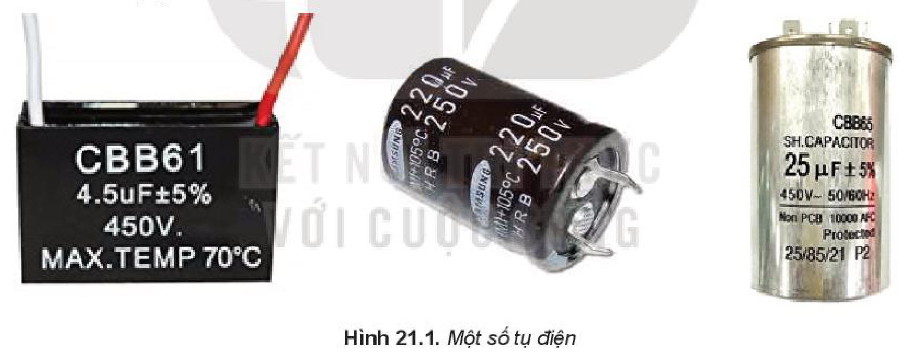
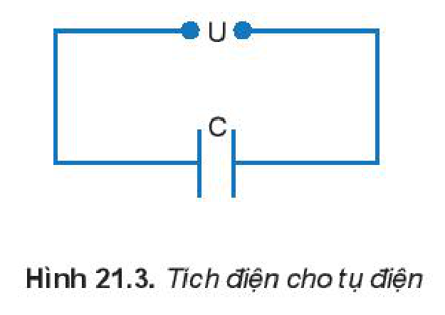
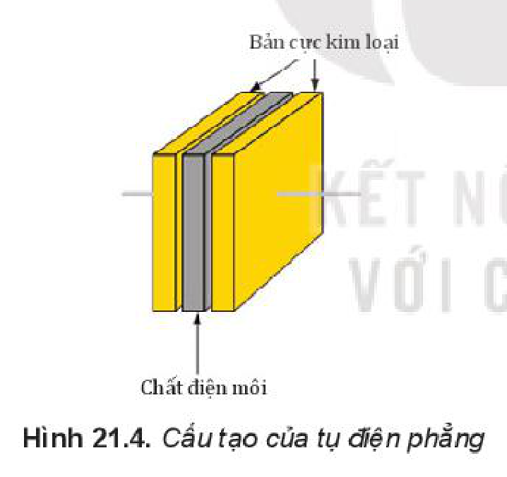
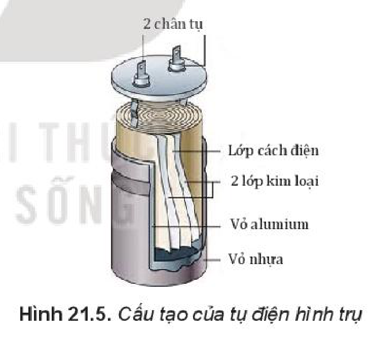
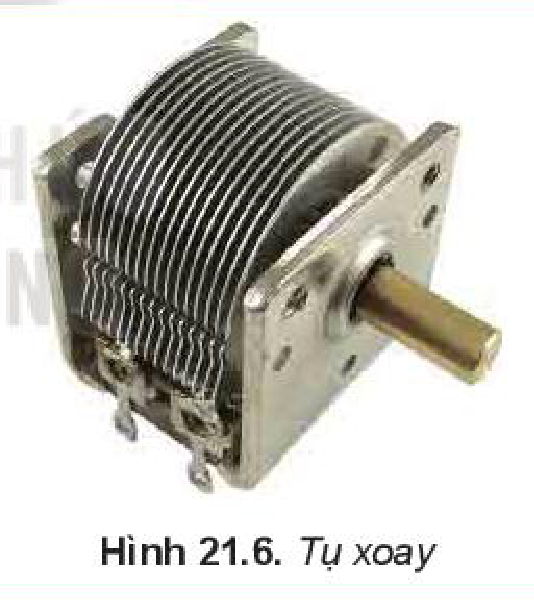
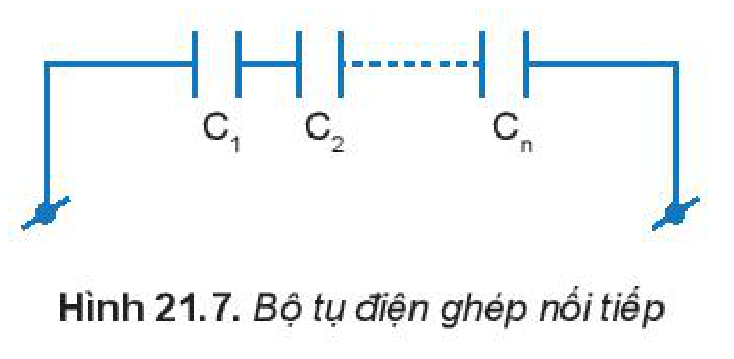
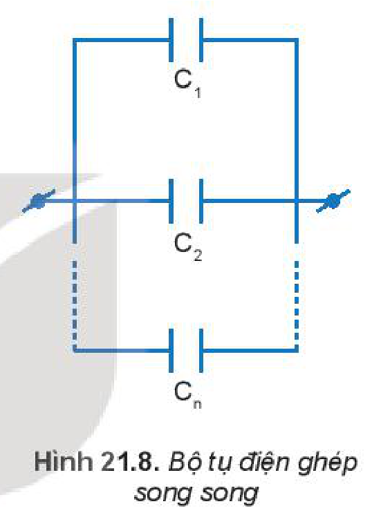
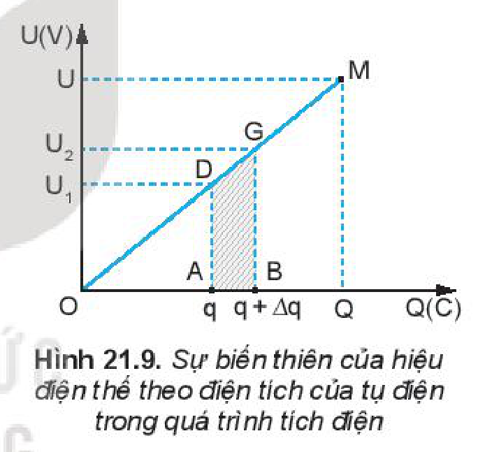
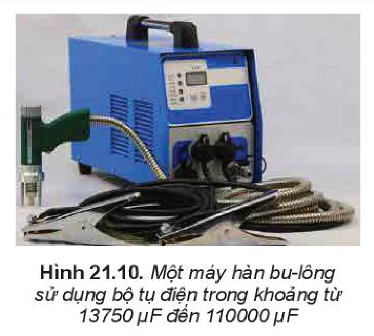

<!-- pdf:85 -->

# BÀI 21: TỤ ĐIỆN

## 🔴 Mở đầu

> Nếu một chiếc quạt điện gặp trục trặc như: cánh quạt quay chậm hoặc không quay dù vẫn cắm điện; động cơ nóng, rung và có âm thanh bất thường, thì nguyên nhân mà chúng ta cần xem xét là hỏng tụ điện. Vậy tụ điện có cấu tạo như thế nào?

## I. TỤ ĐIỆN

- Tụ điện được sử dụng trong các thiết bị điện như quạt điện, tủ lạnh, ti vi, động cơ,... với các hình dạng khác nhau.

- ***Tụ điện** là một loại linh kiện điện tử gồm hai vật dẫn đặt gần nhau và ngăn cách nhau bởi môi trường cách điện (**điện môi**). Mỗi vật dẫn được gọi là một **bản tụ điện**.*
- Mật độ điện tích tự do trong điện môi là rất nhỏ do đó **điện môi** là những chất không dẫn điện. Khi điện trường ngoài đặt vào điện môi lớn hơn một giới hạn nhất định thì các liên kết giữa các điện tích trái dấu trong nguyên tử của chất điện môi sẽ bị phá vỡ, điện tích tự do xuất hiện. Lúc này điện môi trở thành dẫn điện (**điện môi bị đánh thủng**).
- Khi vẽ mạch điện, tụ điện được kí hiệu như Hình 21.2.

<!-- pdf:86 -->

- Trong mạch điện, tụ điện có nhiệm vụ tích điện và phóng điện. Ta có thể hình dung quá trình tích điện và phóng điện như sau:
  + Để tích điện cho tụ điện, người ta nối hai bản cực của tụ điện với hai cực của nguồn điện một chiều. Bản nối với cực dương sẽ tích điện dương, bản nối với cực âm sẽ tích điện âm (Hình 21.3). Điện tích trên hai bản tụ điện có độ lớn bằng nhau nhưng trái dấu. Ta gọi độ lớn này là **điện tích của tụ điện**.
  + Sau khi tích điện cho tụ điện, ta bỏ nguồn điện ra và nối hai bản tụ điện với một điện trở (hoặc bóng đèn), sẽ có dòng điện chạy qua điện trở và điện tích trên tụ điện giảm nhanh. Ta gọi đó là **sự phóng điện của tụ điện**.

> **Em có biết:**
>
> - Tụ điện gồm hai bản phẳng bằng kim loại, đặt song song, giữa hai bản là chất điện môi, có thể là không khí như chúng ta đã biết được gọi là **tụ điện phẳng** (Hình 21.4).
> - Trong thực tế, người ta thường chế tạo tụ điện với hai bản là hai tấm giấy thiếc, kẽm, hoặc nhôm; Lớp điện môi làm bằng giấy tẩm chất cách điện (paraffin); Để giảm kích thước của linh kiện, người ta cuộn tụ điện lại và đặt trong một vỏ bằng kim loại (Hình 21.5). Tụ điện lúc này có dạng hình trụ.
>
> 
>
> 

## II. ĐIỆN DUNG CỦA TỤ ĐIỆN

### 1. Điện dung

- Dùng một nguồn có hiệu điện thế $U$ để tích điện cho một số tụ điện khác nhau. Kết quả cho thấy độ lớn điện tích mà các tụ điện này tích được là không giống nhau, nghĩa là khả năng tích điện của chúng là khác nhau.
- Với mỗi tụ điện nhất định người ta đã chứng minh được: độ lớn điện tích $Q$ tụ điện tích được tỉ lệ thuận với hiệu điện thế đặt vào hai bản của nó.

$$Q = CU \quad (21.1)$$
<!-- ocr-ok: đối chiếu ảnh trang PDF 86 khớp công thức (21.1) -->

<!-- pdf:87 -->

- Đại lượng $C$ là một hằng số đặc trưng cho khả năng tích điện của tụ điện ở một hiệu điện thế xác định và được gọi là **điện dung của tụ điện**.

***Điện dung của tụ điện** là đại lượng đặc trưng cho khả năng tích điện của tụ điện khi đặt một hiệu điện thế $U$ vào hai bản tụ điện. Nó được tính bằng tỉ số giữa điện tích $Q$ của tụ điện và hiệu điện thế $U$ đặt vào hai bản tụ điện.*

$$C = \frac{Q}{U} \quad (21.2)$$
<!-- ocr-ok: đối chiếu ảnh trang PDF 87 khớp công thức (21.2) -->

Trong công thức (21.2), khi $Q$ được tính bằng đơn vị Coulomb (C), $U$ được tính bằng đơn vị Vôn (V) thì đơn vị của điện dung $C$ là **fara** (kí hiệu là F).

*Vậy, **fara** là điện dung của một tụ điện mà nếu đặt hiệu điện thế $1\text{ V}$ vào hai bản tụ điện thì điện tích của tụ điện là $1\text{ C}$.*

Chú ý rằng, tụ điện được sử dụng trong thực tế thường có điện dung cỡ khoảng từ $10^{-12}\text{ F}$ đến $10^{-6}\text{ F}$ nên người ta cũng thường dùng các đơn vị:

+ $1\text{ micrôfara}$ (kí hiệu là $\mu\text{F}$) $= 10^{-6}\text{ F}$.
+ $1\text{ nanôfara}$ (kí hiệu là $\text{nF}$) $= 10^{-9}\text{ F}$.
+ $1\text{ picôfara}$ (kí hiệu là $\text{pF}$) $= 10^{-12}\text{ F}$.

Trên vỏ tụ điện thường được ghi hai thông số kĩ thuật quan trọng (Hình 21.1) là điện dung của tụ điện và hiệu điện thế tối đa được sử dụng (nếu dùng quá hiệu điện thế này, tụ điện có nguy cơ bị đánh thủng). Tuỳ vào từng loại tụ điện mà có thể có thêm các thông số khác như tần số dòng điện, khoảng nhiệt độ mà tụ điện hoạt động bình thường,...

> **Em có biết:**
>
> Ngoài các tụ điện thông dụng trong công nghệ và cuộc sống, người ta còn chế tạo ra loại **tụ điện xoay**, là một loại tụ điện có thể thay đổi được điện dung.
>
> 

> **Câu hỏi:**
>
> 1. Cho một tụ điện trên vỏ có ghi là $2\ \mu\text{F} - 200\text{ V}$.
>    a) Đặt vào hai bản tụ điện một hiệu điện thế $36\text{ V}$. Hãy tính điện tích mà tụ điện tích được.
>    b) Hãy tính điện tích mà tụ tích được ở hiệu điện thế tối đa cho phép.
> 2. Có hai chiếc tụ điện, trên vỏ tụ điện (A) có ghi $2\ \mu\text{F} - 350\text{ V}$, tụ điện (B) có ghi $2,3\ \mu\text{F} - 300\text{ V}$.
>    a) Trong hai tụ điện trên khi tích điện ở cùng một hiệu điện thế, tụ điện nào có khả năng tích điện tốt hơn?
>    b) Khi tích điện lên mức tối đa cho phép thì tụ điện nào sẽ có điện tích lớn hơn?

<!-- pdf:88 -->

### 2. Điện dung của bộ tụ điện

Trong thực tế muốn có tụ điện với điện dung thích hợp hay hiệu điện thế cần thiết người ta phải ghép các tụ điện thành **bộ tụ điện**.

**a) Ghép nối tiếp**

- Ghép nối tiếp $n$ tụ điện chưa tích điện có điện dung $C_1, C_2, \dots, C_n$ với nhau rồi mắc vào nguồn điện có hiệu điện thế $U$ (Hình 21.7). Hiệu điện thế, điện tích và điện dung của bộ tụ sẽ có mối liên hệ với các đại lượng tương ứng của mỗi tụ theo các công thức sau:

$$U = U_1 + U_2 + \dots + U_n \quad (21.3)$$
<!-- ocr-ok: đối chiếu ảnh trang PDF 88 khớp công thức (21.3) -->

$$Q = Q_1 = Q_2 = \dots = Q_n \quad (21.4)$$
<!-- ocr-ok: đối chiếu ảnh trang PDF 88 khớp công thức (21.4) -->

$$\frac{1}{C} = \frac{1}{C_1} + \frac{1}{C_2} + \dots + \frac{1}{C_n} \quad (21.5)$$
<!-- ocr-ok: đối chiếu ảnh trang PDF 88 khớp công thức (21.5) -->

**b) Ghép song song**

- Ghép $n$ tụ điện chưa tích điện có điện dung $C_1, C_2, \dots, C_n$ song song với nhau rồi mắc vào nguồn điện có hiệu điện thế $U$ (Hình 21.8). Hiệu điện thế, điện tích và điện dung của bộ tụ sẽ có mối liên hệ với các đại lượng tương ứng của mỗi tụ theo các công thức sau:

$$U = U_1 = U_2 = \dots = U_n \quad (21.6)$$
<!-- ocr-ok: đối chiếu ảnh trang PDF 88 khớp công thức (21.6) -->

$$Q = Q_1 + Q_2 + \dots + Q_n \quad (21.7)$$
<!-- ocr-ok: đối chiếu ảnh trang PDF 88 khớp công thức (21.7) -->

$$C = C_1 + C_2 + \dots + C_n \quad (21.8)$$
<!-- ocr-ok: đối chiếu ảnh trang PDF 88 khớp công thức (21.8) -->

*Bài tập ví dụ:*

Có 3 tụ điện với điện dung lần lượt là $C_1 = 2\ \mu\text{F}$, $C_2 = 3\ \mu\text{F}$, $C_3 = 4\ \mu\text{F}$.

a) Tính điện dung của bộ tụ điện khi ba tụ ghép nối tiếp?
b) Tính điện dung của bộ tụ điện khi ba tụ ghép song song? Hãy so sánh để thấy cách ghép nào cho khả năng tích điện tốt hơn?

*Giải:*

a) Sử dụng công thức (21.5) cho bộ tụ điện ghép nối tiếp ta tính được:

$$\frac{1}{C_{nt}} = \frac{1}{C_1} + \frac{1}{C_2} + \frac{1}{C_3}$$
<!-- ocr-ok: đối chiếu ảnh trang PDF 88 khớp công thức lời giải câu a -->

Thay số vào ta có điện dung của bộ tụ điện:

$$C_{nt} = \frac{12}{13}\ \mu\text{F}$$
<!-- ocr-ok: đối chiếu ảnh trang PDF 88 khớp kết quả C_nt -->

<!-- pdf:89 -->

b) Sử dụng công thức (21.8) cho bộ tụ điện ghép song song ta tính được:

$$C_{ss} = C_1 + C_2 + C_3$$
<!-- ocr-ok: đối chiếu ảnh trang PDF 89 khớp công thức lời giải câu b -->

Thay số vào ta tính được điện dung của bộ tụ điện: $C_{ss} = 9\ \mu\text{F}$

Kết quả $C_{ss} > C_{nt}$ cho thấy bộ tụ điện ghép song song có khả năng tích điện tốt hơn.

## III. NĂNG LƯỢNG CỦA TỤ ĐIỆN

Khi sử dụng nguồn điện để tích điện cho tụ, nguồn điện đã thực hiện công $A$ để dịch chuyển các electron từ bản cực nối với cực dương sang bản cực nối với cực âm của tụ điện. Công $A$ này đã chuyển thành thế năng điện của các electron trên bản nhiễm điện âm hay nói cách khác, tụ điện đã tích một năng lượng $W = A$. Khi cho tụ điện phóng điện qua điện trở (hay bóng đèn) thì tụ điện giải phóng năng lượng đã tích luỹ được. Do đó ứng dụng quan trọng nhất trong thực tế của tụ điện là *tích trữ năng lượng* và *cung cấp năng lượng*.

> **Em có biết:**
>
> Người ta sử dụng tụ điện để cung cấp năng lượng khởi động cho động cơ một pha.
>
> Tụ điện còn được sử dụng để tích tụ năng lượng trong mạch khuếch đại của một số loại máy hàn điện, hệ thống âm thanh,...

Quá trình tích điện cho tụ điện $C$ diễn ra trong một khoảng thời gian và hiệu điện thế sẽ tăng tỉ lệ thuận với lượng điện tích đã tích được trên tụ như Hình 21.9.

Ban đầu ta tích điện cho tụ điện tới điện tích $q_1 = q$ bởi một hiệu điện thế $U_1 = \frac{1}{C} \cdot q$. Tiếp tục tích điện thêm cho tụ điện tới điện tích $q_2 = q_1 + \Delta q$ bởi hiệu điện thế $U_2 = \frac{q + \Delta q}{C}$.

Công của nguồn điện dịch chuyển một điện tích nhỏ $\Delta q$ từ bản cực này tới bản cực kia bằng $\Delta A = Fd = \Delta q \cdot Ed = \Delta q \cdot U$.

Khi điện tích $\Delta q$ rất nhỏ, ta có thể coi $U$ là trung bình cộng của $U_1$ và $U_2$: vì vậy $\Delta A = \frac{U_1 + U_2}{2}\Delta q$ chính bằng diện tích hình thang ABGD.
<!-- ocr-ok: đối chiếu ảnh trang PDF 89 khớp đoạn văn (OCR đọc nhầm diện tích thành điện tích) -->

Công để tích điện cho tụ điện đến điện tích $Q$ bằng tổng các điện tích nhỏ $\Delta q$ là $A$ bằng tổng các công nhỏ $\Delta A$ hay tổng các diện tích hình thang tương ứng. Công $A$ mà nguồn điện thực hiện chính bằng diện tích hình tam giác OQM: $A = \frac{QU}{2}$.

*Vậy **năng lượng của tụ điện** khi được tích điện với điện tích $Q$:*

$$W = \frac{QU}{2} = \frac{Q^2}{2C} = \frac{CU^2}{2} \quad (21.9)$$
<!-- ocr-ok: đối chiếu ảnh trang PDF 89 khớp công thức (21.9) -->

Ở đây điện tích $Q$ đơn vị là Coulomb; Hiệu điện thế $U$ đơn vị là Vôn; Điện dung $C$ đơn vị là fara; năng lượng $W$ có đơn vị là jun.

**Năng lượng của tụ điện** cũng chính là **năng lượng điện trường trong tụ điện**.

<!-- pdf:90 -->

> **Câu hỏi:** Có hai chiếc tụ điện, tụ điện D có thông số cơ bản được ghi là $2\text{ mF} - 450\text{ V}$; tụ điện E có thông số cơ bản được ghi là $2,5\ \mu\text{F} - 350\text{ V}$. Khi các tụ điện trên được tích điện tới mức tối đa cho phép, hãy tính năng lượng của mỗi tụ điện.

## IV. ỨNG DỤNG CỦA TỤ ĐIỆN TRONG CUỘC SỐNG

Tích trữ năng lượng là chức năng quan trọng nhất của tụ điện và được sử dụng trong rất nhiều thiết bị điện như động cơ xe máy, máy hàn dùng công nghệ phóng điện của tụ (Hình 21.10), mạch khuếch đại,... Ngoài ra, tụ điện còn có một số chức năng khác nữa lưu trữ điện tích, lọc dòng điện một chiều không cho đi qua mà chỉ cho dòng điện xoay chiều đi qua,...

> **Hoạt động:**
>
> Các em hãy sử dụng sách, báo, Internet hoặc các mạng thông tin khác để tìm hiểu, sưu tập một số tụ điện thông dụng. Tiếp theo, các em lựa chọn và sử dụng các thông tin này để xây dựng một báo cáo *một số ứng dụng của tụ điện trong cuộc sống*. Dưới đây là một mẫu báo cáo để chúng ta tham khảo.
>
> **BÁO CÁO**
> **Một số ứng dụng của tụ điện trong cuộc sống**
>
> **Tên học sinh:** ...
> **Lớp:** ...
>
> I. Thống kê phân loại tụ điện đã sưu tập được
>
> | STT | Điện dung – điện áp | Hình dạng | Thiết bị sử dụng | Mục đích sử dụng | Ghi chú |
> | --- | --- | --- | --- | --- | --- |
> | 1 | | | | | |
> | 2 | | | | | |
> | 3 | | | | | |
> | 4 | | | | | |
>
> II. Kết luận về ứng dụng của tụ điện trong cuộc sống
>
> *Ngày ... tháng ... năm*
> Học sinh kí tên

<!-- pdf:91 -->

> **Em có biết:**
>
> Trong kĩ thuật hàn bu-lông bằng quy trình phóng điện của tụ, người ta sử dụng máy hàn với bộ phận chính gồm bộ tụ điện cùng với bộ phận súng hàn để ép chặt bu-lông vào bề mặt vật liệu cần hàn.
>
> Dòng điện phóng ra từ bộ tụ điện công suất lớn để tạo nhiệt làm nóng chảy đế của bu lông và bề mặt vật liệu, cùng với lực ép bu-lông tạo ra từ súng hàn sẽ tạo thành mối hàn vững chắc.
>
> 

## 📌 Em đã học

- Điện dung của tụ điện là đại lượng đặc trưng cho khả năng tích điện của tụ điện khi đặt một hiệu điện thế $U$ vào hai bản tụ. Nó được tính bằng tỉ số giữa điện tích $Q$ của tụ và hiệu điện thế $U$ đặt vào hai bản tụ.

$$C = \frac{Q}{U}$$

- Fara là điện dung của một tụ điện mà nếu đặt hiệu điện thế $1\text{ V}$ vào hai bản tụ thì điện tích của tụ là $1\text{ C}$.
- Công thức của bộ tụ điện ghép nối tiếp:

$$U = U_1 + U_2 + \dots + U_n$$
<!-- ocr-ok: đối chiếu ảnh trang PDF 91 khớp công thức trong hộp Em đã học -->

$$Q = Q_1 = Q_2 = \dots = Q_n$$
<!-- ocr-ok: đối chiếu ảnh trang PDF 91 khớp công thức trong hộp Em đã học -->

$$\frac{1}{C} = \frac{1}{C_1} + \frac{1}{C_2} + \dots + \frac{1}{C_n}$$
<!-- ocr-ok: đối chiếu ảnh trang PDF 91 khớp công thức trong hộp Em đã học -->

- Công thức của bộ tụ điện ghép song song:

$$U = U_1 = U_2 = \dots = U_n$$
<!-- ocr-ok: đối chiếu ảnh trang PDF 91 khớp công thức trong hộp Em đã học -->

$$Q = Q_1 + Q_2 + \dots + Q_n$$
<!-- ocr-ok: đối chiếu ảnh trang PDF 91 khớp công thức trong hộp Em đã học -->

$$C = C_1 + C_2 + \dots + C_n$$
<!-- ocr-ok: đối chiếu ảnh trang PDF 91 khớp công thức trong hộp Em đã học -->

- Năng lượng tụ điện:

$$W = \frac{Q \cdot U}{2} = \frac{Q^2}{2C} = \frac{C \cdot U^2}{2}$$
<!-- ocr-ok: đối chiếu ảnh trang PDF 91 khớp công thức trong hộp Em đã học -->

- Tụ điện có ứng dụng quan trọng là tích trữ năng lượng và cung cấp năng lượng.

## ✏️ Em có thể

- Đọc hiểu các thông số kĩ thuật cơ bản của tụ điện và xác định được điện dung của tụ điện, hiệu điện thế tối đa cho phép đặt vào tụ điện.
- Hiểu và thực hành được các cách ghép nối tiếp và ghép song song của các tụ điện trong mạch điện.
- Vận dụng được kiến thức về năng lượng của tụ điện để giải thích được nguyên lí hoạt động phóng điện của máy hàn điện, tia sét giữa các đám mây tích điện trái dấu.
- Tìm hiểu về các ứng dụng của tụ điện trong cuộc sống trên cơ sở thu thập và lựa chọn thông tin, xây dựng báo cáo.

## 📷 Danh sách hình trong bài

| Mã hình | Số hình SGK | Trang PDF | Chú thích |
| --- | --- | --- | --- |
| H11-vat_ly-b21-01 | Hình 21.1 | 85 | Một số tụ điện |
| H11-vat_ly-b21-02 | Hình 21.2 | 85 | Kí hiệu tụ điện trong sơ đồ mạch điện |
| H11-vat_ly-b21-03 | Hình 21.3 | 86 | Tích điện cho tụ điện |
| H11-vat_ly-b21-04 | Hình 21.4 | 86 | Cấu tạo của tụ điện phẳng |
| H11-vat_ly-b21-05 | Hình 21.5 | 86 | Cấu tạo của tụ điện hình trụ |
| H11-vat_ly-b21-06 | Hình 21.6 | 87 | Tụ xoay |
| H11-vat_ly-b21-07 | Hình 21.7 | 88 | Bộ tụ điện ghép nối tiếp |
| H11-vat_ly-b21-08 | Hình 21.8 | 88 | Bộ tụ điện ghép song song |
| H11-vat_ly-b21-09 | Hình 21.9 | 89 | Sự biến thiên của hiệu điện thế theo điện tích của tụ điện trong quá trình tích điện |
| H11-vat_ly-b21-10 | Hình 21.10 | 91 | Một máy hàn bu-lông sử dụng bộ tụ điện trong khoảng từ 13750 uF đến 110000 uF |
