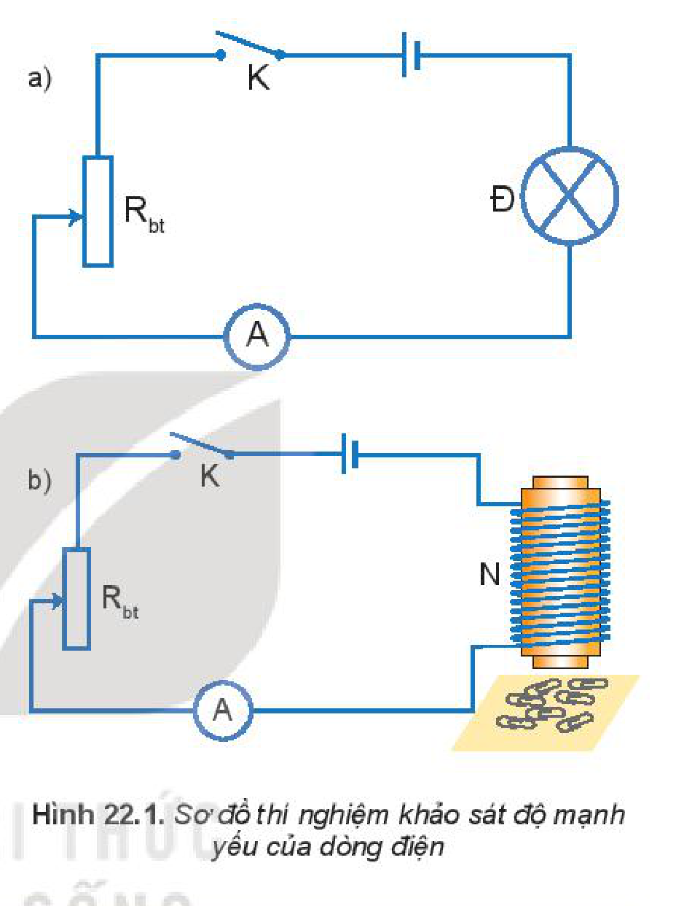
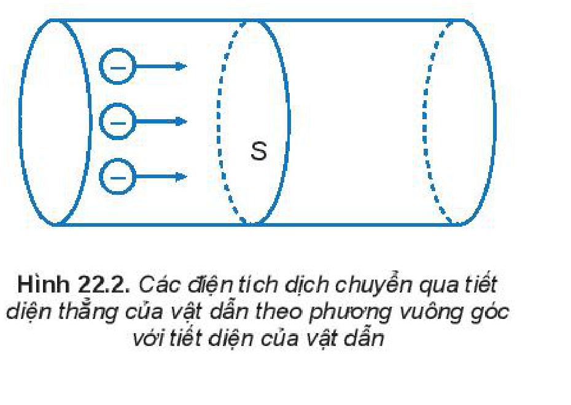
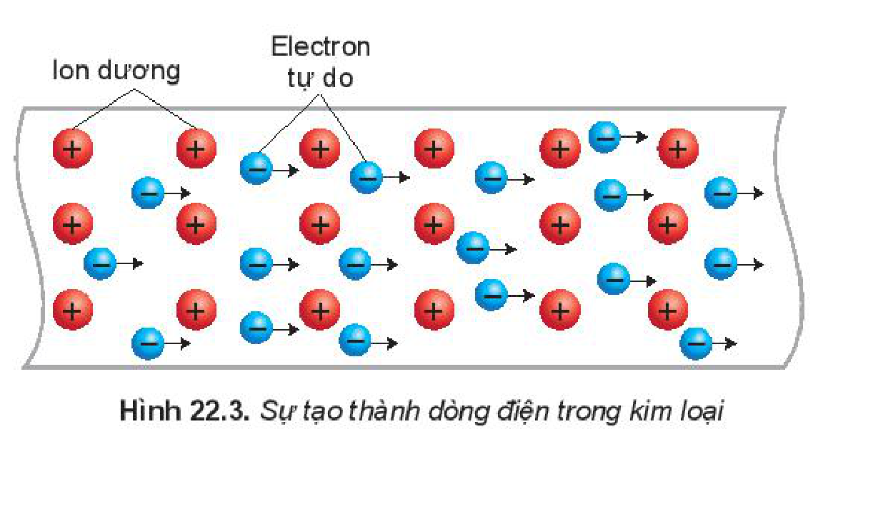
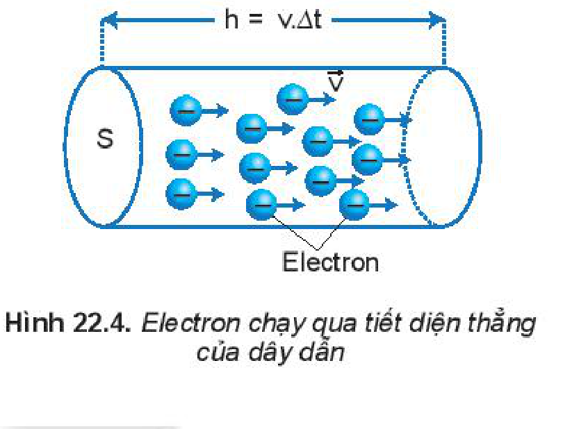
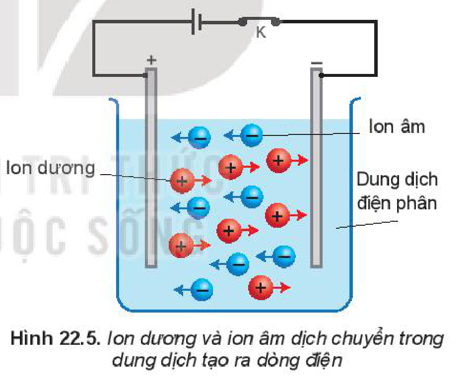

<!-- pdf:93 -->

# BÀI 22: CƯỜNG ĐỘ DÒNG ĐIỆN

## 🔴 Mở đầu

> Cường độ dòng điện là gì và đặc trưng cho tính chất nào của dòng điện?

## I. CƯỜNG ĐỘ DÒNG ĐIỆN

### 1. Thí nghiệm

*Thí nghiệm 1.*

*Chuẩn bị:*
- 1 ampe kế.
- 1 biến trở.
- 1 bóng đèn.
- Nguồn điện.
- Dây nối.
- Khoá K.
- Nam châm điện.
<!-- ocr-ok: đối chiếu ảnh trang PDF 93 khớp nguyên văn (OCR dính từ và kí hiệu sơ đồ) -->

*Tiến hành:*
- Bố trí thí nghiệm như Hình 22.1a.
- Đóng khoá K, dịch chuyển con chạy của biến trở $R_{\text{bt}}$ để số chỉ của ampe kế tăng dần.

> **Câu hỏi:**
>
> 1. Hãy nhận xét về độ sáng của bóng đèn Đ khi số chỉ của ampe kế tăng dần.
> 2. Theo em, thí nghiệm trên cho thấy cường độ dòng điện đặc trưng cho tính chất nào của dòng điện?

*Thí nghiệm 2.*

Thay đèn Đ bằng một nam châm điện N (Hình 22.1b).
- Đóng khoá K, quan sát số lượng ghim giấy bằng sắt mà nam châm hút được.
- Đóng khoá K, điều chỉnh biến trở để số chỉ ampe kế chỉ giá trị lớn hơn giá trị ban đầu, quan sát số lượng ghim giấy bằng sắt mà nam châm hút được. So sánh với số lượng ghim giấy bằng sắt mà nam châm điện hút được trong hai trường hợp.

> **Câu hỏi:**
>
> 1. Hãy nhận xét về số ghim giấy mà nam châm hút được khi chỉ số của ampe kế tăng.
> 2. Từ kết quả thí nghiệm cho thấy cường độ dòng điện đặc trưng cho tính chất nào của dòng điện.

<!-- pdf:94 -->

### 2. Công thức tính cường độ dòng điện

Lượng điện tích chuyển qua tiết diện thẳng của dây dẫn trong một đơn vị thời gian càng lớn thì dòng điện chạy qua dây dẫn càng mạnh (Hình 22.2).

Trong vật lí, người ta gọi độ lớn của **điện lượng** chuyển qua tiết diện thẳng của một dây dẫn trong một đơn vị thời gian là **cường độ dòng điện** chạy qua dây dẫn, được xác định bằng công thức:

$$I = \frac{\Delta q}{\Delta t} \quad (22.1)$$
<!-- ocr-ok: đối chiếu ảnh trang PDF 94 khớp công thức (22.1) -->

Trong công thức trên, đơn vị của cường độ dòng điện là **ampe** (kí hiệu là A), của điện lượng là **Cu-lông** (kí hiệu là C), của thời gian là giây (kí hiệu là s).

Từ công thức (22.1), ta rút ra:

$$\Delta q = I \cdot \Delta t \quad (22.2)$$
<!-- ocr-ok: đối chiếu ảnh trang PDF 94 khớp công thức (22.2) -->

Công thức (22.2) cho thấy ý nghĩa của đơn vị điện lượng **Cu-lông**: $1\text{ Cu-lông}$ là tổng điện lượng của các hạt mang điện chạy qua tiết diện thẳng của dây dẫn trong $1\text{ s}$ bởi dòng điện có cường độ $1\text{ A}$.

Đơn vị của điện lượng: $1\text{ C} = 1\text{ A.s}$.

> **Câu hỏi:** Trên một thiết bị dùng để nạp điện cho điện thoại di động có ghi thông số $10\text{ }000\text{ mA}\cdot\text{h}$. Thông số $10\text{ }000\text{ mA}\cdot\text{h}$ cho biết điều gì?

## II. LIÊN HỆ GIỮA CƯỜNG ĐỘ DÒNG ĐIỆN VỚI MẬT ĐỘ VÀ TỐC ĐỘ CỦA CÁC HẠT MANG ĐIỆN

### 1. Dòng điện chạy trong dây dẫn kim loại

Trong kim loại tồn tại các electron không liên kết với nguyên tử, được gọi là **electron tự do** vì chúng có thể chuyển động tự do về mọi hướng. Khi dây dẫn được nối với nguồn điện thì trong dây dẫn xuất hiện điện trường. Dưới tác dụng của lực điện trường, các electron mang điện tích âm dịch chuyển có hướng ngược với hướng của điện trường, tạo ra dòng điện (Hình 22.3).
<!-- term: Dòng điện chạy trong dây dẫn kim loại -->

Người ta quy ước **chiều dòng điện** trong mạch là chiều từ cực dương sang cực âm của nguồn điện.

Trong kim loại các electron tạo ra dòng điện dịch chuyển ngược chiều với chiều quy ước của dòng điện.
<!-- term: Dòng điện chạy trong dây dẫn kim loại -->

<!-- pdf:95 -->

### 2. Biểu thức liên hệ giữa cường độ dòng điện với mật độ và tốc độ của các hạt mang điện

Nếu gọi:

$S$ là diện tích tiết diện thẳng của dây dẫn.

$n$ là **mật độ hạt mang điện** (ở đây là số electron tự do trong một đơn vị thể tích của dây dẫn).

$v$ là **tốc độ dịch chuyển có hướng** của electron.

$e$ là độ lớn điện tích của electron.

Trong khoảng thời gian $\Delta t$ số electron $N$ chạy qua tiết diện thẳng của dây dẫn là: $N = nSh$, trong đó $h = v \cdot \Delta t$

$$N = nSv \cdot \Delta t$$
<!-- ocr-ok: đối chiếu ảnh trang PDF 95 khớp công thức -->

Do vậy, điện lượng chuyển qua tiết diện thẳng của dây dẫn trong khoảng thời gian $\Delta t$ là:

$$\Delta q = Ne = Snve \cdot \Delta t.$$
<!-- ocr-ok: đối chiếu ảnh trang PDF 95 khớp công thức -->

Theo định nghĩa cường độ dòng điện ở công thức (22.1), ta xác định được cường độ dòng điện chạy qua một dây dẫn kim loại như sau:

$$I = Snve \quad (22.3)$$
<!-- ocr-ok: đối chiếu ảnh trang PDF 95 khớp công thức (22.3) -->

### 3. Bài tập vận dụng

Một dây dẫn bằng kim loại, tiết diện tròn, có đường kính tiết diện là $d = 2\text{ mm}$, có dòng điện $I = 5\text{ A}$ chạy qua. Cho biết mật độ electron tự do là $n = 8,45 \cdot 10^{28}\text{ electron/m}^3$. Hãy tính tốc độ dịch chuyển có hướng của các electron trong dây dẫn.

*Giải:*

Áp dụng công thức (22.3) ta có:

$$I = Snve$$

$$\Rightarrow v = \frac{I}{nSe} = \frac{I}{n\frac{\pi d^2}{4}e} = \frac{4I}{n\pi d^2 e}.$$
<!-- ocr-ok: đối chiếu ảnh trang PDF 95 khớp công thức biến đổi -->

$$= \frac{I}{n\frac{\pi d^2}{4}e} = \frac{4I}{n\pi d^2 e}.$$
<!-- ocr-ok: đối chiếu ảnh trang PDF 95 khớp nguyên văn (SGK in lặp dòng công thức) -->

Thay số ta được: $v \approx 1,2 \cdot 10^{-4}\text{ m/s} = 0,12\text{ mm/s}$.

<!-- pdf:96 -->

## 📌 Em đã học

- Cường độ dòng điện là đại lượng đặc trưng cho tác dụng mạnh, yếu của dòng điện và được xác định bằng công thức: $I = \frac{\Delta q}{\Delta t}$.
- Biểu thức liên hệ giữa cường độ dòng điện trong dây dẫn kim loại với mật độ hạt mang điện **tốc độ dịch chuyển có hướng** của các hạt mang điện là: $I = Snve$.

## ✏️ Em có thể

- Ước tính được cường độ dòng điện của tia sét trong các cơn dông.
- Hiểu được ý nghĩa của thông số $\text{mA}\cdot\text{h}$ ghi trên pin, ac quy và sạc dự phòng.
- Giải thích được nguyên tắc đo điện tâm đồ.

> **Em có biết:**
>
> Trong **dung dịch điện phân** tồn tại các ion dương và ion âm. Khi đóng mạch điện trong bình điện phân, các ion trong dung dịch chính là các hạt mang điện (Hình 22.5).
>
> 

## 📷 Danh sách hình trong bài

| Mã hình | Số hình SGK | Trang PDF | Chú thích |
| --- | --- | --- | --- |
| H11-vat_ly-b22-01 | Hình 22.1 | 93 | Sơ đồ thí nghiệm khảo sát độ mạnh yếu của dòng điện |
| H11-vat_ly-b22-02 | Hình 22.2 | 94 | Các điện tích dịch chuyển qua tiết diện thẳng của vật dẫn theo phương vuông góc với tiết diện của vật dẫn |
| H11-vat_ly-b22-03 | Hình 22.3 | 94 | Sự tạo thành dòng điện trong kim loại |
| H11-vat_ly-b22-04 | Hình 22.4 | 95 | Electron chạy qua tiết diện thẳng của dây dẫn |
| H11-vat_ly-b22-05 | Hình 22.5 | 96 | Ion dương và ion âm dịch chuyển trong dung dịch tạo ra dòng điện |
