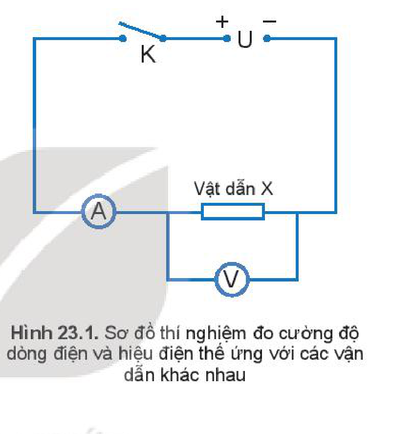
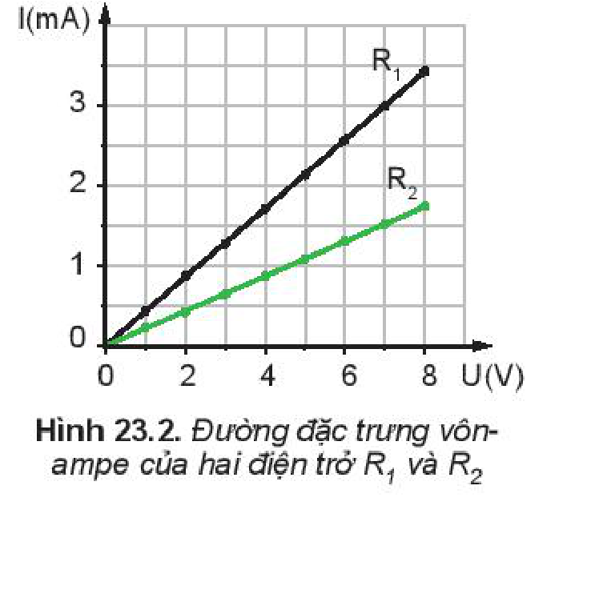
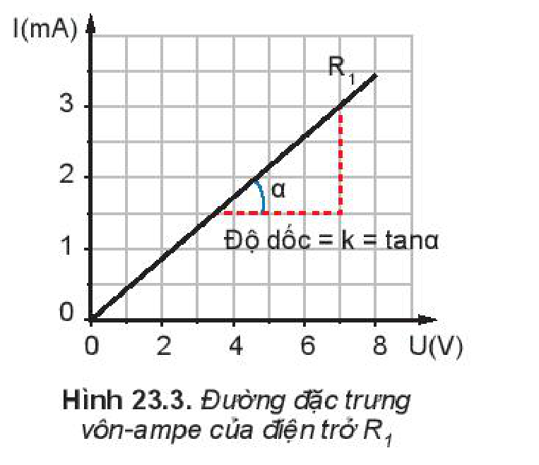
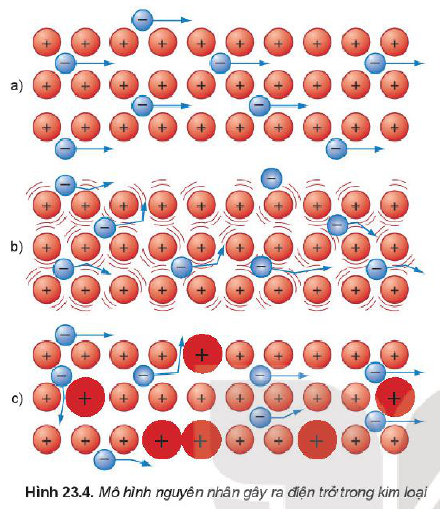
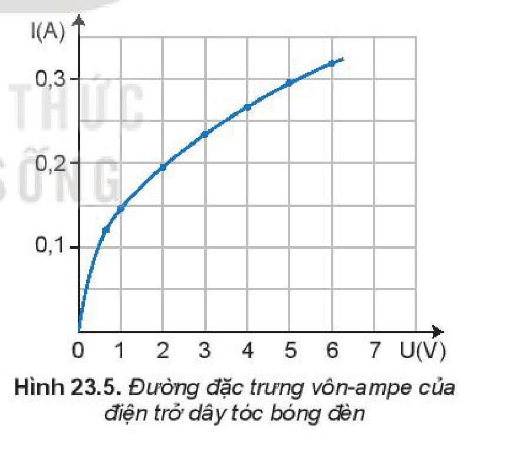
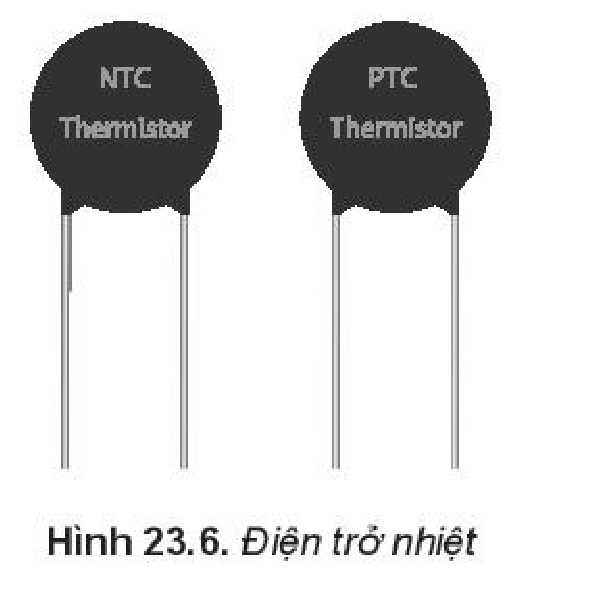
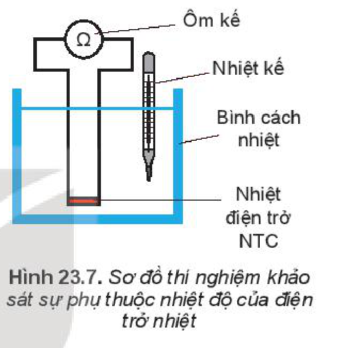
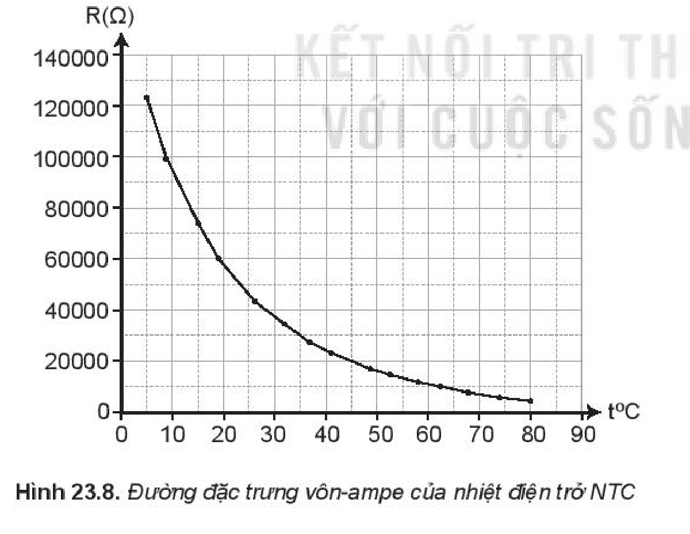
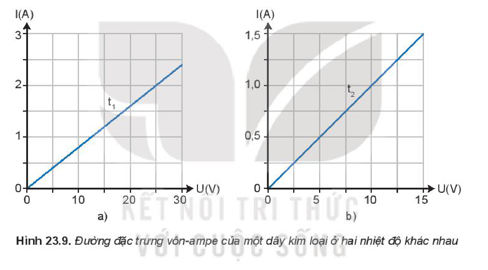
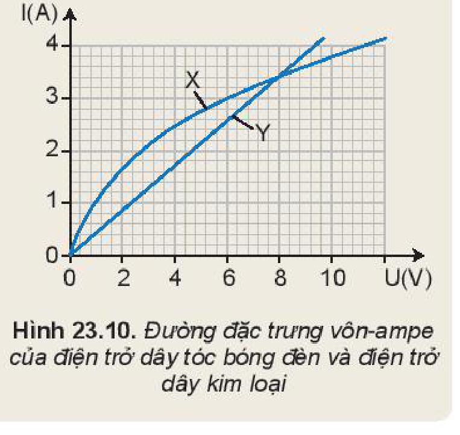

<!-- pdf:97 -->

# BÀI 23: ĐIỆN TRỞ. ĐỊNH LUẬT OHM

## 🔴 Mở đầu

> Các thiết bị điện thông thường mà chúng ta dùng hằng ngày đều có các điện trở. Vậy điện trở đặc trưng cho tính chất nào của vật dẫn và tại sao một vật dẫn lại có điện trở?

## I. ĐIỆN TRỞ

### 1. Thí nghiệm

*Chuẩn bị:*
- 1 ampe kế.
- 1 vôn kế.
- 1 nguồn có thể điều chỉnh thay đổi được hiệu điện thế.
- Hai vật dẫn X và Y khác nhau.
- Dây nối.
- Khoá K.
<!-- ocr-ok: đối chiếu ảnh trang PDF 97 khớp nguyên văn (OCR dính từ và kí hiệu sơ đồ) -->

*Tiến hành:*
- Mắc mạch điện như Hình vẽ 23.1.
- Đóng khoá K. Điều chỉnh hiệu điện thế của nguồn ta thu được các giá trị của cường độ dòng điện $I_1$ chạy qua vật dẫn X, ghi kết quả vào mẫu Bảng 23.1.
- Thay vật dẫn Y vào vị trí của vật dẫn X và lặp lại thí nghiệm, ta thu được các giá trị của cường độ dòng điện $I_2$ chạy qua vật dẫn Y, ghi kết quả vào mẫu Bảng 23.1.

*Bảng 23.1.*

| $U\text{ (V)}$ | Vật dẫn X $I_1\text{ (mA)}$ | Vật dẫn Y $I_2\text{ (mA)}$ |
| --- | --- | --- |
| ? | ? | ? |
| ? | ? | ? |
| ? | ? | ? |
| ? | ? | ? |
| ? | ? | ? |
| ? | ? | ? |
| ? | ? | ? |
| ? | ? | ? |
| ? | ? | ? |

> **Câu hỏi:**
>
> 1. Hãy nhận xét về tỉ số $\frac{U}{I}$ đối với từng vật dẫn X và vật dẫn Y.
> 2. Đối với hai vật dẫn X và vật dẫn Y thì tỉ số $\frac{U}{I}$ có khác nhau không?
> 3. Nếu đặt cùng một hiệu điện thế vào hai đầu vật dẫn X và vật dẫn Y thì cường độ dòng điện chạy qua vật dẫn nào có giá trị nhỏ hơn?

<!-- pdf:98 -->

### 2. Định nghĩa điện trở

Từ kết quả tính tỉ số $\frac{U}{I}$ của thí nghiệm ở trên cho thấy, ứng với mỗi vật dẫn thì tỉ số $\frac{U}{I}$ là một hằng số.

Kí hiệu hằng số trên là $R$, ta có: $R = \frac{U}{I} \Rightarrow I = \frac{U}{R} \quad (23.1)$

Biểu thức (23.1) cho thấy với cùng một hiệu điện thế, $R$ càng lớn thì cường độ dòng điện $I$ càng nhỏ. Điều này chứng tỏ vật dẫn đã cản trở sự dịch chuyển của các điện tích trong dây dẫn càng lớn. Như vậy, $R$ là đại lượng đặc trưng cho cho mức độ cản trở dòng điện của vật dẫn và được gọi là **điện trở**.

Điện trở của dây dẫn được kí hiệu là $R$ ($R$ là chữ cái đầu của từ tiếng Anh Resistance – cản trở).

Trong công thức (23.1), hiệu điện thế $U$ đo bằng vôn, cường độ dòng điện $I$ đo bằng ampe thì điện trở đo bằng **ohm** (**ôm**), kí hiệu là $\Omega$.

$$1\text{ }\Omega = \frac{1\text{ V}}{1\text{ A}}$$
<!-- ocr-ok: đối chiếu ảnh trang PDF 98 khớp công thức đơn vị ôm -->

Một số bội số của ôm:

$1\text{ k}\Omega = 1\text{ }000\text{ }\Omega.$

$1\text{ M}\Omega = 1\text{ }000\text{ k}\Omega = 1\text{ }000\text{ }000\text{ }\Omega.$

> **Em có biết:**
>
> Trong thiết bị điện tử điện trở là một linh kiện quan trọng. Tuỳ vào tỉ lệ pha trộn giữa hợp chất carbon và kim loại mà người ta tạo ra được các điện trở có trị số khác nhau.

### 3. Đường đặc trưng vôn – ampe

**Đường đặc trưng vôn – ampe** là đồ thị biểu diễn sự phụ thuộc giữa hiệu điện thế đặt vào và dòng điện chạy qua linh kiện đang xét.

Bảng 23.2 là kết quả thí nghiệm đối với hai điện trở $R_1$ và $R_2$ theo thí nghiệm ở Mục 1. Từ bảng số liệu ta vẽ được đường đặc trưng vôn – ampe của hai điện trở $R_1$ và điện trở $R_2$ như Hình 23.2.

*Bảng 23.2. Kết quả thí nghiệm*

| $U\text{ (V)}$ | Điện trở $R_1$: $I_1\text{ (mA)}$ | Điện trở $R_2$: $I_2\text{ (mA)}$ |
| --- | --- | --- |
| 0,00 | 0,00 | 0,00 |
| 1,0 | 0,43 | 0,21 |
| 2,0 | 0,86 | 0,43 |
| 3,0 | 1,30 | 0,65 |
| 4,0 | 1,73 | 0,87 |
| 5,0 | 2,17 | 1,09 |
| 6,0 | 2,60 | 1,31 |
| 7,0 | 3,03 | 1,53 |
| 8,0 | 3,45 | 1,75 |

Từ đường đặc trưng vôn - ampe ở Hình 23.2, ta thấy đồ thị là một đường thẳng, $U$ tăng thì $I$ cũng tăng. Như vậy đường đặc trưng vôn - ampe của điện trở là hàm bậc nhất xuất phát từ gốc toạ độ, ta có công thức:

$$I = kU \quad (23.2)$$
<!-- ocr-ok: đối chiếu ảnh trang PDF 98 khớp công thức (23.2) -->

với $k = \frac{1}{R}$ là hằng số không đổi gọi là **độ dẫn điện**.

<!-- pdf:99 -->

Trường hợp đơn giản nhất là đặc trưng vôn – ampe của một điện trở $R$. Từ công thức $I = \frac{U}{R}$, đường đặc trưng vôn - ampe là đường thẳng đi qua gốc toạ độ, có độ dốc càng lớn khi điện trở $R$ càng nhỏ (Hình 23.3).

> **Câu hỏi:**
>
> 1. Đường đặc trưng vôn-ampe của điện trở có đặc điểm gì? Đặc điểm này nói lên điều gì về mối quan hệ giữa hiệu điện thế $U$ và cường độ dòng điện $I$.
> 2. Độ dốc của đường đặc trưng vôn-ampe của điện trở liên quan đến điện trở như thế nào?

*Bảng 23.2. Điện trở suất và hệ số nhiệt điện trở của một số kim loại*
<!-- term: Hệ số nhiệt điện trở -->

| Kim loại | $\rho_0\text{ }(\Omega\text{.m})$ | $\alpha\text{ (K}^{-1}\text{)}$ |
| --- | --- | --- |
| Bạc | $1,62 \cdot 10^{-8}$ | $4,1 \cdot 10^{-3}$ |
| Đồng | $1,69 \cdot 10^{-8}$ | $4,3 \cdot 10^{-3}$ |
| Nhôm | $2,75 \cdot 10^{-8}$ | $4,4 \cdot 10^{-3}$ |
| Sắt | $9,68 \cdot 10^{-8}$ | $6,5 \cdot 10^{-3}$ |
| Bạch kim | $10,60 \cdot 10^{-8}$ | $3,9 \cdot 10^{-3}$ |
| Vonfam | $5,25 \cdot 10^{-8}$ | $4,5 \cdot 10^{-3}$ |
<!-- ocr-ok: đối chiếu ảnh trang PDF 99 khớp Bảng 23.2 (OCR đọc nhầm số mũ âm) -->

## II. ĐỊNH LUẬT OHM

Mối quan hệ giữa hiệu điện thế $U$, cường độ dòng điện $I$ và điện trở $R$ của vật dẫn kim loại đã được nhà bác học người Đức Georg Simon Ohm (1789 – 1854) xác định bằng thực nghiệm và phát biểu thành định luật, gọi là **định luật Ohm**:

**Định luật Ohm:** *Cường độ dòng điện chạy qua vật dẫn kim loại tỉ lệ thuận với hiệu điện thế ở hai đầu vật dẫn, tỉ lệ nghịch điện trở của vật dẫn.*

Biểu thức: $I = \frac{U}{R} \quad (23.3)$

trong đó: $I$ là cường độ dòng điện chạy qua vật dẫn, đơn vị là ampe, kí hiệu là (A).

$U$ là hiệu điện thế giữa hai đầu vật dẫn, đơn vị là vôn, kí hiệu là (V).

$R$ là điện trở của vật dẫn, đơn vị là ohm, kí hiệu là ($\Omega$).

## III. NGUYÊN NHÂN GÂY RA ĐIỆN TRỞ VÀ ẢNH HƯỚNG CỦA NHIỆT ĐỘ LÊN ĐIỆN TRỞ

### 1. Nguyên nhân gây ra điện trở trong vật dẫn kim loại

Trong kim loại, các nguyên tử bị mất electron hoá trị trở thành các ion dương. Các ion dương liên kết với nhau một cách trật tự tạo nên **mạng tinh thể kim loại**. Chuyển động nhiệt của các ion có thể phá vỡ trật tự này. Nhiệt độ càng cao dao động nhiệt càng mạnh, mạng tinh thể càng trở nên mất trật tự. Sự mất trật tự của mạng tinh thể cản trở chuyển động của electron tự do, là nguyên nhân gây ra điện trở của kim loại (Hình 23.4).
<!-- term: Nguyên nhân gây ra điện trở trong vật dẫn kim loại -->

<!-- pdf:100 -->

- *a) Ở nhiệt độ thấp, các electron tự do chuyển động tương đối dễ dàng.*
- *b) Ở nhiệt độ cao, các electron tự do bị cản trở chuyển động do sự dao động của các ion, gây ra sự va chạm giữa electron và ion.*
- *c) Các nguyên tử tạp chất cũng là nguyên nhân cản trở chuyển động của các electron.*

> **Câu hỏi:** Vận dụng công thức $I = Snve$ để giải thích tại sao điện trở $R$ của vật dẫn kim loại lại phụ thuộc vào chiều dài $l$, tiết diện $S$ và **điện trở suất** $\rho$ của dây theo công thức $R = \frac{\rho l}{S}$.

### 2. Ảnh hưởng của nhiệt độ lên điện trở

**a) Điện trở của đèn sợi đốt**

Dòng điện chạy qua điện trở có tác dụng làm nóng điện trở. Nguyên lí này này được sử dụng trong các bộ phận sưởi ấm, và cả trong dây tóc của bóng đèn sợi đốt. Hiệu ứng đốt nóng xảy ra do các electron va chạm với các nguyên tử. Khi electron chạy qua một vật dẫn điện, electron bị mất năng lượng. Các nguyên tử thu được năng lượng và dao động nhanh hơn. Sự dao động xảy ra nhanh hơn có nghĩa là nhiệt độ cao hơn.

Dòng điện chạy qua dây tóc của bóng đèn sinh nhiệt, làm cho dây tóc nóng lên do đó điện trở của dây tóc thay đổi trong quá trình khảo sát. Khi dòng điện và hiệu điện thế nhỏ, đường đặc trưng vôn-ampe gần đúng là đường thẳng. Ở hiệu điện thế cao hơn, đường đặc trưng bắt đầu cong (Hình 23.5). Điều này cho thấy rằng điện trở của dây tóc bóng đèn tăng lên vì tỉ số $\frac{U}{I}$ tăng lên.

Trên đường đặc trưng, khi dây tóc bóng đèn phát sáng thì đường đặc trưng có độ dốc nhỏ nên điện trở lớn. Do vậy, ta thấy điện trở của dây tóc bóng đèn phụ thuộc vào nhiệt độ.

<!-- pdf:101 -->

**b) Điện trở nhiệt**

**Điện trở nhiệt** (thermistor) là linh kiện có điện trở thay đổi một cách rõ rệt theo nhiệt độ. Điện trở nhiệt được ứng dụng rộng rãi trong kĩ thuật điện tử, làm cảm biến nhiệt (Hình 23.6).

Để khảo sát sự phụ thuộc của **nhiệt điện trở NTC** (Negative Temperature Confficent) vào nhiệt độ người ta làm thí nghiệm như sau:

- Bố trí thí nghiệm như Hình 23.7.
- Đặt nhiệt điện trở vào giữa bình, đặt nhiệt kế vào trong bình, cạnh nhiệt điện trở.
- Đổ nước mát vào bình cách nhiệt. Sau khoảng 2 phút, đo nhiệt độ của nước và điện trở của nhiệt điện trở.
- Tăng nhiệt độ của nước trong bình bằng cách thêm từ từ nước sôi vào nước trong bình. Chờ nhiệt độ của nước trong bình ổn định. Đo nhiệt độ của nước và điện trở của nhiệt điện trở.
- Lặp lại thao tác để đo nhiệt độ và điện trở của nhiệt điện trở ở các nhiệt độ khác.

Kết quả thí nghiệm thu được như trong Bảng 23.3.

*Bảng 23.3. Kết quả thí nghiệm*

| Nhiệt độ ($^\circ\text{C}$) | Điện trở ($\Omega$) |
| --- | --- |
| 5 | 121951,2 |
| 9 | 99206,3 |
| 15 | 73529,4 |
| 19 | 60532,7 |
| 26 | 43478,3 |
| 32 | 33333,3 |
| 37 | 26595,7 |
| 41 | 22522,5 |
| 49 | 16077,2 |
| 53 | 13661,2 |
| 58 | 11160,7 |
| 62 | 9542,0 |
| 68 | 7564,3 |
| 74 | 6016,8 |
| 80 | 4807,7 |
<!-- ocr-ok: đối chiếu ảnh trang PDF 101 khớp Bảng 23.3 (OCR bỏ sót một số hàng do đồ thị nằm cạnh) -->

Từ số liệu trong Bảng 23.3, ta vẽ được đường đặc trưng vôn-ampe của điện trở nhiệt NTC như Hình 23.8.

<!-- pdf:102 -->

Ngoài nhiệt điện trở NTC, trong thực tế còn có loại **nhiệt điện trở PTC** (Positive Temperature Coefficient). Điện trở của nhiệt điện trở PTC tăng khi nhiệt độ tăng.

> **Câu hỏi:** Từ kết quả thí nghiệm em rút ra nhận xét gì về sự phụ thuộc của nhiệt điện trở NTC vào nhiệt độ?

> **Câu hỏi:**
>
> Hai đồ thị trong Hình 23.9a, b mô tả đường đặc trưng vôn - ampe của một dây kim loại ở hai nhiệt độ khác nhau $t_1$ và $t_2$
> a) Tính điện trở của dây kim loại ứng với mỗi nhiệt độ $t_1$ và $t_2$.
> b) Dây kim loại ở đồ thị nào có nhiệt độ cao hơn?

> **Hoạt động:**
>
> Đồ thị Hình 24.10 thể hiện đường đặc trưng vôn-ampe của hai linh kiện là dây tóc bóng đèn và dây kim loại.
> a) Xác định đường nào là của dây tóc bóng đèn, đường nào là của dây kim loại.
> b) Xác định hiệu điện thế mà tại đó dây tóc bóng đèn và dây kim loại có điện trở như nhau.
> c) Xác định điện trở ứng với hiệu điện thế xác định được ở câu b.
>
> 

<!-- pdf:103 -->

## 📌 Em đã học

- Điện trở là đại lượng đặc trưng cho mức độ cản trở dòng điện của vật dẫn . Đơn vị của điện trở là (ôm), kí hiệu là $\Omega$.
- Định luật Ôm: Cường độ dòng điện chạy qua vật dẫn kim loại tỉ lệ thuận với hiệu điện thế ở hai đầu vật dẫn, tỉ lệ nghịch điện trở của vật dẫn: $I = \frac{U}{R}$.
- Điện trở kim loại phụ thuộc vào nhiệt độ theo gần đúng là hàm bậc nhất $R = R_0[1 + \alpha(t - t_0)]$.
- Nhiệt điện trở là loại điện trở có giá trị thay đổi đáng kể theo nhiệt độ. Có hai loại **nhiệt điện trở NTC** và **nhiệt điện trở PTC**.
<!-- term: Hệ số nhiệt điện trở -->

## ✏️ Em có thể

- Giải thích được nguyên nhân gây ra điện trở trong kim loại.
- Hiểu được tại sao khi sử dụng đèn LED lại tiết kiệm năng lượng điện hơn so với bóng đèn dây tóc.

> **Em có biết:**
>
> **Hiện tượng siêu dẫn**
>
> **Hiện tượng siêu dẫn** là hiện tượng một số kim loại và hợp kim khi nhiệt độ thấp hơn một **nhiệt độ tới hạn** $T_c$ thì điện trở của nó đột ngột giảm xuống bằng $0$.
>
> Khi vật dẫn ở trạng thái siêu dẫn, điện trở của nó gần bằng $0$. Vì vậy, nếu trong một vòng dây siêu dẫn có dòng điện chạy qua thì dòng điện này có thể duy trì rất lâu, sau khi bỏ nguồn điện đi. Các **vật siêu dẫn** có nhiều ứng dụng trong thực tế. Người ta chế tạo ra những nam châm điện có cuộn dây bằng vật liệu siêu dẫn, có thể tạo ra từ trường mạnh trong thời gian dài mà không hao phí năng lượng vì toả nhiệt.
>
> *Bảng 23.4. Giá trị $T_c\text{ (K)}$ của một số kim loại, hợp kim*
>
> | Vật liệu | $T_c\text{ (K)}$ |
> | --- | --- |
> | Thuỷ ngân | 4,15 |
> | Kẽm | 0,85 |
> | Nhôm | 1,19 |
> | Chì | 7,19 |
> | $\text{Nb}_3\text{Sn}$ | 18 |
> | $\text{Nb}_3\text{Ge}$ | 23 |

## 📷 Danh sách hình trong bài

| Mã hình | Số hình SGK | Trang PDF | Chú thích |
| --- | --- | --- | --- |
| H11-vat_ly-b23-01 | Hình 23.1 | 97 | Sơ đồ thí nghiệm đo cường độ dòng điện và hiệu điện thế ứng với các vận dẫn khác nhau |
| H11-vat_ly-b23-02 | Hình 23.2 | 98 | Đường đặc trưng vôn-ampe của hai điện trở R1 và R2 |
| H11-vat_ly-b23-03 | Hình 23.3 | 99 | Đường đặc trưng vôn-ampe của điện trở R1 |
| H11-vat_ly-b23-04 | Hình 23.4 | 100 | Mô hình nguyên nhân gây ra điện trở trong kim loại |
| H11-vat_ly-b23-05 | Hình 23.5 | 100 | Đường đặc trưng vôn-ampe của điện trở dây tóc bóng đèn |
| H11-vat_ly-b23-06 | Hình 23.6 | 101 | Điện trở nhiệt |
| H11-vat_ly-b23-07 | Hình 23.7 | 101 | Sơ đồ thí nghiệm khảo sát sự phụ thuộc nhiệt độ của điện trở nhiệt |
| H11-vat_ly-b23-08 | Hình 23.8 | 101 | Đường đặc trưng vôn-ampe của nhiệt điện trở NTC |
| H11-vat_ly-b23-09 | Hình 23.9 | 102 | Đường đặc trưng vôn-ampe của một dây kim loại ở hai nhiệt độ khác nhau |
| H11-vat_ly-b23-10 | Hình 23.10 | 102 | Đường đặc trưng vôn-ampe của điện trở dây tóc bóng đèn và điện trở dây kim loại |
