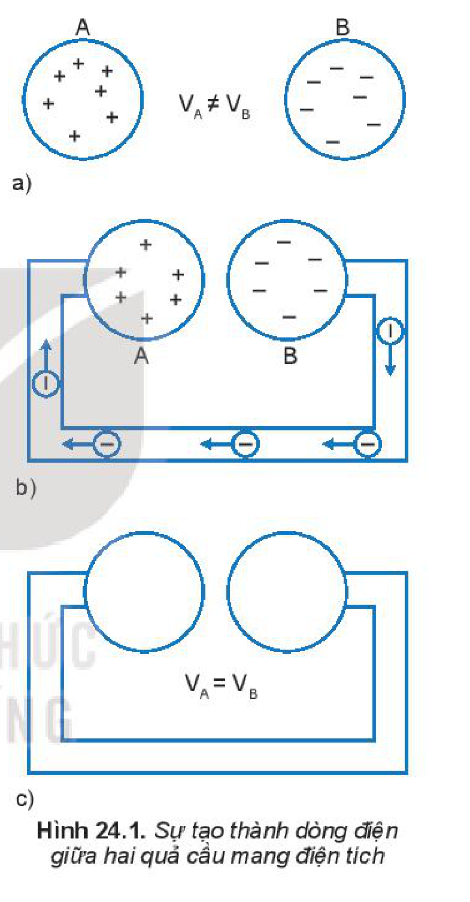
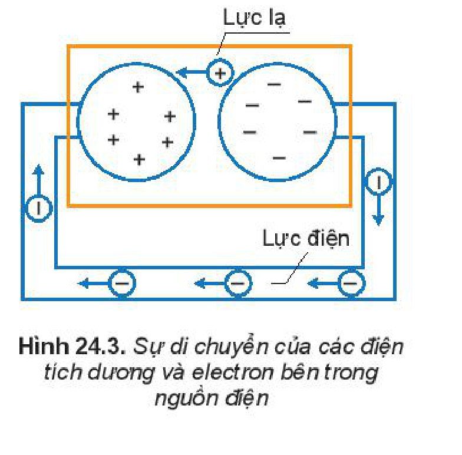
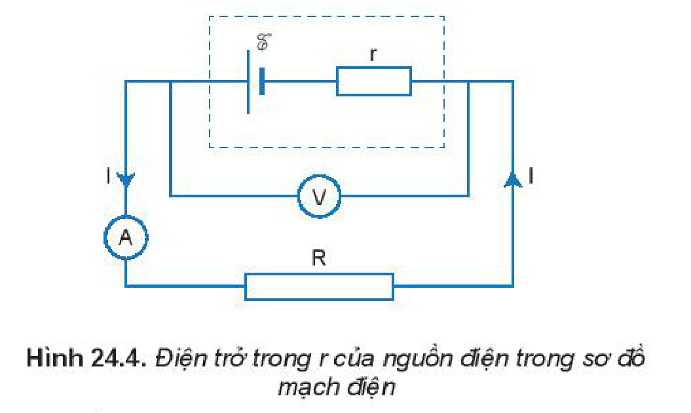
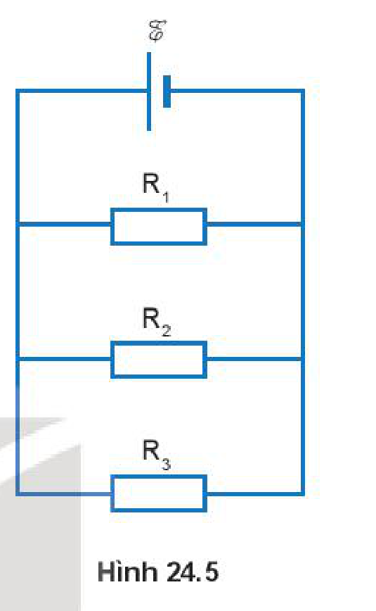
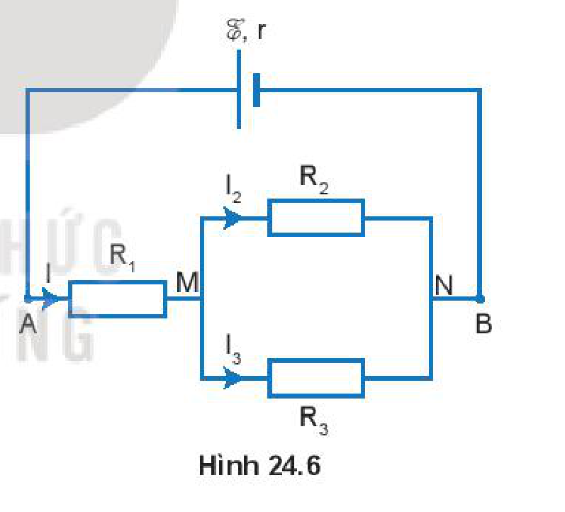

<!-- pdf:104 -->

# BÀI 24: NGUỒN ĐIỆN

## 🔴 Mở đầu

> Em đã biết nguồn điện có khả năng cung cấp năng lượng điện để tạo ra dòng điện sử dụng trong đời sống. Vậy nguồn điện là gì? Vì sao nguồn điện có thể tạo ra dòng điện?

## I. NGUỒN ĐIỆN. SUẤT ĐIỆN ĐỘNG CỦA NGUỒN ĐIỆN

### 1. Điều kiện để duy trì dòng điện

Giả sử có hai quả cầu kim loại A và B giống nhau, quả cầu A mang điện tích $+q$ và quả cầu B mang điện tích $-q$. Giữa quả cầu A và B có một hiệu điện thế $U_{\text{AB}} = V_{\text{A}} - V_{\text{B}}$ (Hình 24.1a).

Khi nối quả cầu A với quả cầu B bằng một sợi dây kim loại, dưới tác dụng của lực điện các electron tự do dịch chuyển từ quả cầu B sang quả cầu A tạo thành dòng điện trong mạch (Hình 24.1b). Tuy nhiên, dòng điện này không tồn tại lâu dài, mà chỉ tồn tại trong thời gian rất ngắn, khi $V_{\text{A}} = V_{\text{B}}$ thì không còn tồn tại dòng điện trong mạch (Hình 24.1c)
<!-- term: Điều kiện để duy trì dòng điện -->

> **Câu hỏi:** Tại sao dòng điện trong trường hợp mô tả ở Hình 24.1 chỉ tồn tại trong khoảng thời gian rất ngắn? Làm thế nào để duy trì dòng điện trong trường hợp này lâu dài?

### 2. Nguồn điện

**Nguồn điện** là thiết bị để tạo ra và duy trì hiệu điện thế, nhằm duy trì dòng điện trong mạch. Mỗi nguồn điện đều có hai cực là cực dương ($+$) và cực âm ($-$). Nguồn điện được kí hiệu như Hình 24.2. Hiệu điện thế giữa hai cực của nguồn điện được duy trì ngay cả khi có dòng điện chạy qua các vật dẫn nối liền giữa hai cực của nó, có nghĩa là sự tích điện khác nhau ở các cực của nguồn điện tiếp tục được duy trì.

Để tạo ra các điện cực như vậy, trong nguồn điện phải có lực thực hiện công để tách các electron ra khỏi nguyên tử, sau đó chuyển các electron hoặc ion dương được tạo thành như thế ra khỏi mỗi cực. Khi đó một cực thừa electron được gọi là **cực âm**, cực còn lại thiếu electron hoặc thừa ít electron hơn cực kia gọi là **cực dương**. Việc tách các electron ra khỏi

<!-- pdf:105 -->

nguyên tử không phải do lực điện thực hiện mà phải do các lực có bản chất khác với lực điện thực hiện, được gọi là các **lực lạ**.

### 3. Suất điện động của nguồn điện

Khi nối hai cực của nguồn điện bằng một vật dẫn tạo thành mạch kín thì trong mạch có dòng điện. Nếu vật dẫn làm bằng kim loại thì chỉ có sự dịch chuyển của các electron tự do từ cực âm, qua vật dẫn đến cực dương (Hình 24.3). Bên trong nguồn điện, dưới tác dụng của **lực lạ**, các hạt tải điện dương lại dịch chuyển ngược chiều điện trường từ cực âm đến cực dương. Khi đó, lực lạ thực hiện một công thắng công cản của trường tĩnh điện bên trong nguồn điện.

Để đặc trưng cho khả năng thực hiện công của nguồn điện người ta đưa ra đại lượng gọi là **suất điện động** của nguồn điện, kí hiệu là $\mathcal{E}$.

Suất điện động $\mathcal{E}$ của nguồn điện là đại lượng đặc trưng cho khả năng thực hiện công của nguồn điện và đo bằng thương số giữa công $A$ của lực lạ thực hiện khi làm dịch chuyển một điện tích dương $q$ bên trong nguồn điện từ cực âm đến cực dương và độ lớn của điện tích $q$ đó:

$$\mathcal{E} = \frac{A}{q} \quad (24.1)$$
<!-- ocr-ok: đối chiếu ảnh trang PDF 105 khớp công thức (24.1) -->

Đơn vị của suất điện động là vôn, kí hiệu là V.

Số vôn ghi trên mỗi nguồn điện cho biết trị số của suất điện động của nguồn điện đó. Số vôn này cũng là giá trị của hiệu điện thế giữa hai cực của nguồn điện khi mạch điện hở.

## II. ẢNH HƯỚNG CỦA ĐIỆN TRỞ TRONG CỦA NGUỒN ĐIỆN LÊN HIỆU ĐIỆN THẾ GIỮA HAI CỰC CỦA NGUỒN

### 1. Điện trở trong của nguồn

Trong mạch điện kín, dòng điện chạy qua mạch ngoài và bên trong nguồn điện. Như vậy, nguồn điện cũng là một vật dẫn và cũng có điện trở. Điện trở này được gọi là **điện trở trong của nguồn điện**. Vì vậy, mỗi nguồn điện được đặc trưng bằng suất điện động $\mathcal{E}$ và điện trở trong $r$ của nguồn.

Trong mạch kín khi đo hiệu điện thế giữa hai đầu của nguồn, ta luôn nhận được một giá trị hiệu điện thế nhỏ hơn giá trị suất điện động của nguồn. Lí do này có một vài nguyên nhân nhưng nguyên nhân quan trọng nhất đó là các nguồn điện đều có điện trở trong.

### 2. Ảnh hưởng của điện trở trong của nguồn điện lên hiệu điện thế giữa hai cực của nguồn

Để dễ hình dung, ta tưởng tượng tách điện trở trong $r$ của nguồn ra bên ngoài, khi đó nguồn điện được xem là lí tưởng, không có điện trở trong. Nguồn điện lúc này được xem như mắc cùng một điện trở $r$ như mô tả ở trong phần đường đứt nét (Hình 24.4).

<!-- pdf:106 -->

Khi mắc nguồn điện với mạch ngoài bởi điện trở $R$. Khi đó, điện trở của mạch gồm điện trở mạch ngoài $R$ mắc nối tiếp với điện trở trong $r$. Giả sử dòng điện chạy trong mạch có cường độ $I$ thì trong khoảng thời gian $t$ có điện lượng $q = It$ chuyển qua mạch. Nguồn điện đã thực hiện công $A$, theo công thức (24.1), công $A$ có giá trị:

$$A = q\mathcal{E} = \mathcal{E}It \quad (24.2)$$
<!-- ocr-ok: đối chiếu ảnh trang PDF 106 khớp công thức (24.2) -->

Cũng trong khoảng thời gian $t$ đó nhiệt lượng toả ra ở điện trở ngoài $R$ và điện trở trong $r$ là:

$$Q = RI^2t + rI^2t \quad (24.3)$$
<!-- ocr-ok: đối chiếu ảnh trang PDF 106 khớp công thức (24.3) -->

Theo định luật bảo toàn năng lượng, năng lượng tiêu thụ trên toàn mạch phải bằng năng lượng do nguồn điện cung cấp. Từ công thức (24.2) và (24.3), ta có:

$$\mathcal{E}It = RI^2t + rI^2t$$
<!-- ocr-ok: đối chiếu ảnh trang PDF 106 khớp công thức -->

$$\text{hay } \mathcal{E} = IR + Ir = I(R + r) \quad (24.4)$$
<!-- ocr-ok: đối chiếu ảnh trang PDF 106 khớp công thức (24.4) -->

> **Câu hỏi:** Khi dùng vôn kế để đo hiệu điện thế giữa hai cực của nguồn điện thì số chỉ trên vôn kế và số vôn ghi trên nhãn của nguồn điện có mối liên hệ như thế nào? Điều đó cho biết có gì tồn tại bên trong của nguồn điện?

> **Em có biết:**
>
> Từ các hệ thức (24.4) ta có:
>
> $$I = \frac{\mathcal{E}}{R + r}$$
>
> Với $(R + r)$ là tổng điện trở của mạch ngoài và điện trở trong của nguồn điện, được gọi là **điện trở toàn phần** của mạch điện kín.
>
> Hệ thức $I = \frac{\mathcal{E}}{R + r}$ biểu thị **định luật Ôm đối với toàn mạch**, được phát biểu như sau:
>
> *Cường độ dòng điện chạy trong mạch điện kín tỉ lệ thuận với suất điện động của nguồn điện và tỉ lệ nghịch với điện trở toàn phần của mạch điện đó.*

Người ta gọi tích số của cường độ dòng điện với điện trở của đoạn mạch là **độ giảm thế** trên đoạn mạch. Như vậy, theo công thức (24.4) ta có suất điện động của nguồn điện có giá trị bằng tổng các độ giảm thế ở mạch ngoài và mạch trong.

Nếu gọi $U = IR$ là **hiệu điện thế mạch ngoài** thì công thức (24.4) được viết lại là:

$$U = \mathcal{E} - Ir \quad (24.5)$$
<!-- ocr-ok: đối chiếu ảnh trang PDF 106 khớp công thức (24.5) -->

**Hiệu điện thế mạch ngoài** cũng là hiệu điện thế giữa hai cực dương và âm của nguồn điện.

> **Câu hỏi:**
>
> Từ biểu thức (24.5), hãy:
> 1. Mô tả ảnh hưởng của điện trở trong của nguồn điện lên hiệu điện thế giữa hai cực của nguồn.
> 2. So sánh suất điện động và hiệu điện thế giữa hai đầu đoạn mạch.
> 3. Trường hợp nào thì hiệu điện thế $U$ giữa hai cực của nguồn điện bằng suất điện động $\mathcal{E}$ của nguồn?

<!-- pdf:107 -->

> **Em có biết:**
>
> **Hiện tượng đoản mạch** (hay còn gọi là **ngắn mạch**) xảy ra khi nguồn điện được nối với mạch ngoài có điện trở không đáng kể hoặc bằng $0$, nguyên nhân do việc chập mạch điện làm cho điện trở của dây dẫn bằng $0$, khi đó cực âm của nguồn nối trực tiếp với cực dương của nguồn mà không qua thiết bị điện.

> **Câu hỏi:** Vì sao sẽ rất nguy hiểm nếu hiện tượng đoản mạch xảy ra đối với mạng điện ở gia đình?

### 3. Bài tập luyện tập

1. Cho mạch điện như Hình 24.5. Suất điện động $\mathcal{E} = 10\text{ V}$, bỏ qua điện trở trong của nguồn. Các giá trị điện trở $R_1 = 20\text{ }\Omega$, $R_2 = 40\text{ }\Omega$, $R_3 = 50\text{ }\Omega$.
   a) Tính cường độ dòng điện chạy qua điện trở $R_1$.
   b) Tính cường độ dòng điện $I$ chạy qua mạch chính.

2. Cho mạch điện như Hình 24.6. Các giá trị điện trở $R_1 = 3\text{ }\Omega$, $R_2 = 4\text{ }\Omega$ và $R_3 = 6\text{ }\Omega$. Suất điện động của nguồn $\mathcal{E} = 12\text{ V}$, điện trở trong của nguồn $r = 0,6\text{ }\Omega$.
   a) Tính điện trở của đoạn mạch AB.
   b) Tính cường độ dòng điện chạy qua các điện trở $R_1$, $R_2$, $R_3$ và hiệu điện thế giữa hai đầu mỗi điện trở.

## 📌 Em đã học

- Suất điện động $\mathcal{E}$ của nguồn điện là đại lượng đặc trưng cho khả năng thực hiện công của nguồn điện và đo bằng thương số giữa công $A$ của lực lạ thực hiện khi làm dịch chuyển một điện tích dương $q$ bên trong nguồn điện từ cực âm đến cực dương và độ lớn của điện tích $q$ đó.
  $$\mathcal{E} = \frac{A}{q}$$
  Đơn vị của suất điện động là vôn, kí hiệu là V.
- Mối liên hệ giữa suất điện động và hiệu điện thế mạch ngoài:
  $$\mathcal{E} = U + Ir \text{ hay } U = \mathcal{E} - Ir.$$

## ✏️ Em có thể

- Mô tả được ảnh hưởng của điện trở trong của nguồn điện lên hiệu điện thế giữa hai cực của nguồn điện.
- Xác định được cường độ dòng điện, điện trở trong của pin mặt trời.

## 📷 Danh sách hình trong bài

| Mã hình | Số hình SGK | Trang PDF | Chú thích |
| --- | --- | --- | --- |
| H11-vat_ly-b24-01 | Hình 24.1 | 104 | Sự tạo thành dòng điện giữa hai quả cầu mang điện tích |
| H11-vat_ly-b24-02 | Hình 24.2 | 104 | Kí hiệu nguồn điện |
| H11-vat_ly-b24-03 | Hình 24.3 | 105 | Sự di chuyển của các điện tích dương và electron bên trong nguồn điện |
| H11-vat_ly-b24-04 | Hình 24.4 | 106 | Điện trở trong r của nguồn điện trong sơ đồ mạch điện |
| H11-vat_ly-b24-05 | Hình 24.5 | 107 | Hình 24.5 |
| H11-vat_ly-b24-06 | Hình 24.6 | 107 | Hình 24.6 |
