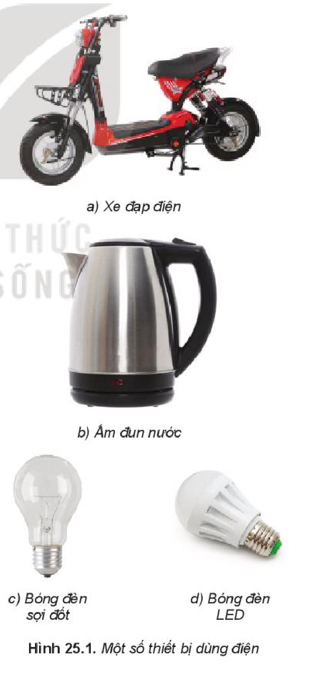
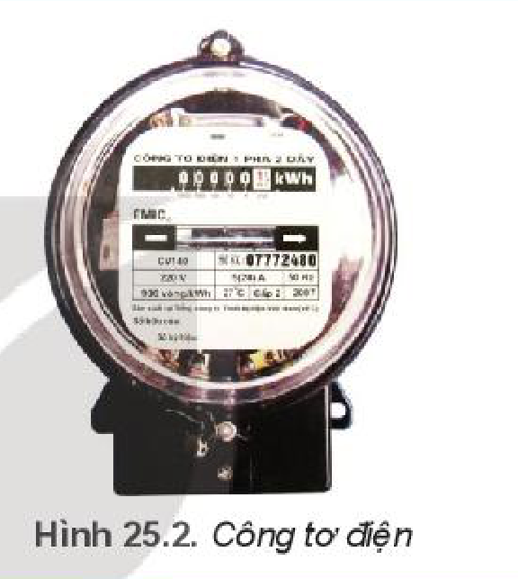

<!-- pdf:108 -->

# BÀI 25: NĂNG LƯỢNG ĐIỆN VÀ CÔNG SUẤT ĐIỆN

## 🔴 Mở đầu

> | BỘ C S | CHỈ SỐ MỚI | CHỈ SỐ CŨ | HS NHÂN | ĐN TIÊU THỤ | ĐƠN GIÁ | THÀNH TIỀN |
> | --- | --- | --- | --- | --- | --- | --- |
> | KT | 8.429 | 8.157 | 1 | 272 | | |
> | | | | | 50 | 1.549 | 77.450 |
> | | | | | 50 | 1.600 | 80.000 |
> | | | | | 100 | 1.858 | 185.800 |
> | | | | | 72 | 2.340 | 168.480 |
> | Cộng: | | | | 272 | | 511.730 |
> | Thuế suất GTGT: 10% | | | Thuế GTGT: | | | 51.173 |
> | Tổng cộng tiền thanh toán: | | | | | | 562.903 |
> | Số tiền viết bằng chữ: *Năm trăm sáu mươi hai nghìn chín trăm linh ba đồng.* | | | | | | |
> | Người ký : | | | | | Ngày ký: | |
>
> Bảng bên ghi một số nội dung trong Hoá đơn tiền điện giá trị gia tăng (GTGT) của Công ty điện lực. Em hãy cho biết ý nghĩa của các số liệu trong bảng.
<!-- ocr-ok: đối chiếu ảnh trang PDF 108 khớp bảng hoá đơn GTGT trong hộp mở đầu -->

## I. NĂNG LƯỢNG ĐIỆN

Khi đặt hiệu điện thế $U$ vào hai đầu của một mạch tiêu thụ điện, dưới tác dụng của lực điện, các điện tích tự do trong mạch điện chuyển dời có hướng tạo ra dòng điện. Ta đã biết công của lực điện trong trường hợp này được tính bằng công thức: $A = qU$.

Nếu $t$ là thời gian dòng điện chạy trong mạch thì cường độ dòng điện là $I = \frac{q}{t}$, thì công của lực điện là:

$$A = UIt \quad (25.1)$$
<!-- ocr-ok: đối chiếu ảnh trang PDF 108 khớp công thức (25.1) -->

Ở đây $A$ là số đo năng lượng điện mà đoạn mạch nhận được (tiêu thụ) từ nguồn điện và được gọi là ***năng lượng điện tiêu thụ*** của đoạn mạch. Do đó:

*Năng lượng điện tiêu thụ của đoạn mạch bằng công của lực điện thực hiện khi di chuyển các điện tích.*

$$W = A = UIt \quad (25.2)$$
<!-- ocr-ok: đối chiếu ảnh trang PDF 108 khớp công thức (25.2) -->

Đơn vị của năng lượng điện tiêu thụ là jun, kí hiệu là J.

Dòng điện chạy trong đoạn mạch gây ra các tác dụng khác nhau và khi đó có sự chuyển hoá năng lượng điện tiêu thụ của đoạn mạch thành các dạng năng lượng khác.

<!-- pdf:109 -->

> **Câu hỏi:**
>
> 1. Năng lượng điện tiêu thụ trong dụng cụ, thiết bị dùng điện ở Hình 25.1 chuyển hoá thành dạng năng lượng nào là nhiều nhất?
> 2. Hãy chứng minh rằng, nếu đoạn mạch chỉ có điện trở $R$ (**đoạn mạch thuần điện trở**) thì **nhiệt lượng đoạn mạch toả ra** khi có dòng điện chạy qua được tính bằng công thức:
>
> $$Q = I^2Rt = \frac{U^2}{R}t \quad (25.3)$$

> **Lưu ý:** Ngoài đơn vị Jun, người ta còn dùng đơn vị **kilôoát giờ** ($\text{kW.h}$) để đo năng lượng điện tiêu thụ. $1\text{ kW}\cdot\text{h} = 3,6 \cdot 10^3\text{ kJ}$.

> **Em có biết:**
>
> Người ta đo năng lượng điện tiêu thụ bằng một thiết bị gọi là ***công tơ điện*** (Hình 25.2). Khi các dụng cụ, thiết bị tiêu thụ năng lượng điện hoạt động thì đĩa của công tơ quay, số chỉ của công tơ tăng dần. Đơn vị của chỉ số trên công tơ là $\text{kW.h}$. Trong đời sống người ta thường gọi $1\text{ kW.h}$ là 1 ***số điện***.
>
> 

## II. CÔNG SUẤT ĐIỆN

**Công suất tiêu thụ năng lượng điện** (gọi tắt là **công suất điện**) của một đoạn mạch là năng lượng điện mà mạch tiêu thụ trong một đơn vị thời gian:

$$\mathscr{P} = \frac{U^2}{R} = UI \quad (25.4)$$
<!-- ocr-ok: đối chiếu ảnh trang PDF 109 khớp công thức (25.4) -->

Đơn vị của công suất điện là **Oát**, kí hiệu là W.

> **Câu hỏi:** Hãy chứng minh rằng $1\text{ kW.h} = 3,6 \cdot 10^3\text{ kJ}$.
<!-- ocr-ok: đối chiếu ảnh trang PDF 109 khớp nguyên văn câu hỏi -->

*Bảng 25.1. Công suất điện của một số thiết bị dùng điện*

| Thiết bị | Công suất điện | Thiết bị | Công suất điện |
| --- | --- | --- | --- |
| Đèn tuýp LED $1,2\text{ m}$ | $25\text{ W}$ | Tủ lạnh | $100\text{ W}$ |
| Bóng đèn huỳnh quang $1,2\text{ m}$ | $36\text{ W}$ | Máy giặt | $470\text{ W}$ |

<!-- pdf:110 -->

| Thiết bị | Công suất điện | Thiết bị | Công suất điện |
| --- | --- | --- | --- |
| Bóng đèn sợi đốt | $40\text{ W}$ | Nồi cơm điện | $600\text{ W}$ |
| Quạt cây | $55\text{ W}$ | Bàn là | $1\text{ }000\text{ W}$ |
| Tivi LED 32 inches | $69\text{ W}$ | Điều hòa $9\text{ }000\text{ BTU}$ | $2\text{ }638\text{ W}$ |

> **Em có biết:**
>
> Nếu trên dụng cụ hoặc thiết bị dùng điện ghi $220\text{ V} - 100\text{ W}$, thì phải hiểu là chỉ khi nào dụng cụ hoặc thiết bị được dùng ở đúng hiệu điện thế $U = 220\text{ V}$ (bằng với ***hiệu điện thế định mức***) thì công suất điện của nó mới bằng $100\text{ W}$. Công suất này được gọi là **công suất định mức**.

> **Hoạt động:**
>
> 1. Trên hoá đơn GTGT (tiền điện) ở đầu bài học, tiền điện được tính lũy tiến (càng dùng điện nhiều thì đơn giá của $1\text{ kW}\cdot\text{h}$ điện càng tăng). Theo em, cách tính này nhằm những mục đích gì? Tại sao?
> 2. Cho các thông tin về bóng đèn sợi đốt và bóng đèn LED cùng có độ sáng như sau:
>
> | | Đèn sợi đốt | Đèn LED |
> | --- | --- | --- |
> | Giản đồ phân phối năng lượng | Điện năng $100\text{ J} \rightarrow$ Ánh sáng nhìn thấy $5\text{ J}$ + Nhiệt năng $95\text{ J}$ ($220\text{ V} - 100\text{ W}$) | Điện năng $100\text{ J} \rightarrow$ Ánh sáng nhìn thấy $80\text{ J}$ + Nhiệt năng $20\text{ J}$ ($220\text{ V} - 20\text{ W}$) |
> | Thời gian hoạt động | $1\text{ }000\text{ h}$ | $30\text{ }000\text{ h}$ |
> | Giá tiền/bóng | $8\text{ }000\text{ đồng}$ | $48\text{ }000\text{ đồng}$ |
> | Giá tiền điện | $2\text{ }000\text{ đồng/kW}\cdot\text{h}$ | $2\text{ }000\text{ đồng/kW}\cdot\text{h}$ |
>
> Giả sử trung bình mỗi bóng đèn sử dụng $5\text{ h/ngày}$, em hãy tính tiền điện phải trả cho từng bóng đèn mỗi tháng và trong $30\text{ }000\text{ h}$, từ đó lập luận để so sánh về hiệu quả kinh tế khi sử dụng hai loại bóng trên.

<!-- pdf:111 -->

## III. BÀI TẬP

### 1. Bài tập ví dụ

Trên nhãn của một ấm điện có ghi $220\text{ V} - 1\text{ }000\text{ W}$. Sử dụng ấm điện này ở hiệu điện thế $200\text{ V}$ để đun sôi 2 lít nước từ nhiệt độ $20\text{ }^\circ\text{C}$. Tính thời gian đun nước. Biết hiệu suất của ấm là $90\%$, nhiệt dung riêng của nước là $4\text{ }190\text{ J/kg.K}$, coi điện trở của ấm điện không thay đổi so với khi hoạt động ở chế độ bình thường.

*Giải:*

Nhiệt lượng cần để đun sôi 2 lít nước từ $20\text{ }^\circ\text{C}$:

$$Q = mc \cdot \Delta t = 2 \cdot 4\text{ }190 \cdot (100 - 20) = 670\text{ }400\text{ J}$$
<!-- ocr-ok: đối chiếu ảnh trang PDF 111 khớp công thức -->

Hiệu suất của ấm $H = 90\%$ nên năng lượng điện tiêu thụ của ấm là:

$$A = \frac{Q}{H} = \frac{670\text{ }400}{0,9} \approx 744\text{ }889\text{ J}$$
<!-- ocr-ok: đối chiếu ảnh trang PDF 111 khớp công thức -->

Điện trở của ấm điện

$$R = \frac{U_{\text{đm}}^2}{\mathscr{P}_{\text{đm}}} = \frac{220^2}{1000} = 48,4\text{ }\Omega$$
<!-- ocr-ok: đối chiếu ảnh trang PDF 111 khớp công thức -->

Từ công thức $A = \frac{U^2}{R} \cdot t$, suy ra thời gian đun nước thời gian đun nước:

$$t = \frac{AR}{U^2} = \frac{744\text{ }889 \cdot 48,4}{200^2} \approx 901\text{ s}.$$
<!-- ocr-ok: đối chiếu ảnh trang PDF 111 khớp công thức -->

### 2. Bài tập

1. Trên nhãn của bóng đèn 1 có ghi $220\text{ V} - 20\text{ W}$ và bóng đèn 2 có ghi $220\text{ V} - 10\text{ W}$. Coi điện trở của mỗi bóng đèn không thay đổi.
   a) Tính năng lượng điện tiêu thụ của mỗi bóng đèn khi sử dụng ở hiệu điện thế $200\text{ V}$ trong thời gian 2 giờ.
   b) Tính tổng công suất điện tiêu thụ của cả hai bóng đèn trong những trường hợp sau:
   - Mắc song song hai bóng đèn vào hiệu điện thế $220\text{ V}$.
   - Mắc nối tiếp hai bóng đèn vào hiệu điện thế $220\text{ V}$.
   c) Dùng cách mắc nào nêu trên để cả hai bóng đèn đều sáng bình thường? Tại sao?
2. Thông thường, ở nước ta hiệu điện thế mạng điện trong các gia đình, trường học,... là $220\text{ V}$. Em hãy tìm hiểu về hiệu điện thế định mức, công suất định mức của mỗi thiết bị điện, cách mắc các thiết bị điện dùng trong lớp học của em và thời gian sử dụng trung bình của từng thiết bị mỗi tháng để làm các việc sau:
   a) Vẽ lại sơ đồ mạch điện.
   b) Áp dụng giá điện trong Hoá đơn GTGT (tiền điện) ở đầu của bài học để dự tính tiền điện trung bình phải trả mỗi tháng cho lớp học.
   c) Hãy đề xuất phương án sử dụng tiết kiệm điện cho gia đình, lớp học.

<!-- pdf:112 -->

## 📌 Em đã học

- Năng lượng điện tiêu thụ của đoạn mạch được đo bằng công của lực điện thực hiện khi dịch chuyển các điện tích. Công thức tính công của lực điện $A = qU = UIt$. Đơn vị là Jun, kí hiệu là J.
- Đối với đoạn mạch thuần điện trở, nhiệt lượng đoạn mạch toả ra khi dòng điện chạy qua được tính bằng công thức: $Q = RI^2t$.
- Công suất tiêu thụ năng lượng điện của một đoạn mạch là năng lượng điện mà đoạn mạch tiêu thụ trong một đơn vị thời gian. Công thức tính:
  $$\mathscr{P} = \frac{A}{t} = UI.\text{ Đơn vị là Oát, kí hiệu là W.}$$

## ✏️ Em có thể

- Giải thích được nội dung ghi trong hoá đơn tiền điện và ý nghĩa của việc tính giá điện lũy tiến; lợi ích của việc thay đèn sợi đốt bằng đèn LED.
- Ước tính được số tiền điện trung bình mỗi tháng phải trả cho các dụng cụ và thiết bị điện dùng trong nhà và các biện pháp tiết kiệm năng lượng điện tiêu thụ.

## 📷 Danh sách hình trong bài

| Mã hình | Số hình SGK | Trang PDF | Chú thích |
| --- | --- | --- | --- |
| H11-vat_ly-b25-01 | Hình 25.1 | 108 | Một số thiết bị dùng điện |
| H11-vat_ly-b25-02 | Hình 25.2 | 109 | Công tơ điện |
