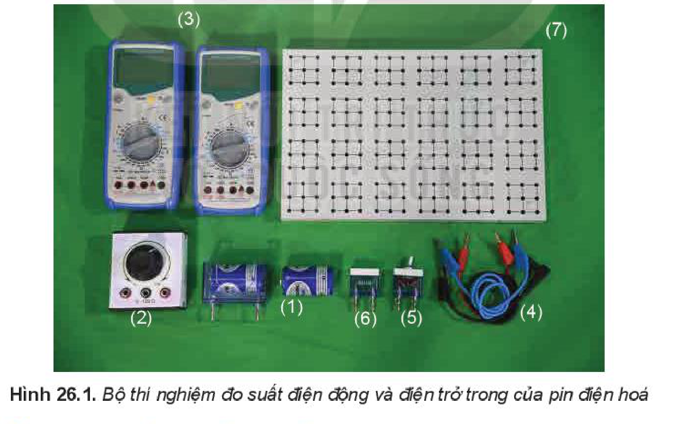
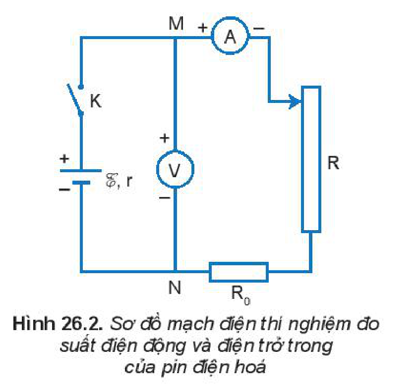
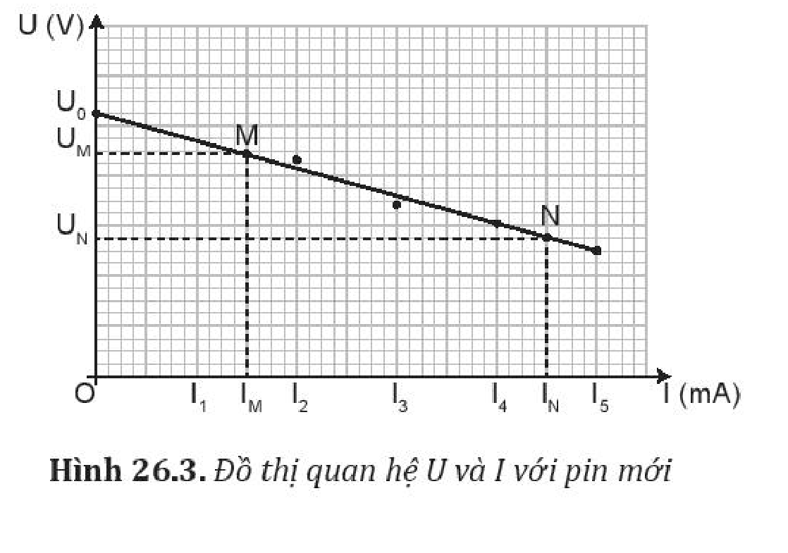

<!-- pdf:113 -->

# BÀI 26: THỰC HÀNH: ĐO SUẤT ĐIỆN ĐỘNG VÀ ĐIỆN TRỞ TRONG CỦA PIN ĐIỆN HOÁ

## 🔴 Mở đầu

> Pin điện hoá khi sử dụng sau khoảng thời gian thì suất điện động và điện trở trong thay đổi và đến một mức nào đó sẽ cần thay pin mới. Làm thế nào đo được suất điện động và điện trở trong của pin điện hoá bằng dụng cụ thí nghiệm?

## I. DỤNG CỤ THÍ NGHIỆM

- Hai pin điện hoá loại $1,5\text{ V}$ (một pin cũ đã sử dụng gần hết điện, một pin mới chưa sử dụng) (1).
- Một biến trở $100\text{ }\Omega$ (2).
- Hai đồng hồ đo điện đa năng hiện số (3).
- Dây nối (4).
- Công tắc điện K (5).
- Điện trở bảo vệ $R_0$ (6).
- Bảng lắp mạch điện (7).

## II. THIẾT KẾ PHƯƠNG ÁN THÍ NGHIỆM

> **Hoạt động:**
>
> Hãy trả lời các câu hỏi sau:
> a) Có thể sử dụng đồng hồ đo điện đa năng để đo trực tiếp suất điện động của nguồn điện và điện trở trong của nguồn không? Tại sao?
> b) Để xác định suất điện động và điện trở trong của pin cần đo các đại lượng nào?
> c) Thiết kế phương án thí nghiệm để đo suất điện động và điện trở trong của pin điện hoá.

<!-- pdf:114 -->

## III. TIẾN HÀNH THÍ NGHIỆM

A. Tiến hành thí nghiệm với nguồn điện là một pin cũ.

1. Bố trí thí nghiệm như Hình 26.2.
2. Điều chỉnh biến trở đến giá trị $100\text{ }\Omega$.
3. Đóng khoá K, bật đồng hồ đo hiệu điện thế và cường độ dòng điện.
4. Ghi giá trị hiệu điện thế $U$ và cường độ dòng điện $I$ vào mẫu Bảng 26.1. Ngắt khóa K.
5. Lặp lại 4 lần các bước 2, 3, 4 với giá trị $R$ giảm dần.
6. Đánh dấu các điểm thực nghiệm lên hệ trục tọa độ và vẽ đường thẳng đi gần nhất các điểm thực nghiệm (tham khảo Hình 26.3)
7. Kéo dài đường đồ thị cắt trục tung tại $U_0$ (tham khảo Hình 26.3).
8. Xác định suất điện động $\mathcal{E}$ của pin là giá trị $U_0$.
9. Chọn hai điểm M, N trên đồ thị xác định các giá trị $U, I$ tương ứng và xác định điện trở trong theo công thức:

$$r = \frac{U_{\text{M}} - U_{\text{N}}}{I_{\text{N}} - I_{\text{M}}}$$
<!-- ocr-ok: đối chiếu ảnh trang PDF 114 khớp công thức tính điện trở trong -->

10. Ước lượng sai số bằng đồ thị.

B. Tiến hành thí nghiệm với nguồn điện là một pin mới.

1. Thay nguồn điện bằng pin mới.
2. Lặp lại các bước thí nghiệm như thí nghiệm với pin cũ, và ghi số liệu vào Bảng 26.2, vẽ đồ thị $U = f(I)$ và xác định suất điện động, điện trở trong của pin.

## IV. KẾT QUẢ THÍ NGHIỆM

*Bảng 26.1. Kết quả đo với pin cũ*

| Số thứ tự | $R\text{ }(\Omega)$ | $U\text{ (V)}$ | $I\text{ (mA)}$ |
| --- | --- | --- | --- |
| 1 | ? | ? | ? |
| 2 | ? | ? | ? |
| 3 | ? | ? | ? |
| 4 | ? | ? | ? |
| 5 | ? | ? | ? |
<!-- ocr-ok: đối chiếu ảnh trang PDF 114 khớp mẫu Bảng 26.1 -->

$I = 0 \Rightarrow U_0 = \mathcal{E} = \dots$

$r = \dots \quad \Delta r = \dots$

*Bảng 26.2. Kết quả đo với pin mới*

| Số thứ tự | $R\text{ }(\Omega)$ | $U\text{ (V)}$ | $I\text{ (mA)}$ |
| --- | --- | --- | --- |
| 1 | ? | ? | ? |
| 2 | ? | ? | ? |
| 3 | ? | ? | ? |
| 4 | ? | ? | ? |
| 5 | ? | ? | ? |
<!-- ocr-ok: đối chiếu ảnh trang PDF 114 khớp mẫu Bảng 26.2 -->

$I = 0 \Rightarrow U_0 = \mathcal{E} = \dots$

$r = \dots \quad \Delta r = \dots$

<!-- pdf:115 -->

> **Hoạt động:**
>
> **Nhận xét và đánh giá kết quả thí nghiệm**
> 1. Nhận xét về dạng đồ thị và mối quan hệ $U$ và $I$ đối với pin cũ và pin mới.
> 2. Em có thể đề xuất một phương án thí nghiệm khác để có thể đo suất điện động và điện trở.

## 📌 Em đã học

- Xác định suất điện động và điện trở trong của một pin hoặc ac quy bằng dụng cụ thí nghiệm.

## ✏️ Em có thể

- Giải thích tại sao trong khi tiến hành thí nghiệm không nên đóng mạch điện trong thời gian dài.

> **Em có biết:**
>
> **Pin lithium-ion** là loại pin được dùng phổ biến trong điện thoại di động, máy tính xách tay, xe máy điện, ô tô điện, thậm trí trong tàu ngầm sử dụng động cơ điện. Pin lithium-ion có khối lượng nhẹ, khả năng lưu trữ điện năng lớn, sạc điện nhanh và sạc được nhiều lần.
>
> Công nghệ xe điện đang được phát triển tại Việt Nam, phần lớn năng lượng điện sử dụng pin lithium-ion. Mỗi pin có suất điện động khoảng $3,2\text{ V}$ được ghép thành bộ pin có suất điện động $48\text{ V}$, $60\text{ V}$, $72\text{ V}$ hoặc cao hơn để sử dụng trong các loại xe khác nhau.

## 📷 Danh sách hình trong bài

| Mã hình | Số hình SGK | Trang PDF | Chú thích |
| --- | --- | --- | --- |
| H11-vat_ly-b26-01 | Hình 26.1 | 113 | Bộ thí nghiệm đo suất điện động và điện trở trong của pin điện hoá |
| H11-vat_ly-b26-02 | Hình 26.2 | 114 | Sơ đồ mạch điện thí nghiệm đo suất điện động và điện trở trong của pin điện hoá |
| H11-vat_ly-b26-03 | Hình 26.3 | 114 | Đồ thị quan hệ U và I với pin mới |
