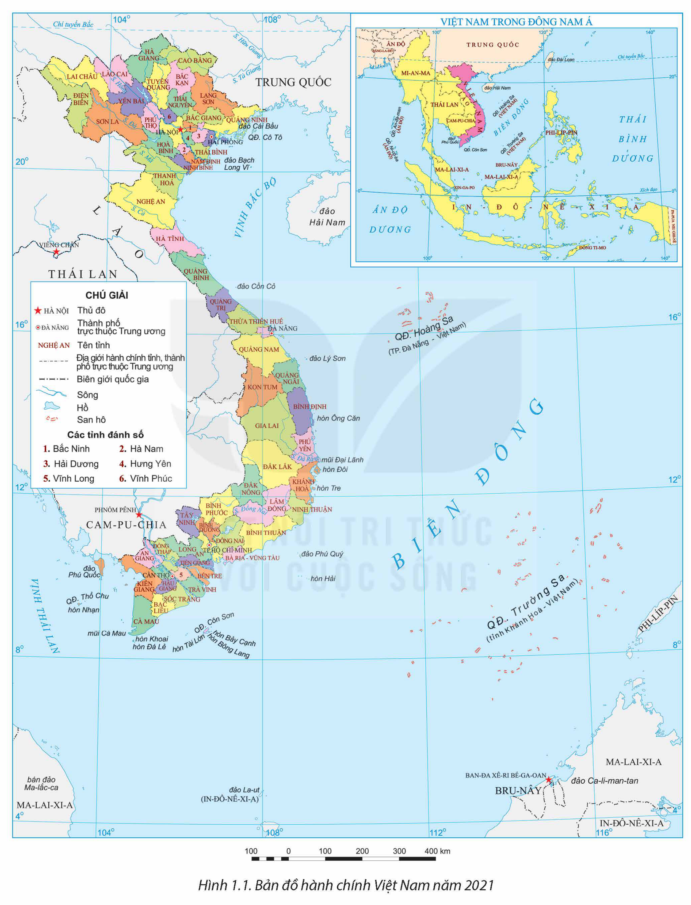
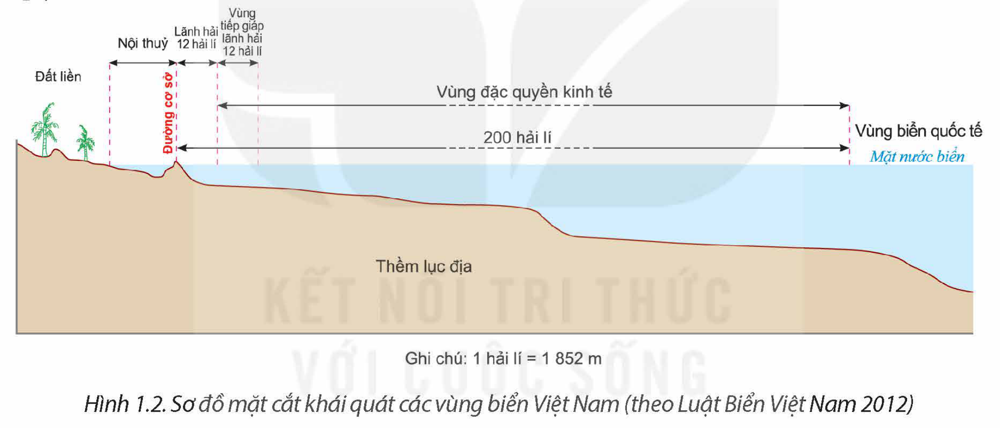

<!-- pdf:7 -->

# BÀI 1: VỊ TRÍ ĐỊA LÍ VÀ PHẠM VI LÃNH THỔ

## 🔴 Mở đầu

Việt Nam có vị trí địa lí đặc biệt. Lãnh thổ Việt Nam là một khối thống nhất và toàn vẹn, bao gồm vùng đất, vùng biển, vùng trời. Vị trí địa lí và phạm vi lãnh thổ có ảnh hưởng như thế nào đến tự nhiên, kinh tế – xã hội và an ninh quốc phòng của nước ta?

## I. VỊ TRÍ ĐỊA LÍ, PHẠM VI LÃNH THỔ

### 1. Vị trí địa lí

– Việt Nam gần trung tâm của khu vực Đông Nam Á. Trên đất liền, nước ta tiếp giáp với các nước láng giềng Trung Quốc, Lào, Cam-pu-chia và có chung Biển Đông với nhiều quốc gia.

<!-- term: Điểm cực trên đất liền của Việt Nam -->
Phần đất liền, phạm vi lãnh thổ Việt Nam được xác định bởi các điểm cực: điểm cực Bắc ở khoảng vĩ độ 23°23'B tại xã Lũng Cú, huyện Đồng Văn, tỉnh Hà Giang; điểm cực Nam ở khoảng vĩ độ 8°34'B tại xã Đất Mũi, huyện Ngọc Hiển, tỉnh Cà Mau; điểm cực Tây ở khoảng kinh độ 102°09'Đ tại xã Sín Thầu, huyện Mường Nhé, tỉnh Điện Biên; điểm cực Đông ở khoảng kinh độ 109°28'Đ tại xã Vạn Thạnh, huyện Vạn Ninh, tỉnh Khánh Hoà. Trên vùng biển, phạm vi lãnh thổ của nước ta còn xuống tới khoảng vĩ độ 6°50'B và từ khoảng kinh độ 101°Đ tới trên 117°20'Đ tại Biển Đông.

Như vậy, Việt Nam nằm hoàn toàn trong vòng đai nóng nội chí tuyến bán cầu Bắc và thuộc khu vực khí hậu nhiệt đới gió mùa châu Á.

– Lãnh thổ Việt Nam tiếp giáp với Biển Đông thông ra Thái Bình Dương, liền kề với vành đai sinh khoáng Thái Bình Dương và vành đai sinh khoáng Địa Trung Hải, trên đường di cư của nhiều loài sinh vật.

– Việt Nam nằm trên ngã tư đường hàng hải và hàng không quốc tế nối liền châu Á với châu Đại Dương, Thái Bình Dương với Ấn Độ Dương; trong khu vực kinh tế phát triển năng động bậc nhất trên thế giới.

<!-- pdf:8 -->

*Hình 1.1. Bản đồ hành chính Việt Nam năm 2021*

<!-- pdf:9 -->

> ❓ Dựa vào thông tin mục 1 và hình 1.1, hãy xác định và nêu đặc điểm vị trí địa lí của Việt Nam.

### 2. Phạm vi lãnh thổ

<!-- term: Lãnh thổ Việt Nam -->
Lãnh thổ Việt Nam là một khối thống nhất và toàn vẹn bao gồm vùng đất, vùng biển và vùng trời.

– Vùng đất

<!-- term: Vùng đất Việt Nam -->
Vùng đất là toàn bộ phần đất liền được xác định trong phạm vi đường biên giới của nước ta với các nước láng giềng và phần đất nổi của hàng nghìn hòn đảo trên Biển Đông, với tổng diện tích các đơn vị hành chính hơn 331 nghìn km² (Niên giám Thống kê Việt Nam 2021).

– Vùng biển

<!-- term: Vùng biển Việt Nam -->
Vùng biển Việt Nam có diện tích khoảng 1 triệu km², tiếp giáp với vùng biển của các nước Trung Quốc, Phi-líp-pin, Ma-lai-xi-a, Bru-nây, In-đô-nê-xi-a, Xin-ga-po, Cam-pu-chia và Thái Lan. Vùng biển nước ta bao gồm: nội thuỷ, lãnh hải, vùng tiếp giáp lãnh hải, vùng đặc quyền kinh tế và thềm lục địa.

*Hình 1.2. Sơ đồ mặt cắt khái quát các vùng biển Việt Nam (theo Luật Biển Việt Nam 2012)*

<!-- term: Nội thuỷ -->
+ Nội thuỷ là vùng nước tiếp giáp với bờ biển, ở phía trong đường cơ sở và là bộ phận lãnh thổ của Việt Nam.

> 💡 EM CÓ BIẾT?
>
> Luật Biển Việt Nam được Quốc hội thông qua vào ngày 21 tháng 6 năm 2012. Luật gồm 7 chương, 55 điều, có hiệu lực thi hành từ ngày 1 tháng 1 năm 2013. Chủ quyền của Việt Nam trên quần đảo Hoàng Sa và quần đảo Trường Sa được khẳng định từ Điều 1 của luật.

<!-- term: Lãnh hải -->
+ Lãnh hải là vùng biển có chiều rộng 12 hải lí tính từ đường cơ sở ra phía biển. Ranh giới ngoài của lãnh hải là biên giới quốc gia trên biển của Việt Nam.

<!-- term: Vùng tiếp giáp lãnh hải -->
+ Vùng tiếp giáp lãnh hải là vùng biển tiếp liền và nằm ngoài lãnh hải Việt Nam, có chiều rộng 12 hải lí tính từ ranh giới ngoài của lãnh hải.

<!-- term: Vùng đặc quyền kinh tế -->
+ Vùng đặc quyền kinh tế là vùng biển tiếp liền và nằm ngoài lãnh hải Việt Nam, hợp với lãnh hải thành một vùng biển có chiều rộng 200 hải lí tính từ đường cơ sở.

<!-- pdf:10 -->

<!-- term: Thềm lục địa -->
+ Thềm lục địa là vùng đáy biển và lòng đất dưới đáy biển, tiếp liền và nằm ngoài lãnh hải Việt Nam, trên toàn bộ phần kéo dài tự nhiên của lãnh thổ đất liền, các đảo và quần đảo của Việt Nam cho đến mép ngoài của rìa lục địa. Trong trường hợp mép ngoài của rìa lục địa này cách đường cơ sở chưa đủ 200 hải lí thì thềm lục địa nơi đó được kéo dài đến 200 hải lí tính từ đường cơ sở. Trong trường hợp mép ngoài của rìa lục địa này vượt quá 200 hải lí tính từ đường cơ sở thì thềm lục địa nơi đó được kéo dài không quá 350 hải lí tính từ đường cơ sở hoặc không quá 100 hải lí tính từ đường đẳng sâu 2 500 m.

<!-- term: Vùng trời Việt Nam -->
– Vùng trời Việt Nam là khoảng không gian bao trùm lên lãnh thổ nước ta, trên đất liền được xác định bằng các đường biên giới; trên biển là ranh giới phía ngoài của lãnh hải và không gian của các đảo.

> ❓ Dựa vào thông tin mục 2 và hình 1.1, 1.2, hãy trình bày đặc điểm phạm vi lãnh thổ Việt Nam.

## II. ẢNH HƯỞNG CỦA VỊ TRÍ ĐỊA LÍ, PHẠM VI LÃNH THỔ ĐẾN TỰ NHIÊN, KINH TẾ – XÃ HỘI VÀ AN NINH QUỐC PHÒNG

### 1. Ảnh hưởng đến tự nhiên

Vị trí địa lí và phạm vi lãnh thổ có ảnh hưởng trực tiếp đến sự hình thành các đặc điểm tự nhiên của nước ta.

– Việt Nam nằm hoàn toàn trong vòng đai nóng nội chí tuyến bán cầu Bắc, trong khu vực thường xuyên chịu ảnh hưởng của gió Mậu dịch và gió mùa châu Á. Do đó nước ta có sắc thái chung của thiên nhiên vùng nhiệt đới ẩm gió mùa, khí hậu chịu ảnh hưởng của gió mùa, hệ sinh thái rừng nhiệt đới gió mùa phát triển trên đất feralit là cảnh quan tiêu biểu cho thiên nhiên nước ta.

– Phần đất liền của nước ta hẹp ngang, lại nằm kề Biển Đông có nguồn ẩm dồi dào nên thiên nhiên chịu ảnh hưởng sâu sắc của biển, các hệ sinh thái rừng thường xanh chiếm ưu thế.

– Việt Nam nằm ở vị trí tiếp giáp, nối liền lục địa với đại dương, liền kề với các vành đai sinh khoáng nên có tài nguyên khoáng sản khá phong phú, đa dạng. Nước ta là nơi hội tụ của nhiều luồng động, thực vật có nguồn gốc từ Hoa Nam (Trung Quốc) xuống, từ Ấn Độ – Mi-an-ma sang, từ Ma-lai-xi-a – In-đô-nê-xi-a lên và cả luồng di cư hằng năm của các loài sinh vật từ những vùng khác nên thành phần loài sinh vật nước ta rất phong phú.

– Vị trí địa lí và đặc điểm lãnh thổ đã tạo cho thiên nhiên của nước ta có sự phân hoá đa dạng, khác nhau giữa miền Bắc với miền Nam; giữa miền núi với đồng bằng,... hình thành các miền địa lí tự nhiên khác nhau.

<!-- pdf:11 -->

– Nước ta nằm trong vùng có nhiều thiên tai như bão, áp thấp nhiệt đới, lũ, ngập lụt, hạn hán,...

> ❓ Dựa vào thông tin mục 1, hãy phân tích ảnh hưởng của vị trí địa lí và phạm vi lãnh thổ đến tự nhiên của nước ta.

### 2. Ảnh hưởng đến kinh tế – xã hội và an ninh quốc phòng

– Vị trí địa lí gần trung tâm Đông Nam Á, nằm trong khu vực có kinh tế phát triển năng động bậc nhất thế giới, án ngữ trên các tuyến hàng hải, hàng không huyết mạch thông thương giữa Ấn Độ Dương và Thái Bình Dương, giữa châu Á và châu Đại Dương,... với nhiều cảng biển, cảng hàng không quốc tế,... tạo điều kiện cho Việt Nam hội nhập, giao lưu thuận lợi với các nước trong khu vực và trên thế giới, thúc đẩy mở cửa và thu hút vốn đầu tư của nước ngoài.

– Các nước trong khu vực Đông Nam Á có nhiều nét tương đồng về lịch sử, văn hoá – xã hội và mối giao lưu lâu đời, tạo điều kiện thuận lợi cho nước ta chung sống hoà bình, hợp tác hữu nghị và cùng phát triển với các nước trong khu vực.

– Về mặt chính trị và an ninh quốc phòng, nước ta có vị trí đặc biệt quan trọng ở khu vực Đông Nam Á, một khu vực kinh tế rất năng động và nhạy cảm với những biến động chính trị trên thế giới. Đặc biệt, Biển Đông đối với nước ta là một hướng chiến lược quan trọng trong công cuộc xây dựng, phát triển kinh tế và bảo vệ đất nước.

> ❓ Dựa vào thông tin mục 2, hãy phân tích ảnh hưởng của vị trí địa lí, phạm vi lãnh thổ đến kinh tế – xã hội và an ninh quốc phòng của nước ta.

## ✏️ Luyện tập và vận dụng

- Lập sơ đồ thể hiện ảnh hưởng của vị trí địa lí và phạm vi lãnh thổ đến tự nhiên Việt Nam.
- Tìm hiểu về chế độ pháp lí của các vùng biển nước ta theo Luật Biển Việt Nam số 18/2012/QH13 ngày 21 tháng 6 năm 2012.

## 📷 Danh sách hình trong bài

| Mã hình | Trang PDF | Vị trí trong bài | Chú thích gốc |
| --- | --- | --- | --- |
| H12-dia-b01-01 | 8 | Mục I.1 | Hình 1.1. Bản đồ hành chính Việt Nam năm 2021 |
| H12-dia-b01-02 | 9 | Mục I.2 | Hình 1.2. Sơ đồ mặt cắt khái quát các vùng biển Việt Nam (theo Luật Biển Việt Nam 2012) |
